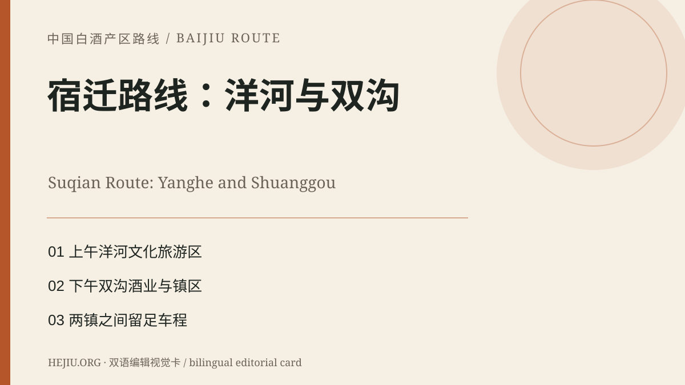
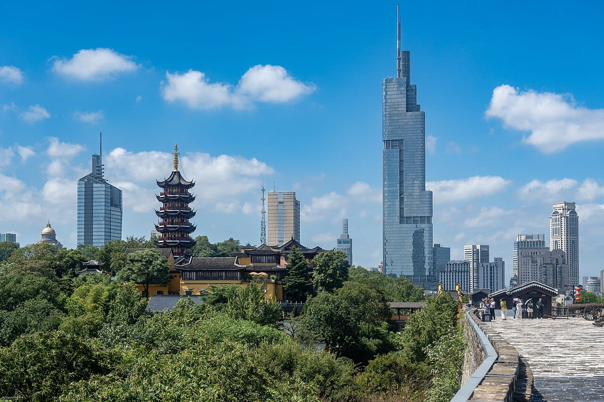
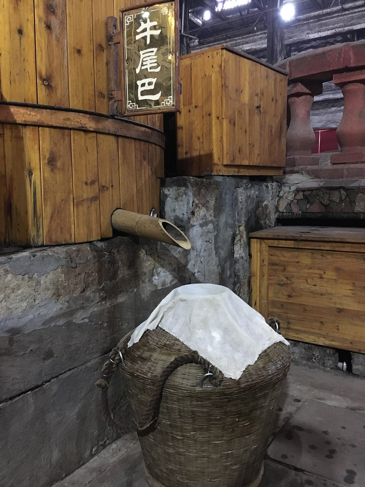

# Suqian Route: Yanghe and Shuanggou

Suqian liquor travel is not “one plant plus one gate”. Yanghe and Shuanggou are two different liquor towns: Yanghe centres on a culture tourism area, displays and plant visits; Shuanggou on old pits, the town and the Hongze Lake water country. Many drive from Yanghe to Shuanggou, photograph a gate and understand neither craft nor space. This route gives the morning to Yanghe, the afternoon to Shuanggou, and allows drive time rather than chasing every workshop.

图：Suqian route bilingual editorial card。Project-created bilingual editorial card for topic identification, not a documentary photograph.

> **Quick verdict**
> **Best for:** travellers who want two strong-aroma liquor towns in one day and will drive or hire a car; works from Suqian or Sihong.
> **Not for:** visitors who want one slow stop and no transfer; the drive between towns is not short.
> **One line:** Yanghe in the morning, Shuanggou in the afternoon, displays before town, and no driving after tasting.

## Why one city, two towns

Yanghe and Shuanggou both belong to Suqian but are different visits. Yanghe’s culture tourism area is more concentrated, with displays, plant exterior and reception in a relatively complete route. Shuanggou sits closer to its town and wetlands, where old pits, plant and daily life mix. Put Yanghe in the morning because displays and plant need continuous time; put Shuanggou in the afternoon because town and wetlands suit the close of day. Do not transfer at lunch: eat in Yanghe or en route, then reach Shuanggou in the afternoon instead of losing time to restaurant searches.

## Morning: Yanghe culture tourism area

Yanghe focuses on strong-aroma baijiu: mud pits, starter culture, distillation and storage. In the exhibition, see process cutaways and flow diagrams first, then compare them with the positions of starter rooms, pit workshops, distillation towers and jar warehouses from the plant exterior. Strong-aroma ferments in solid state in mud pits; longer continuous use and stable mud care produce reliable pit aroma and ethyl caproate. Do not just repeat “old pit”; look at walls, bottom mud, ventilation and drainage. Do not enter working areas or climb fences; ask about strength, volume and charge before tasting, and keep the driver out.

## Afternoon: Shuanggou distillery and town

Shuanggou lies between the Huai River and Hongze Lake, with distillery, town and wetlands adjacent. At the old pits and displays, the focus remains mud-pit fermentation, starter culture and storage. In town, note how the plant coexists with homes, a wet market, restaurants and shuttles; do not treat it as a fake antique street. If time allows, view the water network at the wetland edge toward evening, but do not go onto closed mudflats; mosquitoes are heavy in summer, so wear long trousers and bring repellent. The town is walkable; plant and wetlands need a taxi or car.

## Transport, booking and time

Yanghe lies in Suqian’s Yanghe New Area; Shuanggou lies in southern Sihong County. The drive between them is roughly an hour, depending on live navigation. High-speed rail to Suqian or Sihong needs a local connection, buses are sparse, and a car is more flexible. Yanghe displays and plant exterior take about two hours; adding Shuanggou’s old pits and town fills a day; adding Hongze Lake wetlands needs two. Opening, booking and charges are separate, so confirm both the day before. Wetlands are hot and humid and the distillery smells strong in summer; bring water, a hat and non-slip shoes.

## Tasting, buying and wetlands

Ask about strength, volume and charge before tasting; sip slowly, not on an empty stomach. The driver abstains and does not drive after. Buy from official or authorised shops and keep receipts; do not treat “internal” or “reception” liquor as a bargain. If adding Hongze Lake, choose one birdwatching point rather than squeezing the deep wetland and two liquor towns into one day. For food, try Sihong crayfish, Hongze Lake fish, Yanghe wheel cakes and northern Jiangsu home cooking, keeping strong-aroma liquor modest. Confirm the last bus or designated driver before returning, and do not stay in the wetland until dark. From Suqian, reach Yanghe before nine, eat lunch in Yanghe and arrive in Shuanggou by two; from Sihong, reverse the route but still allow enough time for Yanghe’s displays. With older relatives, reduce workshop walking and understand the models first; with children, prioritise wetlands and use the distillery only for displays. Yanghe and Shuanggou use different booking entries, so confirm both the day before; with half a day, choose Yanghe displays plus plant exterior and skip Shuanggou. Do not take country shortcuts between towns; follow the main road on navigation and avoid mountain roads at night. Eat at local meal times, carry water and a hat, ask the last bus, allow extra time and walk slowly.

## One-day and two-day versions

The one-day version runs Yanghe displays, lunch, Shuanggou old pits and town; do not let the morning run into noon or add wetlands in the afternoon. The two-day version gives day one to Yanghe and Shuanggou, sleeps in Sihong, and adds Hongze Lake wetlands on day two. With half a day, choose Yanghe displays plus plant exterior and skip Shuanggou; with older relatives, reduce workshop walking and understand the models first. Buy liquor before returning, keep the driver out of tasting, wear long trousers and repellent in summer, and do not stay in the wetland until dark.

## Check before you go

- Confirm Yanghe and Shuanggou opening separately
- Yanghe in the morning, Shuanggou in the afternoon
- Allow enough drive time between towns
- Do not drive after tasting
- Buy only from official or authorised shops
- Choose one birdwatching point in the wetlands
- Long trousers and repellent in summer
- Ask about the last return bus in advance

## Who this route is not for

This route links the Yanghe tourism area with Shuanggou Distillery, good for seeing strong-aroma production and the relationship with wetland grain. If you only want tasting, the exhibition halls and walking at two plants will take most of the day; without a car, inter-town buses are sparse, so allow enough time for the return.

Both Yanghe and Shuanggou need a drive from Suqian city, and Shuanggou town has narrow roads with freight traffic; summer is humid and the plants involve long walks. Booking and guide slots are tight on holidays and may not be available on the day.

Alternative: see only the Yanghe tourism area, or only the Shuanggou old workshop; to add Hongze Lake wetland, allow a full day. Compare plant, city and e-commerce prices when buying, not roadside stalls.

## References

- Yanghe distillery culture tourism area — Yanghe Co., Ltd. — https://www.chinayanghe.com/culture/whzl/cqly/ (Jiangsu Yanghe Distillery Co., Ltd., checked 2026-11-25)
- Suqian Yanghe industrial culture tourism area — official site — https://ly.chinayanghe.com/ (Suqian Yanghe Industrial Culture Tourism Area, checked 2026-11-25)
- Yanghe Co., Ltd. — official site — https://www.chinayanghe.com/ (Jiangsu Yanghe Distillery Co., Ltd., checked 2026-11-25)
- Suqian Municipal People’s Government — https://www.suqian.gov.cn/ (Suqian Municipal People’s Government, checked 2026-11-25)

Related entries: [Yanghe distillery culture tourism area](ref:yanghe), [Shuanggou Distillery (Shuanggou Town)](ref:shuanggou), [Yanghe (Shuanggou parent brand)](ref:brand), [strong-aroma baijiu](ref:style), [Jiangsu](ref:region), [First baijiu guide](ref:guide), [History of Chinese wine](ref:history).

## Related images

Image: Jiangsu Province. Credit: xiquinhosilva, CC BY 2.0, via Wikimedia Commons ([source page](https://commons.wikimedia.org/wiki/File:Nanjing_CBD_from_City_Wall.jpg)). Related image for Suqian Route: Yanghe and Shuanggou.

Image: Fermenting baijiu mash at Luzhou Laojiao, used as an illustrative image of solid-state fermentation; not the Yanghe site. Credit: Xiaomage de, CC BY-SA 4.0, via Wikimedia Commons ([source page](https://commons.wikimedia.org/wiki/File:Baijiu_Produktion_Luzhou_Laojiao.jpg)). Related image for Suqian Route: Yanghe and Shuanggou.
