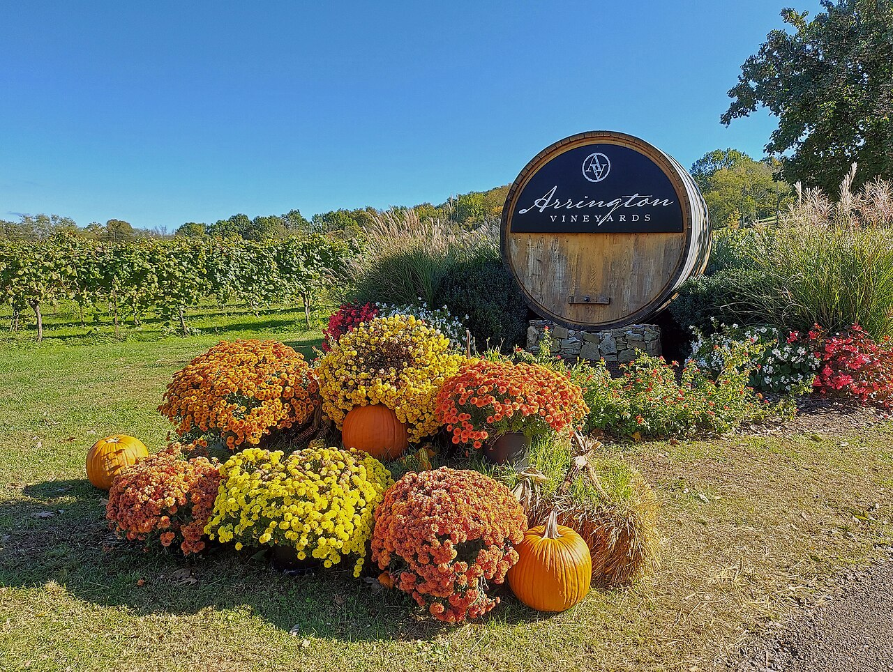

# Tennessee whiskey trail: Lynchburg and Cascade Hollow

Tennessee whiskey is often described as bourbon with a charcoal filter, and that is only half right. The grain and cask rules come close to bourbon, but the charcoal step, the requirement to finish in Tennessee and the brands' own choices make the category stand on its own. This route takes two places: Jack Daniel's in Lynchburg and George Dickel at Cascade Hollow. They are half an hour to forty minutes apart, make the same kind of spirit, and give two answers, one at ambient temperature and one chilled.

Figure: "Tennessee whiskey trail: Lynchburg and Cascade Hollow". Photograph: Tennessee - Arrington Vineyards. Credit: P. Hughes, CC BY-SA 4.0 ([source page](https://commons.wikimedia.org/w/index.php?curid=128050365)). Category image; not a claim that it shows the exact product, site or event.

## Route overview

- Stop one: [Jack Daniel's](ref:jack-daniels), 280 Lynchburg Hwy, Lynchburg, TN 37352; about an hour and a half from Nashville.
- Stop two: [George Dickel](ref:george-dickel), 1950 Cascade Hollow Rd, Tullahoma, TN 37388; about half an hour to forty minutes from Lynchburg.
- Mode: car or chauffeur; neither stop has usable public transport and mobile signal is patchy.
- Duration: a full day, with lunch in Lynchburg or Tullahoma.

## One process, two temperatures

Tennessee whiskey follows bourbon's grain and cask rules: at least 51% corn, new charred oak, and bottling at no less than 40% alcohol by volume. The difference is a sugar-maple charcoal filter before the barrel, plus completion inside Tennessee. Both distilleries do the step, but not in the same way. Jack Daniel's lets new spirit drip slowly through a deep bed of maple charcoal for several days. Dickel chills the spirit first, then passes it through charcoal, a method it calls chill-charged. Cold liquid is thicker and moves more slowly, which the distillery argues makes filtration gentler. The difference is real but not the whole story: fermentation, the cut on the still, barrel entry strength and warehouse position also matter. Dickel spells it whisky without the e, following Scottish convention, while Jack Daniel's uses whiskey.

## Arriving in Lynchburg: scale and the spring

Jack Daniel's treats 1866 as its registration year and calls itself the oldest registered distillery in the United States; the early records are incomplete, so it is safer to say the official story begins in 1866. In 1904 Old No. 7 won gold at the St. Louis World's Fair, and the square bottle and black label were fixed around then. Separating marketing from production shows that half the success came from craft and half from knowing how to make a bottle memorable.

Lynchburg sits in Moore County, dry since Prohibition: no liquor stores and no free sale of alcohol in restaurants. The distillery is the exception, allowed to sell and pour at the visitor centre. The standard tour lasts about 1.8 hours and ends with six tastings; the spring stays at about 56 Fahrenheit and is iron-free. To taste: Old No. 7 brings banana, vanilla, caramel and oak; Gentleman Jack is filtered twice; Single Barrel is more concentrated; Bonded follows the bonded rules. Tasters must be 21 or over with photo ID.

## Turning into Cascade Hollow: cold and quiet

Dickel's brand begins with George A. Dickel's Nashville whiskey business in 1870, while the Cascade Hollow distillery began producing in 1878. It closed during Prohibition, was rebuilt in the mid-twentieth century, and is now part of Diageo under the name Cascade Hollow Distilling Co. The 1870 on the label is the brand; 1878 is the year this site began making spirit.

The hollow covers about 600 acres and is wrapped in trees, with a small visitor centre and a working-workshop feel. It opens Thursday to Tuesday, closed Wednesday, from 9:30 to 16:00 and 11:30 to 16:00 on Sunday. The tour lasts about an hour; production runs Monday to Friday, so weekend tours often miss distillation. Children may join with a Minor ticket. To taste: No. 8 is light and sweet, No. 12 thicker, Barrel Select a single barrel, and Bottled in Bond follows the federal rules; the house style is drier than Jack Daniel's, with less charcoal.

## Tickets, sessions and the last few miles

Both ticket desks are on the official websites. Jack Daniel's sells timed sessions, with barrel-focused and full-day products beyond the standard tour; Dickel recommends booking, and its self-guided tasting is first come, first served. Prices and sessions change, so no fixed figures here. Both require tasters to be 21 or over with photo ID.

Transport is the underestimated part. There is no usable public transport between Lynchburg and Tullahoma, and taxis are unreliable; rent a car in Nashville or Chattanooga. The last miles are unlit rural roads, and navigation sometimes sends cars down the wrong fork. The driver does not drink at all; tastings go to a companion or are skipped. A chauffeur or designated driver is safest.

## Seasons, lodging and the one-stop option

Spring and autumn are most comfortable, with colour in the hills and little risk of ice. Summer is hot and humid, and the still house and barrelhouses are worse; winter is quieter but daylight is short and rural roads turn difficult in ice. The two distilleries close on different days, so check each calendar.

Stay in Lynchburg, Tullahoma or Nashville: Lynchburg is small with limited restaurants, Tullahoma is practical, and Nashville suits a trip that continues into live music. With half a day, Jack Daniel's alone is enough; to understand the two temperatures, do both and skip a third distillery.

## See also

- [Jack Daniel's](ref:jack-daniels): registered in 1866, gold in 1904, Cave Spring and ambient charcoal drip filtration.
- [George Dickel](ref:george-dickel): the 1870 brand, the 1878 site, chilled filtration and No. 8 and No. 12.
- For background, see the Tennessee region, Tennessee whiskey style and bourbon entries.

Opening hours, bookings and transport are subject to official channels; page verified on 2026-11-08.

Further reading: [Tennessee](ref:c-extra-1).

Tennessee whiskey trail is best approached through the order of stops, then the distance and opening hours, and then whether it works as a fixed itinerary. One check alone will not settle it.

**Key facts.**

| Item | Detail |
| --- | --- |
| In one line | From Jack Daniel's in Lynchburg to George Dickel at Cascade Hollow near Tullahoma. The two stops are half an hour to forty minutes apart, both complete their charcoal filtering in Tennessee, and use ambient and chilled m… |
| Stops | 2 |
| Transport | car |
| Stop order | Jack Daniel's Distillery、George Dickel Distillery |

**Sources and limits.** The key claims about Tennessee whiskey trail: Lynchburg and Cascade Hollow are checked against the following sources: Jack Daniel's, George Dickel, Tennessee Whiskey Trail (Used to check the spread of Tennessee distilleries, how visits are linked and the booking entry) and 4 sources in total. Prices, batches and status change; the body is project-written and does not reproduce source text.

**Read alongside.** Put Tennessee whiskey trail: Lynchburg and Cascade Hollow next to Jack Daniel's Distillery, George Dickel Distillery, Tennessee: the first fixes identity and boundary, the others provide a region, process or peer comparison. Read this page first, then return to those entries; the links become coordinates, not decoration.
