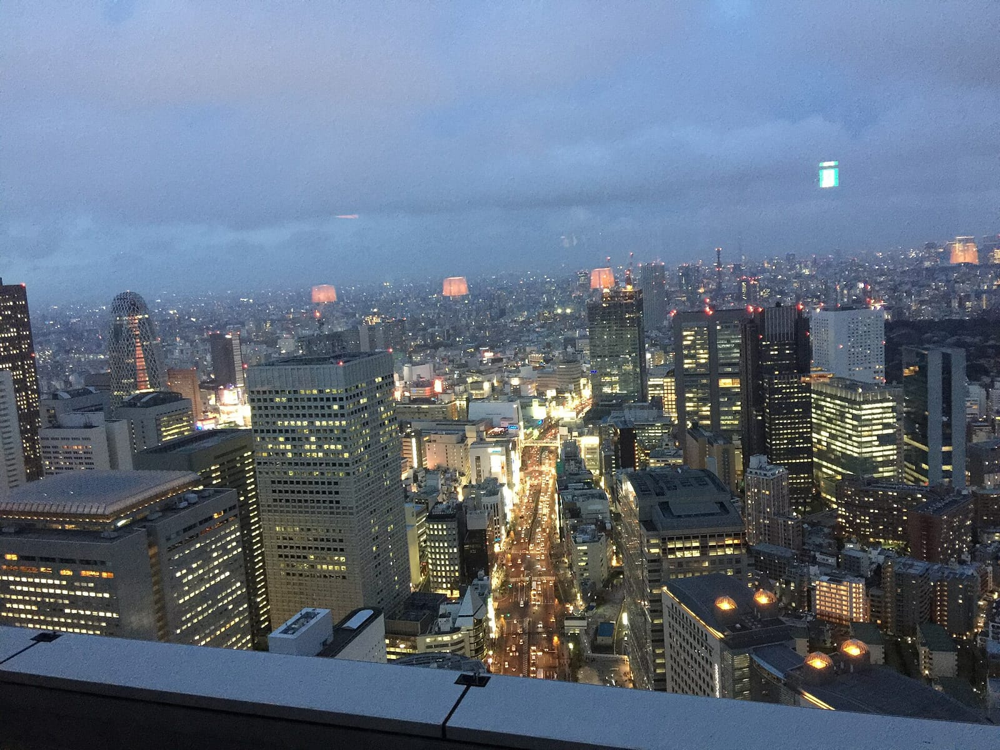

# Tokyo bar route: two bartenders in Ginza

This route has only two stops, both in Ginza and linked on foot. The first is Bar High Five in Ginza 5-chome; the second is Star Bar Ginza in a 1-chome basement by Namiki-dori. Both are known as specialist bars, but their specialisms point in opposite directions: one has no fixed menu and mixes after a conversation, the other is built on classics and an old-school counter. Walking both in one evening shows two standards of Ginza bartending, and how one district turned "a quiet drink" into a civic habit.

Figure: Related photograph of Tokyo bar route: two bartenders in Ginza. Image: Jc8136, CC BY-SA 4.0, via Wikimedia Commons ([source page](https://commons.wikimedia.org/wiki/File:Shinjuku_at_night.JPG)).

> **Quick verdict**
> **In one line:** This route helps you plan Tokyo bar route: two bartenders in Ginza, including the order, timing and stops that matter.
>
> - **Best for:** Anyone turning Tokyo bar route: two bartenders in Ginza into a one- or two-day route and needs the order and the stops that matter.
> - **Not for:** If you want only want one stop and do not intend to follow a route.
> - **Check first:**
>   - Star Bar's operating status is marked unknown on this route: the official site exists, but there is no verifiable information that it is open on a given day.
>   - - Stop one: High Five, basement of a building at 5-4-15 Ginza; opened in July 2008, Monday to Saturday 17:00–01:00, last entry 00:00, closed Sundays and Japanese national holidays.

## Two stops and timing

- Stop one: [High Five](ref:highfive), basement of a building at 5-4-15 Ginza; opened in July 2008, Monday to Saturday 17:00–01:00, last entry 00:00, closed Sundays and Japanese national holidays.
- Stop two: [Star Bar Ginza](ref:star), basement in Ginza 1-chome by Namiki-dori; 1100 yen cover charge per person, drinks on top.
- Mode: walking. Both stops are inside the Ginza grid, so no metro transfer is needed; decide about returning only after the second drink.
- Suggested time: about three hours. Allow sixty to seventy-five minutes at the first stop, ten to fifteen minutes walking, and sixty to ninety minutes at the second.
- Why this order: High Five opens in the evening and suits the first drink; Star Bar is quieter and slower, better as the finish. Check official channels for the actual last order.

## The lineage of two bartenders

Hidetsugu Ueno worked at Star Bar before opening High Five in 2008; Star Bar's owner-bartender, Hisashi Kishi, won an international bartending championship in 1996, at the age of 31. Put the two timelines together and they are not rival "old versus new" bars but two generations practising one tradition.

Kishi stayed in Ginza 1-chome, making classic cocktails while serving as president of the Japan Bartenders Association and principal of the Ginza Bartender School; Ueno shrank the counter, removed the menu and turned service into a conversation. One keeps the standard and teaches it outward; the other takes the standard apart and rebuilds it around each guest's preference. The route works not because both are famous but because they give two answers to the same set of basics.

That also explains Ginza. Professionalism here is not one uniform tone but several recognisable practices, and lineage links them rather than leaving each isolated.

## Stop one: High Five's no-menu counter

High Five is in Ginza 5-chome, with an entrance in the basement and a facade that is easy to miss. There is no menu to read; the bartender first asks what direction you want: base spirit, strength, sweet or sour, fruit, aroma, short or long. This is often called an "omakase" style, but it does not mean the bartender decides everything — you can say clearly what you do not want and adjust halfway.

Ice is the house's craft display. The bartender hand-carves a large block of clear ice into a diamond or sphere and puts it in the glass; the purpose is not a photograph but a smaller surface area, slower melting and steadier dilution. Watching takes time, so the first stop is not for a rushed schedule. According to The World's 50 Best entry, drinks average about 16 dollars, with a possible service or seating charge; the small room does not suit large groups, and two or three people is best.

High Five has taken no reservations since 2015 and only answers a call before arrival to confirm seats; it closes on Sundays and national holidays and has an early last entry. Check the official home page for buy-outs and temporary closures before travelling, which is easier than discovering a dark basement. Order a clearly structured classic first to calibrate your palate, then let the bartender make the second to your preference.

## From 5-chome to 1-chome

Leave High Five and walk north along Namiki-dori. You pass the Ginza 4-chome crossing, with Wako and Mitsukoshi on the Chuo-dori side while Namiki-dori runs parallel to the west; continue through 3-chome and 2-chome, then look for the building entrance on the right after entering 1-chome. The whole walk is about ten to fifteen minutes, with no bridge and no transfer, a short distance inside the Ginza grid.

Actual paths are affected by construction barriers, shop entrances and the night's crowds; follow on-site signs and a live map. Ginza addresses run by chome, ban and go, and numbering on opposite sides of one street may not be consecutive; do not search by a "bar street" impression. Find the building by address, then find the basement.

The walk is more than transport. From 5-chome to 1-chome you cut through Ginza's densest commercial stretch, where department stores, flagship shops, galleries and offices alternate and bars hide in basements or upper floors. One pass shows why Ginza bars tend to be small rooms: they attach themselves to vertical commercial space instead of occupying a whole street.

## Stop two: Star Bar's old-school counter

Star Bar Ginza is in a basement in Ginza 1-chome by Namiki-dori. The counter is amber, the stools are leather, the room is quiet and the whole bar is non-smoking; the official page calls it a traditional bar in the Ginza style, serving classic cocktails with the house's own handling. Its ice is another system: hand-cut clear ice, its own natural ice and special machine ice, divided by three modes of heat transfer, with Ninja Ice the most famous because it almost vanishes in the glass.

Ordering here is the reverse of the first stop. A classic list is the frame; you can order a clearly structured short drink or state a preference, but do not expect the surprise of no-menu customising. It sells accuracy, temperature and repeatability rather than a different drink every time. Watching the bartender [stir](ref:stirring), handle ice and polish the glass tells you more about the bar than asking for its signature.

The bill also follows another logic: 1100 yen cover charge per person, drinks on top. An old-school cover buys time and a seat, not admission; there is no need to fill the counter at once, and finishing one drink before ordering the next is the normal rhythm.

## The expectation gap: two kinds of professionalism

The common mistake is to treat the two bars as the first and second halves of one experience. At High Five, guests take the missing menu as an invitation and spend a few minutes describing preferences; at Star Bar, guests treat "classic" as a contract and expect steadiness and accuracy without much explanation. Bring the first expectation into the second room and the reserve reads as coldness; bring the second into the first and the service feels without a handle.

What you pay for differs too. High Five charges by the drink, about 16 dollars on average, selling conversation, customising and ice-carving time; Star Bar charges 1100 yen per person for the seat and then by the drink, selling a standard, an old counter and an uninterrupted stretch of time. Neither is cheap, but the reasons differ, so compare what you want before comparing prices.

Ginza's "silent service" is often misread as snobbery. It is closer to a work ethic: the bartender speaks little and watches the glass, the temperature and your pace; guests lower their voices and do not use the counter as a stage. Time Out Tokyo states the general rules for Ginza's master bars plainly: keep your voice down, wear at least a collared shirt, and expect a cover charge. Treat these as entry rules rather than a personal attitude and the evening flows better.

The relation between [the bar and the city](ref:pubcity) runs both ways here: Ginza shapes the bar, and the bar in turn sets the district's night. Both stops are small, quiet and unsuitable for large groups — not a coincidence but the result of one set of urban spaces and trade habits.

## Boundaries of hours, bookings and etiquette

Star Bar's operating status is marked unknown on this route: the official site exists, but there is no verifiable information that it is open on a given day. Fixed closing days, last orders, reservations and buy-outs belong to official channels. High Five has taken no reservations since 2015 and only confirms seats by telephone at short notice; neither bar welcomes large groups.

This route gives no coordinates and draws no map: the two bars' latitude and longitude are left empty in the content repository, and with no verifiable coordinate source only the walking relationship is described in words. For precise navigation, use a live map and follow on-site signs.

The route does not guarantee any day's opening. If the first stop is full, do not treat the second as a fallback and rush it; specialist Ginza bars deserve an hour each, and two bars in a night is fuller than three or four. Before the final drink, check the last metro and the taxi rank, then decide how long the last glass can take.

## References

- [Bar High Five — Map & Access](https://www.barhighfive.com/map), Bar High Five, checked for the address, hours, last entry and closing days.
- [Bar High Five — Staff](https://www.barhighfive.com/staff), Bar High Five, checked for the 2008 opening, Ueno's time at Star Bar and the end of reservations in 2015.
- [High Five — The 50 Best Discovery](https://www.the50.com/discovery/Establishments/Japan/Tokyo/High-Five.html), The World's 50 Best, checked for the average price of about 16 dollars and the hand-carved ice.
- [STAR BAR GINZA store introduction](https://www.starbar.jp/store-introduction-ginza), STAR BAR, checked for the Ginza 1-chome location, hand-cut clear ice and the smoking ban.
- [STAR BAR About Us](https://www.starbar.jp/about-us), STAR BAR, checked for the classic cocktail line, three kinds of ice and the 1100 yen cover charge.
- [Star Bar Ginza](https://www.timeout.com/tokyo/bars-and-pubs/star-bar-ginza), Time Out Tokyo, checked for the Namiki-dori location, the 1996 title and the age of 31.
- [The best Tokyo bars: meet the masters](https://www.timeout.com/tokyo/bars-and-pubs/the-best-tokyo-bars-masters), Time Out Tokyo, checked for Ginza's rules on volume, dress and cover charges.

Page verified on 2026-11-09; hours, booking rules and prices are subject to official channels.

Further reading: [Alsace Grand Cru trail: Kaysersberg and Riquewihr](ref:c-extra-1).
