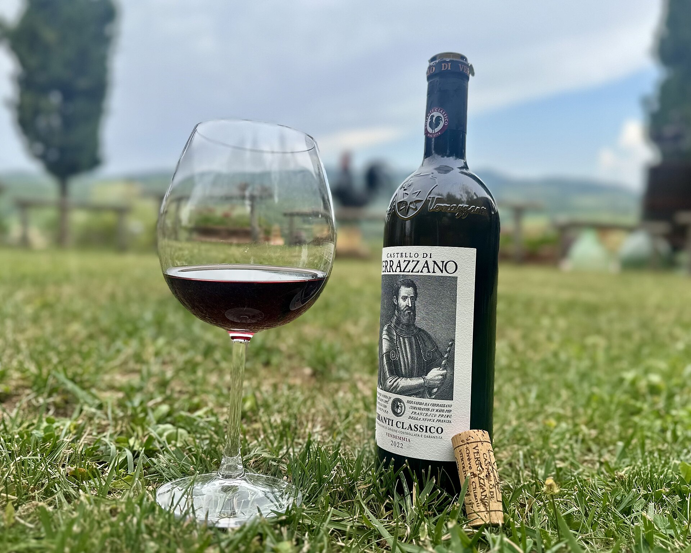
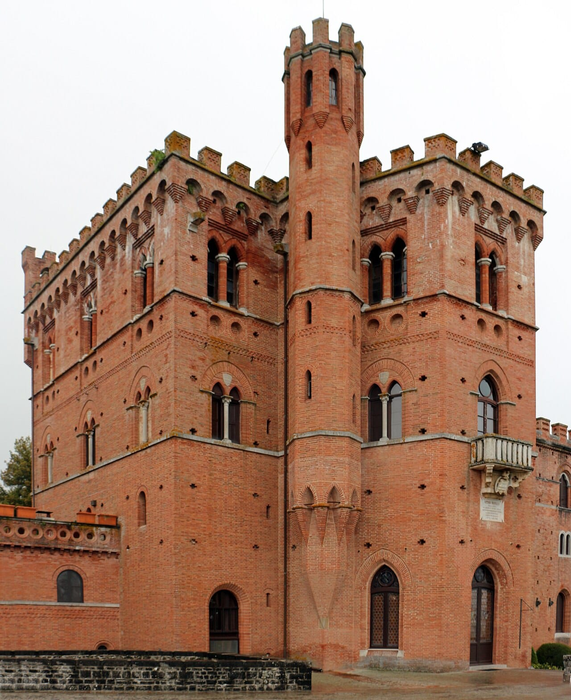

# Chianti Classico: from Florence to three estates

Chianti Classico lies between Florence and Siena and is easily reduced to a checklist. Many itineraries compress it into "visit a winery and drink", which misses the layers: one appellation can be told through a castle, a family, a formula and a contemporary building. This route links three stops in a day — Antinori at Bargino, Castello di Brolio at Gaiole and Fattoria Fèlsina at Castelnuovo Berardenga.

Figure: Related photograph of Chianti Classico: from Florence to three estates. Image: FranzKafka2000, CC BY-SA 4.0, via Wikimedia Commons ([source page](https://commons.wikimedia.org/wiki/File:Chianti_Classico_example_bottle_-_Annata_type.jpg)).

> **Quick verdict**
> **In one line:** This route helps you plan Chianti Classico: from Florence to three estates, including the order, timing and stops that matter.
>
> - **Best for:** Anyone turning Chianti Classico: from Florence to three estates into a one- or two-day route and needs the order and the stops that matter.
> - **Not for:** If you want only want one stop and do not intend to follow a route.
> - **Check first:**
>   - - Stop one: Antinori nel Chianti Classico, Via Cassia per Siena 133, Loc.
>   - Sangiovese is the axis of Chianti Classico, but not the only grape.

## Route overview

- Stop one: [Antinori nel Chianti Classico](ref:antinori), Via Cassia per Siena 133, Loc. Bargino, 50026 San Casciano Val di Pesa (FI), inaugurated in October 2012.
- Stop two: [Castello di Brolio](ref:brolio), Località Brolio, 53013 Gaiole in Chianti (SI), documented as Ricasoli property as early as 1141.
- Stop three: [Fattoria Fèlsina](ref:felsina), Via del Chianti 101, 53019 Castelnuovo Berardenga (SI), bought by the Poggiali family in 1966.
- Mode: car or hired car; the legs are roughly 20–35 kilometres each, about 80–90 kilometres in total.
- Duration: a full day — Antinori in the morning, lunch at the winery or in Gaiole, Brolio and Fèlsina in the afternoon.
- Key warning: do not drive after tasting. All three stops serve alcohol, the roads are winding, and a designated driver or hired car is the precondition.

## Why Chianti Classico

Chianti Classico is not a synonym for Chianti. It is a separate DOCG between Florence and Siena, covering about 71,800 hectares: the whole municipalities of Castellina, Gaiole, Greve and Radda in Chianti, plus parts of neighbouring municipalities. "Classico" refers to the historic core, not a "classic style": read it as "the old zone".

The symbol is the Black Rooster, or Gallo Nero, carried on the neck or back label of every bottle; it belongs to the Chianti Classico Wine Consortium, founded in Radda in Chianti in 1924; 2024 marked its centenary. A producer may use it only by following the rules on varieties, yields, ageing and bottling.

The three stops are three ways in. Antinori uses contemporary architecture and gravity-flow winemaking to show how production is displayed; Brolio uses a castle, a family and the 1872 formula to show how rules were written; Fèlsina uses Sangiovese clones and plots to show how a variety is taken apart.

## Stop one: Antinori nel Chianti Classico

Bargino comes first because it is closest to Florence and works as an introduction. The winery opened in October 2012; designed by Archea Associati, it is mostly buried in the hillside, leaving two horizontal cuts and a rooftop restaurant above ground. Visitors descend a spiral staircase to cellar levels and pass fermentation, ageing and tasting spaces at different heights — gravity-flow vinification, which reduces mechanical handling.

The Tinaia Tour covers family history and winemaking and ends with three wines from different estates. The Bottaia Tour goes into more atmospheric cellars and includes four wines. The CRU Tour offers seven wines and lunch at the rooftop restaurant Rinuccio 1180. For a first visit, Tinaia or Bottaia is enough.

What to see: the cuts, spiral staircase, suspended tasting room, rooftop restaurant and wine shop; the cellar itself is the working part. What to drink: Pèppoli annata, Villa Antinori Riserva and Vinsanto form a sequence — fruit and acidity, Riserva structure, then the sweetness of dried grapes.

## Stop two: Castello di Brolio

Driving south through Greve and Radda, Brolio Castle appears on the ridge south of Gaiole. The first stones date to the Middle Ages, and the Ricasoli acquisition is recorded as early as 1141; the castle was attacked by Aragonese and Spanish forces, disputed in the seventeenth century and bombed in the Second World War. What stands today is a layered result of rebuilding: medieval defences, Romanesque and neo-Gothic additions and nineteenth-century Tuscan details.

The central figure is Bettino Ricasoli (1809–1880), the "Iron Baron", twice prime minister of newly united Italy. In 1872 he set down the Chianti formula: Sangiovese for aroma and backbone, Canaiolo for softness, and white grapes such as Malvasia for balance. This is a nineteenth-century formula, not today's law: Chianti Classico later excluded white grapes and now requires at least 80% Sangiovese.

What to see: walls and towers, courtyards, gardens, the Ricasoli Collection and the wine shop at the foot of the hill. Castle tickets and tastings are separate. What to drink: Brolio annata, Brolio Riserva and Castello di Brolio Gran Selezione form the clearest ladder; the flagship uses estate-grown grapes only, is made only in the best years and ages in the Brolio cellars. Allow 2–2.5 hours.

## Stop three: Fattoria Fèlsina

South of Brolio the road moves from Chianti Classico oak woods to the bare earth of the Crete Senesi, and Fèlsina sits on the boundary. There is no castle; the estate looks like a working farm, with vineyards, olive groves, farmhouses, cellars and the Bottega forming one complex. Domenico Poggiali bought it in 1966; Giuseppe Mazzocolin joined in the late 1970s, the first Rancia and Fontalloro were made in 1983, and Giovanni Poggiali joined in 1990.

The point is the fork in Sangiovese. Rancia comes from the farm of the same name and is a Chianti Classico Riserva; Fontalloro comes from vineyards crossing the appellation boundary and is bottled as a Tuscan IGT. Born the same year, they took different legal paths: one stays inside the appellation, the other uses the IGT for more freedom. Tasting them is more effective than a definition: the same variety, in different plots and rules, shows entirely different structures.

What to see: the old tufa cellar, the 1970s underground cellar connected to the old stables, the stainless-steel equipment added in 1998 and the mass selection in the vineyards. What to drink: Berardenga annata, Rancia, Fontalloro, and Colonia Gran Selezione if the budget allows.

## From Florence: the drive and the rhythm

Leave Florence towards San Casciano and Bargino on the SS2 or the Chiantigiana road: about 20 kilometres and half an hour in normal traffic. Book the first tour around 10:00; the visit and tasting take about 1.5–2 hours. Lunch can be at Rinuccio 1180 or in Greve or Gaiole; the winery restaurant needs a separate booking.

Bargino to Brolio is about 35 kilometres and 50 minutes via Greve, Radda and Gaiole; the road is winding, so times vary. Aim for Brolio around 14:00, see the castle and gardens first, then taste at the shop. Brolio to Fèlsina is about 25 kilometres and 40 minutes via Gaiole and Castelnuovo Berardenga; aim for 16:00, with about two hours for the visit.

The return to Florence is about 60 kilometres and 1 hour 15 minutes via Siena. For a day trip, get on the road before 18:30 to avoid night driving. All three stops serve alcohol, so the safest arrangement is a hired car or designated driver; if you drive yourself, use the spittoons and do not treat "just a sip" as safe.

## Sangiovese, the Black Rooster and Riserva

Sangiovese is the axis of Chianti Classico, but not the only grape. The appellation requires at least 80% Sangiovese, with the rest from authorised red varieties such as Canaiolo, Ciliegiolo, Colorino, Malvasia Nera and Mammolo, plus international varieties including Cabernet Sauvignon, Cabernet Franc and Merlot; since 2006 it may be made entirely from red varieties. Sangiovese has high acidity and dry tannin, often with sour cherry, violet, tomato leaf and earth; the blend adds roundness, colour and aromatic layering.

The Black Rooster is the collective trademark, carried on the neck or back label. It does not guarantee you will like the wine, but it shows the bottle comes from the zone and follows the rules. Do not confuse it with "Chianti": the two are separate DOCGs.

Riserva is not a sweeter "reserve" or simply a better vineyard. Annata must age at least 12 months; Riserva at least 24 months, including three in bottle, with a minimum alcohol of 12.5%; Gran Selezione at least 30 months, including three in bottle, with at least 90% Sangiovese, estate-grown grapes only and a minimum alcohol of 13%. Riserva is longer ageing and higher ripeness; Gran Selezione, introduced in 2014, is the top of the pyramid.

## Booking, seasons and safety limits

Confirm three things when booking: the type of visit, the language and the meeting point. At Antinori, Tinaia, Bottaia and CRU are different products with different durations, prices and meals. At Brolio, the castle ticket and the wine-shop tasting are separate. At Fèlsina, tours and tastings are booked by email or phone. High season (May–October) and weekends fill up, so book days or weeks ahead; during harvest (September–October) some visits may be rerouted.

The best windows are April–June and September–October: long days and moderate temperatures. July and August are hot, and afternoon driving is tiring; November to March is quiet, some estates shorten their hours, and Brolio Castle closes in winter, so check before leaving. Cellars are cool whatever the month, so bring a light layer.

There is one safety rule: do not drink and drive. All three stops offer tastings and spittoons. Chianti roads are narrow, winding and steep, with poor lighting at night. A designated driver, a hired car or a transport-inclusive tour makes this route work. Smell before tasting, sip slowly and avoid strong perfume.

To go deeper, continue with the venue pages for [Antinori](ref:antinori), [Brolio](ref:brolio) and [Fèlsina](ref:felsina). Opening hours, bookings and transport are subject to official channels; this route was verified on 2026-11-08.

## Related images

Image: Castello di Brolio. Credit: Sailko, CC BY 3.0, via Wikimedia Commons ([source page](https://commons.wikimedia.org/wiki/File:Castello_di_brolio,_edificio_padronale_11.JPG)). Related image for Chianti Classico: from Florence to three estates.

Image: Tuscany vineyard. Credit: cova69, CC BY 2.0, via Wikimedia Commons.. Credit: cova69, CC BY 2.0, via Wikimedia Commons ([source page](https://commons.wikimedia.org/w/index.php?curid=1393578)). Related image for Chianti Classico: from Florence to three estates.
