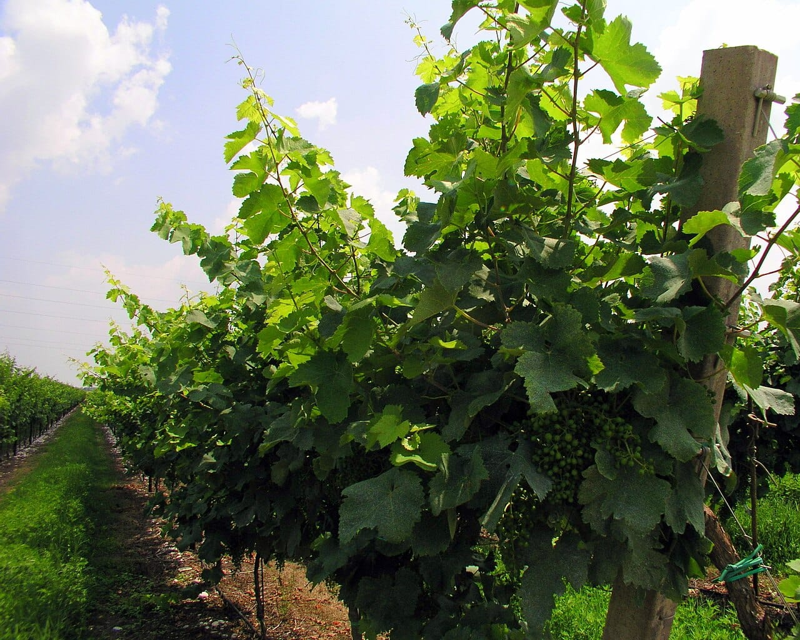

# Veneto Prosecco trail: Valdobbiadene to Fumane

This route starts at Bisol1542 in Valdobbiadene and ends at Allegrini in Fumane. The first is the world of Glera and tank-fermented sparkling wine; the second is the world of Corvina and dried grapes. They are about an hour and a half apart, yet feel like two wine countries. Putting them in one day is not about drinking more; it is about seeing the technical fork inside Veneto: the same north-east Italy, one seeking pressure and freshness, the other density and controlled oxidation.

Figure: "Veneto Prosecco trail: Valdobbiadene to Fumane". Photograph: Vineyard, San Giorgio di Valpolicella, Veneto, Italy. Credit: Unknown photographer, CC BY-SA 2.0 ([source page](https://commons.wikimedia.org/w/index.php?curid=354325)). Category image; not a claim that it shows the exact product, site or event.

## A line across two appellations

The first stop is in Santo Stefano, inside the core of Conegliano Valdobbiadene Prosecco Superiore DOCG; the second is in Fumane, in the Valpolicella Classica. Both are administratively in Veneto, but geographically they are separated by the Venetian plain and the hills around Verona. From Valdobbiadene, the drive via Conegliano, Treviso or Verona takes about an hour and a half; the exact route depends on whether you use the motorway.

The order can be reversed: see the drying rooms and cellars in Fumane first, then head north to Valdobbiadene. Sparkling wine suits daytime tasting, however, and red wine suits dinner; with one day, start at Bisol in the morning, drive to Allegrini in the afternoon and keep the reds for the evening. The route does not try to cover both appellations; it offers two clear comparison samples.

## Glera and the steep Valdobbiadene slopes

[Glera](ref:glera) is the principal permitted variety for Prosecco, and Conegliano Valdobbiadene Prosecco Superiore DOCG requires at least 85%. It has high acidity, low alcohol and aromas of white flowers, green apple and pear, which suits fresh sparkling wine. The Valdobbiadene hills were formed from ancient seabeds and glacial deposits, with marl, sandstone and gravel that drain quickly; day-to-night temperature range helps the fruit keep acidity and aroma.

Exposure matters more than latitude here. The hills mostly run east-west, with vineyards on the south-facing slope and woodland on the north; altitude runs from about 100 to 500 metres, cooler and slower-ripening higher up. The official description calls this "heroic" viticulture: steep, narrow parcels that machines cannot enter. What you see is not a neat vineyard but a map of stone walls, grass banks and small plots.

## Six hundred hours of hand work

The official figure is blunt: farming one hectare of vineyard in Valdobbiadene needs at least 600 hours of manual work, several times the labour of mechanised methods. Harvest must be by hand, with fruit carried down in small boxes by people or small transporters; where the slope is too steep, even the transporter cannot enter. This is not nostalgia but a cost structure: labour hours go straight into the price of the wine.

In 2019 the hills were listed as a UNESCO World Heritage site, precisely for the agricultural landscape created by centuries of interaction between people and terrain. The status brings tourism and pressure: more visitors, higher land prices, and the question of whether a younger generation will continue such intense slope farming. When drinking a Prosecco, consider who carries those 600 hours and whether the price covers them.

## Cartizze, Rive and Grave di Stecca

Cartizze is a small hillside in Valdobbiadene with a legal area of only 107 hectares, between San Pietro di Barbozza, Santo Stefano and Saccol, described officially as the quality summit of the zone. Its Glera ripens more fully, giving a broader body and aromas closer to yellow apple, honey and flowers; it can be made at different sweetness levels, from Brut to Dry. Cartizze is not "the sweetest Prosecco" but "the weightiest slope".

Rive are the small villages or parcels on steep slopes, with stricter rules and a specific place name on the label. Grave di Stecca is another case: in Valdobbiadene, a walled single vineyard of about 2.4 hectares at roughly 270 metres, with limestone and gravel soils, shaped like a Burgundian clos. It proves that Prosecco also has "enclosed" sites, not only large-scale production. Together, the three show that "place" in Veneto is not an empty word.

## Tank fermentation or traditional method

The second fermentation decides the style and cost of a [sparkling](ref:sparkling) wine. Tank fermentation (Charmat/Martinotti) completes it in a pressurised stainless steel vessel; short contact with yeast keeps fresh fruit and lowers cost, which suits large volumes. The traditional method ferments in bottle, with long lees contact creating bread, nuts and finer bubbles at higher cost and longer cycle.

Most Prosecco uses tank fermentation, which is exactly why it is fresh, affordable and everyday; but tank does not mean poor quality, since base wine, fermentation temperature and time on the lees still matter. The traditional method exists in Veneto too, for example in some Alta Langa and Franciacorta-style wines, but it is not the core of these two stops. In a tasting, ask whether the wine is tank or bottle fermented, and how long it stayed on the lees; the answer explains the palate better than bubble size.

## Stop one: Bisol1542

[Bisol](ref:bisol) is in Santo Stefano at Via Follo 33, 31049 Valdobbiadene (TV). The brand dates its history to 1542 and joined the Lunelli Group in 2014; its cellar is cut into the rock, with temperatures between 10°C and 15°C, suitable for historic bottles and aged wine. The cellar opens Monday to Saturday 10:00–13:00 and 15:00–18:00, Sunday 10:00–13:00, and visits and tastings are booked through hospitality@bisol.it.

This stop is about how a steep slope becomes wine: from the brand story in reception, into the rock walls and vaults of the old cellar, then to a tasting of Cartizze, Rive and standard DOCG. Compare the three across sweetness, acidity and lees contact instead of simply choosing "the most expensive bottle". The cellar is cold, so bring a light jacket in summer; floors can be wet, so wear non-slip shoes.

## Stop two: Allegrini

[Allegrini](ref:allegrini) is in Fumane at Via Giare 5, 37022 Fumane (VR). Its core is Corvina, dried grapes and Amarone: fruit is dried for months in ventilated rooms before a long fermentation and [oak](ref:oak) ageing. In 1979 Giovanni Allegrini planted only Corvina on the top of La Grola and made La Poja; today the range also includes La Grola, Palazzo della Torre and several levels of Amarone.

The hospitality page lists several experiences: a 45-minute tasting at €30 per person, 1 hour 30 minutes including the historic cellar at €45, a 3-hour vineyard route at €70, a 2-hour visit with the drying centre and a five-vintage vertical tasting at €150, and a €190 La Grola hillside experience reserved for Wine Club members. Prices and contents are subject to the booking page; the drying rooms have strong airflow and intense aromas, so tell the guide early if you are sensitive.

## Driving, booking and September

The two stops are about an hour and a half apart, and with the drive in and out of Venice or Verona, two stops in one day is tight. Aim for Bisol at 10:00, allow about an hour and a half for the visit and tasting, have lunch in Conegliano or Treviso, then drive to Fumane for a 3-hour or 1 hour 30 minute experience. In the reverse direction, remember that the Bisol cellar closes at 18:00 and allow at least an hour and a half between stops.

September and October bring the Prosecco harvest and preparation for Valpolicella drying, when estates are busiest, so book early; spring and early summer are more comfortable. The railway between Venice and Verona is convenient, but neither winery is beside a station, so the last leg needs a bus or taxi. Anyone driving should not drink at all; Veneto's country roads are narrow and poorly lit at night, so a designated driver or hired car is safer. Opening hours, bookings and prices are subject to official channels; this route was verified on 2026-11-09, and coordinates should be confirmed through official channels.

## References

- [Bisol — official English site](https://bisol.it/bisol/en/): the Santo Stefano cellar, steep slopes, DOCG range and brand history.
- [Bisol1542 — Strada del Prosecco](https://www.coneglianovaldobbiadene.it/soci/bisol-1542/10475/): address, cellar hours, visits and the 2014 Lunelli Group entry.
- [Allegrini — hospitality page](https://allegrini.it/ospitalita/): experience lengths, prices and Wine Club events.
- [Prosecco.it — Area of Origin](https://www.prosecco.it/en/area-of-origin/): 15 communes, Glera, 600 hours of manual work and the 2019 UNESCO listing.
- [Prosecco.it — DOCG](https://www.prosecco.it/en/conegliano-valdobbiadene-prosecco-superiore-docg/): the 1969 DOC, 2009 DOCG and category system.
- [Grave di Stecca — Nino Franco](https://www.ninofranco.it/it/vini/grave-di-stecca/): the walled single vineyard, its area, altitude and tank fermentation.

## Related images

Image: Glera. Credit: paul Barker Hemings from seregno, 85, CC BY-SA 2.0, via Wikimedia Commons ([source page](https://commons.wikimedia.org/wiki/File:Prosecco_vitigni.jpg)). Related image for Veneto Prosecco trail: Valdobbiadene to Fumane.

