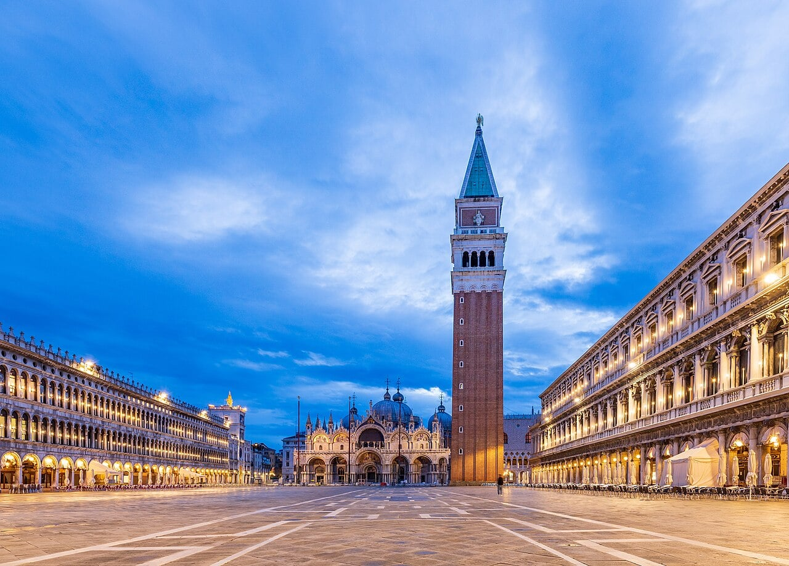
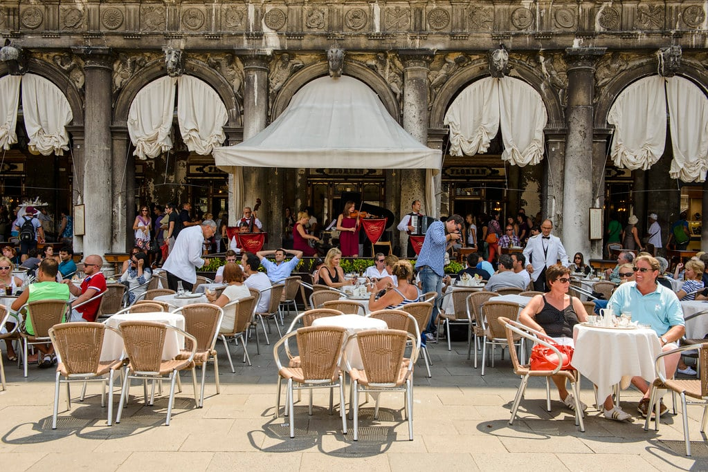

# Venice: two bars around Piazza San Marco

This route links two ways of “having a drink” around Piazza San Marco: sit first at Caffè Florian on the square, then walk to nearby Harry's Bar for a Bellini. Both are within a few minutes' walk of the square, making this a good evening plan that moves from the slow pace of a café to the formality of a bar.

Figure: Piazza San Marco in Venice at dusk, with the campanile and the Procuratie framing the square. Image: Matthias Süßen, CC BY-SA 4.0, via [source page](https://commons.wikimedia.org/wiki/File:Piazza_San_Marco_(Venice)_at_night-msu-2021-6449-.jpg).

## Route overview

- Stop one: [Caffè Florian](ref:florian), Piazza San Marco 56/59, opened in 1720, on the arcaded side of the square.
- Stop two: [Harry's Bar Venice](ref:harrys), Calle Vallaresso 1323, founded by Giuseppe Cipriani in 1931.
- Mode: walking. From the square, walk through the arcades and lanes; no transport is needed.
- Suggested duration: two to three hours. Allow forty to sixty minutes at the first stop, a few minutes' walk, and forty to sixty minutes at the second.

## Why these two stops

Caffè Florian represents the Venetian café tradition: opened in the 18th century, with ornate halls, a terrace facing the square and often a small live band. Harry's Bar represents another tradition: the 20th-century cocktail bar, small and formal, known for the Bellini and carpaccio.

The two are not far apart, yet they show two different eras: the former sells time and spectacle on the square, the latter sells craft and recipe behind the bar. Putting them on one route makes the layered meaning of “a drink in Venice” easier to grasp than visiting either alone.

## Stop one: Caffè Florian

Caffè Florian is on Piazza San Marco and opened in 1720; it is one of the longest continuously operating cafés in Europe. It consists of several halls with different decorative styles, and its terrace faces the square; Casanova, Byron and other figures are recorded as visitors.

Order a coffee or hot chocolate and sit inside to look at the decoration, or on the terrace to watch the square. Watch the cost structure: prices here are clearly above those of an ordinary café, and some seats may carry a music supplement. Confirm the seating charge and performance arrangements before ordering to avoid a surprise at the bill. In high season, avoid midday.

Two details are missed. Florian was founded by Floriano Francesconi on 29 December 1720 as “Alla Venezia Trionfante”, the victorious Venice, and only later took the owner's nickname Florian. It occupies part of the Procuratie Nuove, the arcaded building on the square's southern side, so the café was tied to the square's public life, not merely a tourist rest stop.

## Stop two: Harry's Bar

Harry's Bar is on Calle Vallaresso, close to Piazza San Marco, and was founded by Giuseppe Cipriani in 1931. The room is small, with a compact bar and closely spaced tables, and service is formal; the signature is the Bellini (white peach purée and Prosecco), and carpaccio is usually served as a starter.

Order a Bellini with a simple starter. If you only want the atmosphere, avoid main meal times; dress need not be overly formal, but respect the quiet tone of the room. Prices are high, and in season it is wise to confirm booking and opening hours in advance.

The signature drinks have origins. The Bellini was created by Giuseppe Cipriani in 1948 and named after the 15th-century Venetian painter Giovanni Bellini; carpaccio was devised in 1950 for a Venetian countess advised to eat raw meat, and takes its name from the painter Vittore Carpaccio. Both point to one background: the bar moved in Venetian artistic circles.

## How to walk it

Use Piazza San Marco as the only landmark: find Caffè Florian on the arcaded side of the square, and after sitting there walk along the western side of the square to Calle Vallaresso, where Harry's Bar stands. The whole route needs no bridge crossing or boat, being a short walk around the square.

Actual paths are affected by crowds, temporary barriers and shop entrances; follow on-site signage. Coming from a vaporetto stop or gondola pier, it is smoother to reach the square first and then follow the order above; for specific access, follow on-site guidance from Venice public transport.

## Cost, booking and timing

Both stops are expensive venues in the core tourist area of Venice. Caffè Florian's charges relate to seat type and live music; Harry's Bar's relate to dishes, drinks and service. Both may involve supplements or minimum charges, and asking the rules before ordering saves trouble later.

For timing, start in the late afternoon: sit on the square for a while, then move to Harry's Bar towards evening. That way you see the square's daytime crowds and still sit down before the bar moves into its evening rhythm. Allow waiting time in high season and at holidays, and confirm booking ahead for Harry's Bar.

## Boundaries

Opening hours, menus, prices, seating rules, dress requirements and temporary closures are set by the two venues' official channels; this route does not guarantee any particular day's opening. Historical visits and “the seat where so-and-so used to sit” are background narrative, not a statement about current quality.

For Venice: two bars around Piazza San Marco, this route provides neither a map nor coordinates: the two venues' latitude and longitude are left empty in the content repository, and with no verifiable coordinate source the project rule is not to draw a schematic map, only to describe the walking relationship in words. For precise navigation, use a live map service and follow on-site signage.

Further reading: [Reading a city through its bars](ref:c-extra-1), [A history of taverns: from wine shops and inns to bars](ref:c-extra-2), [Italy](ref:c-extra-3).

**At a glance:** From Caffè Florian on Piazza San Marco to Harry's Bar on Calle Vallaresso, both within a few minutes' walk of the square. A short evening route about the transition from the Venetian café to the cocktail bar. 

Read Venice through the order of stops, then the distance and opening hours, and finally whether it works as a fixed itinerary. The sequence matters.

Start with [Caffè Florian](ref:florian) for stop order, then read [Reading a city through its bars](ref:c-extra-1) for transport. Seeing both keeps Venice from being confused with a neighbouring idea.

**Key facts.**

| Item | Detail |
| --- | --- |
| In one line | From Caffè Florian on Piazza San Marco to Harry's Bar on Calle Vallaresso, both within a few minutes' walk of the square. A short evening route about the transition from the Venetian café to the cocktail bar. |
| Stops | 2 |
| Transport | walk |
| Stop order | Caffè Florian、Harry's Bar Venice |

**Sources and limits.** The key claims about Venice: two bars around Piazza San Marco are checked against the following sources: Caffè Florian (Used to check the address, the 1720 opening and visiting information), Cipriani (Used to check Harry's Bar's address, its 1931 founding and visiting information), Comune di Venezia (Used to check the square and the walking environment around it). Prices, batches and status change; the body is project-written and does not reproduce source text.

## Related images

Image: ' 09 - ITALY - Vineyard and signs Emilia Romagna wine - Mollino. Credit: Topural 1, CC BY-SA 2.0, via Wikimedia Commons.. Credit: Topural 1, CC BY-SA 2.0, via Wikimedia Commons ([source page](https://commons.wikimedia.org/w/index.php?curid=35825496)). Related image for Venice: two bars around Piazza San Marco.

Image: The open-air tables of Caffè Florian under the arcades of Piazza San Marco, with the band playing in front of the white awning.. Credit: Son of Groucho, CC BY 2.0, via Wikimedia Commons ([source page](https://www.flickr.com/photo.gne?id=9755522045)). Related image for Venice: two bars around Piazza San Marco.
