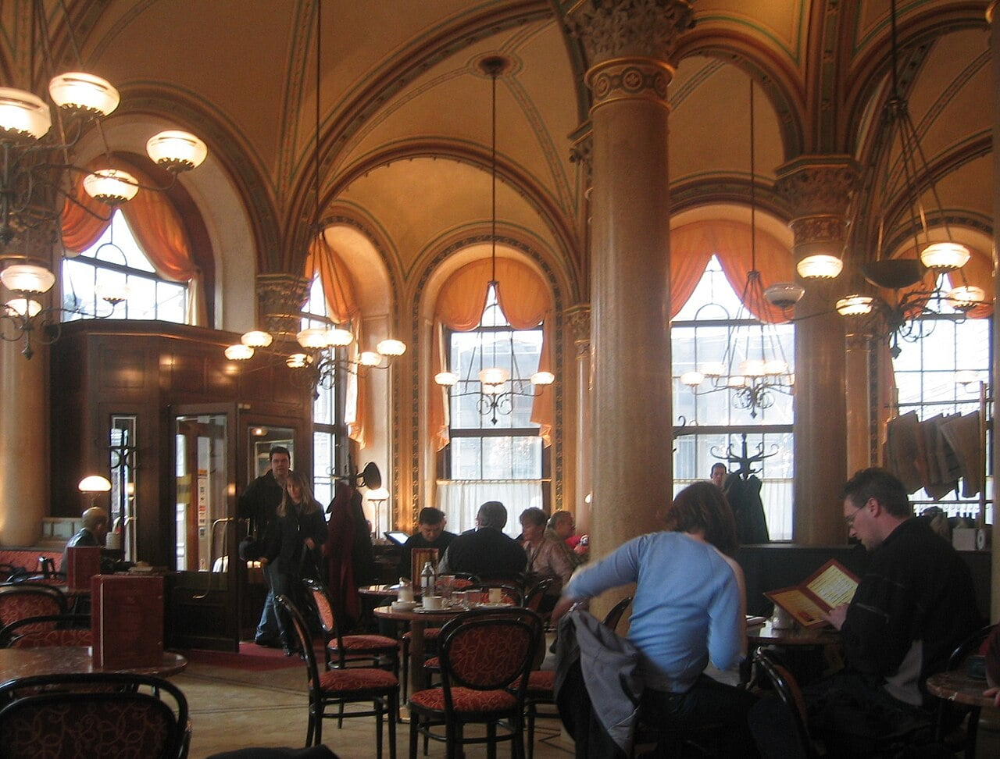

# Vienna coffee-house evening: Café Central to Café Sperl

This route has only two stops, yet it sets two kinds of Viennese coffee house side by side: Café Central inside the Palais Ferstel in the inner city, with its high vaulted hall and many visitors; and Café Sperl in Mariahilf in the sixth district, closer to a neighbourhood public sitting room, with marble tables, Thonet chairs and billiard tables still in use. Both normally stay open into the evening, so an evening start and two or three hours are enough to compare them slowly; Café Central has been closed for renovation since March 2026, so confirm that it has reopened before choosing it as the starting point.

Figure: The vaulted hall of Café Central in Vienna, with chandeliers and seating beneath the marble columns. Image: Andreas Praefcke, CC BY 3.0, via [source page](https://commons.wikimedia.org/wiki/File:Wien_Cafe_Central_2004.jpg).

> **Quick verdict**
> **In one line:** This route helps you plan Vienna coffee-house evening: Café Central to Café Sperl, including the order, timing and stops that matter.
>
> - **Best for:** Anyone turning Vienna coffee-house evening: Café Central to Café Sperl into a one- or two-day route and needs the order and the stops that matter.
> - **Not for:** If you want only want one stop and do not intend to follow a route.
> - **Check first:**
>   - - Stop one: Café Central, Herrengasse 14, 1010 Wien, opened in 1876, on the ground floor of the Palais Ferstel.
>   - Café Central represents the arcade hall.

## Route overview

- Stop one: [Café Central](ref:central), Herrengasse 14, 1010 Wien, opened in 1876, on the ground floor of the Palais Ferstel; as checked on 8 November 2026 it was closed for a comprehensive renovation, with reopening scheduled for autumn 2026 but no confirmed date.
- Stop two: [Café Sperl](ref:sperl), Gumpendorfer Straße 11, 1060 Wien, opened in 1880, in the Mariahilf district.
- Mode: walking or U-Bahn. The walk between the two takes about twenty to thirty minutes; by metro you usually change once in the centre and arrive at Museumsquartier (U2) or Kettenbrückengasse (U4), then walk a few minutes.
- Suggested duration: two to three hours. Sixty to ninety minutes at the first stop, twenty to thirty minutes to change stops, sixty to ninety minutes at the second.

## Why these stops

Café Central represents the arcade hall. It occupies the ground floor of the Palais Ferstel, a building that originally housed the Vienna Stock Exchange; after the exchange moved out in 1876, the brothers Gustav and Hermann Pach opened a café there. What you see today is not the early-20th-century room: the café closed for a period in the mid-20th century and reopened in 1986 as the Palais Ferstel was restored. It inherits the 1876 name, position and coffee-house tradition, but not every piece of furniture and decoration survives from 1876. Its fame is tied to the intellectual circles of the early 20th century, and the official account names Leon Trotsky, Sigmund Freud, the writers Alfred Polgar, Stefan Zweig and Peter Altenberg, and the architect Adolf Loos.

Café Sperl represents the neighbourhood coffee house. The building went up in 1880 to designs by the Ringstrasse-era architects Gross and Jelinek, first under the name “Ronacher”; in December of that year the Sperl family took it over, and the name has stayed. Adolf Kratochwilla took over in 1884 and his family ran it until 1968; around 1895 the Siebenerclub and the Hagengesellschaft used it as a meeting place, and in 1897 the Vienna Secession emerged from that artistic circle. Manfred Staub took over in 1968, and the 1983 restoration preserved the original atmosphere. Its awards and history show a place used daily by locals, not a sight kept alive only by the label “oldest”.

Putting the two together compares the “hall” with the “neighbourhood”: the first shows the coffee house as a city front room, the second as an everyday living room. Both are places to sit, not to stand and drink quickly.

## Stop one: Café Central

Why go: the room is the attraction. The main hall is high and open, with stone columns and vaulting above the seats and a view of Herrengasse from the windows; the side rooms and the arcade are quieter. Seats in a Viennese coffee house are not designed for turnover, and the tables are spaced so that one person with a book can sit all afternoon. It makes a good first stop because the room is large, the menu broad and the place easy for a first visit.

What to order: the coffee list is an introduction to the Viennese system. Wiener Melange is espresso with hot milk and milk foam, closer to a small latte but lighter; Einspänner is a tall glass of espresso under a thick layer of cream; Verlängerter is a “lengthened” espresso, close to a mild Americano; Kleiner Brauner and Großer Brauner are small or large coffees with a little milk. Melange is the safest first order, Einspänner for a stronger drink and Verlängerter for a lighter one. For dessert, Sachertorte or Apfelstrudel works, and Austrian dishes appear at meal times.

How long: sixty to ninety minutes. Early morning is quietest; two or three in the afternoon is the peak for cakes and visitors, with queues at the door; in the evening there is piano music, a fuller room and a higher volume of conversation. Arriving in the evening usually means a shorter queue than mid-afternoon, but still allow time to wait.

Practical note: the address is Herrengasse 14, 1010 Wien. Take the U3 to Herrengasse and you arrive at the door; from St Stephen's Cathedral it is about five minutes on foot. The official menu card has listed hours of 08:00–22:00 Monday to Saturday and 10:00–22:00 on Sundays and holidays. Find a seat yourself and wait for the server; do not stand at the entrance waiting to be seated or order at the bar. Traditional Viennese coffee houses usually charge no seating fee and no “music fee”, and the bill is drinks and food plus a tip. If a tourist-area menu lists a seating fee or minimum charge, follow the menu.

Check before you go: as of 8 November 2026 the official site said Café Central at Palais Ferstel had been closed since 16 March 2026 for a comprehensive renovation, with reopening “scheduled for autumn 2026” but no confirmed date; verify again before travelling. During the closure the team welcomes guests at DECENTRAL (Freyung 3/1, 1010 Wien, daily 07:30–22:00), its pop-up counterpart serving pastries, focaccia, coffee and spritz. If Café Central is still closed, swap the first stop for DECENTRAL: the structure and walking distances change, and the vaulted hall cannot be reproduced.

## Stop two: Café Sperl

Why go: it preserves its 19th-century interior layout and the traces of daily use. Inside, the central hall has marble tabletops, bentwood Thonet chairs, newspaper racks along the wall and several billiard tables. Nothing is artificially aged; wear and repairs have accumulated through use, which is exactly the state the 1983 restoration kept. Seats by the window are good for reading in daylight; the billiard area is livelier; tables towards the back are better for quiet conversation.

What to order: the coffee list is again the Viennese system, with Melange, Einspänner, Verlängerter, Kleiner Brauner and Großer Brauner. The house signature is the Sperltorte, which the Vienna tourist board also recommends; breakfast, Viennese home cooking and house-made pastries are also available. The safest combination is a Melange with a slice of Sperltorte; if you want something savoury, order a Viennese dish or breakfast first and put the coffee after it.

How long: sixty to ninety minutes. Early morning is quietest; two or three in the afternoon is the peak for cakes and visitors; on Sunday afternoon there is piano music, a fuller room and louder conversation. Choose a seat at the back or by the window for quiet; accept the crowd and the noise if you want the old coffee house as a public sitting room.

Practical note: the address is Gumpendorfer Straße 11, 1060 Wien. Take the U4 to Kettenbrückengasse or the U2 to Museumsquartier, then walk about five to ten minutes; bus 57A also stops at Laimgrubengasse. The Vienna tourist board page lists hours of 07:00–22:00 Monday to Saturday and 10:00–20:00 on Sundays and holidays, with piano music on Sunday from 15:30–17:30. Find a seat yourself and wait for the server; do not stand at the entrance waiting to be seated or order at the bar. At the bill, rounding up or adding 5%–10% is usual; state the total including the tip and do not leave cash on the table.

## Order and transport

Follow the order “Café Central → Café Sperl”. Café Central is in the inner city, easiest to reach and a natural starting point; sit in the arcade hall for a while as the light fades, then move west to Mariahilf. Café Sperl is more everyday in character, and an evening seat there shows local customers better than daytime.

The legs:

- On foot: leave Herrengasse, head south-west via Graben, Kärntner Straße and Opernring, then along Gumpendorfer Straße to number 11, about twenty to thirty minutes. The line passes through the busiest pedestrian part of the inner city, still crowded in the evening, and suits a slow walk.
- By metro: walk from Café Central to a nearby station, take the U-Bahn to Museumsquartier (U2) or Kettenbrückengasse (U4) and walk five to ten minutes to the café. The two stops usually require one change in the centre; for specific changes and entrances, use the Vienna public transport information and on-site signage.
- By bus: bus 57A to Laimgrubengasse serves Café Sperl, useful from the Mariahilfer Straße direction.

Neither stop needs transport to “arrive”, but the distance is not short: walking costs half an hour, while the metro adds station access and a change. Treating the walk as part of the route, or the metro as the time-saving option, is more reliable than deciding on the spot.

## Duration and budget

Two to three hours is a reasonable range. Sixty to ninety minutes at the first stop, twenty to thirty minutes for the walk or metro, sixty to ninety minutes at the second. If you have one drink at each and skip cake, the route can compress to two hours; a cake and a proper meal at Sperl stretches it naturally.

On budget, both are mid-to-upper level in Vienna but structured differently: Café Central's position and fame bring visitors, and the gap between breakfast, afternoon tea and a full meal is wide; at Sperl a coffee and a cake cost clearly less than a full meal. Traditional Viennese coffee houses generally do not list a seating fee or music fee separately, so the bill is drinks and food plus a tip; where a menu lists a seating fee or minimum charge, follow the menu.

Sunday needs special planning: Café Sperl opens 10:00–20:00 on Sundays and holidays, closes earlier than on weekdays, and the piano music is in the afternoon at 15:30–17:30 rather than in the evening. On a Sunday, put Sperl in the afternoon and Café Central after it or on another day.

## Who it suits and who it does not

It suits anyone wanting to compare two kinds of Viennese coffee house; small groups of two to four; people happy to sit down and give half an hour or an afternoon to one table; anyone interested in the coffee list, cakes and coffee-house architecture; and anyone looking for a quiet place in the evening.

It does not suit people in a hurry who only want to stand for a coffee; anyone needing to hold a quiet phone meeting; travellers whose budget only covers the cheapest fast food; people treating a coffee house as a quick photo stop; or anyone expecting a single authoritative claim about which café is “oldest” (the verifiable starting points are 1876 and 1880, and “oldest” has different measures).

Families are welcome, but afternoons and Sunday afternoons are crowded and loud; the billiard tables at Sperl are working facilities, not photo props, so keep an eye on children near them.

## Practical tips and verification notes

First, sitting down is not ordering. At both cafés you find your own seat and wait for the server; signal with eye contact and a quiet voice rather than shouting. One person with a single coffee for two or three hours is accepted in a Viennese coffee house; at peak times, occupying a large table for a long time affects those waiting, so judge for yourself.

Second, understand the cost structure. Traditional Viennese coffee houses usually charge no seating or music fee; where a menu lists a seating fee or minimum charge, follow the menu and do not assume “Viennese cafés never charge extra”. At the bill, state the total including the tip, usually rounded up or 5%–10%.

Third, separate history from original fabric. Café Central closed in the mid-20th century and reopened in 1986; what you see is the restored version, not the 1876 room intact. Café Sperl was restored in 1983, preserving atmosphere and use; do not mistake wear for set dressing.

Fourth, treat the famous names as background. Café Central's Trotsky, Freud and writers belong to historical narrative, and “the chair where someone always sat” is mostly later legend. Sperl's Secession connection is art history too, not a statement about today's service.

Fifth, this route describes the structure of the route and verifiable facts only: as checked on 8 November 2026 Café Central was still under renovation with no confirmed reopening date, and Café Sperl's hours follow its official page. The two venues' latitude and longitude are left empty in the content repository, and with no verifiable coordinate source the project rule is not to draw a schematic map. For precise navigation, use a live map service and follow on-site signage.

Further reading: [Reading a city through its bars](ref:c-extra-1), [Time in a cup](ref:c-extra-2), [A history of drinking vessels: how the cup changed the drink](ref:c-extra-3).
