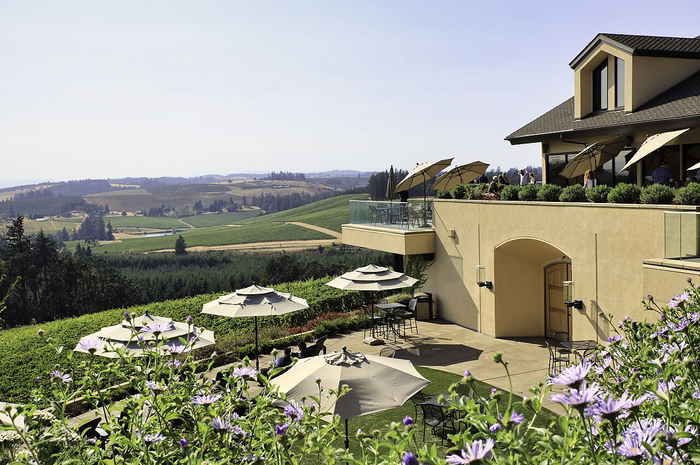

# Willamette Valley Wine Route

A drive south from Portland anchored on two Dundee Hills estates, Domaine Drouhin Oregon and The Eyrie Vineyards: Burgundy capital arriving in 1987 in the morning, David Lett’s original 1965 blocks in the afternoon — the two starting points of Oregon Pinot in one day. The loop is about 100 kilometres and works by car, forty minutes from Portland.

Figure: Willamette Valley Wine Route: Willamette Valley Vineyards Estate in the Salem Hills (Wikimedia Commons). Image: WillametteValleyVineyards1983, CC BY-SA 4.0, via Wikimedia Commons ([source page](https://commons.wikimedia.org/wiki/File:Willamette_Valley_Vineyards_Estate_in_the_Salem_Hills.jpg)).

## Route overview

Leave Portland at 9:00, take I-5 south and reach Domaine Drouhin Oregon around 9:45. Spend the morning on the estate and in the tasting room, focusing on Dundee Hills Pinot and Roserock; lunch in Dundee or Dayton at 12:00. At 13:30 drive about twenty-five minutes to Eyrie in McMinnville, taste and walk the vines for ninety minutes; after 15:30 go to old-town McMinnville or a Carlton tasting room, return at 17:30 and be back in Portland around 18:30.

As a Portland day trip this fits; to see more estates, stay a night in Dundee or McMinnville and split Yamhill-Carlton and Eola-Amity Hills into a second day. Willamette sub-appellations are close on the map, but every estate needs an appointment, so two a day is the comfortable maximum.

## Regional background

The Willamette Valley runs from just south of Portland down toward Eugene, with the Coast Range to the west and the Cascades to the east. Pacific moisture is largely blocked by the coastal mountains, leaving warm, dry summers and wet, cold winters; the growing season is longer than California’s and a little warmer than Burgundy’s. That marginal climate ripens Pinot slowly, with high acidity and low alcohol, closer to Burgundy than to California.

Dundee Hills sits in the northern valley, with east-facing slopes catching morning sun and afternoon breezes; the soils are mostly Jory volcanic clay and ironstone, well drained but able to hold water. David Lett planted the first Pinot here in 1965 and other pioneers followed in the 1970s; in 1987 Robert Drouhin bought land here, giving Dundee Hills both an “American origin” and a “French capital” story.

## Stop one: Domaine Drouhin Oregon

Domaine Drouhin Oregon is at 6750 Breyman Orchards Road near Dayton, about forty-five minutes from Portland. In 1987 Robert Drouhin bought 225 acres in Dundee Hills and brought his daughter Véronique over as founding winemaker; the first personal vintage came in 1988 and the first Laurène in 1992. The estate now has about 235 acres, 130 of them planted, and a winery built into the slope so gravity moves fruit from level to level instead of pumps.

The range centres on Dundee Hills Pinot: Laurène is the flagship, Louise the softer sibling, Dundee Hills the appellation wine, and Roserock comes from the Eola-Amity Hills property bought in 2013. Start with Dundee Hills as a baseline, move to Laurène for structure and ageing potential, then Roserock to compare the cooler, more southern Eola-Amity Hills; go light to rich, not the reverse.

The visit covers the gravity-flow winery, Jory soil and the Burgundy comparison; for a quick tasting, take Dundee Hills plus Laurène, about an hour. With children, the outdoor space is friendlier than the tasting room, but tastings still need quiet; weekends and peak season need booking.

## Stop two: Eyrie

Eyrie is at 935 N. Kutch Street in McMinnville, about twenty-five minutes from Drouhin. In 1965 David Lett brought about 3,000 Pinot cuttings from California to Oregon and planted them near Corvallis on 22 February; in 1966 he bought 20 acres in Dundee Hills and made his first vintage in 1970. The 1975 Reserve placed in the top ten at the 1979 Paris blind tasting, and at the 1980 Beaune rematch it lost to Drouhin’s 1959 Chambolle-Musigny by 0.2 points — the moment Burgundy began to take Oregon Pinot seriously.

Eyrie is still family-run, with Jason Lett taking over in 2005. Five estate vineyards total about 67 acres: Original Vines planted 1966–1974, Sisters from 1989, Outcrop 1982–2000, Roland Green from 1988, and Daphne 1974–1984 at nearly 900 feet. All are organic, dry-farmed and own-rooted, on Jory and Nekia volcanic soil, with the same recipe per site, wild yeast and about 12% new oak.

The tasting room is small and old-school: no château, no big screen, just a table and a few bottles. Compare Original Vines with Sisters — the first leaner, more mineral and closer to 1970s Oregon, the second rounder with more fruit. With one bottle, choose Original Vines or Reserve; to understand today’s Eyrie, choose Sisters or Outcrop.

## Lunch and a third stop

Lunch has three options: Dundee, Dayton, or old-town McMinnville. Dundee and Dayton are limited but close to the estates; McMinnville has more choice and suits an afternoon wander. If you are driving afterwards, do not drink much; McMinnville’s bookshops, cafés and historic buildings are a better use of time than a third estate.

For a third stop, choose by interest: more Pinot in Carlton or Yamhill, a view over Dundee Hills from a ridge or lookout, or simply rest in McMinnville. Do not push south to Eola-Amity Hills, which stretches the day to ten hours.

With children, swap the third stop for old-town McMinnville or a park rather than more wine; both tasting rooms are small and children get bored. Spring and autumn are the best vineyard light, summer afternoons are hot, and winter is wet and slippery.

## Seasons and roads

Spring is wet, autumn mild, summer afternoons can reach thirty degrees, winter is cold and damp; harvest usually runs from September to October, the busiest time with tight appointments. Dundee Hills mornings are foggy, so use fog lights; once the fog lifts, the slopes open views across the Coast Range and valley.

Allow about forty-five minutes from Portland to Drouhin, twenty-five minutes from Drouhin to Eyrie, and fifty minutes back; add an hour for Carlton or old-town McMinnville. I-5 and OR-99W clog on Friday afternoons and weekends, so avoid the 16:00–18:00 return; country roads are narrow, deer appear at night, and long night drives should be avoided.

## Booking and etiquette

Book tastings at both estates, especially weekends and peak season; neither handles large walk-in groups well, so email ahead for more than six people. Spit into the spit bucket and keep driving tastings to one or two; Eyrie’s tasting room is small, so leave large luggage and strollers behind, and Drouhin’s outdoor steps and slopes call for proper shoes.

This route does not draw a map or provide live prices; roads, hours and booking rules change, so check both estate websites and the Oregon Wine Board before leaving. If an estate closes unexpectedly, do not force it — put old-town McMinnville or Carlton in the plan and the day still works.

## Decision table: how to split the day

| Segment | Time | Drive | Stop | Best for |
| --- | --- | --- | --- | --- |
| Portland → Dundee Hills | 9:00–9:45 | about 45 min | — | self-drive, same-day return |
| Domaine Drouhin Oregon | 9:45–12:00 | — | about 2 h 15 min | comparing Dundee Hills with Eola-Amity Hills |
| Lunch: Dundee / Dayton | 12:00–13:30 | — | about 1 h 30 min | everyone |
| Dundee → McMinnville | 13:30–13:55 | about 25 min | — | self-drive |
| The Eyrie Vineyards | 13:55–15:30 | — | about 1 h 30 min | seeing the 1965 origin and old vines |
| McMinnville old town / Carlton | 15:30–17:30 | 20–30 min | about 2 h | an extra tasting or a walk |
| Return to Portland | 17:30–18:30 | about 1 h | — | same-day return |

Both wineries require bookings; this is a “two is just right, three is rushed” route, not a checklist.

## Related images

Image: Category image for The Eyrie Vineyards. Credit: Rvannatta ( talk · contribs ) Image edits: Peteforsyth ( talk · contribs ), CC BY-SA 3.0, via Wikimedia Commons ([source page](https://commons.wikimedia.org/wiki/File:Wvatbethel1.jpg)). Related image for Willamette Valley Wine Route.

Image: Pinot Noir. Credit: Cjp24, Public domain, via Wikimedia Commons ([source page](https://commons.wikimedia.org/wiki/File:Grape_near_Sancerre.jpg)). Related image for Willamette Valley Wine Route.

## Frequently asked questions

### Is one day enough?

Yes, for two wineries. Give Drouhin and Eyrie 1.5–2 hours each; with lunch and driving, the day is full. For a third winery, stay overnight in Dundee or McMinnville and put Yamhill-Carlton or Eola-Amity Hills on day two.

### What if I do not have a car?

Public transport is sparse and ride-hailing between wineries is unreliable; do not rely on buses alone. Book a driver, join a small tour or arrange transfers in advance, and fix the two winery times. Anyone drinking should not drive.

### How do I book the wineries?

Both require advance booking. Drouhin tastings are usually 10:00–15:00; check Eyrie’s official page for slots and rules. Do not arrive without a booking. State the party size, whether you want a tasting and whether you need a guide, and confirm the cancellation policy.

> **Next:** Read [Domaine Drouhin Oregon](ref:drouhin) and [Eyrie](ref:eyrie) to understand the two estates, then the [Willamette Valley](ref:willamette) region and [Pinot Noir](ref:pinot) pages for the terroir context.

## Further reading and see also

- Related entries: [domaine-drouhin-oregon](ref:ddo), [eyrie-vineyards](ref:eyrie), [willamette-valley](ref:willamette), [red-wine](ref:red), [pinot-noir](ref:pinot).
- To go deeper, compare this route with Sonoma’s Russian River Valley: both are Pinot country, but Oregon is cooler and leaner, Sonoma rounder and more fog-driven.
- With half a day, choose Drouhin plus old-town McMinnville and skip Eyrie; with only two hours, choose one estate rather than trying both.

**In brief:** South from Portland into the Willamette Valley, anchored by Domaine Drouhin Oregon and The Eyrie Vineyards in the Dundee Hills; a day of 1960s–70s pioneer planting, Burgundian Pinot Noir, old vines and organic farming, and the Oregon Wine Board’s regional story.
