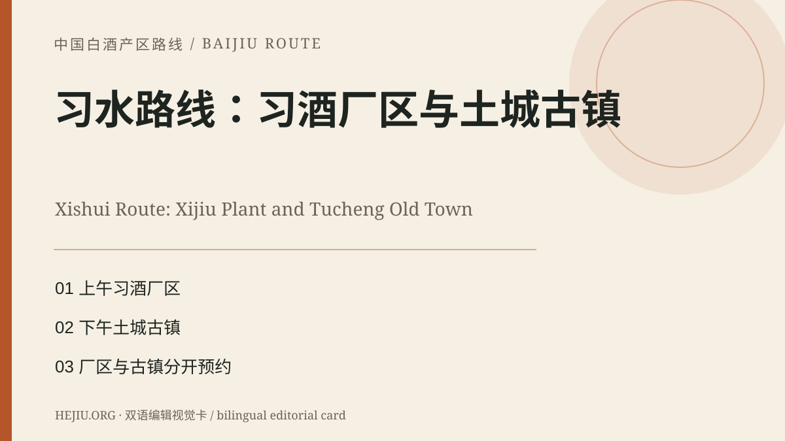

# Xishui Route: Xijiu Plant and Tucheng Old Town

Xishui places two kinds of time on one river: sauce-aroma production in Xijiu Town is industrial time; Tucheng’s salt firms, ferries and Four Crossings are historical time. Many cross from Erlang, stop at the Xijiu gate and photograph Tucheng, understanding neither. This route gives the morning to the plant and valley, the afternoon to the memorial and old street: industry first, history second, a smoother flow.

图：Xishui route bilingual editorial card。Project-created bilingual editorial card for topic identification, not a documentary photograph.

> **Quick verdict**
> **Best for:** travellers on a Sichuan–Guizhou liquor route who want both a sauce-aroma plant and Chishui history; works by car or hired driver.
> **Not for:** old-town photo hunters who will not book the plant; the two sites need a drive.
> **One line:** plant in the morning, Tucheng in the afternoon, memorial before old street, and no driving after tasting.

## Why plant and old town are separate

The Xijiu plant and Tucheng old town are different spaces and different narratives. The plant is a working sauce-aroma production site requiring booking, gates and safety boundaries. Tucheng layers an old town, a memorial and ferries, and needs walking and a timeline. Put the plant in the morning, when production visits run and energy is best; put Tucheng in the afternoon, when the memorial and old street can be walked one way and the day closes calmly. Allow enough drive time between them and avoid transferring at lunch.

## Morning: Xijiu plant

Xijiu Town sits on the middle Chishui, with the plant climbing the slope. Follow four lines: high-temperature starter culture, autumn grain feeding, repeated steaming and draw-off, and long storage. In workshops, watch starter-block temperature, sorghum crushing, the looseness of stacked grain, pit sealing and draw-off rounds; do not just memorise numbers but see how they land in a team. If workshops are closed, use cutaways and flow diagrams in the exhibition, then compare valley orientation and plant layout from the viewpoint. Do not climb fences or follow lorries through gates; ask about strength, volume and charge before tasting, and keep the driver out.

## Afternoon: Tucheng old town

Build the timeline before walking the space. Enter the Four Crossings memorial and use the map and timeline to understand manoeuvre across the Chishui, the role of ferries and boats, and how local society was changed by war. Then walk the ferry and old street; salt firms, boat guilds, stilt houses and stone steps become a transport route rather than a backdrop. The old street slopes, so wear non-slip shoes and walk memorial, ferry and street one way without backtracking. Follow photo signs and do not flash documents or textiles. With children, explain the crossing route first, then let them find Tucheng on the map.

## Transport, lodging and time

Xijiu Town lies in eastern Xishui County, usually approached from Zunyi, Luzhou or Chongqing; roads are mountainous and fog slows rain driving. Tucheng lies in western Xishui on the Chishui; the drive from Xijiu takes time, buses are sparse, and a car is more flexible. Plant exterior and exhibition take about two hours; adding Tucheng’s memorial and old street fills a day; adding Chishui needs two. Sleeping in Xishui county town or Xijiu is safer than a same-day return; ask about hot water, parking, breakfast and checkout. The valley is humid in summer, so bring water and a hat; stone steps are slippery after rain, so older people and children walk slowly.

## Tasting, buying and return

Do not drive mountain roads after tasting; the driver abstains. Buy from official or authorised shops and keep receipts; do not treat “internal” or “reception” liquor as a bargain. Confirm the return bus or designated driver before leaving, and do not wait until dark in Tucheng to look for a car. For food, try Xishui mutton rice noodles, Tucheng glutinous-rice balls, tofu pudding and Chishui River fish, keeping sauce-aroma liquor modest. With half a day, choose either the plant exhibition or Tucheng memorial, not both in a rush; with children, Tucheng before the plant, because a map task works better than dates.

## One-day and two-day versions

The one-day version runs Xijiu plant, lunch, Tucheng memorial and old street; do not let the morning run into noon or push the memorial to closing. The two-day version gives day one to Xijiu and Tucheng, sleeps in Xishui, and adds Chishui or Erlang on day two. In rain or fog, see one fewer point rather than driving mountain roads at night; with older relatives, reduce stone steps and put the memorial in the best-energy slot. Buy liquor before returning, keep the driver out of tasting, ask about cross-county buses early, and do not wait until dark in the old street. A same-day return from Zunyi or Luzhou consumes most of the day, so one night in Xishui is steadier; with half a day, choose either the plant exhibition or the Tucheng memorial. With older relatives, reduce stone steps and put the memorial in the best-energy slot; with children, see the map and timeline first, then walk the old street. Check batch codes, eat at local meal times, slow down for oncoming traffic and allow extra time.

## Check before you go

- Check whether the plant visit is open
- Plant in the morning, Tucheng in the afternoon
- See the map and timeline at the memorial first
- Wear non-slip shoes for stone steps
- Do not drive after tasting
- Buy only from official or authorised shops
- Ask about cross-county buses in advance
- Watch mountain roads and slippery surfaces in rain

## Who this route is not for

This route pairs the Xijiu estate with Tucheng old town in one day, good for travellers interested in both production and Chishui history. If you only want to taste, the walking and hosting process at the estate can feel long; with elders or children, the river crossing, slopes and stone steps need more time.

Buses run from Xishui county town to Xijiu town, but frequency depends on the hour; crossing from Maotai can also meet checks and traffic. Historic sites in Tucheng need separate tickets or a booked guide, and capacity is tight on holidays.

Alternative: see only the Xijiu estate, or only Tucheng and the Chishui valley; to include Maotai, allow at least two days rather than pressing three stops into one. Do not drive immediately after tasting.

## References

- Xishui County People’s Government — County profile — https://www.xsx.gov.cn/zjxs/xsgk/jj2023/202605/t20260525_90206553.html (Xishui County People’s Government, checked 2026-11-25)
- Xijiu — Company profile — https://www.gzxijiu.com/about/introduction?menuId=r_5uFQaERX42fDKDI7O2B (Guizhou Xijiu Co., Ltd., checked 2026-11-25)
- Zunyi Municipal People’s Government — https://www.zunyi.gov.cn/ (Zunyi Municipal People’s Government, checked 2026-11-25)
- GB/T 2260-2007 Administrative division codes of the People’s Republic of China (Standardization Administration of China, checked 2026-11-25)

Related entries: [Xijiu Distillery (Xijiu Town)](ref:distillery), [Tucheng Old Town (Xishui)](ref:tucheng), [Xijiu](ref:brand), [sauce-aroma baijiu](ref:style), [Guizhou](ref:region), [First baijiu guide](ref:guide), [History of Chinese wine](ref:history).

## Related images

Image: Guizhou. Credit: Huangdan2060, CC BY 3.0, via Wikimedia Commons ([source page](https://commons.wikimedia.org/wiki/File:Huangguoshu_Waterfall_in_October_2020,_Picture12.jpg)). Related image for Xishui Route: Xijiu Plant and Tucheng Old Town.

Image: Xijiu. Credit: Lhzss8, CC BY-SA 4.0, via Wikimedia Commons ([source page](https://commons.wikimedia.org/wiki/File:%E4%B8%80%E6%AC%BE%E4%B9%A0%E9%85%92.jpg)). Related image for Xishui Route: Xijiu Plant and Tucheng Old Town.
