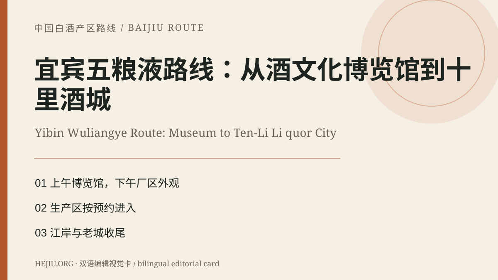

# Yibin Wuliangye Route: Museum to Ten-Li Liquor City

Yibin liquor travel easily collapses into “a photo at the Wuliangye gate”. This route splits the day: use the morning to understand strong-aroma process in the museum, spend the afternoon following Ten-Li Liquor City’s public roads to see how the plant spreads along the Min River, and finish in the old town and by the water. It does not try to walk every workshop; it lets you understand what makes the scale.

图：Yibin Wuliangye route bilingual editorial card。Project-created bilingual editorial card for topic identification, not a documentary photograph.

> **Quick verdict**
> **Best for:** first-time Yibin visitors who want a one-day strong-aroma framework; works by car or taxi.
> **Not for:** visitors who treat the plant as a free park and will not book; production is not an open trail.
> **One line:** museum in the morning, plant exterior and river in the afternoon, workshops only on official routes, and no driving after tasting.

## Why museum before plant

The museum is not an indoor tick-box; it gives the afternoon plant exterior its meaning. Strong-aroma production depends on pits, mud, grain, distillation and storage together. Go to the plant first and you see big buildings, pipes and lorries without knowing how a pit works inside the chain. Cutaways, tools and flow diagrams in the museum break the process apart; then the public roads let you see which buildings correspond to starter culture, fermentation, distillation, storage and packaging. Build the framework first, then look at scale, and information is not crushed by size.

## Morning: build the strong-aroma framework

Look for four things in the museum: grain ratios, starter-block cultivation, continuous mud-pit use, and graded storage and blending. Strong-aroma baijiu often uses sorghum, rice, glutinous rice, wheat and maize in ratios that vary by producer; starter culture shapes aroma and fermentation; pit mud is the home of the microbial community, and continuous use and daily maintenance matter more than the word “age”. Do not only photograph bottles: photograph flow diagrams and cutaways, then compare them with building positions from outside the plant in the afternoon. If a guide is available, take craft first and brand story second; do not mix them.

## Afternoon: the public route through Ten-Li Liquor City

Ten-Li Liquor City stretches along the Min River. Plant roads, gates, riverfront and some public spaces can be walked or driven, but working workshops, warehouses and logistics lanes cannot be entered. The afternoon method is “scale from the river, layout from the gates, detail from the museum”: view how the plant spreads along the water from permitted public roads, then use gates and display points to locate starter rooms, distilleries, jar warehouses and packaging. Do not climb fences, follow a lorry through a gate, or fly a drone close to the plant. Give way to production vehicles and shift crowds.

## Transport, booking and rain plan

A taxi from Yibin West station to Minjiang West Road takes roughly half an hour; Wuliangye Airport lies northwest of the city and the drive varies. Museum plus plant exterior fits half a day; a full day adds the old town and river. Production visits follow official notices, and availability, photography and charges change, so reconfirm the day before. In rain, shorten the outdoor plant route and substitute the museum plus indoor old-town points. Spent grain smells strong in summer; sensitive visitors should mask, and everyone needs non-slip shoes.

## Tasting, buying and return

Ask about strength, volume and charge before tasting; sip slowly, not on an empty stomach. The driver abstains and does not drive after. Buy from official or authorised shops and keep receipts; do not treat “internal” or “reception” liquor as a bargain, and leave unclear bottles behind. Keep twenty minutes to sit by the river before returning; it conveys the scale better than one more stop. If adding Lizhuang or the Bamboo Sea, give the countryside a separate day rather than squeezing it into a plant half-day. For dinner, try Yibin burning noodles, Lizhuang white pork and river fish, keeping alcohol modest.

## One-day and two-day versions

The one-day version runs museum, plant exterior, riverfront and old town, with lunch in the city and no self-driving after tasting. The two-day version gives the first day to the plant and old town and the second to Lizhuang or the Bamboo Sea, keeping the countryside as a separate block. With half a day, skip the old town and focus on the museum plus one stretch of plant exterior; with older relatives, reduce walking, understand the museum cutaways first, then view gates and river by car. In every version, production only on official routes, and tasting kept apart from buying. With half a day, take the museum plus one stretch of riverfront and skip the old town in the afternoon; with older relatives, view gates and river by car and walk only in the museum. Put the outdoor block toward evening in summer, and switch to museum plus Guanying Old Street in rain. Give Lizhuang and the Bamboo Sea separate days rather than combining them with the plant. Keep twenty minutes by the river before returning instead of spending it all finding the car; the driver skips tasting, buying comes last, and opening is reconfirmed the day before.

## Check before you go

- Confirm museum and production booking
- Museum in the morning, exterior in the afternoon
- Do not climb plant fences
- Do not drive after tasting
- Buy liquor before departure
- Switch to indoor options in rain
- Mask and non-slip shoes in summer
- Give the countryside a separate day

## Who this route is not for

If you want one museum in half a day, this route will feel loose: it links the museum, the Ten-Li Wine City and old Yibin, and suits a full day. It is also not especially child-friendly: the estate involves a lot of walking and the tasting is not for minors, so with children keep the museum and the riverfront.

By transport, city buses reach some points, but walking between estate areas is long and summer is humid; a taxi or hired car is easier. If catching a high-speed train home, allow at least an hour from the estate to the station.

Alternative: for a short visit, see only the Wuliangye Wine Culture Museum; to cover more drinks, split Yibin and Luzhou into two days rather than forcing them into one. Buying and shipping follow official channels, not roadside stalls.

## References

- National Cultural Heritage Administration museum annual report — Wuliangye Wine Culture Exhibition Hall — http://nb.ncha.gov.cn/museumdetail.html?msg=695e97ba55204e019622a4a0c22255c5&nianfen=2025 (National Cultural Heritage Administration, checked 2026-11-25)
- Yibin Municipal People’s Government — Yibin, China’s liquor capital — https://www.yibin.gov.cn/xxgk/rdgz/202309/t20230911_1903005.html (Yibin Municipal People’s Government, checked 2026-11-25)
- Wuliangye Group — About us — https://www.wuliangye.com.cn/en/about/Introduce.html (Wuliangye Group, checked 2026-11-25)
- Sichuan Online Red Base — Wuliangye Wine Culture Museum — https://hsjd.scdjw.com.cn/cover01.html?id=116 (Sichuan Online Red Base, checked 2026-11-25)

Related entries: [Wuliangye Wine Culture Museum](ref:museum), [Wuliangye Distillery (Ten-Li Liquor City)](ref:estate), [Wuliangye](ref:brand), [strong-aroma baijiu](ref:style), [Sichuan](ref:region), [First baijiu guide](ref:guide), [History of Chinese wine](ref:history).

## Related images

Image: Wuliangye. Credit: 东京村子, CC BY-SA 3.0, via Wikimedia Commons ([source page](https://commons.wikimedia.org/wiki/File:%E4%BA%94%E7%B2%AE%E6%B6%B2%E6%97%97%E8%88%B0%E5%BA%97_-_panoramio.jpg)). Related image for Yibin Wuliangye Route: Museum to Ten-Li Liquor City.

Image: Sichuan. Credit: FISU, CC BY 3.0, via Wikimedia Commons ([source page](https://commons.wikimedia.org/wiki/File:%E9%9B%AA%E5%B1%B1%E4%B8%8B%E7%9A%84%E6%88%90%E9%83%BD%E5%B8%82%E5%A4%A9%E9%99%85%E7%BA%BF_Chengdu_skyline_with_snow_capped_mountains.jpg)). Related image for Yibin Wuliangye Route: Museum to Ten-Li Liquor City.
