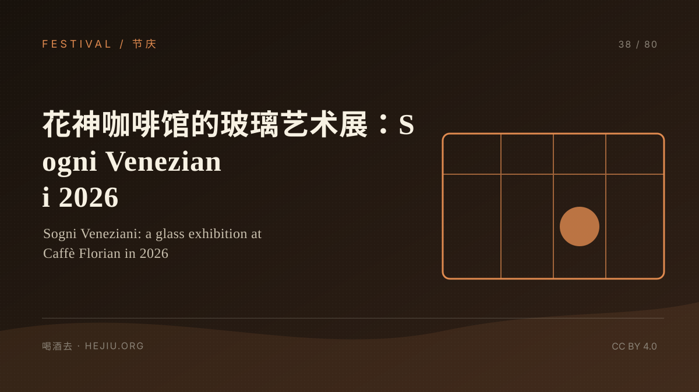

# 花神咖啡馆的玻璃艺术展：Sogni Veneziani 2026

2026 年 9 月 12 日至 10 月 18 日，花神咖啡馆的历史厅举办 Pierpaolo Seguso 的玻璃雕塑展“Sogni Veneziani”（威尼斯之梦）。展览属于 2026 年第十届威尼斯玻璃周（The Venice Glass Week）的城市节目之一，但展期比玻璃周本身更长：玻璃周在 9 月 12 日至 20 日举行，展览则延续到 10 月 18 日。展览免费、无需预约，开放时间随咖啡馆每日 9:00–23:00。活动已经结束，本页记录当届安排与规则。

图：花神咖啡馆的玻璃艺术展：Sogni Veneziani 2026栏目示意图。项目自产或类别插图，用于酒吧与餐饮语境，不是该对象的实拍。

> **先给结论**
> **一句话：** 这页判断：花神咖啡馆的玻璃艺术展：Sogni Veneziani 2026，现在是什么状态，以及现场怎么参与。
>
> - **适合谁：** 想了解花神咖啡馆的玻璃艺术展：Sogni Veneziani 2026的现场、机制和当届状态的人。
> - **不适合谁：** 只查当届票务或实时安排、不看活动边界的人。
> - **先看这两点：**
>   - 威尼斯玻璃周创办于 2017 年，到 2026 年是第十届。
>   - - 展期：2026 年 9 月 12 日至 10 月 18 日。

## 活动背景

威尼斯玻璃周创办于 2017 年，到 2026 年是第十届。官方介绍把它写成一场国际性的玻璃艺术节，节目分布在威尼斯、梅斯特雷与穆拉诺，形式包括展览、装置、工作坊、画廊与历史建筑中的特别项目。2026 年第十届会期为 9 月 12 日至 20 日，官方称有 200 多场活动。它的重点不是把玻璃集中到一个展馆，而是让观众在城市里移动，沿着工坊、展厅与历史空间逐一观看。

花神咖啡馆与穆拉诺玻璃的关系并不是从这届展览才开始。花神官方文章回顾了历史厅曾经展出的玻璃艺术家与作品，包括 Silvano Rubino、Lucio Bubacco、Davide Salvadore、Lilla Tabasso 等，也提到国际艺术家。这个名单说明花神把“历史咖啡馆”当作当代艺术的展场，而不是只做复古陈列；玻璃的透明、反光与脆弱，正好与历史厅的镜面、壁画与金色装饰形成对话。

“Sogni Veneziani”是 Pierpaolo Seguso 的个展。官方文章把作品的主线写成“内在变化”：玻璃雕塑不是呈现一个完成的答案，而是记录思考、经验与意识如何在时间里变形。Seguso 关注过程而不是结果；玻璃在成型时是流动的，冷却后变得坚固，却又保留脆弱性，这种材料状态与“持续生成”的主题相互对应。展览标题因此更像一段旅程，而不是一个终点。

对花神咖啡馆来说，这场展览延续了它“在营业中的历史空间做艺术”的做法。观众不是走进一座白盒子美术馆，而是在一间仍在卖咖啡、甜点与座位的咖啡馆里看作品。展品与镜面、壁画、光线共处，同一个作品在上午与下午可能呈现不同的观感；这也是花神官方文章反复强调“光与空间”的原因。

## 时间与地点

- 展期：2026 年 9 月 12 日至 10 月 18 日。
- 开放时间：每日 9:00–23:00，随花神咖啡馆营业时间。
- 地点：[花神咖啡馆（威尼斯）](ref:florian)，圣马可广场 57 号，历史厅（Historic Rooms）。
- 时区：Europe/Rome。
- 本页 `start` 取展期首日 9:00，`end` 取末日 23:00，与官方活动页给出的每日开放时间一致。

需要区分两个时间层。第一层是威尼斯玻璃周的会期：9 月 12 日至 20 日，城市里的展览、装置与活动集中在这段时间。第二层是花神这场展览的展期：9 月 12 日至 10 月 18 日，比玻璃周长出近一个月。计划专程看展的人，不必把行程压在第一周；但玻璃周期间的圣马可广场与穆拉诺人流更密，交通与预约安排会更紧张。

官方活动页把地址写作 Piazza San Marco 57, 30124 Venezia，并标注展览在花神咖啡馆内。咖啡馆位于圣马可广场的拱廊下；从广场步行进入即可，不需要坐船到穆拉诺。展期跨越 9 月与 10 月，威尼斯在 10 月下旬才结束夏令时，因此本页的 `+02:00` 偏移适用于整个展期；若主办方临时调整开放时间，仍以官方公告为准。

## 参与方式与票务

这场展览的门票规则很直接：免费入场，无需预约。威尼斯玻璃周官方活动页在“Evento”栏写明“Ingresso gratuito”（免费入场）与“Prenotazione non richiesta”（无需预约），并注明展览在花神咖啡馆的正常营业时间内对公众开放。也就是说，观众不需要买一张单独的展览票，也不需要提前在玻璃周官网登记。

但“免费展览”不等于“免费使用咖啡馆”。花神咖啡馆仍在营业，历史厅是它的座位区与用餐空间；展览开放给公众，同时咖啡馆继续为客人提供餐饮服务。实际参观时，应按咖啡馆的入座与消费规则就座，不要为了看展长时间占据座位而不点单，也不要把展品前的通道当成摄影棚。展览的“免费”指的是不另收门票，不是把整间咖啡馆变成免费展馆。

官方活动页标注展览有无障碍通道（Accesso per disabili），并列出电话 +39 041 5205641 与邮箱 info@caffeflorian.com 作为咨询方式。需要确认轮椅通行、团体参观或历史厅临时关闭安排的观众，可以直接联系咖啡馆。花神没有为这场展览发布单独的预约入口；如果现场人流达到容量上限，工作人员可能采取分批入场，这类临时措施以现场指引为准。

展览不包含导览、讲座或工作坊的固定场次。花神官方文章与玻璃周活动页都只描述展陈与开放时间，没有列出“每天几点有导览”。想把展览看完整，最稳妥的方式是留出 30 到 60 分钟，在咖啡馆点单后安静地走一遍历史厅；如果只想顺路看一眼，也可以把展览当作进入花神的一个理由，而不是一整天的行程。

## 现场与规则

展览在历史厅内进行，作品是玻璃雕塑，材质脆弱，观众应与展品保持距离，不要触摸、敲击或倚靠展台。历史厅本身有壁画、镜面与金色装饰，拍照时不要为了取景移动家具、攀爬围栏或挡住服务通道。咖啡馆的侍者仍在工作，展览再安静，也不能把厅堂当成无人空间。

光线的变化是这场展览的一部分。官方文章说，玻璃的透明与反光会与镜面、壁画、金色细节互动，同一个作品在早晨与下午看起来可能不同。若时间允许，可以在开门后的头一小时看一遍，傍晚再回来看同一件作品；这比只在正午拍一张照片更接近展览的意图。展期后期，威尼斯进入秋季，日照角度与游客密度都会变化，观感也会不同。

着装与礼仪按咖啡馆的日常规则即可：没有硬性着装要求，但进室内脱帽、收好湿伞是基本礼貌；不要大声通话、不要让孩子在展品间奔跑。带婴儿车或行动不便的同行者，应先确认拱廊入口与历史厅的实际通行条件；官方活动页标注有无障碍通道，但具体路线仍以现场为准。冬季涨潮不在这段展期内，但 10 月的威尼斯仍可能降雨，拱廊地面湿滑，进出要留神。

展览免费，但咖啡馆的餐饮消费另计。花神的座位价格属于威尼斯核心区高位，露台与拱廊座位、音乐附加费与普通咖啡不是同一套计价逻辑；若只想看展，可以选择室内座位或短时间停留，不必为了“最好的位置”支付露台溢价。展览作品不出售，官方页面也没有公布衍生品；不要向工作人员询问“展品是否可买”，这类问题应以咖啡馆官方渠道的回复为准。

## 玻璃艺术放进历史厅

威尼斯玻璃周把展览放在花神咖啡馆的历史厅，而不是白盒子画廊：穆拉诺玻璃作品与镜面、壁画、木饰、吊灯共处一室，观看距离、背景与光线都由这栋 18 世纪的建筑决定。展览由 Pierpaolo Seguso 参与，主题围绕“威尼斯的梦”，把穆拉诺岛的玻璃工艺放进圣马可广场的日常营业空间。展品数量、尺寸与具体陈列位置以官方页面和现场为准，本页不逐一列举。

## 从花神到广场周边的一条动线

花神咖啡馆在圣马可广场的拱廊下，展览在馆内历史厅，免费入场且无需预约；餐饮消费与露台座位另计。广场步行范围内还有哈利酒吧与其他历史酒吧，想按“历史咖啡馆 + 经典酒吧”的顺序走，可参考本仓的圣马可两家酒吧路线。广场人流、涨潮与店铺临时歇业都会影响实际动线，出发前以当日公告为准。

## 核验状态与边界

本页的展期与开放时间来自两处官方页面：花神咖啡馆文章写“9 月 12 日至 10 月 18 日”并在历史厅展出；威尼斯玻璃周活动页写“12 Set 2026 – 18 Ott 2026”，并给出每日 9:00–23:00、免费入场、无需预约与无障碍通道。玻璃周官网首页补充第十届会期为 9 月 12 日至 20 日，说明花神的展览比城市节庆更长。三处来源在展期与地点上互相印证，因此本页不写猜测性的“延长至某日”。

边界有三条。第一，本页记录的是 2026 年当届展览，活动已经结束；2027 年的玻璃周日期、花神是否继续参展、艺术家与展期都应以当届官方页面为准。第二，免费与无需预约是官方活动页在核验时的规则，不代表展期内每一天都一定开放；历史厅可能因私人活动、维护或拍摄临时关闭，遇到这种情况只能以现场公告为准。第三，展览的开放时间随咖啡馆营业时间，9:00–23:00 是官方活动页给出的常规时段，节假日与特殊活动可能调整；本页不把“每天一定开到 23:00”写成保证。

本页图片为花神咖啡馆玻璃艺术展的现场图，图注已标摄影者与许可；展陈分布在历史厅与咖啡馆空间，未绘制展厅地图。展品照片、艺术家肖像与海报不在本页许可范围内；花神咖啡馆位于圣马可广场，展览在固定建筑内，不涉及路线坐标，因此不绘制示意图。读者前往时按广场拱廊的位置寻找入口即可，具体入口与无障碍路线以现场标识为准。

相关条目：[威尼斯圣马可广场两站酒吧路线](ref:venice-san-marco-two-bars)、[哈里酒吧（威尼斯）](ref:harrys-bar-venice)、[酒与节庆：节令酒里的时间表](ref:wine-and-festivals)。

## 另见

- [花神咖啡馆（威尼斯）](ref:florian)：了解 1720 年开业的历史、各历史厅的装饰、座位与音乐附加费，以及圣马可广场一带的到达方式。
- [圣马可两家酒吧路线](ref:venice-san-marco-two-bars)：把历史咖啡馆与经典酒吧排成一条可走完的路线。
- [哈利酒吧（威尼斯）](ref:harrys-bar-venice)：另一处与圣马可广场步行可达的历史酒吧。
- [酒与节庆](ref:wine-and-festivals)：理解展览、节庆与饮酒场景之间的关系。
- 威尼斯玻璃周的完整节目、其他展场与场次变更，以 The Venice Glass Week 官网为准；本页只处理花神咖啡馆在 2026 年展出的“Sogni Veneziani”。

展览日期、票务与场地以威尼斯玻璃周与花神咖啡馆的官方公告为准；本页核验于 2026-11-08。
