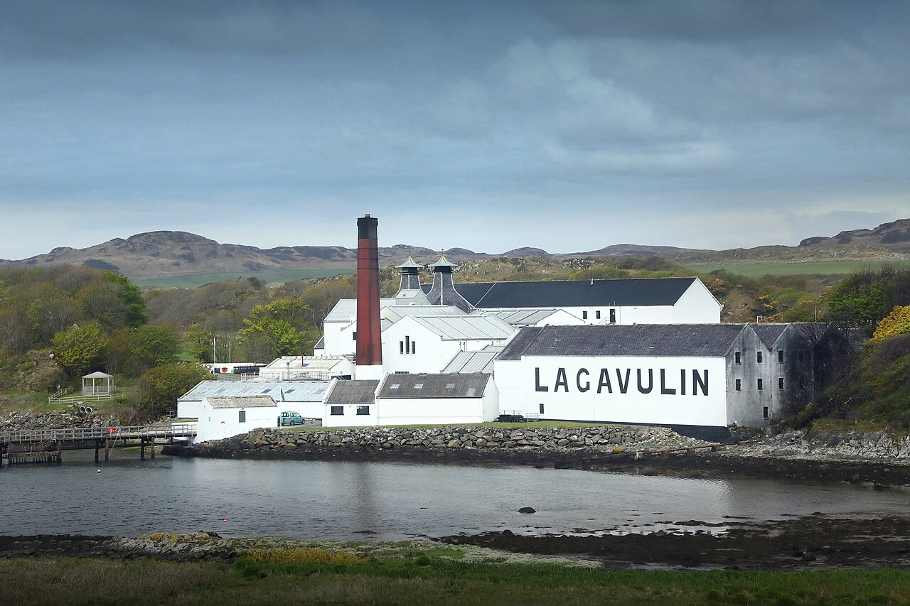

# 艾雷岛威士忌节 Fèis Ìle 2026

2026 年 5 月 22 日至 31 日，第 40 届 Fèis Ìle 在苏格兰艾雷岛举行。它是威士忌日历上最集中、也最难临时安排的一周：岛上各家蒸馏厂轮流开放，音乐会、盖尔语活动、徒步、钓鱼与社区晚餐穿插其间。活动已经结束，本页记录当届的日期、场地、开放日安排与参与规则。

图：艾雷岛威士忌节 Fèis Ìle 2026举办地区的一处实景。图片：Charlie Marshall，CC BY 2.0，via Wikimedia Commons（[原图页面](https://commons.wikimedia.org/wiki/File:2019-05-05_Lagavulin_Distillery.jpg)）。这张照片用于说明艾雷岛威士忌节 Fèis Ìle 2026所在城镇或产区的环境，不是当届活动现场。

## 活动是什么

Fèis Ìle 常被简称为“艾雷岛威士忌节”，但它首先是一个岛屿文化节。1986 年第一届举办时，节目以徒步、历史讲座、幻灯片、盖尔语 ceilidh 与戏剧为主，只有一场威士忌品鉴；后来蒸馏厂逐渐加入，才变成今天“每家酒厂一天开放日”的格式。2026 年的节目仍然保留社区面向：开幕式游行、家庭 ceilidh、钓鱼比赛、音乐演出与酒厂开放日并列，不是一张只面向酒商的品鉴表。

对访客来说，最重要的结构是“一天一厂”。岛上的蒸馏厂在十天里各自选一天做 open day，酒厂会安排参观、限定酒款、品鉴、餐车与现场音乐；有的开放日免费入场，有的需要买票，有的体验另收费用。把 Fèis Ìle 当成一个“买一张票就能喝遍全岛”的活动，会从一开始就安排错。

## 2026 年时间地点

- 会期：2026 年 5 月 22 日（周五）至 5 月 31 日（周日），共 10 天。
- 时区：Europe/London（英国夏令时，UTC+1）。
- 主会场：没有单一主会场，活动分布在艾雷岛各村与各家蒸馏厂；开幕式在 Port Ellen。
- 本页 `start` 取 5 月 22 日 00:00，`end` 取 5 月 31 日 23:59:59，用于界定会期；各场活动具体时刻见下。

2026 年的会期比往年更长：官方把结束日延伸到第二个周日，由 Islay Ales 与 Laggan Bay Distillery 接手。这是当届最明显的变化，也让住宿、渡轮与租车的压力向后多推了一天。开幕式在 5 月 22 日 17:00 从 Port Ellen 小学出发，沿 Frederick Crescent 游行至 Ramsay Hall；19:30 在 Ramsay Hall 有乡村音乐 ceilidh。这两场是社区活动，不是酒厂品鉴。

与任务点名的三家南岸酒厂，2026 年的开放日安排是：

- [乐加维林](ref:lagavulin)：5 月 23 日（周六）11:00–18:00，免费入场，品鉴与体验需另行预约；现场有音乐、威士忌与鸡尾酒吧、餐车。18 岁以上才能参加品鉴与体验，狗可以进厂区但不能进入体验或参观。
- [拉弗格](ref:laphroaig)：5 月 26 日（周二）10:00–16:30，免费入场，品鉴与体验需另行预约；同样是 18 岁以上才能参加品鉴与体验。
- [阿贝](ref:ardbeg)：5 月 30 日（周六）10:00–17:00，需要门票，门票可在线上或当天购买，体验也可当天安排；当届的 Final Fling 已售罄，由 Peat and Diesel 压轴。

三家酒厂都在 Port Ellen 以西的南岸，彼此距离不远；官方的 Three Distilleries Pathway 把 Port Ellen、拉弗格、乐加维林与阿贝串成一条步行路线。走路可以完成，但十天里天气、风力和路面状况变化很快，穿防水鞋比穿时装更重要。

## 历史与机制

Fèis Ìle 的起点是 1985 年。当时当地成立了一个委员会，目的是延长艾雷岛的夏季旅游季、给岛上的盖尔语文化找到年度聚点；1986 年第一届 Fèis Ìle 举办，节目以社区活动为主，只有一场威士忌品鉴。此后蒸馏厂陆续加入，开放日逐渐成为节日的核心，Fèis Ìle 也从“岛民自己的节日”变成全球威士忌爱好者会提前一年订房的朝圣周。2026 年是第 40 届，官方与酒厂都把“40 周年”作为当届的标识。

机制上，Fèis Ìle 由本地志愿者组成的委员会运营，是一个非营利组织；节日本身不收门票，收入来自活动票、赞助与周边，用于支持岛上的文化与社区项目。各家蒸馏厂的开放日由酒厂自己组织，票务也由酒厂或合作平台处理；2026 年的委员会与合作伙伴活动票务通过 Skiddle 销售。这个结构决定了信息是分散的：没有一张“总票”，也没有一个统一的入场口，必须逐场查酒厂公告。

另一个机制是“限定”。许多酒厂会在 Fèis Ìle 期间发布节日限定酒款或提供酒窖取酒体验，这些项目通常需要提前预约，数量有限。它们不是节日的全部，但在二手市场上被放大，容易让第一次来的人以为“没抢到限定就等于没来”。实际上，开放日的音乐、餐车、厂区参观与和海风一起排队聊天，才是这个节日最稳定的部分。

## 现场怎么参与

第一步是确认你参加的是哪一天、哪家酒厂。Fèis Ìle 的节目按天排列，同一天可能有两三家同时开放；如果你只有一天，应该按酒厂选择，而不是按“哪里能喝到最多”选择。第二步是订交通与住宿。艾雷岛没有铁路，主要靠渡轮与飞机；从 Kennacraig 或 Port Ellen 进岛，渡轮在节日期间很满，租车也要提前。岛上公交覆盖有限，酒厂之间打车方便但高峰时难叫，官方页面会列出当地出租车电话。

第三步是区分“入场”与“体验”。乐加维林与拉弗格的开放日免费入场，但品鉴、参观与特殊体验要单独预约；阿贝的开放日需要门票，Final Fling 另行售票。所有品鉴与体验都限制 18 岁以上，入口处会查证件。不要为未成年人买品鉴票，也不要把“免费入场”理解成“免费喝酒”。

第四步是安排饮酒与驾驶。艾雷岛道路窄、风大、单车道多，酒厂开放日之后不要开车。可以把住宿订在 Port Ellen 或 Bowmore，利用出租车、步行与官方接驳；如果住在偏远村庄，提前预约返程车辆。渡轮与航班会受天气影响，回程不要卡在最后一天的最后一般船。

## 酒与城市

艾雷岛的威士忌形象建立在泥煤、海风与南岸三家酒厂的风格差异上。乐加维林 1816 年由 John Johnston 创立，以重泥煤、梨形蒸馏器与 16 年单一麦芽闻名；阿贝 1815 年取得执照，经历关闭与重开，今天以重泥煤与 Old Kiln Cafe 的访客体验著称；拉弗格 1815 年由 Johnston 兄弟创立，厂区紧邻 Kilbride 溪与海，游客中心与预约制参观是它的主要入口。三家酒厂在同一条南岸路线上，却各自强调不同的发酵、蒸馏与陈酿选择，这正是 Fèis Ìle 开放日最有价值的地方：你可以在几天内用同一片海风作背景，比较三种重泥煤的表达。

对岛屿来说，威士忌节不是单纯的旅游生意。它把住宿、餐饮、交通、音乐与盖尔语活动绑在一起，给冬季安静的岛带来一年中最集中的现金流；但同时也带来房价、渡轮运力与环境承载的压力。2026 年把会期延长到十天，一方面分散了人流，另一方面也把压力拉长。理解这个张力，才不会把 Fèis Ìle 写成一张“酒厂打卡清单”。

## 争议与边界

第一，“节日免费”不等于“所有活动免费”。Fèis Ìle 本身不卖门票，但酒厂开放日的门票、品鉴、参观、Final Fling 与限定酒款都要单独付费或预约。2026 年阿贝的开放日需要门票，乐加维林与拉弗格免费入场但体验收费，三种模式并存。

第二，开放日不是“随时可进”。每家酒厂只有一天，时间固定；乐加维林 11:00–18:00、拉弗格 10:00–16:30、阿贝 10:00–17:00 都是当届公告，下一届会变。不要用 2026 年的时间表安排 2027 年的行程。

第三，限定酒款与 Final Fling 的售罄容易被二手市场放大。2026 年阿贝的 Final Fling 已售罄，主办方明确说由 Peat and Diesel 压轴；这类信息应以官方票务页为准，不要相信“内部票”。

第四，天气与交通是硬约束。渡轮、航班、道路与步行路线都可能因风雨调整；把行程排得太满，反而会错过开放日。岛上医疗与救援资源有限，饮酒后不要徒步走海岸线。

第五，届次与日期。2026 年是第 40 届，首届在 1986 年；2026 年会期是 5 月 22 日至 31 日，首次延伸到第二个周日。2027 年官方已经公布为 5 月 28 日至 6 月 6 日，说明日期每年变动，不能套用。

本页图片为 Fèis Ìle 期间艾雷岛酒厂的现场图，图注逐张署名；各酒厂活动分散在岛上，未绘制统一接驳地图。三家酒厂都在南岸，地址与相对位置已在地点页中说明；Fèis Ìle 的节目分布在整座岛，单张示意图无法同时表达渡轮、道路与每日开放日，因此不绘制路线图。

## 另见

- [乐加维林蒸馏厂](ref:lagavulin)：1816 年创立、重泥煤风格、导览与 Warehouse No.3。
- [拉弗格蒸馏厂](ref:laphroaig)：1815 年创立、南岸海风与预约制参观。
- [阿贝蒸馏厂](ref:ardbeg)：1815 年执照、重泥煤风格与 Old Kiln Cafe。
- [艾雷岛](ref:islay)：产区、泥煤与海岛威士忌的地理背景。
- [苏格兰威士忌](ref:scotch)：苏格兰威士忌的法规、产区与风格框架。
- [地方与工艺](ref:process)：风土、蒸馏与陈酿如何塑造酒的风格。
