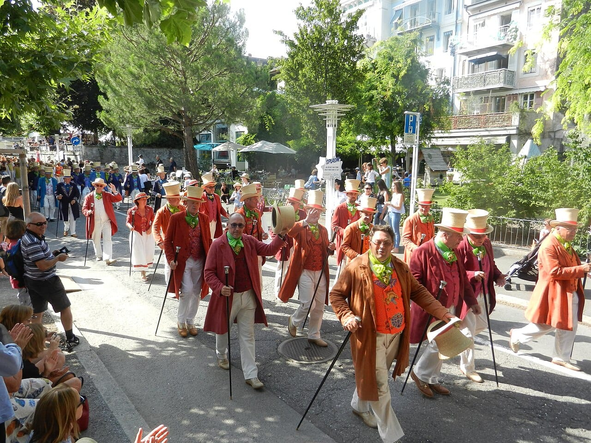

# 沃韦葡萄种植者节：一代人只办一次的葡萄酒节

大多数葡萄酒节一年一次，沃韦葡萄种植者节不是。它由沃韦的葡萄种植者兄弟会（Confrérie des Vignerons）组织，大约每一代人办一次，间隔在 14 到 28 年之间。最近一届在 2019 年举行，下一届要再等约二十年。它不是酒展，也不是品鉴会，而是一场把葡萄种植、采收、酿酒与地方生活编成露天表演的节庆。

图：2019 年沃韦葡萄种植者节的兄弟会游行；画面不是露天剧场内部，也不代表下一届的安排。图片：Beat Ruest，CC BY-SA 4.0，via Wikimedia Commons（[原图页面](https://commons.wikimedia.org/wiki/File:F%C3%AAte_des_Vignerons_Vevey_2019_-_Cort%C3%A8ge_de_la_Confr%C3%A9rie_des_Vignerons_(2).jpg)）。

## 一代人一次的节

“每代人一次”不是营销话术，而是组织的节奏。兄弟会每次办节都要重新搭建露天剧场、组织数千名表演者、训练合唱与乐队、制作服装与道具，并协调沃韦市、沃州政府、赞助商与居民。这样的规模无法年年复制，所以它选择以“代”为单位。

这也意味着它不是一个可以随时买票参加的旅游产品。每一届的日期、导演、剧本、音乐与舞台设计都不同；错过一届，可能要等二十年。2019 年之后，主办方明确表示下一届要等约二十年。这种稀缺性让它成为沃韦地方身份的一部分，也让研究者和游客必须把“届次”说清楚。

## 1797 年与更早的游行

兄弟会的历史可以追溯到 17 世纪。1648 年已有节庆记载，早期形式是兄弟会年度集会时的游行（pourmenade），后来演变为“bravade”。1797 年通常被视为第一届“真正的”葡萄种植者节，因为它把游行、表演与葡萄种植者的加冕仪式结合在一起。

19 世纪以后，节庆逐渐加入大型露天剧场、合唱、管弦乐与历史场景。20 世纪的几届引入了现代舞台技术，但核心仍然是“给葡萄种植者加冕”：在节庆中评选并表彰优秀种植者，把酿酒人的劳动放到舞台中央。这个仪式比明星表演更重要，它解释了节庆为什么属于葡萄种植者，而不是属于旅游局。

## 沃韦与拉沃

沃韦（Vevey）位于瑞士沃州，濒临日内瓦湖，背后是拉沃（Lavaux）梯田葡萄园。拉沃于 2007 年被列入 UNESCO 世界文化遗产，葡萄种植者节则在 2016 年被列入 UNESCO 人类非物质文化遗产。两个身份相互支撑：一个保护景观，一个保护活态传统。

拉沃的梯田由中世纪修道院与葡萄种植者逐步修建，今天仍以人工方式维护。葡萄种植者节把这片景观里的劳动、季节与社群关系搬上舞台，让观众看到葡萄酒不只是商品，也是地方记忆。节庆场地在沃韦集市广场，临时搭建的露天剧场面向日内瓦湖，观众席与舞台都是临时的。

## 2019 年一届

2019 年一届从 7 月 18 日持续到 8 月 11 日，共 21 场演出。露天剧场有约 20,000 个座位，舞台面积约 14,000 平方米，约 5,500 名表演者参与，包括合唱团、乐队、舞者、杂技演员与本地志愿者。导演是 Daniele Finzi Pasca，音乐由 Maria Bonzanigo、Jérôme Berney 与 Valentin Villard 创作。

演出分日场与夜场，内容围绕葡萄种植的年度循环、拉沃的地景、地方历史与神话展开。开幕场包含种植者加冕仪式，传统上在清晨举行。门票按场次出售，部分场次售罄；同期还有城市里的街头表演、展览与音乐会。2019 年之后，主办方与沃韦市都面临如何把舞台、服装与档案保存下来的问题。

## 谁在组织

组织者是 Confrérie des Vignerons，一个位于沃韦的非营利兄弟会，成员来自葡萄种植者、酒商与地方社群。兄弟会负责节庆的总体方向、种植者评选与仪式；每一届会聘请艺术总监、作曲家、编舞、舞台设计师与制作团队。沃韦市与沃州政府提供场地、许可、交通与部分资金，赞助商与门票收入分担成本。

这种结构让节庆既保持地方性，又具备专业制作水准。兄弟会不是政府机构，也不是商业公司；它的合法性来自历史、会员与地方认可。节庆的账目、门票与赞助安排逐届公布，但完整财务细节不一定公开，引用数字时要看出处。

## 它为什么被 UNESCO 记住

UNESCO 看中的不是“场面大”，而是活态传承：葡萄种植知识、梯田维护、节庆仪式、音乐与服装如何在家庭、兄弟会与地方社群中传递。节庆把葡萄种植者的劳动变成公共表演，让年轻一代在参与中学习，这是它与其他葡萄酒节最大的区别。

它也为葡萄酒文化提供了一个非商业化的样本。大多数酒节以销售与旅游为目标，葡萄种植者节以“加冕种植者”为核心，商业赞助只是支撑。它提醒人们：葡萄酒节的根可以是农业与社群，而不只是品牌与流量。

## 边界与常见误读

第一，它不是年度活动。把 2019 年当成“每年 7 月举行”是错的；下一届要等约二十年。第二，它不是酒展。现场不以品鉴与销售为核心，重点是表演与仪式。第三，它不是“瑞士全国节日”。它属于沃韦与拉沃地方，其他瑞士城市有各自的葡萄节。第四，它不是免费活动。演出需要购票，城市活动与街头表演可能免费，但核心剧场不是。第五，UNESCO 列入不等于自动获得资金或法律保护，保护仍靠地方社群与政府。

常见误读还有：把“每代人一次”当成固定 25 年；把种植者加冕当成选美；把节庆当成旅游宣传片。更准确的理解是：它是一个由葡萄种植者兄弟会维护的活态传统，用露天表演把农业劳动、地方历史与社群记忆放在一起。想理解葡萄酒与风土的关系，可参考[风土](ref:terroir)；想理解节庆与酒的关系，可参考[酒与节庆](ref:festivals)；想核对国际葡萄与葡萄酒组织对葡萄酒产业的统计口径，可参考[OIV](ref:oiv)；想从一杯酒开始练习品鉴，可参考[第一次品鉴](ref:first-tasting)。它最终落在[葡萄酒](ref:wine)与拉沃的葡萄园上。

对照阅读：[葡萄酒](ref:wine)、[风土（terroir）](ref:terroir)。

相关条目：[酒与节庆：节令酒里的时间表](ref:festivals)。

**关键事实。**

| 项目 | 内容 |
| --- | --- |
| 一句话定位 | 沃韦葡萄种植者节（Fête des Vignerons）由沃韦的葡萄种植者兄弟会组织，1797 年首次以“真正的节庆”形式举行，此后大约每一代人办一次，间隔在 14 到 28 年之间；它把葡萄种植、采收、酿酒与地方生活编成一场露天表演，2016 年被 UNESCO 列入人类非物质文化遗产 |
| 日期 | 2019-07-18–2019-08-11 |
| 官网 | fetedesvignerons.ch |
