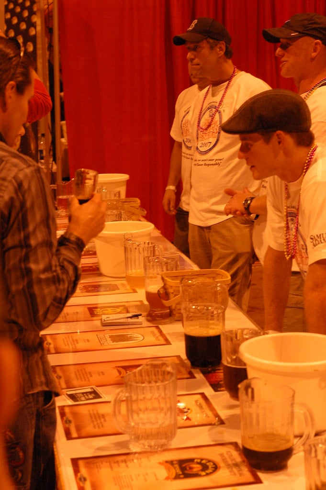

# 美国大啤酒节：从 1982 年的酒店聚会到户外啤酒节

美国大啤酒节（Great American Beer Festival，GABF）常被叫作“美国精酿啤酒的年度聚会”。它既是消费者可以买票参加的啤酒节，也是酒厂之间的专业比赛。2026 年，它第一次离开丹佛会议中心，搬到 Levitt Pavilion 的户外场地。理解 GABF，要看它如何从 1982 年的一场小型聚会，长成美国精酿行业的质量信号。

图：美国大啤酒节现场的一个典型展位，工作人员在长桌后为观众倒酒。图片：Herkie，CC BY-SA 2.0，via [原图页面](https://www.flickr.com/photos/44038067@N00/1603082280)。

## 美国精酿的年度聚会

GABF 由 Brewers Association 主办，定位是“美国最重要的饮料酒精节庆、专业比赛与文化现象”。现场有数百家酒厂带来上千款啤酒，观众可以品鉴、与酿酒师交流、参加讲座与活动。比赛部分由评委对参赛酒样打分，获奖名单在节庆期间公布。

它同时服务两类人：消费者来发现新酒、体验精酿文化；行业来参赛、学习、 networking 与做品牌展示。这种“公众节庆 + 专业比赛”的双重身份，让 GABF 与纯贸易展或纯酒节都不一样。

## 1982 年从博尔德开始

1982 年，GABF 在科罗拉多博尔德的 Harvest House 首次举行，作为 American Homebrewers Association 年会的一部分。首届只有 24 家酒厂、47 款啤酒与 800 名观众。它当时更像一个家酿与小型酒厂的聚会，而不是全国性赛事。

1984 年，GABF 移师丹佛；随着美国精酿啤酒运动扩张，参展酒厂与观众数量迅速增长。2000 年，它搬到 Colorado Convention Center，成为大型室内啤酒节。2022 年庆祝 40 周年。2026 年，它首次改为户外，在丹佛 Ruby Hill 社区的 Levitt Pavilion 举行。

## 丹佛与 Levitt Pavilion

丹佛是科罗拉多州首府，也是美国精酿啤酒的重镇。城市周边有大量酒厂，科罗拉多州在美国精酿版图上占有重要位置。GABF 长期在丹佛举办，与本地啤酒文化形成互相强化：酒厂把 GABF 当成年度主场，城市把 GABF 当成旅游与产业名片。

2026 年的 Levitt Pavilion 位于 Ruby Hill Park，是一个非营利音乐场地，拥有开阔草坪、城市天际线与露天舞台。户外场地让 GABF 可以加入现场音乐、餐车与更自由的动线，但也带来天气、交通与场地容量的新问题。主办方把 2026 年视为一次“重新想象”，不是简单的搬家。

## 2026 年一届

2026 年 GABF 于 10 月 10 日至 11 日举行，周六与周日各一场，时间均为 12:00 至 16:00。门票从 60 美元起，另有含 PAIRED 活动的套票；部分场次售罄。现场有数百家酒厂的啤酒、现场音乐、餐车、Stein hoisting 等活动。

与室内时期相比，2026 年的规模与动线都有变化。户外场地能容纳更多人，但也更依赖天气；演出与餐车增加节庆感，但品鉴体验可能受排队与空间影响。对第一次参加的人，建议先看展商名单与风格分布，不要试图“喝遍全场”。

## 比赛与啤酒风格

GABF 的比赛部分始于 1987 年，首届只有 12 个风格类别，后来扩展到上百个类别。评委按 Brewers Association 的 Beer Style Guidelines 打分，评估外观、香气、风味、口感与整体表现。参赛酒厂可以选择类别，类别策略会影响获奖概率。

比赛与节庆同期，但参赛不等于参展，获奖也不等于市场成功。对酒厂来说，GABF 奖牌是质量信号与营销素材；对消费者来说，奖牌是发现新酒的入口，但不是绝对排名。风格指南会随行业变化更新，比如加入无酒精啤酒类别，这说明“什么是好啤酒”的标准也在变。

## 谁在组织，谁在参展

主办方是 Brewers Association，一个代表美国小型与独立酿酒厂的贸易协会。它负责比赛规则、评委组织、票务、场地与媒体；参展酒厂付费或按会员资格参与，观众买票入场。赞助商与合作伙伴提供资金与活动支持。

这种结构让 GABF 与 BA 的行业议程紧密相连。BA 通过 GABF 推广“craft brewer”定义、啤酒风格与独立酒厂品牌；酒厂通过 GABF 获得曝光与奖项；消费者通过 GABF 进入精酿文化。三者形成循环，但也带来商业化的张力。

## 边界与常见误读

第一，GABF 不是“无限畅饮”。门票包含品鉴，但酒厂带来的是样品，醉酒闹事会被请出。第二，它不是“啤酒奥运会”。比赛按类别评审，奖项不是全球绝对排名。第三，参展不等于获奖，获奖也不等于所有风格都优秀。第四，2026 年的户外形式是一次尝试，不能把 Levitt Pavilion 当成永久场地。第五，GABF 主要面向美国酒厂，国际酒厂参与有限，不能把它当成“世界啤酒全景”。

常见误读还有：把 GABF 当成“家酿比赛”（它面向商业酒厂，家酿有单独赛事）；把 BA 的“craft”定义当成法律；把票务售罄当成“活动失败”。更准确的理解是：GABF 是美国精酿啤酒的年度节庆与专业比赛，用公众品鉴与行业评审把酒厂、酿酒师与消费者连接起来。想练习啤酒品鉴，可参考[啤酒品鉴入门](ref:beer-tasting)；想读懂标签，可参考[酒标很小，线索不少](ref:read-a-label)；想了解“精酿”在美国行业语境中的定义，可参考[精酿啤酒](ref:craft-beer)；想理解节庆与酒的关系，可参考[酒与节庆](ref:festivals)。它最终落在[啤酒](ref:beer)与美国精酿行业上。

对照阅读：[啤酒](ref:beer)、[2015 年前后的中国精酿啤酒兴起](ref:craft-beer)。

相关条目：[啤酒品鉴入门：从香气、酒体到苦度](ref:beer-tasting)。

**关键事实。**

| 项目 | 内容 |
| --- | --- |
| 一句话定位 | 美国大啤酒节（Great American Beer Festival，GABF）1982 年在科罗拉多博尔德的 Harvest House 首次举行，当时只有 24 家酒厂、47 款啤酒与 800 名观众；它由 Brewers Association 主办，是美国最重要的精酿啤酒节与赛事之一 |
| 日期 | 2026-10-10–2026-10-11 |
| 官网 | greatamericanbeerfestival.com |

**来源与边界。** 本页关于「美国大啤酒节：从 1982 年的酒店聚会到户外啤酒节」的关键事实，主要由以下来源交叉核对：Great American Beer Festival；Brewers Association（1982 年首届在 Boulder Harvest House、24 家酒厂 47 款啤酒 800 名观众、2026 年移师 Levitt Pavilion；2026 年 10 月 10 日至 11 日、Levitt Pavilion、周六周日 12:00–16:00 两场、票价 60 美元起）、Brewers Association（Brewers Association 主办、2026 年 10 月 10 日至 11 日、Levitt Pavilion 与丹佛；GABF 比赛自 1987 年开始、首届仅 12 个风格类别、风格指南随行业更新）。产品、地址或营业状态变化较快时，以 greatamericanbeerfestival.com 的最新页面为准；价格、批次与状态会变，涉及这些字段时以页面所列来源的最新版本为准。正文为项目自写，来源只作核验，不复制原文。

**并读。** 把「美国大啤酒节：从 1982 年的酒店聚会到户外啤酒节」与「啤酒」、「啤酒品鉴入门：从香气、酒体到苦度」、「2015 年前后的中国精酿啤酒兴起」放在一起读时，先确认它们是同一层级还是上下游关系：先确认届次与场地，再比较展期、票务与活动结构。本页负责给出活动的基本坐标，对照条目补上具体案例与差异；读完再回到本页，才能分清哪些差别属于活动本身，哪些只是产地、批次或品牌选择。
