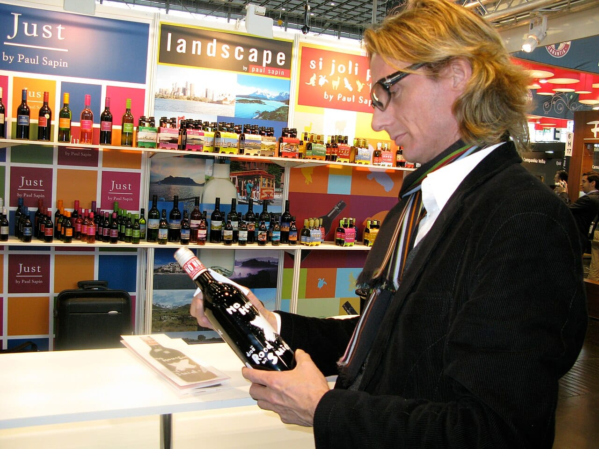

# ProWein：杜塞尔多夫的三月，葡萄酒与烈酒的交易场

ProWein 是葡萄酒行业每年三月的重要约会。它在杜塞尔多夫展览中心举行，只对行业观众开放，展商来自全球产区，买家来自零售、餐饮、进口与分销。它不是一个让消费者买票喝酒的节庆，而是一个把供给与需求放在同一栋展馆里的交易场。理解 ProWein，要看它的“专业观众”边界与 1994 年以来的扩张。

图：杜塞尔多夫 ProWein 展会现场；画面不是某一届的官方记录，也不代表 2027 年展商名单。图片：FLY2005，CC BY 2.0，via Wikimedia Commons（[原图页面](https://commons.wikimedia.org/wiki/File:Prowein_%C3%A0_D%C3%BCsseldorf.jpg)）。

## 不是品酒会，是 trade-only 展会

ProWein 的官方定位是国际葡萄酒与烈酒专业展会。它只对 trade visitors 开放，包括酒商、进口商、分销商、餐厅与酒店采购、媒体与行业机构。普通消费者不能随便买票入场，这一点把它与酒节、酒庄开放日区分开来。

展会现场有大量品鉴，但品鉴是商务工具，不是娱乐项目。展商用样品让买家判断品质、价格与市场匹配度；买家在几天内走完多个产区，比较风格与报价。展会还设有论坛、讲座与趋势发布，帮行业理解市场变化。它的核心是“做生意”，不是“过节”。

## 1994 年从 ProVins 开始

ProWein 1994 年首次举办，当时名字是 ProVins，灵感来自前一年在杜塞尔多夫办的一场法国葡萄酒小型展示。首届于 1994 年 2 月 23 日至 24 日举行，只有 321 家展商、1,517 名观众，全部展商挤在一个展馆里，来自德国、法国、希腊、意大利、哥伦比亚、奥地利、葡萄牙、西班牙与匈牙利。

1995 年第二届扩展到两个展馆、532 个展位；名字也改为 ProWein，以适配不同语言。此后它逐步增加烈酒、起泡酒、无酒精与低酒精品类，成为覆盖全品类的大型展会。2027 年一届定于 3 月 7 日至 9 日，主办方同时调整定位，强调“Focus. Proximity. Industry.”。

## 杜塞尔多夫与三月档期

杜塞尔多夫是德国北莱茵-威斯特法伦州的首府，位于莱茵河畔，靠近德国、比利时与荷兰的边界。它是德国重要的展览城市，Messe Düsseldorf 拥有大型展馆与交通配套。三月档期在葡萄酒行业的年度节奏里有特殊位置：南半球采收刚结束，北半球新酒还在窖中，买家可以同时评估新旧世界的供应。

三月也是欧洲春季展会密集期，ProWein 与周边的葡萄酒活动形成“行业周”。参展商与买家通常会把杜塞尔多夫与巴黎、伦敦、米兰的行程串起来。对产区来说，三月是发布新酒、寻找进口商与测试市场反馈的窗口；对买家来说，是锁定全年采购计划的关键节点。

## 展区与品类

ProWein 的展区按产区与品类组织，覆盖静态葡萄酒、起泡酒、香槟、烈酒、无酒精与低酒精饮品，以及酒具、包装、软件与服务。展商从大型酒庄到小型生产者都有，部分产区以国家馆或地区馆的形式集中展示。展会还设有“Village”之类的主题区，给小生产者与新兴品类更多曝光。

近年展会增加了烈酒与无酒精板块，反映消费结构的变化。葡萄酒仍然是核心，但“只做葡萄酒”的定位已经不够。对买家来说，这意味着可以在同一场展会里比较葡萄酒、烈酒与无酒精替代品；对展商来说，意味着竞争不再只来自同一品类。

## 谁在组织，谁在参展

主办方是 Messe Düsseldorf，一家德国展览公司。它负责场地、招商、观众组织、媒体与现场运营；展商付费租展位，买家免费或低价注册，媒体与行业机构通过认证入场。展会不以门票为主要收入，展位费与赞助是核心。

这种商业模式决定了展会的气质：它服务的是贸易，不是公众。展商会投入大量预算搭建展台、运输样品、安排人员；买家会安排采购与谈判日程。展会的成功指标不是“来了多少人”，而是“成交与后续联系有多少”。这也是它与其他酒节最大的区别。

## 它为什么是欧洲领先

ProWein 的优势来自规模、地理位置与专业性。规模让买家能在一个地方看到全球产区；地理位置让欧洲买家容易到达；专业性让展会保持 trade-only 的边界，不被游客稀释。它还与 OIV、产区协会、媒体与行业机构合作，发布趋势与数据，增强内容权重。

对产区来说，ProWein 是进入欧洲市场的重要门槛；对买家来说，它是年度选品的集中地；对行业媒体来说，它是观察风向的场所。它的影响力不是来自“最好喝”，而是来自“最集中”。

## 边界与常见误读

第一，它不是消费者活动。没有 trade 身份不能随意入场，买票也不等于能进所有展区。第二，它不是“葡萄酒节”。没有街头表演、音乐节与大众品鉴，核心是商务。第三，展会上的品鉴不是质量认证。展商展示的是样品，买家需要自己判断，不能把“参展”当成“获奖”。第四，展位大小不等于品质。大展台可能来自大品牌或产区协会，小展台也可能有优秀生产者。第五，日期与展馆每年可能调整，2027 年的 3 月 7 日至 9 日只适用于当届。

常见误读还有：把 ProWein 当成“德国葡萄酒展”（它覆盖全球）；把“专业观众”当成“只要报名就能进”；把展会上的价格当成零售价。更准确的理解是：它是欧洲领先的葡萄酒与烈酒交易会，用集中展示与商务匹配服务行业。想读懂酒标，可参考[酒标很小，线索不少](ref:read-a-label)；想理解产区差异，可从[风土](ref:terroir)入手；想核对国际葡萄与葡萄酒组织的行业口径，可参考[OIV](ref:oiv)；想区分交易会与面向公众的酒节，可参考[酒与节庆](ref:festivals)。它最终服务的是[葡萄酒](ref:wine)的全球贸易。

相关条目：[葡萄酒](ref:wine)、[风土（terroir）](ref:terroir)、[酒标很小，线索不少](ref:read-a-label)。

**关键事实。**

| 项目 | 内容 |
| --- | --- |
| 一句话定位 | ProWein 1994 年以 ProVins 之名在杜塞尔多夫首次举办，当时只有 321 家展商、1,517 名观众与一个展馆；今天它是欧洲领先的葡萄酒与烈酒专业展会，只对行业观众开放 |
| 日期 | 2027-03-07–2027-03-09 |
| 官网 | prowein.com |

**来源与边界。** 本页关于「ProWein：杜塞尔多夫的三月，葡萄酒与烈酒的交易场」的关键事实，主要由以下来源交叉核对：Messe Düsseldorf（1994 年首办、每年三月在杜塞尔多夫举行、欧洲领先葡萄酒与烈酒专业展会、2027 年 3 月 7 日至 9 日；杜塞尔多夫展览中心与主办方背景）、ProWein；Messe Düsseldorf（1994 年 2 月 23 日至 24 日首办、321 家展商、1,517 名观众、来自德国/法国/希腊/意大利/哥伦比亚/奥地利/葡萄牙/西班牙/匈牙利；ProWein 1994 年创立、2027 年 3 月 7 日至 9 日、以及展会定位调整）、OIV（国际葡萄酒行业统计、标准与市场背景）。产品、地址或营业状态变化较快时，以 prowein.com 的最新页面为准；价格、批次与状态会变，涉及这些字段时以页面所列来源的最新版本为准。正文为项目自写，来源只作核验，不复制原文。
