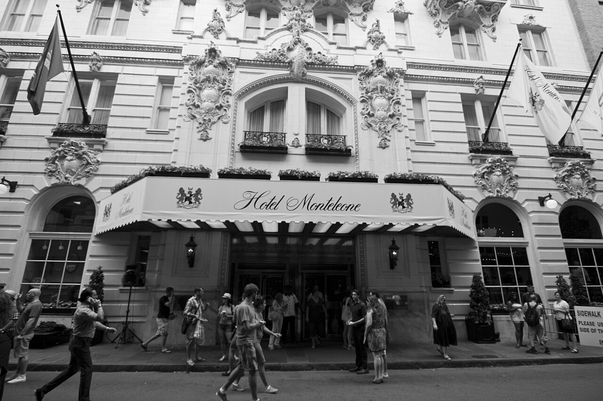

# Tales of the Cocktail：从一条酒吧步行路线长成的调酒行业年会

Tales of the Cocktail 的名字听起来像一场讲故事的酒会。它确实从故事开始：2002 年，新奥尔良的鸡尾酒爱好者 Ann Tuennerman 组织了一条参观历史酒吧的步行路线，边走路边讲每杯酒与每家店的故事。二十多年后，它变成全球调酒与烈酒行业最重要的年度会议之一。理解它，要看它如何从“本地导览”长成“行业基础设施”。

图：Tales of the Cocktail 在蒙特莱昂酒店的活动现场；画面不是 2026 年会议，也不代表当届日程。图：Dan Silvers，CC BY 2.0。。图片：Dan Silvers，CC BY 2.0，via Wikimedia Commons（[原图页面](https://commons.wikimedia.org/wiki/File:Tales_of_the_Cocktail_at_the_Hotel_Monteleone,_New_Orleans,_LA.jpg)）。

## 不是“喝酒大会”，是行业年会

Tales of the Cocktail 期间当然有大量品鉴与派对，但它的核心是教育、网络与奖项。会议设有 seminars、tastings、networking events、competitions 与 Spirited Awards，面向调酒师、蒸馏师、品牌代表、记者、酒吧经营者与调酒爱好者。白天是课程与讨论，晚上是品牌活动与社交，二者共同构成行业年度聚会。

它与普通酒展的区别在于“内容密度”。酒展以展台与样品为主，Tales 以议题与人的连接为主：一个调酒师可以在这里学到新技术、见到同行、讨论行业问题，也可以为品牌做展示。它不是政府主办的公共文化节，而是由非营利基金会组织的行业会议。

## 2002 年的步行导览

2002 年，Ann Tuennerman 在新奥尔良组织“New Orleans Original Cocktail Tour”，带人走访法国区的历史酒吧，讲鸡尾酒与城市的故事。2003 年 9 月，为庆祝导览一周年，她办了第一次 Tales of the Cocktail 聚会，规模很小，参加者包括调酒师、作家与爱好者。

2005 年卡特里娜飓风后，活动暂停，2006 年回到新奥尔良，并改到 7 月举行，以避免与飓风纪念日重叠。此后它逐年扩张，加入教育课程、比赛、奖项与更多品牌参与。2018 年，组织方成立 Tales of the Cocktail Foundation，把活动与全年教育、资助项目放在非营利框架下。

## 新奥尔良与法国区

新奥尔良是鸡尾酒历史的关键城市。法国区的酒吧、酒店与餐厅保存了许多经典鸡尾酒的故事，比如 Sazerac、Ramos Gin Fizz、Hurricane 与 Vieux Carré。Tales 选择在这里举办，不只是因为旅游吸引力，也因为城市本身提供了“鸡尾酒文化”的叙事场所。

会议场地分布在法国区的酒店与酒吧，The Ritz-Carlton New Orleans、Hotel Monteleone 等历史酒店常被使用。参与者白天在会议室与品鉴室之间移动，晚上在酒吧与派对之间移动。城市空间与会议内容相互强化：你在课堂听到的历史，走几条街就能看到对应的酒吧。

## 2026 年一届

2026 年第 24 届于 7 月 19 日至 24 日举行，主场地是 The Ritz-Carlton, New Orleans，主题为“Spark”。会议包含教育课程、品鉴、行业交流、品牌活动与 Spirited Awards；Spirited Awards 于 7 月 23 日颁发。门票分不同档位，部分活动需要单独预约。

Tales 的日程通常很密：同一时段有多个课程与品鉴，参与者要提前做选择；晚上有品牌派对与行业聚会，很多活动需要邀请或额外购票。对第一次参加的人来说，最重要的不是“喝到最多”，而是选好主题、留出交流时间、注意酒精与体力管理。

## 教育、奖项与社区

Tales 的教育内容覆盖调酒技术、原料、酒吧运营、品牌故事、可持续、包容与行业政策。课程形式包括讲座、工作坊、品鉴与圆桌，讲者来自酒吧、酒厂、媒体与学术机构。它不是资格认证课程，参与者不会因为听了几堂课就获得官方执照。

Spirited Awards 是行业奖项，覆盖酒吧、调酒师、品牌、媒体与教育项目。奖项由评审团评选，获奖对酒吧与个人的商业价值很高，但奖项不是质量保证，也不是终身称号。Tales 还通过基金会做资助、导师与社区项目，把会议收入与行业回馈连接起来。

## 谁在组织，钱从哪里来

组织者是 Tales of the Cocktail Foundation，一个非营利机构。收入来自门票、品牌赞助、活动合作与商品销售；支出包括场地、讲者、制作、人员与社区项目。品牌赞助在酒类会议中很常见，但主办方通常会把教育内容与品牌活动分开，避免把课程变成广告。

这种模式有张力。赞助让会议能够维持规模与低价票，但品牌影响力也可能渗透到内容与奖项。读者看到某场品鉴或某个奖项时，可以问：这是教育内容，还是品牌推广？主办方的编辑与评审规则是否公开？这些问题不是否定会议，而是理解它的商业结构。

## 边界与常见误读

第一，Tales 不是“喝酒比赛”。它有品鉴与派对，但核心是教育、网络与奖项。第二，它不是政府主办。主办方是非营利基金会，政府可能提供场地或旅游支持，但不决定内容。第三，门票不等于全部权限。很多活动需要单独预约或邀请，买一张通票不能进所有场次。第四，它不是“鸡尾酒界奥斯卡”。Spirited Awards 有影响力，但评审与类别有限，不能覆盖全球所有酒吧。第五，新奥尔良不是唯一举办地。Tales 有海外活动与品牌合作，但年度主会议仍在新奥尔良。

常见误读还有：把 Tales 当成“品酒旅游”；把赞助品牌当成主办方；把奖项当成绝对排名。更准确的理解是：它是一个由基金会组织的行业年会，用教育、奖项与社交把全球调酒社区聚在一起。想先了解调酒的基本逻辑，可参考[调酒，是另一种认识酒的方式](ref:cocktail-basics)；想理解节庆与酒的关系，可参考[酒与节庆](ref:festivals)；想从一杯酒开始练习品鉴，可参考[第一次品鉴](ref:first-tasting)；想理解一杯酒里的时间层次，可参考[一杯酒里的时间](ref:time-in-a-cup)；想比较鸡尾酒与啤酒的差别，可参考[啤酒](ref:beer)。它最终落在鸡尾酒文化与新奥尔良的城市生活上。

对照阅读：[调酒，是另一种认识酒的方式](ref:cocktail-basics)、[第一口，先别急着下结论](ref:first-tasting)。

相关条目：[酒与节庆：节令酒里的时间表](ref:festivals)。

**关键事实。**

| 项目 | 内容 |
| --- | --- |
| 一句话定位 | Tales of the Cocktail 2002 年由 Ann Tuennerman 在新奥尔良发起，最初是一条参观历史酒吧的步行路线，后来发展为全球调酒与烈酒行业的年度会议；2026 年第 24 届于 7 月 19 日至 24 日在新奥尔良举行，包含教育课程、品鉴、社交活动与 Spirited Awards |
| 日期 | 2026-07-19–2026-07-24 |
| 官网 | talesofthecocktail.org |

**来源与边界。** 本页关于「Tales of the Cocktail：从一条酒吧步行路线长成的调酒行业年会」的关键事实，主要由以下来源交叉核对：Tales of the Cocktail Foundation（2026 年 7 月 19 日至 24 日、第 24 届、The Ritz-Carlton New Orleans 与主题 Spark；2002 年起源、从步行导览到全球鸡尾酒会议、法国区与教育/品鉴/奖项结构）、New Orleans & Company（新奥尔良法国区、酒店与鸡尾酒文化背景）。产品、地址或营业状态变化较快时，以 talesofthecocktail.org 的最新页面为准；价格、批次与状态会变，涉及这些字段时以页面所列来源的最新版本为准。正文为项目自写，来源只作核验，不复制原文。
