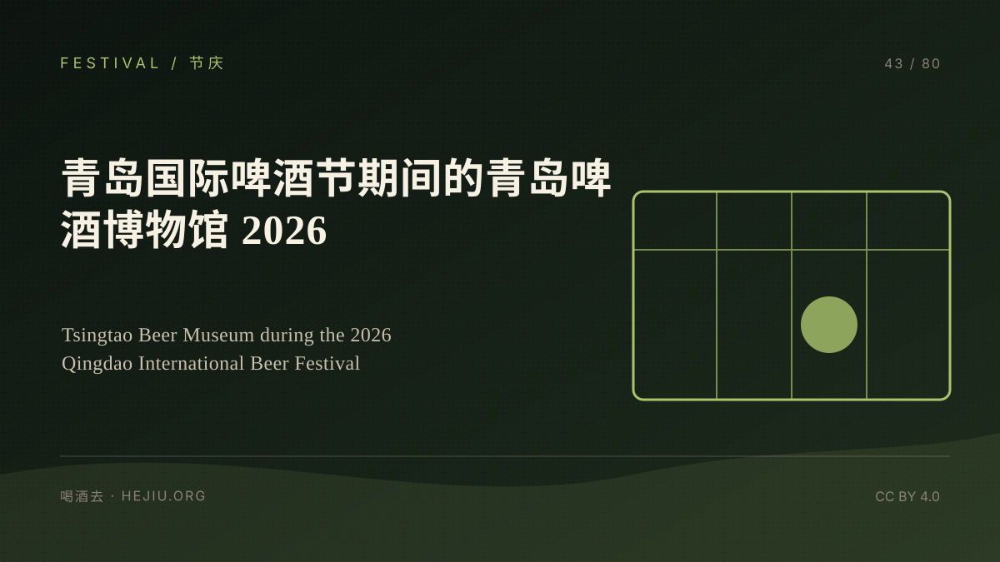

# 青岛国际啤酒节期间的青岛啤酒博物馆 2026

第 36 届青岛国际啤酒节于 2026 年 7 月 17 日至 8 月 15 日举办，为期 30 天。啤酒节的主会场在西海岸、崂山与青岛老城，青岛啤酒博物馆不在会场名单内，但它位于市北区登州路，是啤酒节期间最容易被顺路安排的一站：博物馆按暑期时段开放，并运行《金色奇妙夜》夜游。活动已经结束，本页记录 2026 年当届的开放安排、购票方式与边界。

图：青岛国际啤酒节期间的青岛啤酒博物馆 2026栏目示意图。项目自产或类别插图，用于啤酒语境，不是该对象的实拍。

> **先给结论**
> **一句话：** 这页判断：青岛国际啤酒节期间的青岛啤酒博物馆 2026，现在是什么状态，以及现场怎么参与。
>
> - **适合谁：** 想了解青岛国际啤酒节期间的青岛啤酒博物馆 2026的现场、机制和当届状态的人。
> - **不适合谁：** 只查当届票务或实时安排、不看活动边界的人。
> - **先看这两点：**
>   - 青岛国际啤酒节从 1991 年首届举办，到 2026 年已是第 36 届。
>   - - 啤酒节会期：2026 年 7 月 17 日至 8 月 15 日。

## 活动背景

青岛国际啤酒节从 1991 年首届举办，到 2026 年已是第 36 届。青岛市政府在 2026 年 6 月 26 日的新闻发布会上公布会期：7 月 17 日至 8 月 15 日，为期 30 天。官方表述把本届啤酒节写成“全域统筹、多点联动”，设西海岸、崂山、青岛老城三大会场，延续“青岛与世界干杯”的主题。三大会场继续实行免门票入园，这一点与博物馆的票务是两套系统。

青岛啤酒博物馆在 2003 年 8 月 15 日开馆，馆址是 1903 年德资啤酒厂的原址。它既是国家一级博物馆，也是仍在运转的啤酒厂参访点：老设备、德式工业建筑与玻璃后的自动化产线被放在同一条参观线上。博物馆的常规开放时间按季节分档；暑期 7 月至 8 月是全年开放时间最长的一段，因此啤酒节与博物馆的高峰期自然重叠。

官方文旅推荐把“打卡青啤博物馆的‘金色奇妙夜’”写进啤酒节玩法。这句话说明博物馆在啤酒节期间的角色：它不是啤酒节的分会场，也不是凭啤酒节门票就能进入的展馆，而是城市在节庆期间推荐的一处夜间文旅项目。白天看工业遗产与生产线，晚上看夜游，构成一条与主会场不同的路线。

## 时间与地点

- 啤酒节会期：2026 年 7 月 17 日至 8 月 15 日。
- 博物馆暑期开放：7 月 1 日至 8 月 31 日，07:30 起入馆，18:30 停止入场。
- 夜游入场：7 月 19:30–21:00；8 月 19:00–21:00。
- 地点：[青岛啤酒博物馆](ref:tsingtao-museum)，青岛市市北区登州路 56 号。
- 时区：Asia/Shanghai。
- 本页 `start` 与 `end` 取啤酒节首日 00:00 与末日 23:59:59，用于界定节庆档期；博物馆与夜游的具体入场时刻见上。

这里需要处理一处口径差异。青岛啤酒博物馆 2026 年 6 月 9 日通过微信公众号发布的公告写：7 月至 8 月博物馆入馆时间为 07:30–18:30；8 月《金色奇妙夜》入场时间为 19:00–21:00。博物馆官网“参观须知”页则写：7 月 1 日至 8 月 31 日 07:30–19:30，18:30 停止入场。两处来源对“闭馆时间”的写法不一致，但对“07:30 开始入馆、18:30 停止入场”是一致的。本页按更保守的 18:30 停止入场来写，并提醒读者以出行当日的官方公告为准。

## 参与方式与票务

博物馆实行线上分时段购票与实名制检票。官方公告要求游客提前通过“青岛啤酒博物馆”微信公众号购票，也可在 OTA 平台搜索“青岛啤酒博物馆”预约；入馆时凭本人二代身份证、购票二维码等原件核验。购票时如果所选时段显示“不可约”，表示该时段已约满，现场也没有票可售，不能临时进馆。这条规则在啤酒节期间尤其重要：暑期与周末的时段会比平日更早售罄。

普通票的免票群体包括 70 周岁及以上老人、1.4 米及以下儿童（需成人陪同）、残疾人、现役军人、退休军人、持山东惠才卡的高层次人才与消防人员；60–69 周岁老人、全日制本科及以下且 23 岁及以下学生、退役军人可购买半价或优待票。完整票种、价格与证件要求以购票页和现场公示为准，本页不写固定票价。

《金色奇妙夜》是单独售票的夜游项目。博物馆夜游页面把它描述为首个啤酒主题行浸式演绎夜游，包含 5 大沉浸式故事场景、18 个精灵角色与 600 秒 3D mapping 秀，页面标价 300 元。这个价格是页面显示价，可能随票种、渠道与场次变化；夜游也不是普通参观票的附赠项目，买白天门票不等于能进夜游。

啤酒节本身免门票，但“免门票”只适用于啤酒节会场，不适用于博物馆。博物馆的参观票、夜游票与啤酒节会场消费是三套独立的票务与计价系统。把“啤酒节免费”理解成“博物馆也免费”，是这一档期最常见的误解之一。

## 现场与规则

白天参观建议预留两到三小时。先看百年历史文化区，把 1903 年以来的时间线走完；再看生产工艺流程区，重点看老电机、糖化锅、煮沸锅与玻璃后的自动化产线；最后到体验区做互动、品鉴或定制酒标。啤酒节期间人流增加，旅行团常集中在上午十点到下午三点，想避开拥堵，应选择开馆后一小时或下午三点以后入场。

夜游的节奏与白天不同。官方给出的入场窗口是 7 月 19:30–21:00、8 月 19:00–21:00；这是入场时间，不是散场时间。夜游在灯光与投影环境中进行，路线、场次与集合方式按当日票面与现场指引走。不要用白天参观的动线去推演夜游路线，也不要在非开放区域停留拍照。

馆内规则比较具体：生产区有安全与卫生要求，不能自行进入；老设备、档案与展品不要触摸，展馆可能对闪光灯或拍摄范围有限制；不要把通道堵在楼梯口拍照，高峰时后面的人流会积压。带小孩的家庭要看管好孩子，品鉴环节要遵守年龄规定，未成年人不饮酒；品鉴后不要驾车，青岛老城路况复杂，酒后排险与找路都麻烦。

博物馆门口的登州路啤酒街是餐饮消费区，与博物馆不是同一个入口、同一套票。啤酒节期间，啤酒街的晚间热闹与博物馆闭馆时间并不重合：博物馆 18:30 停止入场，夜游另按 19:30 或 19:00 的窗口入场。把“晚上去啤酒街”当成“晚上还能看馆”，会白跑一趟。交通上，地铁 1 号线、2 号线台东站与 1 号线广饶路站、2 号线利津路站都在步行范围内；老城区道路窄、停车位有限，地铁加步行比自驾稳妥。

## 核验状态与边界

本页的日期链条是清楚的：青岛市政府 2026 年 6 月 27 日报道确认第 36 届啤酒节 7 月 17 日至 8 月 15 日；青岛市文化和旅游局 7 月 20 日的玩法推荐在同一会期内点名博物馆“金色奇妙夜”；博物馆 6 月 9 日公告给出 7 月至 8 月的入馆与夜游入场时间；博物馆官网“参观须知”与夜游页面补充实名购票、免票群体与夜游内容。五处来源中，四处带官方域名或官方公众号转载，日期与场所信息可以交叉核对。

边界有四条。第一，本页记录的是 2026 年当届安排，活动已经结束；2027 年的啤酒节日期、博物馆暑期时段与夜游排期都应以当届公告为准。第二，博物馆官网“参观须知”与 6 月公告对 7 月至 8 月闭馆时间的写法不一致，本页按 18:30 停止入场来写，不把 19:30 当成保证。第三，夜游页面标价 300 元只是页面显示价，票种、渠道与场次可能不同，本页不写“统一票价”。第四，啤酒节会场免门票不等于博物馆免票，博物馆也不在啤酒节三大会场名单内，本页不把两者混成一个活动。

本页图片为青岛国际啤酒节期间青岛啤酒博物馆现场图，图注逐张署名；节庆场地分布在博物馆与周边街区，未绘制人流路线图。博物馆是固定建筑，地址与步行路线已在地点页中说明；啤酒节会场分散在西海岸、崂山与老城，单张示意图无法同时表达三处会场与博物馆的关系，因此不绘制路线图。

相关条目：[酒与节庆：节令酒里的时间表](ref:c-extra-1)、[啤酒](ref:c-extra-2)、[青岛啤酒](ref:c-extra-3)。

## 另见

- [青岛啤酒博物馆](ref:tsingtao-museum)：了解 1903 年厂址、三大展区、德式工业建筑、常规开放时间、票务与交通。
- 青岛国际啤酒节的会场、节目与交通安排，以青岛市政府与青岛市文化和旅游局当届公告为准；本页只处理啤酒节期间博物馆的开放与夜游安排。

啤酒节场次、票务与场地以青岛啤酒博物馆与主办方的公告为准；本页核验于 2026-11-08。

补充阅读：[酒与节庆：节令酒里的时间表](ref:c-extra-1)、[啤酒](ref:c-extra-2)、[青岛啤酒](ref:c-extra-3)。
