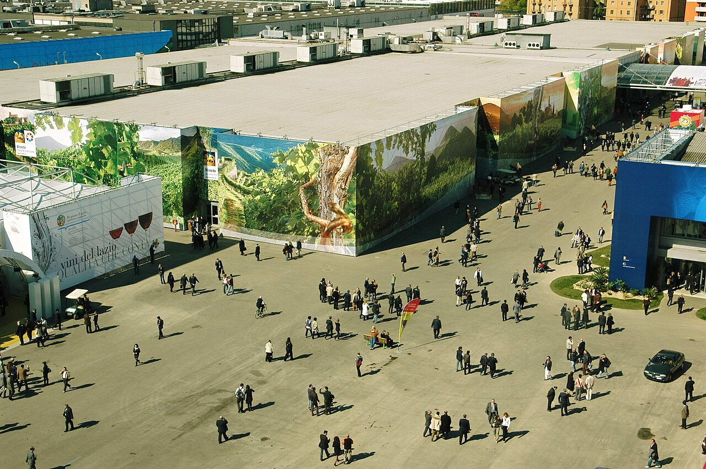

# Vinitaly：维罗纳的意大利葡萄酒年度展台

Vinitaly 是意大利葡萄酒行业每年四月的中心舞台。它在维罗纳展览中心举行，由 Veronafiere 主办，展商以意大利酒庄为主，买家与媒体来自全球。它不是一个面向公众的葡萄酒节，而是意大利酒庄与国际市场之间的交易与展示平台。理解 Vinitaly，要看它从“意大利葡萄酒日”到“国际展会”的演变。

图：维罗纳展览中心 Vinitaly 展馆俯瞰；画面不是某一届的官方现场记录，也不代表 2026 年展商名单。图：Fabio Ingrosso (VinoFamily)，CC BY 2.0。。图片：Fabio Ingrosso (VinoFamily)，CC BY 2.0，via Wikimedia Commons（[原图页面](https://commons.wikimedia.org/wiki/File:Vinitaly,_vista_dei_padiglioni_dall%27alto.jpg)）。

## 意大利酒的年度展台

Vinitaly 的官方定位是意大利葡萄酒与烈酒的国际展会。它的核心是“意大利酒”：从皮埃蒙特、托斯卡纳、威尼托、西西里到南部的普利亚，意大利几乎所有产区都会在这里设展。国际展商也会参加，但比例与位置通常不如意大利本土展商。

展会只对行业观众开放，包括酒庄、进口商、分销商、餐厅、酒店、媒体与行业机构。现场有大量品鉴与商务洽谈，也有论坛、大师班与产区推广活动。它不是让游客“喝一圈”的酒节，而是让买家“选一年”的展会。

## 1967 年的意大利葡萄酒日

Vinitaly 的起点是 1967 年 9 月 22 日至 23 日在维罗纳 Gran Guardia 宫举行的“意大利葡萄酒日”（Giornate del Vino Italiano）。这是一次以会议与展示为主的活动，被视为 Vinitaly 的正式亮相。1969 年第三届开始有 130 家酒庄设展；1971 年活动改名为 Vinitaly，成为完整的贸易展览，并加入葡萄酒拍卖、酿酒设备与 DOC 葡萄酒目录。

1978 年，Vinitaly 获得“国际”资格，外国展商开始参加。1987 年加入橄榄油展区，1988 年加入 Grappa、Brandy 与烈酒展区，1992 年创办国际葡萄酒竞赛。2016 年，第 50 届 Vinitaly 由意大利总统 Sergio Mattarella 开幕，标志它成为国家层面的产业平台。

## 维罗纳与 Veronafiere

维罗纳是威尼托大区的重要城市，位于米兰与威尼斯之间，靠近加尔达湖与阿尔卑斯山南麓。它是意大利葡萄酒贸易与展览的传统城市，Veronafiere 自 1898 年以来就在此办展。维罗纳展览中心拥有多个展馆与室外展区，每年接待大量国际买家。

Veronafiere 是一家展览公司，负责场地、招商、观众组织与媒体。它拥有并直接组织 Vinitaly、Marmomac、Fieragricola、Samoter 等品牌。Vinitaly 的成功与维罗纳的地理位置有关：从欧洲主要城市坐火车或飞机都能到达，展馆离市中心不远，城市本身也有足够的酒店与餐饮。

## 2026 年一届

2026 年第 58 届于 4 月 12 日至 15 日举行。官方新闻稿称，近 4,000 家意大利葡萄酒企业参展，展馆全部启用，官方活动超过 100 场，包括品鉴、论坛与产区推广；来自 70 多个国家的买家与媒体参与，1,000 名重点买家由 Veronafiere 与意大利贸易局（ITA）联合邀请。

2026 年展会增加了 No-Lo（无酒精与低酒精）与烈酒专区，并加强葡萄酒旅游（Vinitaly Tourism）的内容。这说明 Vinitaly 不再只讲“葡萄酒”，而是把消费趋势、旅游与烈酒放在同一个平台上。对意大利酒庄来说，这是展示新酒与寻找出口机会的窗口；对买家来说，是在几天内比较意大利全境产区的机会。

## 展区、品鉴与比赛

Vinitaly 的展区按产区与品类组织，意大利各大区通常有集中展区，酒庄按协会或联合体组团参加。国际展区、烈酒区、无酒精区、酒具与设备区分布在不同的展馆。现场有大量自由品鉴，也有预约制的大师班与垂直品鉴。

Vinitaly 还举办国际葡萄酒竞赛（Concorso Enologico Internazionale），由评委对参赛酒样打分。比赛与展会同期，但参赛不等于参展，获奖也不等于市场成功。对酒庄来说，比赛是质量信号；对买家来说，奖项是参考，不是替代品鉴的理由。

## 谁在组织，谁在参展

主办方是 Veronafiere，一家意大利展览公司。展商付费租展位，买家与媒体通过认证入场，部分活动需要预约。意大利贸易局（ITA）与农业部提供支持，帮助邀请国际买家与媒体。展会的收入来自展位、赞助与服务，门票不是核心。

这种结构让 Vinitaly 与意大利国家推广紧密相连。它既服务商业，也承担“意大利酒国家形象”的功能。读者看到某届展会的主题、主宾国或官方活动时，可以区分哪些是商业展位，哪些是政府支持的推广项目。

## 边界与常见误读

第一，Vinitaly 不是消费者酒节。它只对行业开放，普通游客不能随意买票入场。第二，它不是“意大利所有酒”的展会。展商以意大利酒庄为主，但也有国际展商与烈酒、无酒精品牌。第三，展位不等于品质。大产区协会的展台可能汇集多家酒庄，小酒庄也可能在角落展出好酒。第四，比赛奖项不是绝对排名。评委、类别与参赛策略都会影响结果。第五，日期与展馆每年调整，2026 年 4 月 12 日至 15 日只适用于当届。

常见误读还有：把 Vinitaly 当成“维罗纳葡萄酒节”；把“国际”资格当成“全球最大”；把展会上的样品当成零售产品。更准确的理解是：它是意大利葡萄酒行业的年度交易与展示平台，用展位、品鉴、比赛与媒体把产区与国际市场连接起来。想读懂酒标，可参考[酒标很小，线索不少](ref:read-a-label)；想理解意大利产区差异，可从[风土](ref:terroir)入手；想核对国际葡萄与葡萄酒组织的统计口径，可参考[OIV](ref:oiv)。它最终服务的是[意大利](ref:italy)的[葡萄酒](ref:wine)。

对照阅读：[葡萄酒](ref:wine)、[风土（terroir）](ref:terroir)。

相关条目：[意大利](ref:italy)。

**关键事实。**

| 项目 | 内容 |
| --- | --- |
| 一句话定位 | Vinitaly 1967 年 9 月 22 日至 23 日以“意大利葡萄酒日”在维罗纳首次亮相，1971 年成为正式展会，1978 年获得“国际”资格；今天它由 Veronafiere 主办，是意大利葡萄酒与烈酒行业的核心展会 |
| 日期 | 2026-04-12–2026-04-15 |
| 官网 | vinitaly.com |

**来源与边界。** 本页关于「Vinitaly：维罗纳的意大利葡萄酒年度展台」的关键事实，主要由以下来源交叉核对：Vinitaly；Veronafiere（1967 年 9 月 22 日至 23 日意大利葡萄酒日、1971 年成为 Vinitaly、1978 年国际化与 2016 年 50 届；第 58 届 2026 年 4 月 12 日至 15 日、近 4,000 家意大利酒企、70 多个目标国家与 B2B 配对）、Veronafiere S.p.A.（维罗纳展览中心、Veronafiere 自 1898 年以来的展览业务与 Vinitaly 的主办关系）。产品、地址或营业状态变化较快时，以 vinitaly.com 的最新页面为准；价格、批次与状态会变，涉及这些字段时以页面所列来源的最新版本为准。正文为项目自写，来源只作核验，不复制原文。
