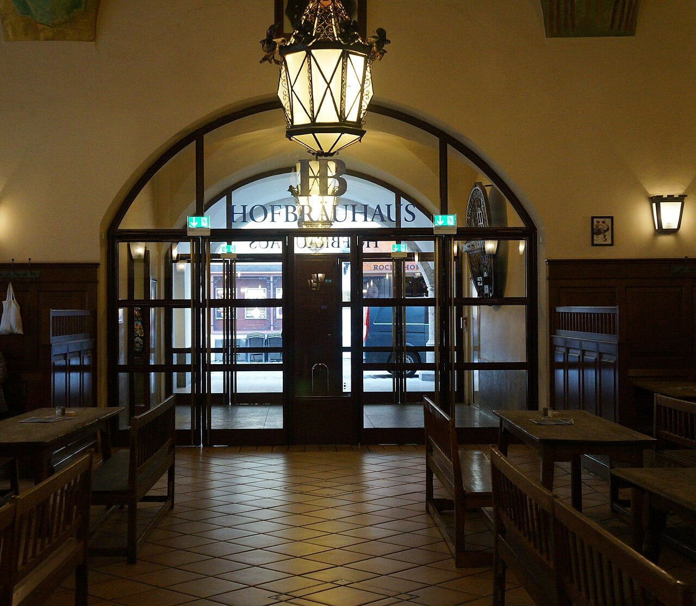

# 皇家啤酒屋的“啤酒馆 Wiesn”2026

2026 年 9 月 19 日至 10 月 4 日，慕尼黑皇家啤酒屋在啤酒节同期举办“WirtshausWiesn”（可译为“啤酒馆啤酒节”）。它的定位很清楚：不是去特蕾西娅草坪挤帐篷，而是在市中心的老啤酒馆里，用啤酒节啤酒、每日现场音乐和啤酒节菜式过同样的节。活动已经结束，本页记录的是当届安排。

图：慕尼黑皇家啤酒屋的入口门厅，玻璃门上可见“HOFBRÄUHAUS”字样。图片：Pierre André Leclercq，CC BY-SA 4.0，via [原图页面](https://commons.wikimedia.org/wiki/File:Munich_Hofbrauhaus_(1).JPG)。

## 主办与届次

主办方是位于慕尼黑 Platzl 9 的皇家啤酒屋（Hofbräuhaus München），其背后的经营主体是巴伐利亚州营的 Staatliches Hofbräu München。皇家啤酒屋由威廉五世公爵于 1589 年设立，最初是宫廷啤酒厂；1828 年，路德维希一世将其向公众开放，逐渐成为慕尼黑最具代表性的啤酒馆之一。自开放以来，这里一直是游客与本地人共处的场所。活动就在这栋建筑内举行，不是另搭场地。

关于届次，官方活动页只标出 2026 年的档期与内容，没有用文字写“第几届”；页面地址中的编号属于站点内部编号，本页不据此推算届数。本页因此按年份记为“2026 年一届”，不替主办方编造届数。可以确认的是，它属于皇家啤酒屋在啤酒节期间的传统档期安排，而不是一次性的临时活动。

## 时间与地点

- 开始：2026-09-19T00:00:00+02:00。
- 结束：2026-10-04T23:59:59+02:00。
- 时区：Europe/Berlin（中欧夏令时，UTC+2）。
- 地点：[皇家啤酒屋](ref:hofbrauhaus)，慕尼黑 Platzl 9，邮编 80331。

这段时间与 2026 年慕尼黑啤酒节的主档期重合：啤酒节同样从 9 月 19 日开始、10 月 4 日结束。WirtshausWiesn 不是主会场的分会场，而是市中心酒馆的平行活动。活动覆盖整个啤酒节档期，但不是每天同一套节目：官方页面只承诺“每日现场音乐”，具体乐队与时段按店内排期。

## 活动内容

官方描述列出三项主要内容：啤酒节啤酒、每日现场音乐、啤酒节菜式。啤酒节啤酒是季节限定风格，酒精度与配方与常规款不同，通常更强调麦芽香与易饮性；音乐通常是巴伐利亚铜管乐队与民谣曲目；菜式则偏向啤酒节常见的烤鸡、香肠、酸菜、面包与甜点。底层的传统大厅与楼上房间氛围不同：底层更喧闹、翻台更快，楼上更适合团体与家庭；天气好时，啤酒花园相对安静。

需要区分“官方承诺”与“实际排期”。官方页面没有公布每日演出的完整时间表，也没有列出全部菜单与价格；本页因此只写活动类型，不写“每天几点有乐队”或“某道菜多少钱”。这类细节逐日变化，计划前往时应查活动页或店内当日公告。

## 参与方式

不需要购票，也不需要预约；按官方页面，直接到店、在底层或啤酒花园找空位即可。自由入座是这项活动最实用的信息：它意味着不必像主会场帐篷那样提前订桌，但也意味着高峰时段要自己找位置。

建议避开傍晚刚开场的时段，或者提前一些到店；周末与啤酒节核心日期的人流会明显增加。团体人数多、或想在晚间黄金时段坐下，仍需要早到。消费按点单计算，酒水与菜式单独计价。只想感受气氛而不就餐的访客，可以在非高峰时段短时停留，但座位仍按消费使用。带孩子或行动不便的访客，最好先确认可用区域与无障碍路线，具体以场地现场指引为准。

## 现场规则

官方页面明确的规则有三条：底层与啤酒花园实行自由入座；不设门票；按点单消费。自由入座区域不接受提前订位，座位先到先得。活动期间店内音量较大、人流密集，随身物品需要自行看管。啤酒花园是露天区域，遇雨或低温时是否开放、座位如何调整，以现场安排为准。

官方页面没有完整列出着装、宠物、儿童、支付方式与自带酒水的规定，本页不替主办方补充。需要这些信息时，应以店内公告或工作人员说明为准。活动在固定建筑内举行，不涉及坐标或地图，因此本页不绘制示意图。

## 核验状态

本页依据三类来源核验：皇家啤酒屋官方活动页，用于确认档期、活动内容、自由入座与免票；官方场地页，用于确认地址与场地信息；酒厂官网，用于确认品牌与啤酒节啤酒的背景。三条来源均为主办方或关联机构官网，未使用二手转述。

未能核验的项目包括：每日乐队名单与演出时段、菜单与价格、啤酒节啤酒的供应数量上限、团体是否需要提前协调、无障碍座位的具体位置。这些项目官方页面没有公布，本页一律不写猜测值。活动状态为已结束（`event_status: past`），最后复核日期为 2026-11-08。档期、菜单、价格与演出安排逐届变化，未来计划前往时应重新核对官方活动页，并以主办方公告为准。

相关条目：[啤酒](ref:beer)、[酒与节庆：节令酒里的时间表](ref:festivals)、[奥古斯丁啤酒厂](ref:augustiner)。

## 另见

- [皇家啤酒屋](ref:hofbrauhaus)：活动场地与历史建筑。
- [啤酒](ref:beer)：啤酒节啤酒所属的大类与风格背景。
- [酒与节庆](ref:festivals)：节庆饮酒的公共功能与组织方式。
- [奥古斯丁啤酒馆](ref:augustiner)：慕尼黑另一处可对照的啤酒馆场所。

**关键事实。**

| 项目 | 内容 |
| --- | --- |
| 一句话定位 | 慕尼黑皇家啤酒屋在 2026 年 9 月 19 日至 10 月 4 日配合啤酒节举办“WirtshausWiesn”：供应啤酒节啤酒、每日现场音乐与啤酒节菜式，底层与啤酒花园自由入座，免门票；活动已结束，本页记录当届安排与核验状态 |
| 日期 | 2026-09-19–2026-10-04 |
| 场地 | 皇家啤酒屋 |
| 官网 | hofbraeuhaus.de |

**来源与边界。** 本页关于「皇家啤酒屋的“啤酒馆 Wiesn”2026」的关键事实，主要由以下来源交叉核对：Hofbräuhaus München（2026 年 9 月 19 日至 10 月 4 日的档期、每日现场音乐、啤酒节啤酒与菜式、自由入座与免费入场；活动场地与地址信息）、Staatliches Hofbräu München（作为啤酒节啤酒与品牌背景参考）、Münchner Innenstadtwirte（2026 年 9 月 19 日至 10 月 4 日、47 家酒馆、第七届及活动已结束的总结）。产品、地址或营业状态变化较快时，以 hofbraeuhaus.de 的最新页面为准；价格、批次与状态会变，涉及这些字段时以页面所列来源的最新版本为准。正文为项目自写，来源只作核验，不复制原文。

**并读。** 把「皇家啤酒屋的“啤酒馆 Wiesn”2026」与「皇家啤酒屋」、「啤酒」、「酒与节庆：节令酒里的时间表」放在一起读时，先确认它们是同一层级还是上下游关系：先确认届次与场地，再比较展期、票务与活动结构。本页负责给出活动的基本坐标，对照条目补上具体案例与差异；读完再回到本页，才能分清哪些差别属于活动本身，哪些只是产地、批次或品牌选择。
