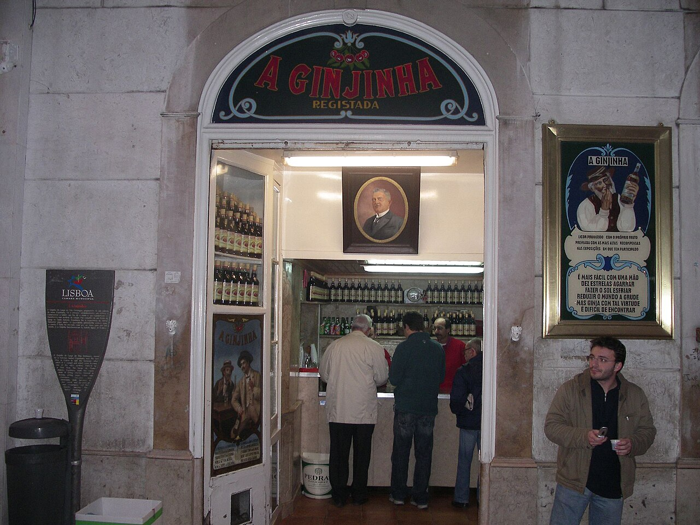

# A Ginjinha

Largo de São Domingos 的西北角，一块红色霓虹招牌、一扇窄门、一段大理石台面，就是 A Ginjinha 的全部门面。这里没有餐桌，也没有“请慢慢享用”的姿态：客人挤在柜台前，点一小杯深红色的 ginjinha，接过杯子，站在门口喝完，把空杯放回台面，再让位给下一个人。它更像一个饮酒版的街角报亭，而不是可以坐一下午的咖啡馆。

图：Largo de São Domingos 8 号的 A Ginjinha 店面，红色招牌与站立式吧台。图片：Shadowgate，CC BY 2.0，via Wikimedia Commons（[原图页面](https://commons.wikimedia.org/wiki/File:Ginjinha_store.jpg)）。

## 1840 年：A Ginjinha的关键起点
A Ginjinha 的官方历史把品牌根源追到 1840 年：当时在 Rua das Portas de Santo Antão 27 号，Francisco Espiñeira Couziño 的父亲经营一间 taverna，卖酒、也聚人。那个地址离今天的 Largo de São Domingos 只有几分钟脚程，属于同一片老城肌理。1910 年，Francisco Espiñeira Couziño 对 Largo de São Domingos 的现址店面做了改造，这被品牌视为“Ginja Espinheira”的真正起点。也就是说，今天游客排队的小店，并不是 1840 年那间 taverna 的原址，而是同一家族把早期生意搬到新门面后留下的二十世纪店面。

理解这层关系很重要。A Ginjinha 不是“1840 年开业至今从未搬动”的单一店铺，而是一个家族品牌在 1840 年扎根、1910 年落定现址、此后延续至今的结果。店里至今保留着旧式柜台、老招牌与家族肖像，品牌官网也把 Francisco 的画像放在历史叙述的中心。它卖的不只是酒，更是一段被家族保存下来的里斯本日常。

## 建筑与空间

店面极窄，红色立面在灰白色的广场边很显眼。门内是一条短柜台，台面上排着酒瓶、杯子和装酒渍樱桃的玻璃罐；柜台后是收银、倒酒与递杯的动作，几乎没有多余空间。墙上挂着老照片、招牌与家族画像，灯光偏暖，白天也能看出岁月的痕迹。因为没有足够的座位，空间的使用方式是“进来—点单—站着喝—离开”，客流像潮水一样在门口涨落。

这种小尺度不是装修风格，而是历史结果。A Ginjinha 所在的老城街区地价高、店面碎，19 世纪的小酒铺没有条件做大；今天它也没有为了游客把店面扩成酒吧。站在门口喝，反而让每个人都有机会靠近柜台，看清倒酒、夹樱桃、递杯的全过程。对第一次来的人来说，最好像当地人一样先观察两分钟，弄清队伍从哪边排、在哪里付款，再开口。

## 酒单与味觉

这里的核心只有一种酒：ginjinha，一种以酸樱桃（ginja）浸渍、加糖与烈酒制成的利口酒。不同来源给酒精度约 22% ABV，入口甜、酸、带一点樱桃核的苦与杏仁感，温度通常偏低，但不加冰。它不像葡萄酒那样需要醒酒，也不像鸡尾酒那样有复杂配方；一小杯下去，先是糖的圆润，再是樱桃的酸，最后留一点烈酒的暖。

点单时最常听到的两个词是“com ela”和“sem ela”。前者是“带它”，指杯底放一颗酒渍樱桃；后者是“不带它”，只喝酒。樱桃不是装饰，而是这杯酒的一部分：浸过酒的果肉更软、更甜，咬开时会有额外的酒液和酸味。第一次来可以点 com ela，喝完酒再把樱桃吃掉；如果不喜欢果肉口感，就点 sem ela。杯子很小，通常一口到两口，续杯很常见，但不要把它当成可以慢慢摇的鸡尾酒。

## 怎么喝

最佳时间是上午十一点前后或傍晚饭前。上午人少，柜台前还有空间，可以看清店里的老物件；傍晚下班后，本地人会和游客混在一起，气氛更热闹，但排队也更长。点单时直接说“uma ginjinha, com ela”或“sem ela”，付钱后站在门口喝，不要把杯子带走。喝完后把空杯放回柜台或指定的回收处，再离开。

如果不想酒精太冲，可以问有没有更小杯或较甜的版本；但这家店的核心产品就是标准配方，不要期待“无酒精版”。配食不需要复杂：一颗樱桃、一块巧克力或一口清水就够。空腹喝会更容易感到甜和烈，先吃点东西再来的体验通常更好。它适合作为一条步行路线的起点或终点，而不是久坐的目的地。

## A Ginjinha的地址与营业安排
- 地址：Largo de São Domingos 8, 1100-320 Lisboa。
- 营业：常见资料给每日约 09:00–22:00，也有来源写 10:00 开门；官方页面未列出逐日时间，出发前以门店或官方渠道为准。
- 交通：地铁 Rossio（绿线）出站即到；从 Praça da Figueira、Rossio 广场步行 1–3 分钟。
- 价格：小杯价格低，适合作为体验式消费；带现金更稳妥，尤其在排队高峰。
- 容量：店面很小，团队参观会阻塞门口；建议两人以内分批进入，不要在柜台前长时间拍摄。
- 无障碍：老店门面窄、门口有台阶与人群，轮椅通行不便；行动不便者建议在外侧观察并请同伴代买。

## 礼仪与常见误区

第一，ginjinha 是利口酒，不是“樱桃葡萄酒”，也不是啤酒；点单时说“ginjinha”最清楚。第二，“com ela”里的“ela”指樱桃，不是“她”，不要把它理解成带女伴。第三，不要站在柜台前慢慢品半小时；这里是站立式小杯消费，后面的人还在等。第四，不要把空杯带走当纪念品；杯子是店里的周转器具。第五，不要因为游客多就认定它是“ tourist trap ”：它确实仍是本地人日常会来的小酒铺，只是高峰时段被游客放大了。第六，不要把 1840 年当成现址店面的开业年；1840 年是品牌根源，1910 年才是 Largo de São Domingos 店面的改造节点。

## 从A Ginjinha延伸到A Brasileira
从 A Ginjinha 出发，往西两分钟是 Rossio 广场与 Praça da Figueira，往南可上 Castelo de São Jorge，往西北步行十分钟到 Chiado 的 [A Brasileira](ref:brasileira)。可以把这一站排成“早餐后先喝一杯 ginjinha → Rossio → 圣乔治城堡 → 下山到 Chiado 喝咖啡 → 傍晚去 Alcântara 或 Bairro Alto”。若想比较葡萄牙历史咖啡馆，[Café Majestic](ref:majestic) 在波尔图，适合另排一天；若继续伊比利亚半岛，马德里的 [Casa Labra](ref:labra) 与 [Botín](ref:botin) 是另一种“老店 + 小食/正餐”的组合。喜欢极小酒吧的人，还可以把阿姆斯特丹的 [Café De Dokter](ref:dokter) 放进同一张“小空间”清单。

**关键事实。**

| 项目 | 内容 |
| --- | --- |
| 一句话定位 | 里斯本 Largo de São Domingos 8 号的 A Ginjinha，是酸樱桃利口酒 ginjinha 的百年站立式小酒铺；品牌把根源追到 1840 年 Rua das Portas de Santo Antão 27 的 taverna，1910 年由 Francisco Espiñeira Couziño 改造现址店面 |
| 地址 | Largo de São Domingos 8, 1100-320 Lisboa, Portugal |
| 城市/国家 | 里斯本 / 葡萄牙 |
| 营业状态 | 已核验营业 |
| 官网 | ginjinhaespinheira.com |

**来源与边界。** 本页关于「A Ginjinha」的关键事实，主要由以下来源交叉核对：A Ginjinha Espinheira（Largo de São Domingos 8, 1100-320 Lisboa 的地址与门店联系方式；品牌自 1840 年延续的定位与 ginjinha 产品叙述）、Lisbon Trip。产品、地址或营业状态变化较快时，以 ginjinhaespinheira.com 的最新页面为准；价格、批次与状态会变，涉及这些字段时以页面所列来源的最新版本为准。正文为项目自写，来源只作核验，不复制原文。

## 参考资料
- 店方历史页：<https://ginjinhaespinheira.com/en/pages/historia>，用于核对 1840 年、1910 年与 Francisco Espiñeira Couziño 的家族叙述。
- 店方联系页：<https://ginjinhaespinheira.com/en/pages/contact>，用于核对地址与联系方式。
- Lisbon Trip 的 ginjinha 指南：<https://www.lisbon-trip.com/guides/ginjinha/>，用于交叉核对酒精度、饮用方式与 com ela / sem ela。
- 同城的 `place:cafe-a-brasileira` 可以对照“站立小杯”与“坐席咖啡馆”的两种里斯本节奏。
- 若把伊比利亚老店串成路线，读 `place:casa-labra`、`place:botin` 与 `place:cafe-majestic`。
- 相关条目：[A Brasileira](ref:brasileira)、[Café Majestic](ref:majestic)、[Casa Labra](ref:labra)、[Botín](ref:botin)、[Café De Dokter](ref:dokter)
