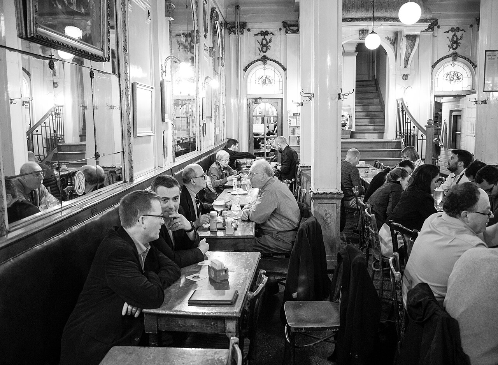
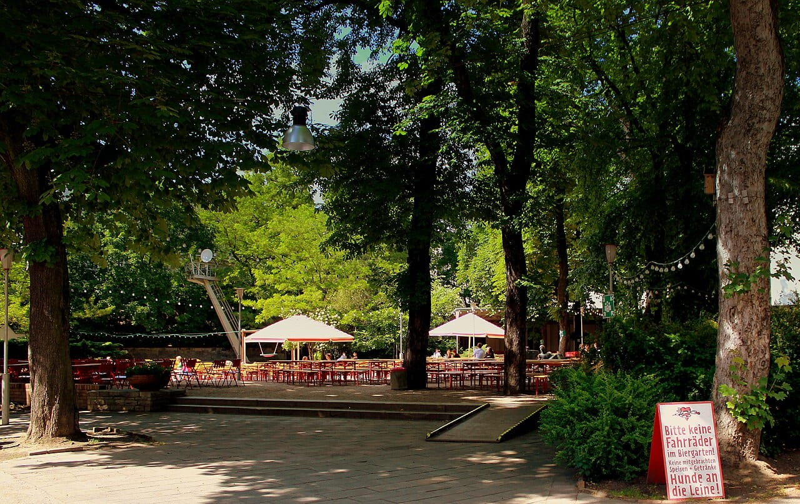

# À la Mort Subite

从布鲁塞尔大广场往圣于贝尔长廊方向走，拐进一条短而窄的坡道，红色霓虹字 “A la Mort Subite” 会在旧式立面上亮起来。白天，门口摆着藤椅与小白桌；晚上，高窗里透出暖黄的光，拱形镜面把整间厅堂拉得很深。它不是那种把“复古”做成布景的酒吧，而是一间从 1920 年代沿用至今的布鲁塞尔咖啡馆：木头、黄铜、镜面与噪声都还在。

图：À la Mort Subite 的室内：木镶板、镜子、长桌与布鲁塞尔老咖啡馆的拥挤气氛。图片：kishjar?，CC BY 2.0，via Wikimedia Commons（[原图页面](https://commons.wikimedia.org/wiki/File:A_La_Mort_Subite.jpg)）。

## 1928 年：À la Mort Subite的关键起点
店名的字面意思是“猝死”，来源不是谋杀，而是牌桌。官方历史页写得很清楚：约 1910 年，Théophile Vossen 在突击街与山坡街转角经营 “La Cour Royale”，常客里有不少比利时国家银行的职员、经纪人与出纳。柜台位置有限，他们宁愿端着酒杯等朋友，也不愿排队站着。酒一轮一轮地请，输赢靠一种叫 pitjesbak 的游戏，后来演变成骰子游戏 421。输家被叫作“死人”；时间紧的时候，大家用“最后一投”一把定胜负，这一投就是 “mort subite”。绰号先在常客嘴里流行，Vossen 干脆把店招改成 “A la Mort Subite”，随后又把名字给了自己酿的 gueuze。

1928 年底，Vossen 把店搬到几步之外的现址——蒙塔涅欧赫布街 7 号。官方历史页说，René 与 Jean-Pierre Vossen 接着祖父的传统做了 36 年；今天站在吧台后面的是第四代 Bernard 与 Olivier Vossen。这里要注意一个常见混淆：店名、酒名与酒厂是三件事。咖啡馆本身不酿造；以 “Mort Subite” 为名的 gueuze、kriek、faro 等酒由合作酒厂生产，咖啡馆只是最著名的销售与命名源头。

## 建筑与空间

现址的建筑建于 1902 年，由 Joseph François Piscador 设计；1910 年，Paul Hamesse 与 F. Seeldraeyers 把它改造成咖啡馆兼餐厅，形成了今天的新路易十六风格。Around Us 的条目把它概括为“高天花板、路易十六装饰、成排长桌与拱形镜子”；官方首页则强调它紧邻圣于贝尔长廊、对面就是长廊入口。1998 年 9 月 17 日，这栋建筑被列为保护遗产，室内与立面因此被整体保留下来。

走进门，先是一个窄窄的入口，然后是纵向很深的大厅。两侧的拱形镜面把柱子和灯球反复反射，空间看起来比实际更长；黄铜管沿着墙脚走，旧海报、老照片与酒牌填满空隙。桌子是浅色木面，椅子是弯木与藤面，靠墙有一排深色长凳。白天，高窗把自然光打成大片；晚上，白色球形吊灯与镜面一起发光，整间店像一条被灯光拉长的走廊。它适合坐下来慢慢喝，不适合站着快闪。

## 酒单与味觉

这里的主角是布鲁塞尔与兰比克家族的啤酒。Mort Subite 系列最常见的是 gueuze、kriek、faro 与 witbier：gueuze 是老年份与年轻兰比克混合后再发酵，酸、干、带柑橘与谷物；kriek 加入樱桃，酸中带果核与杏仁；faro 加入糖，口感更圆、更甜；witbier 则是橙皮与芫荽籽的清爽小麦啤。店里也会备其他比利时啤酒与少量国际品牌，但第一次来，点一杯 Mort Subite gueuze 最能理解这家店为什么存在。

食物是咖啡馆级别：奶酪、萨拉米、火腿、三明治、乡村面包与芥末。官方首页说菜单包含素食选项；分量适合配酒，不是正餐。想吃饱，可以点一份奶酪拼盘加三明治，或者把这里当下午酒，再去大广场附近吃晚餐。不要期待热菜大餐；这里的光线、桌距与噪声都更适合慢饮与聊天。

## 怎么喝

最舒服的时间是下午两点到五点。游客团还没涌入，高窗有自然光，镜面与柱子看得最清楚；周末晚上七点以后，长桌会被家庭与朋友聚会填满，声音很大，想安静聊天要靠近窗边或早点到。周日晚不营业，这一点与许多布鲁塞尔餐馆不同，安排行程时要注意。

点单可以直接说要 gueuze、kriek 或 faro；如果不喜欢酸味，先从 faro 或 witbier 开始。啤酒通常装在对应的玻璃杯里，不要把杯子换来换去。店里提供奶酪与三明治，适合两人分一份。卫生间与入口的动线较窄，轮椅可从官方标注的无障碍入口进入，但高峰时通道会被人群占住。拍照可以，但不要用闪光灯对着镜面与吧台，反光会毁掉整个画面。

## À la Mort Subite的地址与营业安排
- 地址：Rue Montagne-aux-Herbes Potagères 7, 1000 Bruxelles（荷兰语：Warmoesberg 7）。
- 坐标：50.84861, 4.35611。
- 电话：+32 2 513 13 18。
- 营业：周一至周六 11:00–00:00；周日休。官方荷兰语页与英文页均给出这一口径，临时调整以现场为准。
- 交通：从布鲁塞尔中央站步行约 8 分钟；地铁到 Gare Centrale 或 De Brouckère 后步行；紧邻圣于贝尔长廊。
- 预订：小型聚会通常不需预订，大团建议先电话确认；高峰时段可能拼桌。
- 支付：现金、Visa、Mastercard、借记卡、Payconiq、Bancontact 与餐券均可。
- 无障碍：官方标注轮椅可进入，并有户外座位；内部桌距较紧，高峰时需有人协助。
- 宠物：以现场规定为准；不要假设所有咖啡馆都欢迎狗。

## 礼仪与常见误区

第一，不要把这里当成“啤酒厂”。它是咖啡馆兼餐厅，Mort Subite 酒由合作酒厂生产；想看酿造，请去 [Cantillon](ref:cantillon) 这样的兰比克酒厂。第二，不要把店名当成恐怖故事；“mort subite”是牌桌上的决胜一投，不是历史事件。第三，不要只点一杯甜味果啤就下结论；gueuze 的酸与干才是这条线的核心。第四，不要占着长桌开电脑会议；这里是聊天与喝酒的地方，午后才相对安静。第五，不要用闪光灯拍镜面；反光会让照片一片白。第六，不要把“1928”理解成建筑年代；建筑 1902 年，咖啡馆改造在 1910 年，迁入现址才是 1928 年。

## 从À la Mort Subite延伸到Cantillon
出门右转就是圣于贝尔长廊，左转几分钟到大广场；把这一站放进“布鲁塞尔啤酒与咖啡馆”半日线：上午在 [Cantillon](ref:cantillon) 看兰比克与贵兹的酿造，中午回市中心在 À la Mort Subite 喝一杯 gueuze 配奶酪，下午去 [De Halve Maan](ref:halve-maan) 看布鲁日方向的啤酒传统，傍晚再回大广场。若延伸到荷兰，[Café Hoppe](ref:hoppe) 与 [Café De Dokter](ref:dokter) 是阿姆斯特丹棕色咖啡馆的两种尺度；[Prater Garten](ref:prater) 则是柏林栗树下的啤酒花园对照。

这条线步行即可完成布鲁塞尔段；Cantillon 离市中心约 20 分钟步行，也可以坐地铁到 Lemonnier 再走。不要把行程排得太满：这家店的价值在“坐下来”，而不是“拍完就走”。

## 参考资料
- 官方历史页：<https://alamortsubite.com/en/history>，用于核对 1910 年 La Cour Royale、pitjesbak/421、决胜投、1928 年迁址与 Vossen 家族第四代。
- 官方英文首页：<https://alamortsubite.com/en/>，用于核对地址、电话、营业时间、支付方式与菜单结构。
- 官方荷兰语首页：<https://alamortsubite.com/nl>，用于交叉核对荷兰语地址与营业信息。
- Around Us 的建筑条目：<https://it.aroundus.com/p/6055765-a-la-mort-subite>，用于核对 1902 年 Piscador、1910 年 Hamesse 改造、1998 年保护身份与新路易十六风格。
- 同城与跨城条目：[Cantillon](ref:cantillon)、[De Halve Maan](ref:halve-maan)、[Café Hoppe](ref:hoppe)、[Café De Dokter](ref:dokter)、[Prater Garten](ref:prater)。

## 相关图像

图：Prater Garten 的栗树荫与长桌，柏林普伦茨劳贝格。图片：calflier001，CC BY-SA 2.0，via Wikimedia Commons（[原图页面](https://commons.wikimedia.org/wiki/File:PRATERGARTEN_BIER_GARTEN_NEAR_TO_ELBERWALDER_STRASSE_U_BAHN_STATION_BERLIN_GERMANY_JUNE_2013_(9058790131).jpg)）。关联图像：À la Mort Subite。
