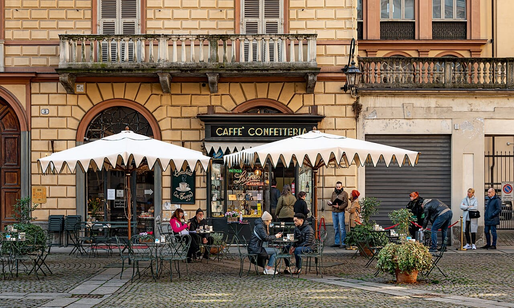

# 阿尔比切林咖啡馆

都灵 Consolata 教堂前的小广场上，Al Bicerin 的门面并不起眼：深色木门、金色手写体招牌、门口几张白色小桌。它面对的是一座巴洛克教堂，侧面是老城窄街；早上开门时，附近上班的人会站着喝一杯咖啡，下午则常有游客排队，等着喝那杯分层的小玻璃杯——bicerin。对都灵人来说，bicerin 不是“特色饮品”，而是这座城市早晨的一部分；Al Bicerin 则是这杯饮品最著名的守门人。

图：都灵 Piazza della Consolata 的 Al Bicerin 店面；咖啡馆 1763 年由 Giuseppe Dentis 开办，1856 年迁入建筑师 Carlo Promis 设计的新楼，照片为现址外观。图片：Jorge Franganillo，CC BY 2.0，via Wikimedia Commons（[原图页面](https://commons.wikimedia.org/wiki/File:Torino_Caff%C3%A8_Al_Bicerin_(52738271224).jpg)）。

## 1763 年：阿尔比切林咖啡馆的关键起点
Al Bicerin 的历史从 1763 年开始。创始人 Giuseppe Dentis 原来是个卖柠檬水（acquacedratario）的小贩，在 Consolata 教堂入口对面开了一间小铺，只有木板桌与长凳。1856 年，建筑师 Carlo Promis 设计了现在这栋楼，咖啡馆搬进去，才有了木饰墙面、镜子、灯与白色大理石圆桌；十九世纪末，门口又加了铁艺与玻璃橱窗，形成今天看到的“老咖啡馆”外观。

bicerin 这杯饮品不是突然发明的，而是从十八世纪流行的 bavareisa 演变而来。bavareisa 由咖啡、巧克力、牛奶与糖浆组成，装在较大的杯子里；最初的 bicerin 把三种原料分开上，后来才合并进一只无把手的小玻璃杯。官方记载三种变体：pur e fiur（类似今天的卡布奇诺，咖啡与奶）、pur e barba（咖啡与巧克力）、‘n poc ‘d tut（“什么都有点”，咖啡、巧克力、奶油三层）。最后一种最受欢迎，最终成为今天默认的 bicerin。

这杯饮品与都灵的宗教生活也有关系。Consolata 教堂的信徒在领圣体前要禁食，咖啡馆就在教堂对面，bicerin 成了领圣体后补充能量的第一站；四旬期里，热巧克力被视为“饮品”而非“食物”，也可以喝。十九世纪，bicerin 的价格长期保持三个 soldi（15 分里拉），直到 1913 年才涨到 20 分；官方引用当时作家的说法，把 minister、法官、教授、商人、送货员、菜贩都列为顾客。它从一开始就是跨阶层的城市饮品，而不是贵族专属。

## 空间与酒单

今天的 Al Bicerin 仍然很小。进门是吧台与几张桌子，墙上挂着老照片、铜器与旧广告；二楼或里侧还有少量座位，但整体不适合大队人马。白色大理石圆桌、深色木饰、镜子与暖色壁灯构成主要视觉；空间紧凑，客人之间距离很近，这也是它“老咖啡馆”气氛的一部分。

菜单以 bicerin 为核心，另有咖啡、热巧克力、茶、果汁与甜点。bicerin 用无把手的小玻璃杯装，三层分明：底层是热巧克力，中间是浓缩咖啡，顶层是牛奶或奶油。除了经典版，还有 pur e fiur 与 pur e barba 两种变体。食物以皮埃蒙特甜点、饼干、巧克力与简单早餐为主，不适合正餐。它不是鸡尾酒吧，也不卖酒；来这里的目标很明确：一杯 bicerin，加一块甜点。

## 怎么喝

bicerin 的正确喝法是不搅拌。嘴唇先碰到顶层的奶/奶油，然后慢慢喝到咖啡与巧克力；每一口都会改变三层比例，最后几口最甜、最浓。不要用勺子把三层搅匀，那会变成一杯普通的摩卡。若觉得太甜，可以点 pur e barba（咖啡与巧克力）或 pur e fiur（咖啡与奶），甜度会更低。

时间上，早上与开门后不久最安静，能站在吧台看店员操作；下午游客多，门口常排队。它周三休息，周日与节假日也会调整；计划行程时先查官网的“Orari & Posizione”。冬天是 bicerin 的最佳季节，热巧克力与奶油在冷天更舒服；夏天可以点冰咖啡或果汁，但 bicerin 仍是招牌。

点单时直接说“un bicerin”，默认是三层都有的 ‘n poc ‘d tut；想要咖啡更突出，点 pur e barba，想要奶香更轻，点 pur e fiur。店员会问是否加奶油，按当天的做法回答即可；若只想快速喝一杯，可以问能否站在吧台，不必等桌子。

## 阿尔比切林咖啡馆的地址与营业安排
地址是 Piazza della Consolata 5, 10122 Torino。它位于都灵老城 Quadrilatero Romano，步行可达 Piazza Castello、Via Garibaldi、Porta Palazzo 与 Piazza della Repubblica。官方营业时间：每日 09:00–19:15，周三休息；圣诞、复活节、San Giovanni 与夏休会调整，具体以官网为准。

咖啡馆通常不接受预订，先到先得；门口排队时，先确认是“堂食”还是“站着喝”，站着喝通常更快。没有着装要求，但空间小，背包与婴儿车不方便。意大利咖啡馆可能收座位费；小费不是强制，可留 5%–10%。店内与露台都禁烟，包括电子烟。

## 礼仪与常见误区

第一个误区是把 bicerin 搅匀；正确做法是不搅拌，分层喝。第二个误区是把 Al Bicerin 当成“bicerin 的发明者”；它是这杯饮品最著名的传统店之一，但 bicerin 是从 bavareisa 演变而来，不是单一人一次发明。第三，不要把它当成正餐餐厅；这里以咖啡与甜点为主。第四，不要占着桌子只拍照；门口排队时，店员会希望客人尽快落座与点单。第五，周三不要白跑；官方明确周三休息，节假日另有安排。

1763 年开办、1856 年迁入现址；bicerin 是分层喝，不是普通摩卡，点单时要说明是否加奶油。

## 从阿尔比切林咖啡馆延伸到圣卡洛咖啡馆
从 Al Bicerin 出来，Consolata 教堂就在对面，往东是 Quadrilatero Romano 的餐厅与小店，往南可到 Piazza Castello 与 Royal Palace，往北是 Porta Palazzo 市场。把 Al Bicerin 与[圣卡洛咖啡馆](ref:san-carlo)排在同一天很合适：上午在圣卡洛喝咖啡，下午到这里喝 bicerin；想比较欧洲历史咖啡馆，可以读[Antico Caffè Greco](ref:greco)、[Caffè Florian](ref:florian)、[Café Sperl](ref:sperl)与[维也纳咖啡馆之夜](ref:vienna-route)。

**关键事实。**

| 项目 | 内容 |
| --- | --- |
| 一句话定位 | 都灵 Consolata 教堂对面的 Al Bicerin，1763 年由 Giuseppe Dentis 开办，1856 年迁入 Carlo Promis 设计的新楼；以咖啡、巧克力与奶油分层的 bicerin 闻名，是都灵最古老的咖啡馆之一 |
| 地址 | Piazza della Consolata 5, 10122 Torino, Italy |
| 城市/国家 | 都灵 / 意大利 |
| 营业状态 | 已核验营业 |
| 官网 | bicerin.it |

**来源与边界。** 本页关于「阿尔比切林咖啡馆」的关键事实，主要由以下来源交叉核对：Caffè Al Bicerin（地址、历史场所身份与当前营业信息；1763 年 Giuseppe Dentis、1856 年 Carlo Promis 新楼、bicerin 从 bavareisa 演变及三种变体）、Locali Storici d'Italia（历史场所认定与都灵传统咖啡馆谱系；不用于当前菜单）。产品、地址或营业状态变化较快时，以 bicerin.it 的最新页面为准；价格、批次与状态会变，涉及这些字段时以页面所列来源的最新版本为准。正文为项目自写，来源只作核验，不复制原文。

## 参考资料
- [圣卡洛咖啡馆](ref:san-carlo)
- [Antico Caffè Greco](ref:greco)
- [Caffè Florian](ref:florian)
- [Café Sperl](ref:sperl)
- [维也纳咖啡馆之夜](ref:vienna-route)

最后核对：地址 Piazza della Consolata 5 与周三休息按咖啡馆官网查于 2026-11-21；bicerin 的分层喝法、以及“最老/发明”一类说法已在正文保留限定。本页是“喝酒去”的都灵咖啡馆条目，中文与英文版同步；文字许可见上方 rights 字段，图片署名与许可见各图注。

对照阅读：[圣卡洛咖啡馆](ref:san-carlo)、[花神咖啡馆（威尼斯）](ref:florian)。
