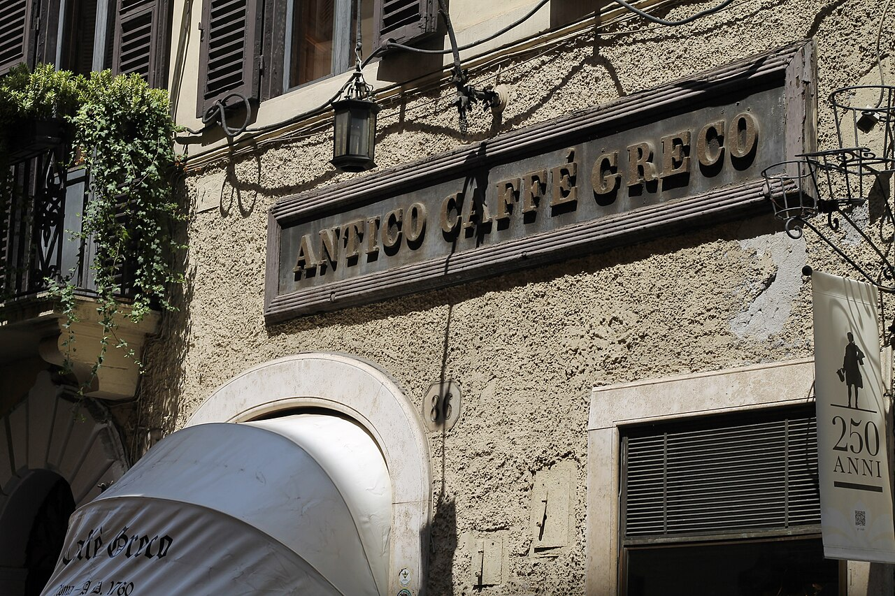
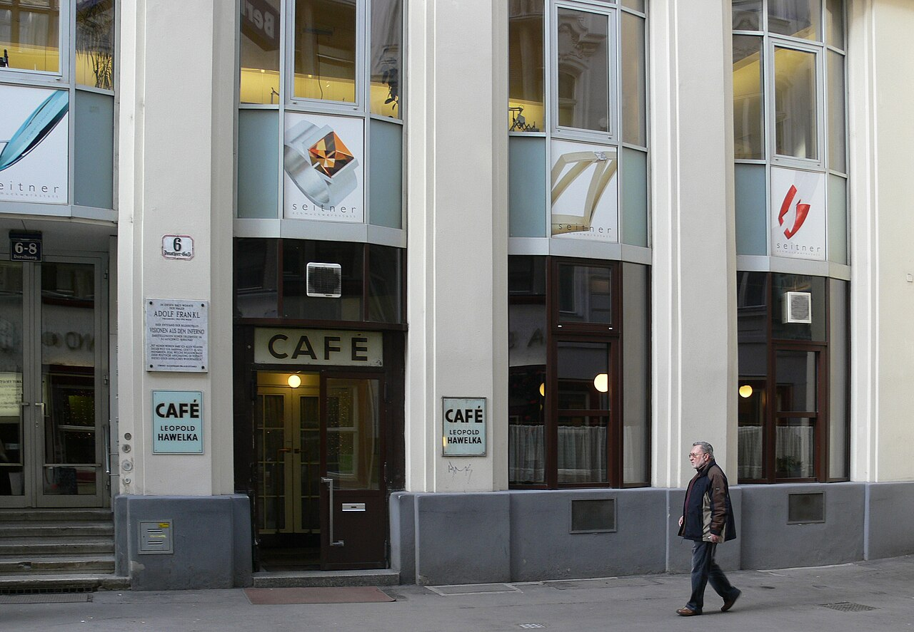

# 罗马希腊咖啡馆

孔多蒂街（Via dei Condotti）是罗马最像橱窗的一条街，奢侈品店把灯光打在石墙上，游客从西班牙台阶一路涌向科尔索大街。86 号的门面并不张扬，木门、旧招牌和一层不高的店面，很容易被走过。这里就是罗马希腊咖啡馆（Antico Caffè Greco），1760 年开业，曾是罗马现存最古老的咖啡馆；2025 年 10 月 8 日，它因租约纠纷被正式驱逐，结束了 265 年的营业。

图：罗马康多蒂街的希腊咖啡馆。图片：Elisabetta Stringhi from Italia，CC BY 2.0，via Wikimedia Commons（[原图页面](https://commons.wikimedia.org/wiki/File:Antico_caff%C3%A9_greco_(14869700159).jpg)）。

> **先给结论**
> **一句话：** 这页判断罗马希腊咖啡馆值不值得专程去，以及到访前要核对什么。
>
> - **适合谁：** 正在计划去罗马希腊咖啡馆、想知道值不值得专程安排半天到一天的人。
> - **不适合谁：** 只想要“必去榜单”、不准备核对预约、交通和开放时间的人。
> - **先看这两点：**
>   - 截至 2026 年 11 月 20 日，希腊咖啡馆没有恢复营业。
>   - 第一，不要把“历史场所”当成“随时可进”。

## 1760 年：罗马希腊咖啡馆的关键起点
希腊咖啡馆的名字来自创始人。1760 年，来自希腊社区的尼古拉·德拉·马达莱纳（Nicola della Maddalena）在孔多蒂街开出这家店，当时这一带是罗马的外国艺术家、旅行者与外交官聚集的区域。意大利国家旅游局的介绍把它称为意大利第二古老的咖啡馆，仅次于威尼斯的花神咖啡馆；这个排序很重要，既说明它的辈分，也提醒读者不要把“罗马最古老”误写成“意大利最古老”。

18 世纪到 19 世纪，罗马是欧洲“壮游”的终点，孔多蒂街靠近西班牙台阶，希腊咖啡馆成了文人、画家与音乐家的落脚点。歌德、拜伦、司汤达、海涅、李斯特、瓦格纳、果戈理、安徒生、易卜生、乔伊斯等名字都被列进它的顾客名单。名单长不等于每个人都把这里当书房，但可以确定的是，它长期承担着“外国人在罗马的会客厅”这一角色：寄信、读报、交换消息、谈 commissioned work，都在咖啡桌旁发生。果戈理在罗马写《死魂灵》部分章节的说法流传很广，俄语媒体与咖啡馆自己的叙述都提到他与这里的联系；把它当作文学史的背景可以，具体到“哪一章在哪张桌子写完”，则不必当成事实。

咖啡馆的空间也参与了它的名声。红色厅（Sala Rossa）与“公共马车厅”（Sala Omnibus）是最常被提到的两个房间。后者细长、狭窄，像一节车厢，名字也由此而来。墙上密集悬挂着绘画、素描、版画与纪念物，数量超过 300 件，使它被描述为“向公众开放的最大私人画廊”之一。这个说法有修辞成分，但它说明了一个事实：这里不是只有咖啡和镜子的咖啡馆，而是一座把 19 世纪罗马艺术圈压缩在几间屋子里的陈列室。

## 空间与酒单

希腊咖啡馆卖的首先是咖啡，但在罗马，咖啡的价格与座位方式绑定。站在吧台喝一杯浓缩，是本地人的日常；坐下由侍者服务，价格会明显提高，因为座位、空间与服务都算进了账单。希腊咖啡馆位于孔多蒂街这样的地段，历史上属于罗马的高价咖啡馆，一杯咖啡的绝对值不低，但它的溢价主要来自位置与历史，而不是豆子本身。把它当成“全罗马最好喝的咖啡”会失望，把它当成“在历史里坐十分钟”的地方，反而准确。

咖啡单是典型的罗马体系：浓缩（espresso）、玛奇朵（macchiato）、卡布奇诺（cappuccino）、拿铁（latte）与摩卡（moka）之外，还有热巧克力与 pastry。意大利人很少在午后就点卡布奇诺，这条“规矩”在旅游区常被放宽，但在老店仍会被侍者默默记在心里。热巧克力在罗马咖啡馆里通常比咖啡更浓稠，冬天点一杯，配一块酥皮点心，比点一大份甜点更接近本地习惯。

食物不是主角。希腊咖啡馆历史上以咖啡、巧克力、糕点和简餐为主，正餐选择有限；它的顾客来这里是为了坐、看、谈，而不是为了吃一顿完整晚餐。若把它当成餐厅，会错过它的重点。真正值得看的是墙面：19 世纪意大利与外国画家的作品、历史照片、名人题赠、旧家具与镜子。它们不是后来布展的“复古道具”，而是长期积累的收藏；但在 2025 年停业时，这批作品已被移出并被意大利文化部接管保护，所以今天从门外看不到原来的陈列。

## 第一次去怎么点

截至 2026 年 11 月 20 日，希腊咖啡馆没有恢复营业。官网页仍在，但没有重新开门或接受预订的公告；建筑门口也不是可以“进去看一眼”的开放场所。因此“第一次去怎么点”要改成“第一次去怎么看”：先在孔多蒂街 86 号确认门面，读一读墙上的历史标识，再沿街走到西班牙台阶与巴布伊诺街，把这家店放回它所在的街区里理解。不要推门、不要敲窗，也不要向周边店员反复打听“什么时候重开”，因为重开时间取决于业主与新租户的安排，周边店铺未必知道。

如果未来重开，点单逻辑可以参照罗马传统咖啡馆：先决定站还是坐。赶时间就站在吧台，点一杯浓缩或玛奇朵，喝完就走；想体验空间就坐下，接受桌价，点一杯咖啡加一份小点心，慢慢看墙。想喝热的、甜的，可以点热巧克力；想喝清爽的，可以点一杯冰镇浓缩或气泡水。不要在门口排队时就把“必点清单”想得太复杂，罗马咖啡馆的菜单通常很短，侍者也不喜欢被追问“哪个最正宗”。

历史建筑类场所的参观与营业是两件事。希腊咖啡馆的建筑受保护，但“建筑在”不等于“咖啡馆在营业”。同样，墙上作品被文化部接管，也不等于它们会在原地重新展出。把“看建筑”“看收藏”“喝咖啡”分开安排，就不会因为一个环节关闭而破坏整天的路线。

## 罗马希腊咖啡馆的地址与营业安排
**地址**：Via dei Condotti 86, 00187 Roma RM, Italy。门牌在孔多蒂街南侧，靠近西班牙台阶与巴布伊诺街交汇处。找 86 号比找“希腊咖啡馆”招牌更可靠，因为门面不大、游客多时容易被遮住。

**交通**：地铁 A 线西班牙站（Spagna）出站，沿孔多蒂街步行约 2 分钟；也可从人民广场（Piazza del Popolo）沿科尔索大街步行过来。孔多蒂街是步行街，车辆不能停在门口；最近的出租车点在国际一大道与西班牙广场周边。石板路在雨天较滑，穿薄底鞋要小心。

**营业状态（重要）**：`operating_status` 记为 `closed`。2025 年 10 月 8 日，业主罗马以色列医院（Ospedale Israelitico）在长期租约诉讼后收回物业，咖啡馆被驱逐；多家媒体报道称，店内的绘画、雕塑与纪念物在 9 月被移出，随后由意大利文化部查封保护，业主计划寻找新租户。截至 2026 年 11 月 20 日，没有官方重开日期。任何“明天开门”“已经恢复”的说法，都应以官网或意大利文化部公告为准。

**门票与预约**：不设门票，因为目前不开放。若未来以新租户形式重开，是否接受预订、是否设最低消费，要以新经营方公告为准；不要沿用旧店的订位方式。建筑外观可自由经过，但门口与相邻店铺之间是公共通道，拍照时不要堵住行人。

**费用**：历史资料显示，希腊咖啡馆的价格高于罗马普通咖啡馆，座位与站立的价格不同；具体数字随年份变化，不建议把旧攻略里的价格当作现价。周围孔多蒂街与西班牙广场的咖啡馆普遍偏贵，想控制预算，可以往北走到人民广场或往南走到万神殿周边的小店。

页面核验日期 2026-11-20；营业状态、开放安排与图片许可见正文与来源注记。

## 礼仪与常见误区

第一，不要把“历史场所”当成“随时可进”。希腊咖啡馆已经停业，门口不是展厅，推门、扒窗、问“能不能只看一眼”都不合适。第二，不要把“意大利第二古老”说成“意大利最古老”；威尼斯花神咖啡馆 1720 年开业，比它早 40 年。第三，不要以为墙上的画还在原处；2025 年停业时收藏已被移出保护，原址陈列是否恢复，要看新租户与监管方的安排。

常见误区还有三个。其一，把孔多蒂街的咖啡价格当成“罗马正常价”；这条街是奢侈品街，租金与座位费都高，往小巷走会便宜很多。其二，把名人名单当成“每个名人都常来”；名单里既有常客，也有只来过一次的旅行者，二者不是一回事。其三，把“关闭”当成“永久拆除”；建筑与历史场所仍在，业主也明确表示要寻找新租户，更准确的说法是“暂停营业，等待新经营方”。

不适合专门绕路的情况：行程只有半天、又带着小孩或大件行李；门口没有可坐的地方，也没有洗手间。适合的安排是把它作为孔多蒂街与西班牙台阶之间的一站，停留五到十分钟，看看门面与街区，再把时间留给仍在营业的咖啡馆。

## 罗马的周边街区
从西班牙台阶下来，沿孔多蒂街向东走，86 号在右手边；继续走到科尔索大街，往北是人民广场，往南是科尔索与威尼斯广场。把希腊咖啡馆放在“西班牙台阶—孔多蒂街—人民广场”这条线上，走路约 20 分钟，不需要专程打车。若想对比“仍在营业的历史咖啡馆”，可以转去万神殿附近的圣欧斯塔基奥咖啡馆（Sant'Eustachio），或巴布伊诺街的卡诺瓦·塔多利尼咖啡馆（Canova Tadolini）；前者以咖啡出名，后者是雕塑家工作室改造的空间，和希腊咖啡馆的“文人客厅”气质不同。

若想把“咖啡馆”作为主题，罗马一天安排两到三家就够。上午在希腊咖啡馆门口看建筑，中午去圣欧斯塔基奥站着喝一杯，下午到卡诺瓦·塔多利尼坐一会儿；晚上回到西班牙台阶看夜景。希腊咖啡馆适合作为“起点”而不是“终点”，因为它现在没有室内体验，把它放在路线开头，心理落差最小。

雨天或夏季高温时，孔多蒂街的人流会集中在有遮阴的拱廊与店门口，拍照要避让；西班牙台阶禁止坐卧与饮食，别把咖啡带上去。若遇到门口有媒体或围挡，说明现场仍在处理租约或保护事务，不要跨越围挡。

## 同城酒吧与延伸阅读
- [酒吧与城市](ref:pub-and-city)：咖啡馆如何用座位、报纸与营业时间组织公共生活。
- [花神咖啡馆（威尼斯）](ref:florian)：意大利最古老、仍在营业的历史咖啡馆，可与罗马的“停业现场”对照。
- [花神咖啡馆（巴黎）](ref:cafe-de-flore)：巴黎左岸的文学咖啡馆，另一种“名人顾客”叙事。
- [中央咖啡馆](ref:cafe-central)：维也纳的文学咖啡馆，1876 年开业，经历過停业与重开。
- [哈维尔卡咖啡馆](ref:hawelka)：维也纳的艺术家咖啡馆，以家庭经营与 Buchteln 闻名。

相关条目：[认识一座城，从一间酒馆开始](ref:pub-and-city)、[花神咖啡馆（威尼斯）](ref:florian)、[花神咖啡馆](ref:cafe-de-flore)。

## 相关图像

图：维也纳哈维尔卡咖啡馆的门面。图片：Photo: Andreas Praefcke，CC BY 3.0，via Wikimedia Commons（[原图页面](https://commons.wikimedia.org/wiki/File:Wien_Caf%C3%A9_Hawelka.jpg)）。关联图像：罗马希腊咖啡馆。
