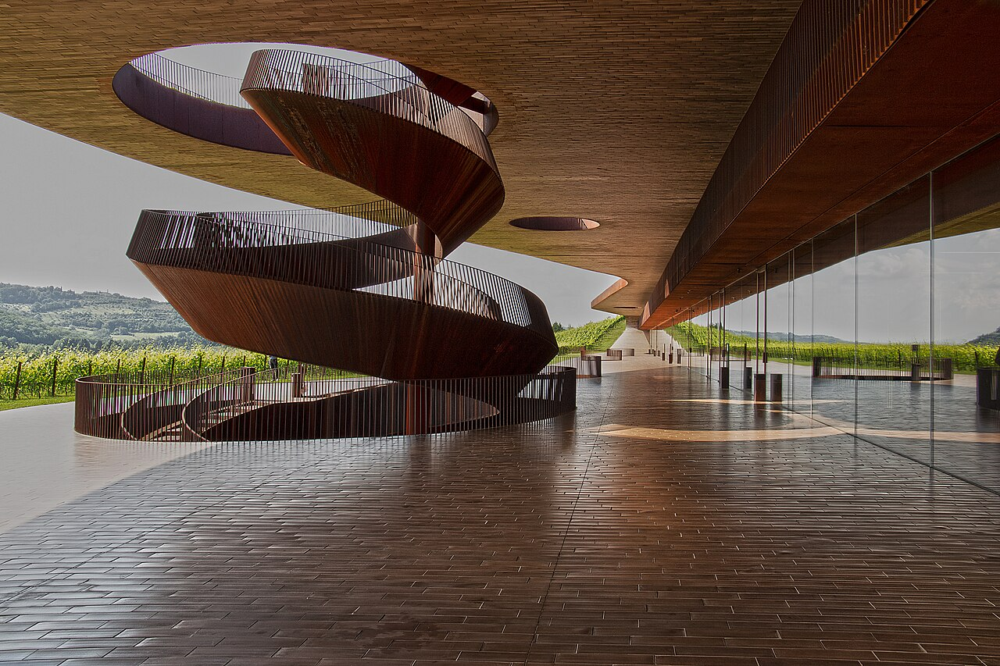

# 安东尼世家经典基安蒂酒庄

从佛罗伦萨向南，沿 SS2 公路进入 San Casciano Val di Pesa 的丘陵，Bargino 一带的葡萄园之间会出现两条细长的水平切口。那不是普通的挡土墙，而是安东尼世家经典基安蒂酒庄露在地表的部分：大部分体量埋在山坡里，参观者从切口进入，沿螺旋楼梯向下，穿过发酵、陈酿与品鉴空间。它既是生产设施，也是安东尼家族在经典基安蒂产区的接待中心。

图：安东尼世家酒庄的螺旋楼梯与几何空间。图片：Repuli，CC BY-SA 4.0，via Wikimedia Commons（[原图页面](https://commons.wikimedia.org/wiki/File:Angoli_e_geometrie.jpg)）。

## 2012 年：安东尼世家经典基安蒂酒庄的关键起点
安东尼家族与葡萄酒的关系可以追溯到 1385 年，Giovanni di Piero Antinori 在这一年加入佛罗伦萨的葡萄酒商行会。官方把这座 2012 年启用的酒庄称为家族二十六代人以来第一次新建的、专门面向葡萄酒爱好者开放的生产与接待设施。它不是把老宅改成游客中心，而是把“让外界看见酿造”写进建筑任务书。

酒庄在 2012 年 10 月启用，由 Archea Associati 设计，主创建筑师为 Marco Casamonti。2022 年，它被 World’s Best Vineyards 评为第一；这个榜单由数百位葡萄酒与旅游专家投票，评价的是酒旅目的地而非单纯酒质。把它当作“建筑与参观体验”的参考可以，但不要把它当成酒款排名的证据。

## 建筑与空间

建筑最醒目的是两条水平切口与屋顶露台。酒庄完全使用当地材料建造，尽量降低对环境与托斯卡纳景观的影响；从远处看，建筑几乎“消失”在坡地里，只留下切口、露台与几处采光井。屋顶上是餐厅 Rinuccio 1180，露台正对葡萄园；建筑内部则依靠重力完成酿造流程，减少机械输送对酒液的处理。

空间组织值得细读。参观者从地面进入，先看到接待与商店，再沿螺旋楼梯下到酒窖层；发酵、陈酿与品鉴被安排在不同标高，重力让酒液在工序之间自然流动。官方把这种设计称为“重力酿造”，并强调它同时满足生产所需的温度、湿度与卫生条件。最容易被记住的是螺旋楼梯与悬挂品鉴室：前者连接三个楼层，后者悬在发酵与陈酿空间之间，玻璃窗外就是酒窖。

艺术是另一条线索。安东尼家族长期资助艺术，酒庄落成后启动了 Antinori Art Project，在建筑与庭院中安排当代艺术展览与场域特定作品。参观时如果遇到布展，不要把它当成装饰：这些作品与“酒庄如何被观看”有关，和酒标、酒窖同样属于空间叙事的一部分。

## 酒单与味觉

在这座酒庄，最直接的品鉴顺序是按“经典基安蒂的三条线”走：村庄级、Riserva 与更进阶的家族酒款。Pèppoli 是经典基安蒂村庄级，风格偏明亮、果味外向，适合作为第一杯；Villa Antinori Chianti Classico Riserva 是 Riserva，经过更长时间陈年，结构更完整，常带有深色樱桃、香料与皮革的气息；Vinsanto del Chianti Classico 则是甜酒，用风干葡萄酿造，适合在餐后小杯收尾。

要理解这些酒，需要知道经典基安蒂的规则。经典基安蒂（Chianti Classico DOCG）要求桑娇维塞至少占 80%，其余可以是法定红葡萄品种；村庄级最低陈年 12 个月，Riserva 最低 24 个月，其中至少 3 个月在瓶中；Gran Selezione 要求桑娇维塞至少 90%，只能用酒庄自有葡萄，最低陈年 30 个月，其中 3 个月在瓶中。Riserva 不是“更甜的珍藏”，而是陈年与酒精度要求更高的一档；Gran Selezione 则是产区金字塔的顶端，2014 年才设立。

在安东尼世家的产品里，Tignanello、Solaia 等酒款来自其他庄园，不在这座酒庄的葡萄园里；酒庄的商店可能售卖家族其他庄园的酒，但不要把“在这里买到”理解成“在这里酿造”。同样，经典基安蒂只是安东尼世家众多产区中的一个，把它当成家族全部会漏掉其他产区的酒款。

## 怎么喝

红葡萄酒 16–18°C。Pèppoli 开瓶即可喝，Villa Antinori Riserva 提前 30–60 分钟，Tignanello 等更进阶酒款可以 1–2 小时。酒杯用中等口径的红酒杯，倒酒不超过杯肚最宽处。Vinsanto 8–10°C，用小甜酒杯，一次 50–70 毫升即可。

配餐上，Pèppoli 配番茄意面、烤蔬菜、披萨；Villa Antinori Riserva 配烤肉、炖牛肉、硬质奶酪；Vinsanto 配杏仁饼、干果、蓝纹奶酪。避免过辣的菜；桑娇维塞的酸度与樱桃香需要油脂与盐分来平衡。

## 安东尼世家经典基安蒂酒庄的地址与营业安排
地址：Via Cassia per Siena 133, Loc. Bargino, 50026 San Casciano Val di Pesa, Firenze。开放时间按季节分两段：4 月至 10 月每日 10:00–18:30；11 月至次年 3 月周一至周五 10:00–17:30，周六与周日 10:00–18:00；酒 shop 与酒庄同步，最后入场为闭馆前一小时。Rinuccio 1180 餐厅在酒庄营业日供应午餐，通常 12:00–16:00，需另行预约。

交通以自驾最方便。从佛罗伦萨走 SS2 或 Chiantigiana 方向约二十公里、半小时量级；从锡耶纳约一小时。酒庄入口正对面有公共停车场，接待处距停车场约 200 米。公共交通班次不密，不开车的话建议预约出租车或含接送的酒庄行程；回程车在傍晚不一定好叫。

## 礼仪与常见误区

酒庄是生产场所，不是主题公园。没有预约不要进入生产区，不要触摸发酵罐、橡木桶、管道与展品；地面可能湿滑，穿防滑鞋。参加导览时把手机调静音，不要用闪光灯，不要挡住通道；酒窖温度低，夏天也带一件外套。

品鉴时先闻后喝，少量慢饮，不想喝完就吐酒；不要喷浓香水，以免干扰别人判断桑娇维塞的香气。带孩子的家庭要提前确认年龄限制与票价；餐厅与酒 shop 可以单独进入，生产区必须跟导览。若当天有婚礼、艺术展或私人活动，部分空间可能关闭，出发前查官网公告。

## 从安东尼世家经典基安蒂酒庄延伸到经典基安蒂路线
周边可以接上[经典基安蒂路线](ref:route)：向北回佛罗伦萨，向南经 Greve、Radda 到 Gaiole 的[布罗利奥城堡](ref:brolio)，或继续到 Castelnuovo Berardenga 的[费尔西纳庄园](ref:felsina)。若只有半天，酒庄本身加一顿午餐已经足够；若要把三座酒庄串成一天，务必把品鉴与驾驶分开，指定司机或包车。

若想把托斯卡纳的“建筑型酒庄”与“传统型酒庄”对照，可以再去[比昂迪-桑蒂](ref:biondi) 的 Greppo：一边是 2012 年的当代建筑，一边是 19 世纪的老酒窖，两种叙事完全不同。把[托斯卡纳产区](ref:tuscany) 的地图打开，先分清佛罗伦萨、锡耶纳与蒙塔希诺三条轴，再安排路线。

## 参考资料
- 托斯卡纳对照：[比昂迪-桑蒂](ref:biondi)、[布罗利奥城堡](ref:brolio)、[费尔西纳庄园](ref:felsina)、[经典基安蒂路线](ref:route)。
- 背景阅读：[托斯卡纳产区](ref:tuscany)。
- 本页不提供地图；开放时间、导览与餐厅信息以官方渠道为准。
