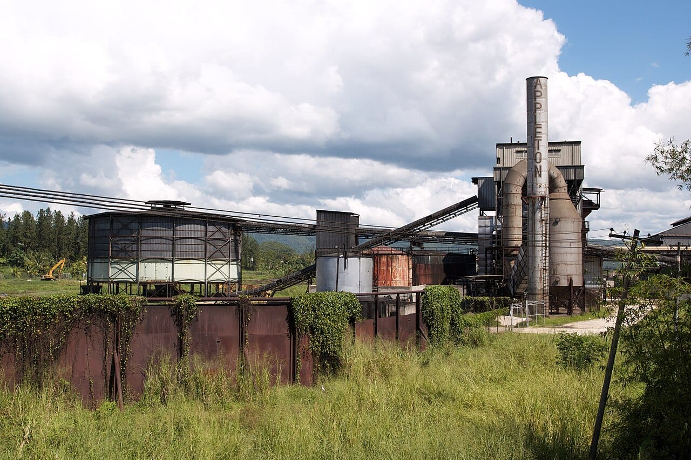
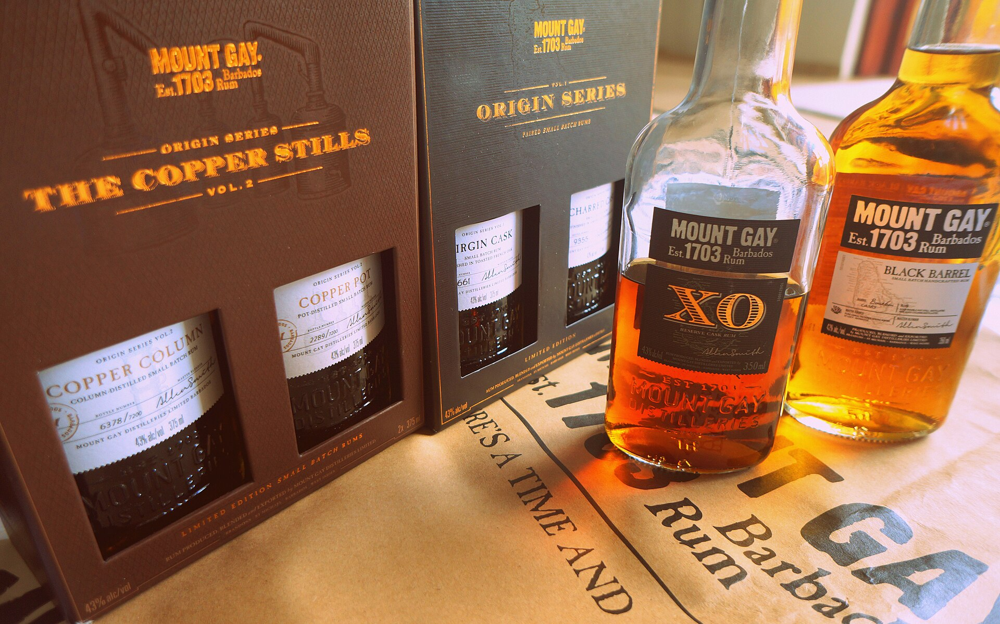

# Appleton Estate

从牙买加南岸的 Santa Cruz 往内陆开，路会逐渐变窄，甘蔗田、石灰岩丘陵与偶尔出现的牛群取代海岸。Appleton Estate 就在 Nassau Valley 的谷地里：一片不算高的厂区、成排的桶库、游客中心与巨大的 “Appleton Estate Jamaica Rum” 拱门。它不是一个“海边酒吧式”的朗姆景点，而是一座仍在运转的甘蔗庄园与蒸馏厂，也是牙买加持续运营最久的朗姆酒厂。

> **到访信息**
> - 地址：Nassau Valley, St. Elizabeth, Jamaica。
> - 开放与预约：以[官方页面](https://www.appletonestate.com/en-us/)为准；开放时间、场次和预约规则会随季节调整。
> - 交通与费用：出发前以官方页面为准，本页不承诺固定票价。
> - 营业状态：已核实；来源最近核对：2026-11-21。

图：Appleton Estate 的厂区一角，Nassau Valley，牙买加圣伊丽莎白教区。图片：Acampbell3000，CC BY 3.0，via Wikimedia Commons（[原图页面](https://commons.wikimedia.org/wiki/File:Appleton_Estate_Jamaica_November_2012.jpg)）。

## 1749 年：Appleton Estate的关键起点
官方“Our Roots”把两个年份分开：1670 年，Francis Dickinson 来到牙买加，以他在英国的家乡命名 Appleton Estate；1749 年，出现最早有记录的合法朗姆蒸馏。前者是庄园的建立，后者是“朗姆生产”的档案起点。官方首页因此写“Since 1749”，并称它是牙买加持续运营最久的蒸馏厂，已有 275 年以上。

所有权几经变化：1871 年 William Hill 买下庄园，后来因财务困难转手；1900 年 Kingston 企业家 Alexander McDowell Nathan 购入，1907 年地震中去世，经理 James Miller Farquharson 接管并扩张，1914 年由弟弟 Walter 接手。1916 年，Cecil Lindo 兄弟买下 Appleton，并在同年 4 月买下 J. Wray & Nephew，两者第一次进入同一公司体系。1970 年 J. Wray & Nephew 启动五年现代化计划；今天 Appleton 属 Campari Group 旗下的 J. Wray & Nephew。官方还写：1981 年 Joy Spence 以首席化学家身份加入，16 年后成为烈酒业界首位女性 Master Blender；1997 年，游客中心在 Appleton 开放。

## 风土与厂区

Nassau Valley 的地质是 Appleton 叙事的地基：石灰岩喀斯特像天然滤器，把雨水过滤成清澈的泉水；官方说这里每天下午两点半左右有一阵雨，肥沃土壤、热带气候与泉水共同构成“单一庄园”的风土。Appleton 的朗姆全部在同一个庄园内生产，这在朗姆世界里并不多见。厂区周围是甘蔗田与丘陵，空气潮湿，桶库里的酒在高温高湿中加速与木桶交换，形成热带陈年特有的颜色与味道。

游客中心与厂区是两套空间：游客中心有接待、影片、品鉴室、餐厅与商店；厂区有压榨、发酵、蒸馏与桶库。参观动线通常从欢迎饮料与短片开始，再走到甘蔗压榨演示、蒸馏车间与桶库，最后回到品鉴室。厂区不是“布景”，而是真实生产现场，部分区域可能因生产或维修关闭；跟紧导览员，不要擅自进入仓库或设备区。

## 工艺与风味

Appleton 的工艺线索是“甘蔗—糖蜜—发酵—蒸馏—橡木桶—热带陈年”。牙买加朗姆常用糖蜜发酵，Appleton 使用自家甘蔗与泉水；蒸馏环节有铜壶蒸馏器与柱式蒸馏器的组合，取酒时分离不同段位，保留风味与酒体。陈年在橡木桶中进行，热带高温让酒液每年蒸发更多（“天使份额”），也让木桶、香草、焦糖与果香更快融合。

风味上，Appleton 的常见描述是香草、橙皮、热带水果、肉豆蔻、可可与咖啡、焦糖与橡木；8 年 Reserve 更轻、更适合调酒，12 年 Rare Cask 更圆、带可可与咖啡，15 年 Black 更厚，21 年 Nassau 更干、更陈。它不像某些过度加糖的“香料朗姆”那样甜腻；它的甜来自甘蔗与桶，而不是糖浆。第一次喝，可以先试 8 年或 12 年，再对比 15 年或 21 年，感受“热带陈年”的厚度。

## 怎么喝

参观项目叫 “Joy Spence Appleton Estate Rum Experience”，含导览与品鉴。典型流程是：欢迎饮料（通常是一款 Appleton 调酒）、介绍影片、甘蔗与糖蜜体验、蒸馏车间、桶库，最后在品鉴室比较三款陈年朗姆。部分导览允许拍照，但蒸馏车间通常禁止；具体以现场规定为准。整个体验约 2–3 小时，含午餐会更长。

喝法上，Appleton 在牙买加最常见的日常组合是 “Appleton & Ting”：Appleton 与葡萄柚汽水 Ting，加大量冰，酸甜、清爽，适合热带天气。经典调酒里，Mai Tai、Rum Punch、Hurricane 都常用 Appleton；陈年款适合纯饮或加一块冰，不要用可乐盖住 12 年以上的味道。品鉴时先闻、再小口、让酒在口腔里停一下；不要一口闷，也不要把品鉴当成“无限畅饮”。

## Appleton Estate的地址与营业安排
- 地址：Nassau Valley, St. Elizabeth, Jamaica；邮寄区域常写 Siloah P.O., Santa Cruz。
- 坐标：18.164468, -77.729135。
- 开放：官方预约页与当地指南通常列周二至周六 9:00–15:30；具体场次与节假日以官方预约为准。
- 门票：导览从约 US$39/人起（仅入场，交通与餐食另计）；价格会变，以官方或预订伙伴为准。
- 预约：建议提前在线预订定时导览；旺季与邮轮日容易满。
- 交通：从 Montego Bay 或 Negril 自驾/包车约 2.5–3 小时，路况多弯；不建议当天往返邮轮港口，时间太紧。
- 时长：2–3 小时；含午餐、YS Falls 或周边景点可安排一整天。
- 无障碍：游客中心与部分路线可轮椅通行，但厂区地面不平；预订时确认。
- 周边：YS Falls、Black River、Treasure Beach、Montego Bay 都可组合；不要酒后长途驾驶。

## 礼仪与常见误区

第一，不要把 Appleton 当成“海滩酒吧”。它是庄园与蒸馏厂，参观重点是工艺与陈年，不是无限喝酒。第二，不要把“1749”与“1670”混为一谈：1670 是 estate 建立，1749 是最早合法蒸馏记录。第三，不要把 Joy Spence 说成“创始人”；她是 1981 年加入、1997 年成为首位女性 Master Blender 的调酒大师，游客中心在她任内开放。第四，不要以为“游客中心 1988 年开放”；官方年表写 1997 年，维基的 1988 说法不可靠。第五，不要只喝加糖的椰子朗姆；先试纯饮或 Appleton & Ting，再判断风味。第六，不要忽略甘蔗种植园与殖民贸易、奴隶制的关系；朗姆酒的历史不只有阳光与海盗，参观时看到相关纪念点，值得停下来。

1670 年建立 estate 与 1749 年最早合法蒸馏记录是两条时间线；参观时听到的品牌故事，不能替代对蒸馏年份与酒款标签的核对。

## 从Appleton Estate延伸到Foursquare
从 Appleton 出来，可以往南到 YS Falls 玩水，或往 Black River 坐船看红树林与湿地，再往 Treasure Beach 住一晚。把这一站放进“加勒比朗姆”长线，可以对照巴巴多斯的 [Foursquare](ref:foursquare)、[Mount Gay](ref:mountgay)，古巴的 [Havana Club 朗姆博物馆](ref:havana) 与 [Santiago 朗姆博物馆](ref:santiago)，以及 [巴巴多斯朗姆路线](ref:route)。它们各自回答不同问题：Appleton 看“单一庄园与热带陈年”，Foursquare 看“糖蜜与蒸馏器实验”，Mount Gay 看“持续运营与 Barbados 风格”，古巴两馆看“国有酒厂与城市酒文化”。

牙买加南岸公共交通不适合串联这些点；包车或跟一日团最稳。从 Montego Bay 出发要预留一整天，从 Negril 出发也要 2.5–3 小时单程；不要把 Appleton 与 Dunans River Falls、YS Falls 排得太满。

## 参考资料
- 官方“Our Roots”：<https://www.appletonestate.com/roots/>，用于核对 1670 年建 estate、1749 年最早合法蒸馏、275 年以上、Nassau Valley 风土、1981 年 Joy Spence 加入、1997 年首位女性 Master Blender 与游客中心开放。
- 官方首页：<https://www.appletonestate.com/en-us/>，用于核对“Since 1749”、牙买加持续运营最久蒸馏厂、单一庄园与导览定位。
- 官方酒款页：<https://www.appletonestate.com/en-us/rums/>，用于核对 8/12/15/21 年酒款与风味。
- 牙买加政府信息服务（JIS）：<https://jis.gov.jm/jamaica/appleton-estate-rum-jamaican-spirits-cuisine-visit-jamaica/>，用于核对持续运营最久、Joy Spence、导览内容与 Appleton + Ting。
- 加勒比朗姆对照：[Foursquare](ref:foursquare)、[Mount Gay](ref:mountgay)、[Havana Club 朗姆博物馆](ref:havana)、[Santiago 朗姆博物馆](ref:santiago)、[巴巴多斯朗姆路线](ref:route)。

## 相关图像

图：芒特盖酒厂相关实景照片。图片：Aneil Lutchman，CC BY-SA 2.0，via Wikimedia Commons（[原图页面](https://commons.wikimedia.org/wiki/File:Mount_Gay_Distilleries_Origin_Series,_Black_Barrel_and_XO.JPG)）。关联图像：Appleton Estate。
