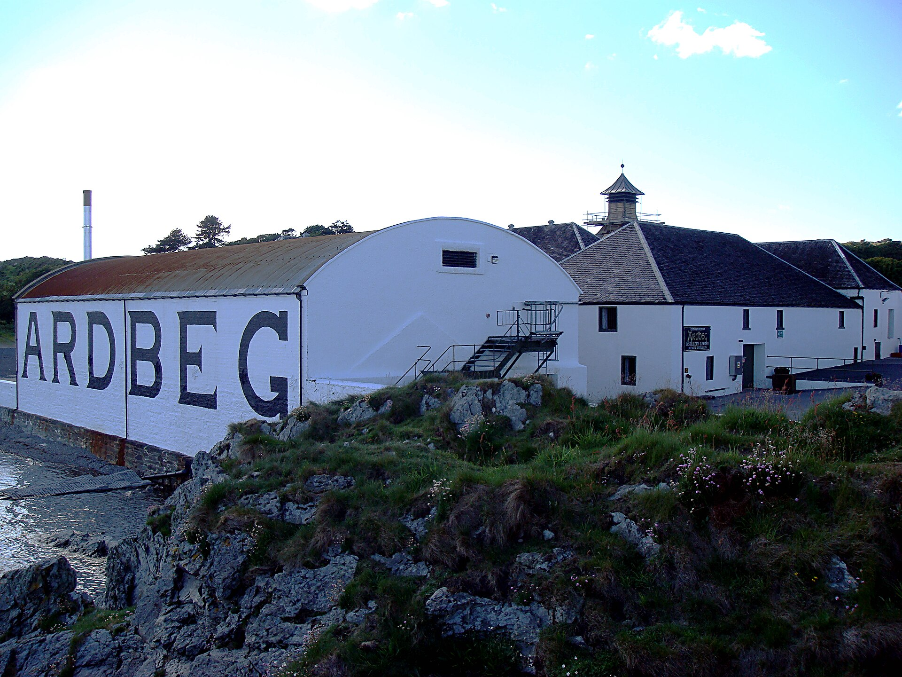

# 阿贝蒸馏厂

阿贝蒸馏厂（Ardbeg Distillery）在艾雷岛南岸，地址是 Port Ellen, Isle of Islay, Argyll, PA42 7EA。它不在波特埃伦镇中心，而是在镇外一条通向海岸的支路上；从主路拐进去，先看到的是低矮的厂房、仓库与访客中心，再往外就是海风与草地。阿贝以重泥煤、带海盐与烟熏感的单一麦芽威士忌闻名，但“最重泥煤”是品牌与酒评里的说法，不是一条可以量化到每一瓶的法规；参访时更值得关注的是它如何把麦芽、泥煤、蒸馏与陈年组合成稳定风格。

> **到访信息**
> - 地址：Ardbeg Distillery, Port Ellen, Isle of Islay, Argyll, PA42 7EA, Scotland。
> - 开放与预约：以[官方页面](https://www.ardbeg.com/)为准；开放时间、场次和预约规则会随季节调整。
> - 交通与费用：出发前以官方页面为准，本页不承诺固定票价。
> - 营业状态：已核实；来源最近核对：2026-11-08。

图：阿贝蒸馏厂相关实景照片。图片：Rappilio，CC BY-SA 3.0，via Wikimedia Commons（[原图页面](https://commons.wikimedia.org/wiki/File:Ardbeg_whiskybrennerei_islay_schottland_16.06.2007.JPG)）。

> **先给结论**
> **一句话：** 这页判断阿贝蒸馏厂值不值得专程去，以及到访前要核对什么。
>
> - **适合谁：** 正在计划去阿贝蒸馏厂、想知道值不值得专程安排半天到一天的人。
> - **不适合谁：** 只想要“必去榜单”、不准备核对预约、交通和开放时间的人。
> - **先看这两点：**
>   - 参观以预约制为主，官方建议提前在线预订导览或品鉴，旺季尤其容易满位。
>   - 第一个误区是把“重泥煤”当成“越贵越好”。

## 1815 年：阿贝蒸馏厂的关键起点
1815 年，约翰·麦克杜格尔（John MacDougall）取得执照，把阿贝建立为一处合法的商业蒸馏厂；官方历史把这一年作为创立年份。此前该地是否有非法蒸馏，常被写进品牌故事，但缺乏公开的原始记录，参观时可以把这类说法当作传说而非定论。1838 年，格拉斯哥酒商托马斯·布坎南（Thomas Buchanan）以 1800 英镑买下蒸馏厂，约翰的儿子亚历山大·麦克杜格尔继续管理；1853 年亚历山大去世后，产权再次转手。

20 世纪后期，阿贝经历了一段艰难时期：1981 年停产，1989 年恢复生产，1997 年被 Glenmorangie Company 收购，2004 年随该公司进入 LVMH 集团。1998 年，访客中心与 Old Kiln Cafe 开放，蒸馏厂开始系统接待游客；今天它既是生产基地，也是艾雷岛“威士忌之路”上的重要站点。阿贝在波特埃伦还有一处住宿项目 Ardbeg House，但住宿与蒸馏厂参观是两套独立的预订系统。

## 空间与酒单

蒸馏厂的参观动线围绕“从大麦到酒液”展开：麦芽（阿贝使用波特埃伦麦芽厂的麦芽）、糖化、发酵、蒸馏、冷凝与陈年。阿贝的泥煤风味来自烘烤麦芽时使用的泥煤烟，而不是在酒液里添加烟熏；发酵时间、蒸馏器形状与冷凝方式会影响最终风格。厂区内可以看到传统的糖化槽与蒸馏器，仓库里堆着橡木桶；靠海的位置让仓库长期处在高湿度与海风环境中，酒液在陈年中会带上咸感与矿物感，这部分解释常被酒厂用来讲“岛屿风格”。

核心酒款包括 Ardbeg Ten、Uigeadail、Corryvreckan、An Oa 与 Wee Beastie 等。Ten 年是基准款，适合第一次接触阿贝的人；Uigeadail 与 Corryvreckan 更重、更复杂，常带有雪莉桶或高泥煤的特征；An Oa 相对柔和，Wee Beastie 年轻、直接。访客中心提供单杯、DIY 品鉴与鸡尾酒，Old Kiln Cafe 提供餐食，Ardstream 拖车在旺季提供简餐。它们属于[苏格兰威士忌](ref:scotch-whisky)与更广的[威士忌](ref:whisky)传统，但阿贝的风格更靠近艾雷岛南岸的重泥煤一端。

## 参观或点单方式

参观以预约制为主，官方建议提前在线预订导览或品鉴，旺季尤其容易满位。标准导览通常从糖化与蒸馏车间走到仓库，讲解阿贝的工艺与历史，时长约 1 小时 15 分钟；冬季有“Classic Winter Tour”等季节性产品，内容与价格随年份调整。访客中心本身可以免费进入，提供单杯酒款、DIY 品鉴与商品；如果只想喝一杯、不参加导览，可以直接到访客中心，但仍要确认当天是否有团队占用空间。

第一次来，建议选包含生产区与仓库的导览，而不是只在访客中心点一杯。阿贝的价值一半在设备与空间：糖化槽的尺寸、蒸馏器的形状、仓库的湿度与海风，这些无法从酒标上读出来。若时间只够一小时，选最短的经典导览；若对泥煤与雪莉桶的差异感兴趣，再选包含更多酒款的品鉴。参加导览前不要喷浓香水，也不要涂气味强烈的护手霜，这会干扰自己和别人的嗅觉判断。

## 阿贝蒸馏厂的地址与营业安排
地址是 Ardbeg Distillery, Port Ellen, Isle of Islay, Argyll, PA42 7EA, Scotland。到艾雷岛通常有两条路：从大陆的 Kennacraig 乘 Caledonian MacBrayne 渡轮到 Port Ellen 或 Port Askaig，航程约 2 小时，通常每天 3 班，周三与周日班次较少；或从格拉斯哥乘 Loganair 飞机到艾雷岛，航程约 30 分钟，每天约两班。上岛后需要租车、打车或乘当地巴士，蒸馏厂之间距离不近，公共交通班次有限。

访客中心开放时间随季节变化：2026 年 5–9 月每天 09:30–17:00，4 月、10 月与 11 月至 2027 年 4 月为周一至周五 09:30–17:00；2026 年 6 月 15 日至 7 月 12 日为静默期，经典导览暂停，但仍有其他品鉴活动。官方列出的额外闭馆日包括 2026 年 5 月 31 日、8 月 13 日与 8 月 15 日；2026 年 12 月 22 日至 2027 年 1 月 4 日闭馆，1 月 5 日重开，最后一场导览在 2026 年 12 月 18 日。开放时间、静默期与临时闭馆会调整，出发前以官网当日公告为准。

门票/预约：经典导览（The Classic Distillery Experience）2026 年价格为每人 £22.50，约 1 小时 15 分钟，含 3 杯 15ml 核心系列品鉴；导览必须预约，线上预订在开始前 12 小时关闭。另有含限定版酒款的导览约 £40、仓库品鉴约 £65 等更高价选项，价格区间大致 £22.50–£70。18 岁以下可以参加经典导览，但不能饮酒；不喝酒的同行者可申请“司机酒样”带走。访客中心本身免费进入，可单杯点酒或做 DIY 品鉴。艾雷岛天气多变，风大、雨多，穿防风防水的外套与防滑鞋比穿正装更合适；蒸馏厂部分老建筑对行动不便者不完全友好，预订时应先询问。最新导览场次、票价与预约关闭时间以 Ardbeg 官网当日预订页为准；页面核验于 2026-11-08。

## 礼仪与误区

第一个误区是把“重泥煤”当成“越贵越好”。泥煤强度是风格选择，不是质量等级；有人喜欢 Uigeadail 的厚重，也有人更适合 Ten 或 An Oa。第二个误区是把阿贝当成波特埃伦镇内可以步行到达的酒厂。它在镇外，步行需要一段时间，且道路没有人行道；没有车的话要提前安排出租车或巴士，不要临时在路边拦车。

第三个误区是只拍照不听说。蒸馏厂的生产区有高温、蒸汽与运转设备，参观时必须跟随导览路线，不要越过黄线或触碰阀门。第四个误区是把品鉴当成“喝得越多越懂”。威士忌的酒精度高，品鉴时应先闻香、加少量水、再小口；不想喝完可以留在杯中或使用吐酒桶。若还要开车，绝对不能饮酒；艾雷岛道路窄、天气变化快，酒后驾驶风险很高。

带狗可以进入商店，但不能进入导览、品鉴区与 Old Kiln Cafe；这是官方明确规则。带孩子的家庭要确认导览是否适合儿童，生产区有噪音与热气，不适合奔跑。参加 Fèis Ìle（艾雷岛威士忌节）期间，岛上住宿与交通非常紧张，蒸馏厂活动也需要提前很久规划；若只想安静参观，避开节日周会更合适。

## 从阿贝蒸馏厂延伸到艾雷岛
阿贝在艾雷岛南岸的“基尔达尔顿三厂”一带，沿 A846 向南可以到 Laphroaig 与 Lagavulin，三处距离不远，适合安排成半日到一日的威士忌路线。除了酒厂，南岸还有 Kildalton Cross 与海岸步道，天气好时可以兼顾风景；波特埃伦镇内有餐厅、商店与渡轮码头，适合作为落脚点。若从 Port Askaig 上岛，则可以先看岛东与岛北，再绕到南岸，路线不要安排得太紧。

对只安排一天的旅行者，建议上午从 Kennacraig 或格拉斯哥出发，中午到波特埃伦，下午参加阿贝导览，傍晚去 Laphroaig 或 Lagavulin 的访客中心，晚上住岛上；当天往返会很赶，渡轮与天气都可能延误。阿贝属于[艾雷岛](ref:islay)产区，而艾雷岛又是[苏格兰](ref:scotland)威士忌的一部分；把阿贝与斯佩塞或高地的酒厂比较，会更容易理解“岛屿泥煤”与“内陆风格”的差别。理解蒸馏与陈年的基本逻辑，可以参考[产地与工艺](ref:place-and-process)。

## 同产区蒸馏厂与延伸阅读
- [艾雷岛](ref:islay)：岛屿威士忌的泥煤、海风与酒厂分布。
- [苏格兰威士忌](ref:scotch-whisky)：法规、产区与风格分类。
- [威士忌](ref:whisky)：从原料到陈年的基本知识。
- [产地与工艺](ref:place-and-process)：理解风土、蒸馏与陈年。
- [LVMH](ref:lvmh)：阿贝所属集团的公司背景。
