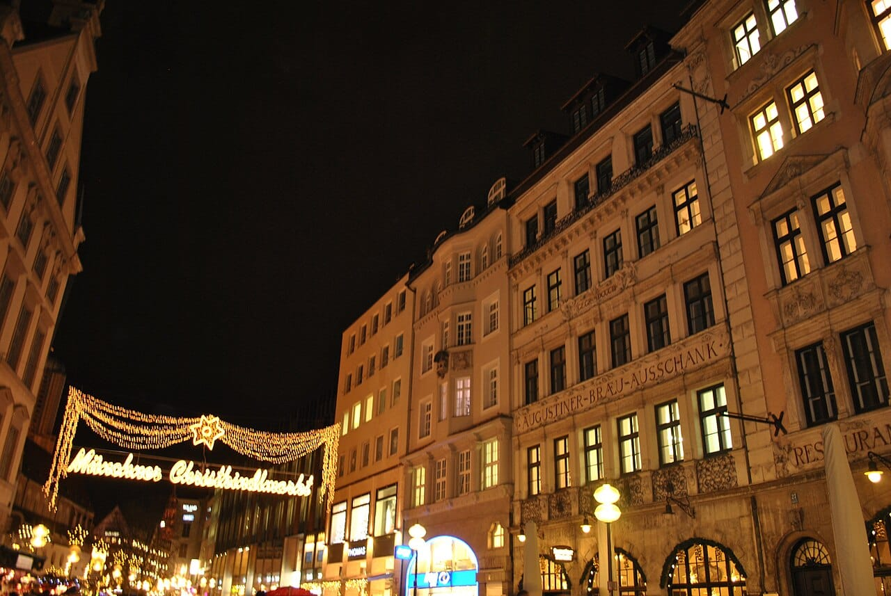
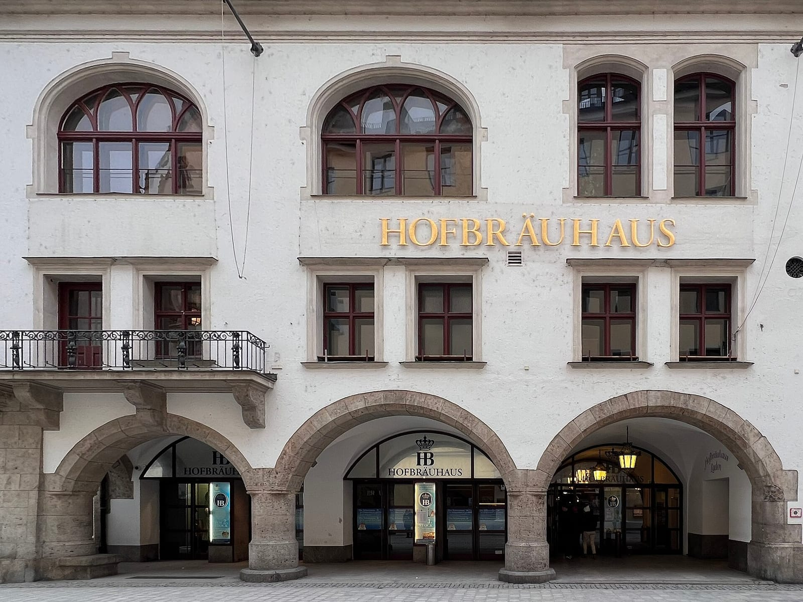

# 奥古斯丁啤酒厂

图：奥古斯丁啤酒厂。图片：Elisa.rolle，CC BY-SA 4.0，via Wikimedia Commons（[原图页面](https://commons.wikimedia.org/wiki/File:Augustiner-Br%C3%A4u_0004.jpg)）。

## 1328 年：奥古斯丁啤酒厂的关键起点
奥古斯丁啤酒厂的厂区在慕尼黑西侧的 Landsberger Straße 31–35，门牌属于 80339 Munich。品牌把 1328 年视为建厂年：1294 年奥古斯丁隐修会在 Haberfeld（今 Frauenplatz 一带）建立修道院，14 世纪初修道院内出现啤酒坊，1328 年的文献首次提到这里在酿酒。修道院酿酒在巴伐利亚并不罕见，奥古斯丁的特殊之处在于它把"供应修士日常"的作坊，逐步做成面向城市的商业啤酒厂。

1803 年的世俗化改变了这家酒厂的产权结构。修道院财产被国家接管，啤酒厂转为私营，此后由瓦格纳（Wagner）家族经营至今，今天的公司名是 Augustiner-Bräu Wagner KG。19 世纪末，生产集中到 Landsberger Straße 现址，形成今天看到的工业建筑群；它保存得较完整，但仍在使用，不是把历史封存起来的主题公园。

奥古斯丁常被称为"慕尼黑现存最古老的啤酒厂"。这个说法指的是修道院酿酒线索与持续经营，而不是某一块招牌从 1328 年挂到现在。另一个可以核实的差异是：1987 年起，奥古斯丁是慕尼黑六大啤酒厂中唯一在十月啤酒节只用木桶出酒的品牌。这条细节比"古老"更能说明它的经营性格——保守、慢、不追新。

## 厂区与酒单

Landsberger Straße 的厂区是生产设施，不是展馆。建筑、装卸区、烟囱与办公部分共同构成一个仍在运转的工厂；游客能进入的部分有限，能否参观、如何预约要以官方回复为准。把厂区当成"啤酒博物馆"会失望，把它当成"城市工业遗产的一角"则能看到另一种慕尼黑。

产品线可以按"日常—浓郁—深色—季节"来记。Lagerbier Hell 是主力：淡色拉格，麦芽甜与温和苦味，酒体干净，传统上用 0.5 升杯；Edelstoff 是 export hell 风格，酒体更饱满、原麦汁浓度更高，酒精度约 5.6%，适合想多要一点结构的人；Dunkel 是深色拉格，烤面包、可可与麦芽香更明显；Pils 更干、更苦，适合喜欢清爽收尾的人；Maximator 是深色双倍博克，酒精度约 7.5%，属于寒冷季节的烈性款。它们都属于更广的[啤酒](ref:beer)与[拉格](ref:lager)家族，但选择逻辑不是"越贵越好"，而是按场合与口味挑。

对第一次接触这个品牌的人，最稳的比较是 Hell 与 Edelstoff 各一杯：前者告诉你"慕尼黑日常是什么味"，后者告诉你"同一家厂把酒体加厚会变成什么样"。Dunkel 与 Maximator 则适合在晚餐或冬天点，空口喝容易累。

## 怎么喝、在哪里喝

厂区本身不设面向散客的常规酒吧，想喝这个品牌，通常去与酒厂相关的餐饮场所。Braustuben 在 Landsberger Straße 厂区一带，是最近的选择，适合"看完厂区外观就坐下吃饭"；Augustiner-Keller 在 Arnulfstraße 52，是带啤酒花园的大型餐饮点，夏天更适合；市中心的 Augustiner am Platzl 则是另一种"游客更容易到达"的选择。三处的营业时间、菜单与是否接受预订都不同，出发前分别查官方信息。

点单方式与慕尼黑其他啤酒馆一致：说杯型与酒名，侍者记在桌卡上，最后一起结账。第一次去建议 Hell 0.5 升配烤猪肘或白香肠；想对比就加一杯 Edelstoff。Maximator 不适合作为第一杯，7.5% 的酒精度在空腹时上升很快。若不喝酒，也可以点矿泉水或苹果汁，巴伐利亚的酒馆通常都提供。

不适合来这里的情况：期待固定时段导览、纪念品商店与"沉浸式体验"的游客；想直接走进车间拍照的人；把厂区当成景点、临时到门口要求参观的旅行者。它更适合对啤酒生产、家族企业或城市工业史有具体兴趣的人，且需要提前做沟通。

## 奥古斯丁啤酒厂的地址与营业安排
地址是 Landsberger Straße 31–35, 80339 München（官方 Impressum 地址）。最近的车站是 S-Bahn Donnersbergerbrücke，出站沿 Landsberger Straße 向西步行约 8–10 分钟（约 650 米）；地铁 U4/U5 Schwanthalerhöhe 步行约 12–15 分钟。具体线路、无障碍电梯与末班车以 MVV 当日查询为准。厂区周边以办公与工业为主，不是逛街型街区。

**开放与预约**：这里是仍在运转的生产厂区，不是酒厂博物馆。官网未设公众参观、品鉴或纪念品商店的预约入口；第三方 2026 年指南也明确写明 Landsberger Straße 厂区不提供公众导览。散客不能临时到门口要求进车间；如因商务、媒体或行业关系需要接洽，须通过官网联系方式提前说明。`operating_status: verified` 只表示酒厂正常运营与地址已核实，不表示每天开放参观。

**门票**：无公众门票，也无常规品鉴收费项目。想喝 Augustiner，应去 Braustuben（Landsberger Straße 19，厂区旁）、Augustiner-Keller（Arnulfstraße 52）或市中心的 Augustiner am Platzl；这些餐饮点各自定价，市中心店通常比厂区店贵一档，啤酒本身在慕尼黑属中等价位。各店营业时间、厨房时段与是否接受预订均以其官方页面为准。

着装没有要求；若因获准的商务访问进入生产区，需遵守工厂安全规定（不要穿凉鞋、不要越过警戒线）。带小孩或推婴儿车的人要先确认餐饮点是否有无障碍入口；厂区不是儿童游乐场所。

「奥古斯丁啤酒厂」的开放时间、价格与预约，以[官网](https://www.augustiner-braeu.de/)的公开页面为准；核验日期为 2026-11-08，临时调整以官网当日公告为准。

## 礼仪与常见误区

把"1328 年"当成公司注册年，是最常见的误读。它是修道院啤酒坊首次见于文献的年份；品牌、家族企业与现代公司结构是后来才形成的。第二个误区是把"修道院酿酒"想象成今天的修道院还在酿酒——原修道院早已世俗化，厂区也不在修道院原址。

第三个误区是把 Edelstoff 当成"酒精度加倍"的烈性酒。它是 export hell，酒精度约 5.6%，比 Hell 稍高、酒体更饱满，但不是双倍博克。真正的高酒精度款是 Maximator，且属于季节性产品。第四个误区是把"奥古斯丁"这个名字当成一家店：慕尼黑有多处挂 Augustiner 招牌的餐饮场所，产权与经营关系各不相同，认店要看具体地址与运营方。

在相关餐饮点喝酒时，礼仪与慕尼黑其他酒馆相同：拼桌先问、碰杯看对方眼睛、结账时报含小费的总额、不要自带酒水。参观厂区若获准进入，不要拍生产线与工人，不要触碰设备；这类要求属于工厂规则，不是"店家态度不好"。

## 从奥古斯丁啤酒厂延伸到皇家啤酒屋
厂区在慕尼黑西侧，往东步行或乘一站车可到 Theresienwiese——十月啤酒节的场地；往东北方向是中央车站与老城。把这一带串起来，可以安排"厂区外观 + Braustuben 午餐 + Theresienwiese 散步"的半日路线，再去市中心看[皇家啤酒屋](ref:hofbrauhaus)，对比州营游客型大厅与家族企业厂区餐饮的差别。

若时间有限，建议只选一处喝酒：想在厂区附近安静吃饭就去 Braustuben；想体验啤酒花园就去 Augustiner-Keller；想顺路逛老城就去市中心店。三处都不适合"临时到门口要求参观车间"，这一点要先想清楚。

## 同城啤酒厂与延伸阅读
- [啤酒](ref:beer)：拉格、小麦与烈性啤酒的基本分类。
- [拉格](ref:lager)：淡色拉格与深色拉格的工艺差异。
- [皇家啤酒屋](ref:hofbrauhaus)：慕尼黑另一处著名啤酒馆，可与本厂区对照。
- [一杯酒，为什么有地方的味道？](ref:place-and-process)：产地、原料与工艺如何进入酒里。

相关条目：[一杯酒，为什么有地方的味道？](ref:place-and-process)。

## 相关图像

图：皇家啤酒屋相关实景照片。图片：Burkhard Mücke，CC BY-SA 4.0，via Wikimedia Commons（[原图页面](https://commons.wikimedia.org/wiki/File:2023-02-03_Hofbr%C3%A4uhaus_am_Platzl_07.jpg)）。关联图像：奥古斯丁啤酒厂。
