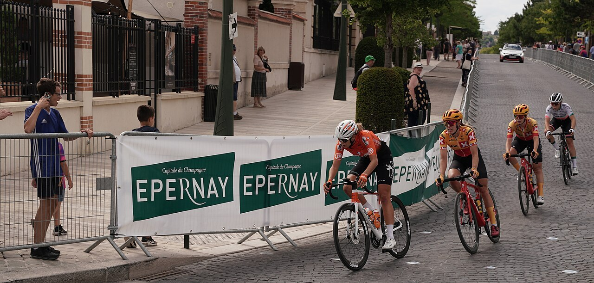

# 埃佩尔奈香槟大道

埃佩尔奈香槟大道（Avenue de Champagne）在埃佩尔奈市中心南侧，从共和国广场一带向东南延伸，约 1.5 公里。它不是一座酒庄，而是一条由香槟酒商宅邸、生产与仓储建筑共同构成的街道。18 世纪这里是巴黎通往德国的大道，被称为“王家之路”；酒商因为地下白垩岩层适合挖酒窖而聚集，街道先后叫过“商业郊区”等名字，1925 年正式改称“香槟大道”。1849 年巴黎—埃佩尔奈铁路通车，把这里与巴黎市场更紧密地连起来。

图：埃佩尔奈香槟大道。摄影：Avenue de champagne épernay 1409027。署名：G.Garitan，CC BY-SA 4.0，来自 Wikimedia Commons（[来源](https://commons.wikimedia.org/w/index.php?curid=121135039)）。

## 1925–2015：埃佩尔奈香槟大道的历史节点
这条街的历史可以分三层看。第一层是交通：它原本是巴黎到德国的大道，18 世纪被称作“王家之路”，酒商沿着这条路把货运往北方。第二层是地质：埃佩尔奈地下是厚厚的白垩岩，挖出的酒窖温度稳定、湿度合适，适合香槟长期陈酿；酒商因此把仓库、宅邸和办公都集中到同一条街上。第三层是制度：1925 年，这条街正式命名为“香槟大道”，此时香槟产区已经通过原产地命名体系确立了“只有香槟区按传统法酿造的起泡酒才能叫 Champagne”的规则。

1994 年，大道被法国列为“美味名胜”（Site Remarquable du Goût）；2015 年，它作为“香槟丘陵、宅邸与酒窖”（Coteaux, Maisons et Caves de Champagne）的一部分列入 UNESCO 世界遗产。这个遗产不是一个点，而是把葡萄园、酒商宅邸与地下酒窖放在一起看的文化景观；大道是其中最有代表性的城市段落之一。

## 空间与酒单

两侧是 19 世纪末风格的宅邸与厂房。Moët & Chandon 在 18 号，Perrier-Jouët 的 Cellier Belle Epoque 在 26 号，香槟葡萄酒与地区考古博物馆在 13 号的 Château Perrier，旅游局在 7 号。Mercier 的酒窖可以乘小火车参观，地下通道长约 18 公里；整条大道地下据市政府统计有约 110 公里酒窖、约 2 亿瓶香槟。地面上看到的是一排房子，地面下才是这条街真正的规模。

这里的“酒单”不是一张菜单，而是各家酒庄各自的参观与品鉴产品。Moët 的经典窖藏游强调品牌史与大规模陈酿；Mercier 的小火车适合第一次看酒窖的人；Perrier-Jouët 把美术新艺术收藏与品鉴放在一起；Boizel 的 Atelier 1834、de Castellane 的花艺与塔楼、Pol Roger 的家族酒庄路线，则各有不同的节奏。价格、语言与是否接待儿童，各家不同，不能拿一家的经验套整条街。

## 参观或点单方式

大道本身是公共街道，步行免费，不需要门票。想进酒窖必须参加对应酒庄的参观，通常要提前在酒庄官网预约；有些酒庄在门口设酒吧或商店，可以临时喝一杯，但不能把“街上逛逛”当成“看遍酒窖”。第一次来建议选一到两家：一家大型酒庄看规模与历史，一家小酒庄看风格差异；一天塞三四家会变成赶场。若只想试酒不预约，大道入口一带和部分酒庄的酒吧提供杯卖，具体开放时间以各家为准。

预约时要注意三件事：参观语言、集合地点与迟到规则。多数酒窖在参观开始前十分钟停止入场，地下通道手机信号弱，迟到往往无法追赶。品鉴是否含在参观里、含几杯、是否有年份香槟，都要在下单前看清。带孩子的家庭要确认酒庄是否允许未成年人进入酒窖，有些只允许在品鉴区等候。

## 埃佩尔奈香槟大道的地址与营业安排
地址：Avenue de Champagne, 51200 Épernay, France（坐标 49.04111, 3.96972，取大道中段）。大道是公共街道，全天通行、步行免费，不需要门票；进入酒窖则须参加各酒庄的参观，通常在自家官网或指定票务页预约，价格、时长、语言与是否含品鉴各家不同。

交通：从埃佩尔奈火车站（Gare d'Épernay）步行约 5 分钟到大道路口；巴黎东站（Gare de l'Est）有直达列车，约 80 分钟；自驾从巴黎走 A4 高速约 90 分钟。街边有公共停车区域，旺季紧张，建议停在市中心公共停车场再步行。

开放时间与限制：大道本身无固定开放时间。沿街酒庄多为每天 9:30–17:30 前后接待，Mercier 小火车、Moët 与 Perrier-Jouët 等需按预约时段入场；收获季（约 9 月）部分酒庄暂停参观，个别酒庄翻修期整段关闭，出行前以各家官方预约页为准。地下酒窖温度较低，夏天也建议带薄外套；路面为石板与缓坡，穿稳当的鞋比穿礼服更实用。

「埃佩尔奈香槟大道」的开放时间、价格与预约，以[官网](https://epernay.fr/sortir-bouger/culture-patrimoine/patrimoine-a-decouvrir/lavenue-de-champagne)的公开页面为准；核验日期为 2026-11-08，临时调整以官网当日公告为准。

## 礼仪与误区

误区一是把“香槟大道”当成一座酒庄或一个品牌。它是一条街，酒庄各自独立经营，门票与预约也各自管理。误区二是以为沿街每扇门都能进，很多宅邸与生产区是私产，门口没有参观标识就不要推门。误区三是把香槟当普通起泡酒，只有在香槟产区、按传统法酿造的起泡酒才能叫 Champagne。误区四是把品鉴当成“喝回票价”，参观的重点是酒窖、工艺与风格差异，不是杯数。

参观酒窖时不要触摸酒瓶与橡木架，不要用闪光灯；品鉴时先看后闻再喝，需要吐酒时使用吐酒桶。开车的人不要试饮，法国对酒驾零容忍。街道上有居民与上班的人，拍照时不要堵住门口，也不要大声招呼同伴。买酒时注意携带与托运限制，香槟瓶重，别在第一家就买到提不动。

## 埃佩尔奈的周边街区
从大道往西北回到市中心，可看埃佩尔奈市政厅与教堂；往东南出城是 Chouilly 与白丘（Côte des Blancs）方向，适合继续看葡萄园。若时间充裕，可去西北约 15 分钟车程的欧维莱尔（Hautvillers），那里与本笃会修士唐培里侬的传说有关；再往北是兰斯（Reims），可看另一组香槟酒庄与兰斯大教堂。把埃佩尔奈安排成一天：上午参观一家酒庄的酒窖，中午在市中心吃饭，下午沿大道散步并看博物馆，比一天跑两家大酒庄更从容。

如果只在大道上走，不预约任何酒窖，也能看到宅邸立面、庭院与街景，但会错过这条街最重要的地下部分。反过来，如果只预约酒窖而不留时间散步，也会把一条有城市生活的街当成一条参观通道。两者各留一半时间，比较合适。

## 同产区酒庄与延伸阅读
香槟大道是理解[香槟](ref:champagne)作为产区、品牌与仪式性饮料的入口，也适合与[起泡酒](ref:sparkling)的工艺比较一起读；[地方与工艺](ref:process)则解释了为什么同一套方法离开香槟会变成另一种酒。

补充阅读：[香槟](ref:c-extra-1)、[A Ginjinha](ref:c-extra-2)。

对照阅读：[香槟法定产区](ref:champagne)、[一杯酒，为什么有地方的味道？](ref:process)。

相关条目：[起泡酒](ref:sparkling)。
