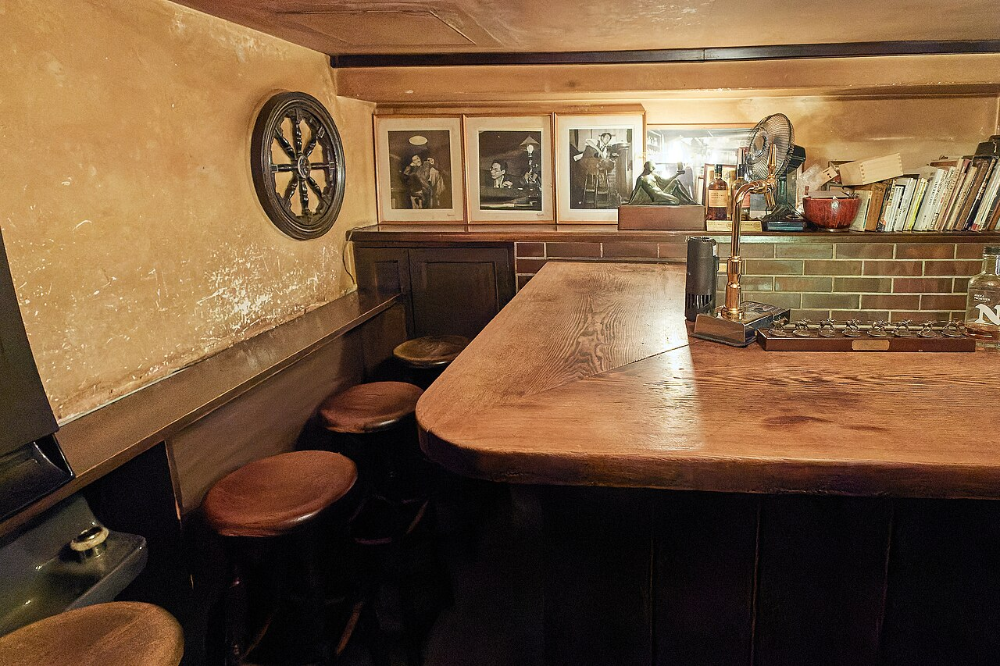

# Bar Lupin

从银座并木通拐进一条小巷，抬头会看到一块红底白字的旧招牌：戴礼帽、单片眼镜的男子侧身举着酒杯，下面写着 “Lupin”。顺着狭窄的楼梯下到地下一层，推开门，噪声突然消失：深色木吧台、黄铜灯、旧镜、墙上的黑白照片，十几把高脚凳。这里不是《文豪野犬》的主题店，而是一间从 1928 年活到今天的文坛酒吧；动漫只是后来叠加的一层读者。

图：Bar Lupin 的 L 形木吧台；1935 年改造的吧台、椅子与灯具在 1970 年代大楼重建时被拆下保存，后按原样装回。图片：Araisyohei，CC BY 4.0，via Wikimedia Commons（[原图页面](https://commons.wikimedia.org/wiki/File:Interior_of_bar_Lupin_Ginza.jpg)）。

## 1928 年：Bar Lupin的关键起点
Bar Lupin 1928 年 10 月 3 日开业，创始人是高崎雪子。她在昭和初期银座的咖啡馆工作，认识了泉镜花、里见弴，又得到菊池宽、久米正雄等人的支持；直木三十五等熟人还帮忙做过宣传单。开业初期是介绍会员制，由女给（女性服务人员）端酒，当时一杯酒约 3 日元；1935 年改造为柜台酒吧，才形成今天以日本梣木（yachidamo）做成的 L 形吧台——长边约 7.5 米，短边约 1.6 米。

战争把这间店推到过边缘。1944 年它被迫休业，店名还因为“敌性语”排斥一度改成日式的“面包亭”；1945 年 1 月空袭中，大楼没有被直击，但门被爆风吹掉、水管漏水。战后物资匮乏，它先以喫茶店重开，再想办法弄到酒，让老客人还能喝上一杯。1972 年大楼重建，店里没有把旧吧台丢掉，而是把吧台、椅子、灯具与装饰全部拆下保存，停业两年，等新楼建好再原样装回去。太宰治坐过的 L 形吧台位置因此保留下来；每年樱桃忌，仍有文学读者在那个座位放一只杯子献杯。

## 建筑与空间

店在地下一层，入口是一条陡而窄的楼梯。门是黑色木门，门把手与门框都旧得发亮；门边的招牌是手绘的 Arsène Lupin 形象——店名取自法国作家莫里斯·勒布朗笔下的怪盗，而不是宫崎骏的动画。进门后空间很小：L 形吧台占去大半，吧台后是酒架与冰柜，吧台前是十几把高脚凳；靠墙有几张小桌，最里面是照片墙。

吧台是日本梣木，颜色偏浅，边缘被几十年手臂磨得圆润。灯光以黄铜吊灯与壁灯为主，亮度刚好照到酒杯与人的脸，不照墙。墙上挂着林忠彦拍摄的织田作之助、坂口安吾与太宰治照片；还有手写的开业纪念帖、旧酒标与插画。空间没有“主题装饰”的密度，它的力量来自少：木头、黄铜、黑白照片与安静。座位不多，背包与大衣要放在脚边或衣帽间，别占过道。

## 酒单与味觉

酒单以威士忌、波本与经典鸡尾酒为主。DEEPTOKYO 说这里的调酒师平木许久（Ikuo Hiraki）做的鸡尾酒很出色，最受欢迎的一款是 Golden Fizz——坂口安吾爱喝的经典 Fizz。Golden Fizz 属于 Fizz 家族：金酒、柠檬汁、糖与苏打，有时加蛋黄，口感绵密、酸度明亮、气泡细。它不像现代鸡尾酒那样追求复杂装饰，而是靠温度、酸度与气泡的平衡。

威士忌从苏格兰单一麦芽到日本威士忌都有，波本与黑麦威士忌也在架上；马尔蒂尼、曼哈顿、边车这类经典也能点。第一次来，可以点 Golden Fizz，或者让吧台按你的口味推荐一杯威士忌（直饮、加冰或高球）。不要要求“文豪同款”以外的花式特调；这里不是以创意菜单取胜，而是以经典配方、冰与温度取胜。小食通常简单，坚果、巧克力或奶酪，别指望正餐。

## 怎么喝

参考营业时间是 17:00–23:00（LO），周日与周一休；以官网或电话为准。最舒服的时段是开门后的 17:00–19:00，店里人少，吧台有位置，调酒师也有空聊两句；21:00 以后，尤其是周五周六，常客与外国客人会把吧台填满。这里不适合大声聚饮，也不适合十几人的团队；两三个人最好，最多四人。

进门后先看是否有空位，不要自己拉开吧台椅；等调酒师示意。点单可以直接说酒名，也可以说“威士忌，加冰”或“Golden Fizz”。吧台座位通常有桌费或服务费，具体以店内菜单为准；结账时确认。拍照可以，但不要用闪光灯，也不要拍调酒师与客人的正脸；如果要拍吧台全景，先问一句。店内允许吸烟吗？以现场为准；不要假设。

## Bar Lupin的地址与营业安排
- 地址：B1F Tsukamoto Real Estate Bldg., 5-5-11 Ginza, Chuo-ku, Tokyo 104-0061（东京都中央区银座 5-5-11 冢本不动产大楼 B1F）。
- 坐标：35.672014, 139.764720。
- 电话：03-3571-0750。
- 营业：参考 17:00–23:00（LO），周日与周一休；节假日与临时休业以官网/电话为准。
- 交通：地铁银座站步行约 3 分钟；从并木通进入小巷，看到红色 Lupin 招牌后下楼。
- 入场：DEEPTOKYO 提示需年龄验证，随身带护照或身份证；穿着过于暴露（凉鞋、短裤、背心）可能被拒。
- 预订：小店通常不接受大团预订，按现场空位入座；特殊节日建议先电话确认。
- 支付：以店内规定为准；日本酒吧常见现金与信用卡并用，备一点现金更稳。
- 无障碍：地下层只能走楼梯，轮椅无法进入；楼梯陡，穿高跟鞋或行动不便者要小心。

## 礼仪与常见误区

第一，不要把这里当成“《文豪野犬》主题咖啡厅”。它是真实的文坛酒吧，动漫只是后来的流行文化层；不要期待角色立牌或主题菜单。第二，不要说是太宰治“创办”了这里；创始人是高崎雪子，太宰是常客。第三，不要大声讨论动漫剧情或拍照打卡；这里的核心是安静喝酒，常客与调酒师都需要空间。第四，不要用闪光灯；吧台很小，闪光会打扰所有人。第五，不要穿背心、短裤与凉鞋；门口可能直接拒绝。第六，不要把“Golden Fizz”当成唯一选择；威士忌与经典鸡尾酒同样值得。

## 从Bar Lupin延伸到Star Bar Ginza
从 Bar Lupin 出来，往南是银座中央通与歌舞伎座，往北是京桥与日本桥，往东是筑地。可以把这一站放进“银座酒吧”夜间线：先到 [Star Bar Ginza](ref:star) 看现代调酒师的精准，再到 [Kamiya Bar](ref:kamiya) 看明治以来的大众酒馆，接着到 [Bar High Five](ref:highfive) 看经典鸡尾酒的另一种服务，最后到 [American Bar Savoy](ref:savoy) 看酒店酒吧的秩序；整条线可以按 [东京酒吧路线](ref:route) 步行或短程打车完成。

银座不适合开车，地铁与步行最稳。晚上 10 点以后，并木通的小巷很安静，但主干道仍有车；回酒店可以走到银座站或东银座站。若想继续喝，注意日本酒吧的 last order 通常比关门时间早 30–60 分钟。

## 参考资料
- Bar Lupin 官方站点：<http://home.u06.itscom.net/lupin/>（由 lupin.co.jp 跳转），用于核对店名、地址、1928 年创业与营业信息。
- DEEPTOKYO 文章：<https://deeptokyo.jp/en/spot/nightlife/1598/>，用于核对 1935 年梣木吧台、太宰/坂口/织田常客、林忠彦照片、Golden Fizz 与入场提示。
- さんたつ 文章：<https://san-tatsu.jp/articles/524680/>，用于核对 1944 年休业、战后重开、1972 年大楼重建与吧台保存、太宰座位、樱桃忌献杯与营业时间。
- JNTO 文章：<https://www.japan.travel/en/de/story/japanische-literatur-reise/>，用于交叉核对 1928 年开业与文豪常客。
- 同城条目：[Star Bar Ginza](ref:star)、[Kamiya Bar](ref:kamiya)、[Bar High Five](ref:highfive)、[American Bar Savoy](ref:savoy)、[东京酒吧路线](ref:route)。
