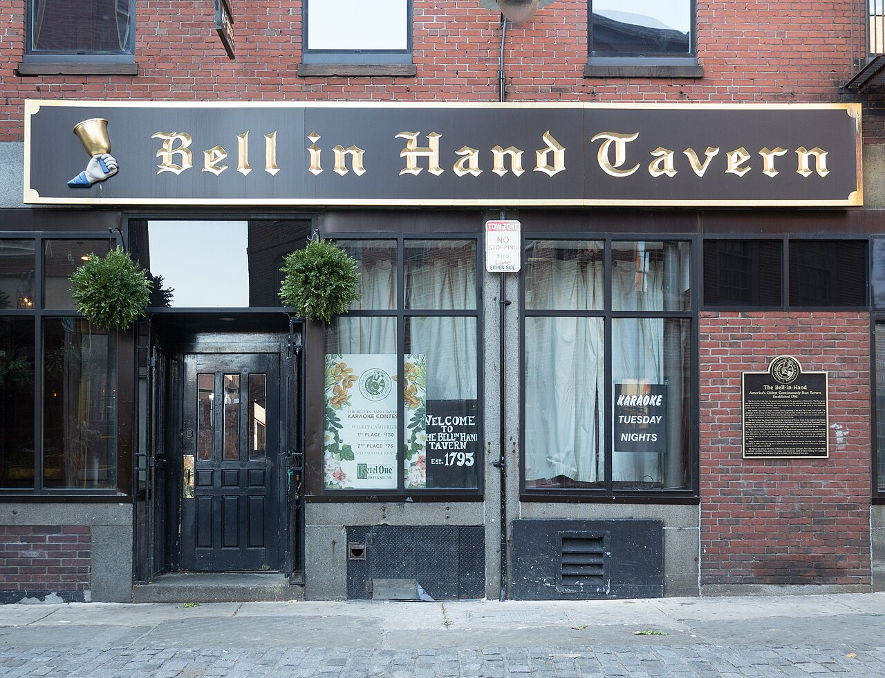

# 钟声酒馆

在波士顿 Union Street 靠近 Faneuil Hall 的一侧，有一间门面不宽、招牌却很好认的酒馆：黑底金字的横匾上画着一只手握铃铛，下面是“Bell in Hand Tavern”。它夹在现代办公楼与游客商店之间，门口常常有人举着手机拍照，也有人直接推门进去喝一杯。钟声酒馆（Bell in Hand）是波士顿最常被称作“老酒馆”的地方之一，但它的故事并不是一条从 1795 年笔直延伸到今天的直线，而是一条不断迁址、停业、改名、再开张的折线。

图：波士顿 Union Street 的 Bell in Hand 酒馆转角外观与招牌；酒馆 1795 年由镇公告员 Jimmy Wilson 创办，照片中的建筑为 19 世纪中叶的砖楼，不是 1795 年原屋。图片：Rhododendrites，CC BY-SA 4.0，via Wikimedia Commons（[原图页面](https://commons.wikimedia.org/wiki/File:Bell_in_Hand_Tavern_(36199).jpg)）。

## 1795 年：钟声酒馆的关键起点
酒馆的官方叙述把起点定在 1795 年：创办人是波士顿的镇公告员（town crier）詹姆斯·“吉米”·威尔逊（James “Jimmy” Wilson）。他每天摇着手铃在街头宣读公告、传消息，酒馆便以那只铃铛和“Bell in Hand”（手持铃铛）为名。这个细节解释了招牌上的图案，也解释了它为什么总被写成“新闻与流言交汇的地方”：在报纸还不普及的年代，镇公告员本人就是移动的信息中心，酒馆则是人们听他讲完消息后留下来讨论的场所。

不过，1795 年的酒馆并不在今天的 Union Street。地方史料与公开记录都显示，它最初靠近旧市政厅，后来迁到 Williams Court/Pi Alley，再到 81 Devonshire Street，最后才落在 Union Street。也就是说，今天的地址是这条“酒馆生命线”的最近一站，而不是起点。现址这栋砖楼属于 19 世纪中叶的城市商业建筑，门面、窗框和内部隔断都经过多次改造；把它当成“1795 年的原屋”会误导读者。

最需要小心的是“美国最老连续营业酒馆”这个称号。店家官网把它当作招牌叙述，公开史料也说它“被认为是”最老连续营业酒吧，但同一句里就承认禁酒令期间停业。Secret Boston 根据波士顿报纸记录指出，这间酒馆在 1915 年已经关门，1934 年才在另一个地址重开，中间停了约 19 年。换句话说，1795 年是“品牌起点”，不是“同一栋房子、同一张执照、一天不断”的起点。把它写成“自 1795 年起连续营业”会与公开记录冲突；更准确的说法是“1795 年创办、多次迁址、禁酒令与 1910 年代经营变动中曾停业，今天仍以同一名字营业”。

19 世纪的钟声酒馆是政治、商业与码头工人混坐的地方。丹尼尔·韦伯斯特（Daniel Webster）等政治人物曾是早期常客，酒馆也常被用作集会、签约和新闻传播的场所。禁酒令结束后，它随着波士顿市中心的功能变化，逐渐从“社区酒馆”转为面向上班族与游客的历史酒吧。今天它仍保留酒馆的日常功能：供应啤酒、鸡尾酒和吧台食物，周末有音乐与体育转播，而不是一座只供参观的故居。

## 空间与酒单

现址是一栋转角砖楼，入口在 Union Street 一侧，室内分成前后两个主要空间和三个吧台区域。墙面以深色木饰与砖墙为主，吧台上方挂着历史照片、旧招牌和体育纪念物；白天光线从临街大窗进来，晚上则靠暖色吊灯与电视屏幕照明。整体气氛更接近“城市酒吧”而不是“乡村客栈”：桌子排得较紧，声音偏大，适合朋友聚会和看球，不适合长时间安静读书。

酒单以美式酒馆的常规组合为主：本地与全国性品牌的生啤、瓶装啤酒、苹果酒，经典鸡尾酒与季节性特调，另有汉堡、龙虾卷、炸鱼、汤和沙拉一类的吧台食物。它不是以精酿闻名的 destination bar，也不是海鲜餐厅；点单时按“酒馆”的预期来，会比按“历史景点”的预期更容易满意。若想吃得轻一点，可以只点汤或小食；若想认真喝，可以让吧台推荐当天状态较好的生啤。

## 怎么喝

第一次来，建议从一杯本地生啤或经典美式淡啤开始，再按心情转向鸡尾酒。波士顿的酒馆文化偏直接：吧台通常忙，点单时说清楚要“一品脱（pint）”还是“半品脱”，要不要开瓶、要不要加冰，比研究复杂酒单更实用。想体验历史感，可以坐在靠窗或靠砖墙的位置，但不要期待“1795 年原貌”——这里的看点是“老名字仍在营业”，不是“老房子原封不动”。

时间上，工作日下午到傍晚最舒服，午餐时段能看清室内细节；晚上和赛事日会非常吵，周末常有音乐活动。若只是想在 Freedom Trail 途中歇脚，喝半品脱、吃一份小食，再继续走，比在这里安排正餐更合适。

## 钟声酒馆的地址与营业安排
地址是 45 Union Street, Boston, MA 02108。它位于波士顿市中心，步行可达 Faneuil Hall、Quincy Market 与 Union Oyster House，最近的地铁站是 State Street 与 Government Center。官方列的营业时间是每日 11:00–02:00，厨房通常到午夜；节假日、赛事与私人活动会调整，出发前查官网或电话确认。

酒馆一般接受散客，团体与包场建议提前联系。美国酒吧的法定饮酒年龄是 21 岁，进门与点酒都可能查证件；带未成年人时，先确认当天是否允许进入以及到几点。这里没有严格着装要求，但晚餐时段穿得稍整齐会更自在。小费按税前金额 18%–20% 是常规，吧台点酒可以按每杯 1–2 美元或账单比例给。

## 礼仪与常见误区

第一个误区是把“1795”当成“这栋楼建于 1795”。更准确的是：酒馆品牌从 1795 年开始，现址建筑是后来的 19 世纪砖楼，地址也换过多次。第二个误区是把“美国最老连续营业酒馆”当成无争议事实；公开记录显示它至少在 1915–1934 年间停业，因此这句话应加引号，写成“店家自称”或“常被称作”。第三个误区是把这里当成博物馆：它是正在营业的酒吧，拍照不要挡住吧台与通道，不要要求店员停下来讲历史。第四个误区是期待安静；这里是城市酒馆，音乐、电视和人群声是体验的一部分。若想要安静聊天，避开赛事日和周末晚间。

## 从钟声酒馆延伸到麦所利老啤酒屋
从酒馆出来，沿 Union Street 走几分钟就是 Faneuil Hall 与 Quincy Market，再往东是 Rose Kennedy Greenway 与海港；往西可接 Freedom Trail，走到 Boston Common。把钟声酒馆与联合牡蛎屋安排在同一条步行线上很自然：两家都在 Union Street，前者偏酒馆，后者偏餐厅，可以先喝半品脱再吃饭，也可以反过来。想比较美国东北部的老酒馆，可以继续读[麦所利老啤酒屋](ref:mcsorleys)与[纽约历史酒馆路线](ref:ny-route)；想理解酒馆与城市的关系，可读[酒馆史](ref:taverns)与[认识一座城，从一间酒馆开始](ref:pub-city)；同城对照见[联合牡蛎屋](ref:union)。

## 参考资料
- [酒馆史：从酒肆、客栈到酒吧](ref:taverns)
- [认识一座城，从一间酒馆开始](ref:pub-city)
- [联合牡蛎屋](ref:union)
- [麦所利老啤酒屋](ref:mcsorleys)
- [纽约历史酒馆路线](ref:ny-route)

最后核对：45 Union Street 的现址、1795 年品牌起点与 1915–1934 年停业记录按官网与公开资料查于 2026-11-21；“最老连续营业”不作为无争议史实。本页是“喝酒去”的波士顿酒馆条目，中文与英文版同步；文字许可见上方 rights 字段，图片署名与许可见各图注。
