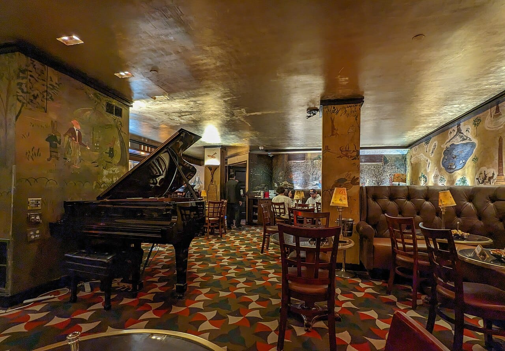

# 贝梅尔曼斯酒吧

贝梅尔曼斯酒吧（Bemelmans Bar）在纽约上东区卡莱尔酒店（The Carlyle）底层，地址是东 76 街 35 号。它 1947 年开业，名字来自奥地利裔美国插画家、作家路德维希·贝梅尔曼斯（Ludwig Bemelmans），也就是《玛德琳》（Madeline）系列的作者。酒吧四壁是他亲笔绘制的中央公园场景：溜冰者、马车、动物与孩子。白天它像一间安静的酒店酒吧，傍晚钢琴响起，入夜后爵士三重奏把房间变成上东区最典型的“夜色客厅”。

图：贝梅尔曼斯酒吧。图片：Ɱ，CC BY-SA 4.0，via Wikimedia Commons（[原图页面](https://commons.wikimedia.org/wiki/File:Bemelmans_Bar.jpg)）。

> **先给结论**
> **一句话：** 这页判断贝梅尔曼斯酒吧值不值得专程去，以及到访前要核对什么。
>
> - **适合谁：** 正在计划去贝梅尔曼斯酒吧、想知道值不值得专程安排半天到一天的人。
> - **不适合谁：** 只想要“必去榜单”、不准备核对预约、交通和开放时间的人。
> - **先看这两点：**
>   - 第一个误区是把 Bemelmans Bar 与 Café Carlyle 当成同一个地方。
>   - 卡莱尔酒店 1930 年开业，是上东区一栋装饰艺术风格的公寓式酒店；贝梅尔曼斯酒吧 1947 年出现在酒店底层，属于战后纽约酒店业重新构想夜生活的产物。

## 1947 年：贝梅尔曼斯酒吧的关键起点
卡莱尔酒店 1930 年开业，是上东区一栋装饰艺术风格的公寓式酒店；贝梅尔曼斯酒吧 1947 年出现在酒店底层，属于战后纽约酒店业重新构想夜生活的产物。它从一开始就不是普通街角酒吧，而是酒店为住客与上东区居民准备的会客空间：房间不大，座位紧凑，光线偏暗，适合低声交谈与慢慢喝酒。

路德维希·贝梅尔曼斯 1898 年生于奥地利，后移居美国，以《玛德琳》系列闻名。关于壁画的由来，流传最广的说法是他以画画换取在酒店一年半的住宿；酒店官方则强调，这组壁画是他现存唯一的公共委托作品。两种说法并不冲突：一个讲交易，一个讲作品在艺术史中的位置。壁画以中央公园为背景，画面里有溜冰、马车、动物与孩子，玛德琳也藏在其中。它不是“儿童插画展”，而是把一位插画家的想象放进了一个成年人喝酒的房间。

酒吧与同酒店的 Café Carlyle 常被混淆。Café Carlyle 是晚餐加卡巴莱演出的空间，钢琴家 Bobby Short 曾在那里驻场三十六年；Bemelmans Bar 是酒吧，音乐以钢琴与爵士三重奏为主，酒单以经典鸡尾酒为核心。两者共享酒店的历史与客群，但不是同一个房间，预订与费用也不同。把 Bemelmans 当成“看演出的餐厅”，或把 Café Carlyle 当成“随便喝一杯的酒吧”，都会安排错。

## 空间与酒单

酒吧在酒店底层，空间不大，吧台、卡座与钢琴挤在同一个房间里。墙面被壁画包围，灯光低，桌面小，座位之间的距离近；这种尺度决定了它的使用方式：适合两三个人聊天、听音乐、喝一两杯，不适合大团体或长时间办公。壁画是房间的主角，但酒店没有把它做成“博物馆式”的隔离，客人就坐在画下面，酒杯、外套与谈话构成了作品今天的观看环境。

酒单以经典鸡尾酒为主：马丁尼、曼哈顿、老式鸡尾酒、金汤力、香槟与葡萄酒都能找到。它不是以“分子调酒”或复杂装饰取胜的酒吧，强项是执行稳定、温度与比例可靠。第一次来，点一杯马丁尼或曼哈顿最稳；如果不想喝烈酒，可以选香槟或葡萄酒。具体酒款、季节特调与价格会变，以酒店官方菜单为准，本页不写固定价格。

音乐是另一半产品。官方页面写明，钢琴手从下午 5:30 开始演奏，爵士三重奏从晚上 9 点后开始；从 5:30 起收取音乐费，卡座每人 25–35 美元、吧台每人 20–25 美元，具体取决于演出者。这笔费用不是“最低消费”，而是现场音乐的费用，酒水另算。若只想安静看壁画，下午开门后到 5:30 前是最便宜的时段；想听三重奏，就要接受晚间的音乐费与人流。

## 怎么喝

先决定坐哪里。卡座适合聊天与看整个房间，吧台适合一个人、看调酒师操作、和邻座搭话；音乐费按区域与演出者不同。预订可以通过 Resy、电话 +1 212 570-7120 或邮件 bemelmansbar@rosewoodhotels.com；卡座建议提前订，吧台位通常先到先得，具体以酒店为准。周末晚间与节假日前后最难订，想听 9 点后的三重奏，最好把时间留足。

点单顺序可以简单一些：先一杯香槟或清淡的高球，再一杯马丁尼或曼哈顿；如果只喝一杯，选马丁尼，告诉调酒师要金酒或伏特加、干的程度、要橄榄还是柠檬皮。鸡尾酒酒精度不低，配一点坚果或小食，不要空腹。纽约的酒吧法定饮酒年龄是 21 岁，入场可能查证件；带国际驾照或护照复印件比只带手机照片稳。

拍照可以拍壁画与自己的酒杯，但不要用闪光灯直射壁画，也不要拍到其他客人的正脸；钢琴演奏时不要大声说话、不要打长时间电话。着装要求是真实执行的：不能穿连帽衫、运动裤、短裤、背心、棒球帽或运动鞋；酒店保留请客人更换着装或改到其他时段的权利。它不是“随便路过喝一杯”的邻家酒吧，出门前换一双鞋、加一件外套，会省去门口被拦下的麻烦。

## 贝梅尔曼斯酒吧的地址与营业安排
地址是 35 East 76th Street, New York, NY 10021, USA，位于麦迪逊大道与公园大道之间；坐标 40.77440, -73.96300。地铁 6 号线到 77 街站，步行一个街区（约 4–6 分钟）；也可乘 M1/M2/M3/M4 等公交到麦迪逊大道或第五大道，再步行过去；打车直接说“The Carlyle”比说酒吧名字更清楚。

营业时间是周日与周一 12:00–24:00，周二至周四 12:00–00:30，周五与周六 12:00–01:00；这是 2026-11-08 复核的官方页面信息，节假日与私人活动会调整。`operating_status` 为 `verified`，表示官方页面与预订渠道在核验日仍正常运营；不等于任何时段都无需预订。5:30 后收取音乐费，卡座与吧台不同；酒水与音乐费分开计算，账单上通常会加税与小费。

预订不是强制，但卡座与晚间黄金时段建议提前订；吧台可以直接到店，但满座时要在门口等。住宿客人与非住客都可能需要排队，周末晚间最明显。酒店与酒吧有无障碍入口，具体路线可以到店前询问；酒吧空间紧凑，轮椅通行需要工作人员协助。周边是上东区，治安总体良好，但夜间仍建议走主街、不要钻进不熟悉的巷子。「贝梅尔曼斯酒吧」的开放时间、价格与预约，以[官网](https://www.rosewoodhotels.com/en/the-carlyle-new-york/dining/bemelmans-bar)的公开页面为准；核验日期为 2026-11-08，临时调整以官网当日公告为准。

## 礼仪与误区

第一个误区是把 Bemelmans Bar 与 Café Carlyle 当成同一个地方。前者是酒吧，后者是卡巴莱演出与晚餐空间；两者的预订、音乐费与着装要求不同。第二个误区是把音乐费当成“最低消费”。它是现场音乐的费用，酒水另算；不想付音乐费，可以 5:30 前到，或只在外带/其他时段安排。

第三个误区是低估着装要求。上东区的酒店酒吧会把“运动休闲”挡在门外：连帽衫、运动裤、短裤、背心、棒球帽、运动鞋都不合适；不是每次都会严格检查，但被要求更换着装时不要争论。第四个误区是把这里当成“安静看壁画”的博物馆。晚间有钢琴与三重奏，房间会变吵；想安静看画，选下午刚开门或工作日的早些时候。

喝酒礼仪上，鸡尾酒不要一口闷；马丁尼温度会很快升高，慢慢喝。不要用手指直接伸进杯子拿橄榄，也不要把手机举到别人面前拍。小费通常按账单 18%–20%，如果服务好可以更高；音乐费与小费是两件事。不要在钢琴手演奏时要求点歌或大声合唱，除非演出者主动邀请。

## 纽约的周边街区
酒吧在 76 街，往西两个街区就是中央公园，往东是麦迪逊大道的画廊与商店。下午可以先逛中央公园的 76 街入口、Bethesda Fountain 与 The Mall，再去看大都会艺术博物馆（第五大道与 82 街），傍晚回到 Bemelmans 喝一杯；这是一条很顺的“公园—博物馆—酒店酒吧”路线。弗里克收藏馆（Frick Collection）在 70 街，新画廊（Neue Galerie）在 86 街，古根海姆在 89 街，都可以按体力加减。

如果想看纽约酒吧的另一面，可以把 Bemelmans 与市中心的历史酒吧串起来：McSorley's Old Ale House 在 7 街，Employees Only 在西村，风格更粗粝、更热闹；上东区的酒店酒吧与市中心的酒吧是两种纽约，不是同一种体验。路线安排上，不要把两家都塞进一个晚上，地铁 6 号线从上东区到市中心要二十多分钟，喝酒后还要考虑回程。

交通上，6 号线 77 街站最近；M79 横穿市区的公交沿 79 街行驶，可以到中央公园西侧与自然历史博物馆；打车在晚间可能堵在麦迪逊大道。只安排一晚的话，建议住上东区或中城，不要把 Bemelmans 与布鲁克林、下东区的行程硬拼在一起。

## 同城酒吧与延伸阅读
贝梅尔曼斯酒吧是[酒吧与城市](ref:pub-and-city)关系的一个纽约样本：酒店酒吧、壁画、音乐与着装规则共同定义了“上东区的夜晚”。想走一条纽约历史酒吧路线，可以看[纽约历史酒吧路线](ref:ny-route)；想对照更老派的爱尔兰酒馆，可以读[麦克索利老酒馆](ref:mcsorleys)；想看禁酒令之后的鸡尾酒吧传统，可以读[Employees Only](ref:employees-only)。

补充阅读：[A Ginjinha](ref:c-extra-1)。

相关条目：[认识一座城，从一间酒馆开始](ref:pub-and-city)、[纽约历史酒馆路线：东村到格拉梅西](ref:ny-route)、[麦克索利老麦酒馆](ref:mcsorleys)。
