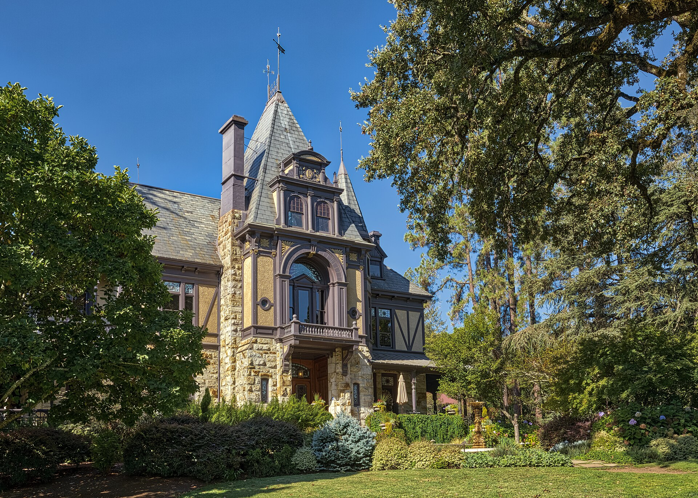
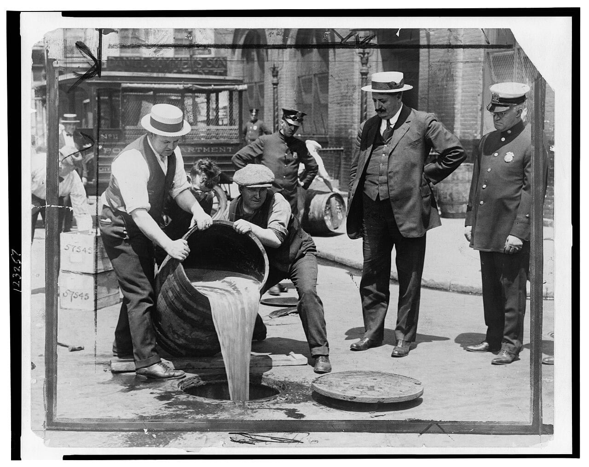

# 贝灵哲酒庄

贝灵哲酒庄在纳帕谷圣赫勒拿镇主街的北端，入口不算张扬，但一走进去就能看到与 29 号公路沿线多数现代酒庄不同的东西：一栋 1884 年的莱茵别墅、一座 1876 年的老酒厂，以及在坡地下手工开凿的酒窖。它由德国美因茨移民贝灵哲兄弟创立，2026 年迎来 150 周年。今天它既是参观景点，也是仍在生产 Private Reserve 赤霞珠的酒庄。

图：贝灵哲酒庄相关实景照片。图片：Frank Schulenburg，CC BY-SA 4.0，via Wikimedia Commons（[原图页面](https://commons.wikimedia.org/wiki/File:Rhine_House,_Beringer_Vineyards.jpg)）。

> **先给结论**
> **一句话：** 这页判断贝灵哲酒庄值不值得专程去，以及到访前要核对什么。
>
> - **适合谁：** 正在计划去贝灵哲酒庄、想知道值不值得专程安排半天到一天的人。
> - **不适合谁：** 只想要“必去榜单”、不准备核对预约、交通和开放时间的人。
> - **先看这两点：**
>   - 酒庄建议提前预约，官网写“建议预订，以确保想要的体验与时间”，当天也可能有余位，但需要在迎宾中心询问。
>   - 第一个误区是把莱茵别墅当成酒店或酒庄主人的故居博物馆。

## 1876 年：贝灵哲酒庄的关键起点
1876 年，雅各布·贝灵哲（Jacob Beringer）与弗雷德里克·贝灵哲（Frederick Beringer）兄弟在圣赫勒拿买下土地，建立酒庄。雅各布此前在东部做过酿酒师，熟悉欧洲的窖藏方式；他看中圣赫勒拿坡地的，不只是阳光，还有可以往山体里挖窖的岩石。两兄弟从德国莱茵河谷来到纳帕，把家乡的建筑趣味也带了过来。

老酒厂（Old Winery）是酒庄最早的建筑，用当地石材砌成，厚墙、小窗，靠山体保温。真正让贝灵哲在纳帕历史上留下位置的是酒窖：在没有现代机械的年代，工人用镐与炸药在山坡里挖出隧道，用来陈年酒。今天参观时走过的隧道，墙面还留着开凿痕迹；它不是天然溶洞，也不是后来用混凝土仿造的“酒窖风”布景。

莱茵别墅（Rhine House）建于 1883 至 1884 年，是弗雷德里克的住宅。它模仿贝灵哲家族在德国莱茵河谷的宅邸，有彩色玻璃与木雕，面向葡萄园。别墅不是酒厂的生产设施，而是“用建筑展示成功”的产物；它后来成为酒庄接待与品鉴的核心空间，也是纳帕谷少数可以入内参观的 19 世纪豪宅之一。

禁酒令（1920–1933）期间，许多纳帕酒庄倒闭，贝灵哲靠宗教用酒等合法许可维持了部分生产，酒窖与建筑得以保存。这段历史常被简化成“禁酒令期间酒庄都关门了”，但实际情况更复杂：有的酒庄转做葡萄汁、有的靠药用或宗教用途存活，贝灵哲属于后者。也正因为建筑与窖藏没有中断，它今天才能以“连续经营”自居。

## 空间与酒单

酒庄的参观空间可以分成四块：迎宾中心、老酒厂、酒窖隧道与莱茵别墅。迎宾中心在 Main Street 一侧，办理预约与品鉴；老酒厂展示早期酿酒设备与酒庄历史；酒窖隧道温度低、光线暗，用于陈年与私人活动；莱茵别墅用于较高阶的品鉴与餐酒活动。四块空间不在一条直线上，动线需要工作人员引导，不能自己乱走。

酒单以赤霞珠为核心。Private Reserve 赤霞珠是酒庄的旗舰，通常来自多个优质园块，风格偏成熟、结构厚；Knights Valley 系列来自索诺马县 Knights Valley 的葡萄，果味更外向；Napa Valley 系列是日常款；此外还有霞多丽、长相思与甜酒。贝灵哲在 1970 年代还因 White Zinfandel 的流行被写进美国葡萄酒史，那是一款粉红、微甜、低酒精的葡萄酒，与今天的精品线定位不同，但确实是酒庄商业史的一部分。

参观项目按深度分档。约 75 分钟的 Estate Tour & Tasting 会走葡萄园、酒窖与莱茵别墅，最后坐下来品鉴单一园酒款；Knights Valley Expression Tour & Tasting 同样约 75 分钟，重点在 Knights Valley 的风土；Discover Beringer 是自助户外导览，允许未成年人参加，适合家庭；此外还有以食品搭配、图书馆年份或私人露台为主题的项目。项目名称与内容会调整，预约页为准。

酒庄的品鉴不追求“一次喝遍所有酒”。Estate Tour 的品鉴通常围绕几款代表性酒，讲地块与年份；如果想喝 Private Reserve 的老年份，需要选择专门的项目。对第一次来的人，Estate Tour 信息量最完整；对已经熟悉贝灵哲的人，可以直接选以图书馆酒或单一园为主题的项目。

## 参观与点单方式

酒庄建议提前预约，官网写“建议预订，以确保想要的体验与时间”，当天也可能有余位，但需要在迎宾中心询问。预约通过官网进入订位系统，选择项目、日期与人数；7 至 14 人的团体需要电话预订，15 人以上走团体通道。含酒项目限 21 岁以上，只有 Discover Beringer 自助户外导览允许未成年人参加。

点单在品鉴时进行，通常由工作人员按项目配酒，不需要自己去吧台。想额外喝一杯，可以在品鉴结束后询问是否有单杯或按瓶购买；酒庄不以酒吧模式运营，临时加点不一定可行。购买整瓶在迎宾中心或商店完成，部分老年份与限量酒需要确认库存。

参观酒窖时不要触摸隧道墙面与桶塞，不要越过警戒线；隧道地面不平，穿防滑鞋。莱茵别墅内可以拍照，但不要使用闪光灯，也不要坐在展柜家具上。参加 Estate Tour 需要步行一段坡道与台阶，行动不便的游客应在预约时说明，酒庄会调整路线。

## 贝灵哲酒庄的地址与营业安排
地址是 2000 Main Street, St. Helena, CA 94574, USA；坐标 38.51061, -122.48130（OpenStreetMap way 768409823）。酒庄在圣赫勒拿镇主街北端，从镇中心步行可达；从纳帕市区开车约 25 分钟，从奥克维尔约 15 分钟，从旧金山经 29 号公路约 1.5 小时。官网列出的品鉴室营业时间为每日 10:00–17:00，节假日与私人活动会调整；以预约页显示的可选时段为准。

公共交通依赖 VINE 巴士，班次不密；也可以用网约车，但回程车不一定好叫。最现实的方式是自驾加指定司机，或包车。圣赫勒拿主街停车位有限，酒庄停车场在旺季中午容易满。`operating_status` 为 `verified`，表示官网与预订渠道在 2026-11-08 仍正常、未见停业公告，不代表当天一定有位。

参观建议提前预约：官网写“建议预订，以确保想要的体验与时间”，当天也可能有余位，但需在迎宾中心询问；7 至 14 人团体需电话预订，15 人以上走团体通道，电话 +1 707-257-5771。含酒项目限 21 岁以上，会查证件，外国驾照或护照均可；唯一例外是 Discover Beringer 自助户外导览，允许未成年人参加。

票价按项目分档（2026 年参考）：Estate Tour & Tasting 约 95 美元/75 分钟，含酒窖与莱茵别墅；Taste of Beringer Tour 约 95 美元；Knights Valley Expression 约 65 美元；Legacy Cave Tour 约 35 美元/30 分钟；Collectors' 约 150 美元；Veranda 约 65 美元；Discover Beringer 户外自助约 35 美元；Backyard Social 约 55 美元（7–15 人）；Rhine House 酒吧约 65 美元。价格与项目会调整，以官网或 Tock 预订页为准。酒窖温度低，夏天也建议带外套。「贝灵哲酒庄」的开放时间、价格与预约，以[官网](https://www.beringer.com/)的公开页面为准；核验日期为 2026-11-08，临时调整以官网当日公告为准。

## 礼仪与误区

第一个误区是把莱茵别墅当成酒店或酒庄主人的故居博物馆。它是 19 世纪的住宅，今天用于接待与品鉴，房间里的家具与装饰有修复与替换，不是“原封不动的故居”。第二个误区是把酒窖当成天然溶洞：它是人工开凿的隧道，墙面的凿痕是历史证据，不是装饰。

第三个误区是把 White Zinfandel 当成贝灵哲的全部。那款酒在 1970 至 1980 年代非常流行，但酒庄今天的核心是 Private Reserve 赤霞珠与单一园酒；用一款商业酒概括整个酒庄，会错过它的历史层次。第四个误区是以为“老酒庄”一定保守：贝灵哲在禁酒令后、1970 年代的品种革命与 2000 年代的旅游化中都做过调整，它既保留旧建筑，也做新项目。

品鉴时吐酒是正常做法，不要一口干；不要用手掌捂杯肚，不要加冰或可乐。拍照可以，但不要挡住通道，也不要把酒杯带出品鉴区。若开车，提前说明，酒庄会提供吐酒桶；不要相信“喝一点没事”，加州对酒驾的执法不留情面。

## 圣赫勒拿的周边街区
贝灵哲在圣赫勒拿主街北端，往南步行就是镇中心的餐厅、咖啡馆与书店；往北是查尔斯·克鲁格酒庄（Charles Krug）与贝灵哲的老邻居，往南是卢瑟福与奥克维尔。半日路线可以是：上午贝灵哲的 Estate Tour，午餐在圣赫勒拿主街，下午往南到蒙大维或作品一号；若只有一天，不要超过两家酒庄加一顿正餐。

圣赫勒拿比奥克维尔安静，主街适合步行，但酒庄之间仍有距离，开车更实际。纳帕谷在采收季（8 月至 10 月）交通拥堵，29 号公路与 Silverado Trail 之间要留出移动时间。把“喝酒”和“开车”分开，是这条路线最重要的前提。

## 同产区酒庄与延伸阅读
贝灵哲酒庄是理解[纳帕谷](ref:napa)与[葡萄酒](ref:wine)历史层次的一个样本：它把 19 世纪的移民建筑、禁酒令的生存策略与 20 世纪的商业创新放在同一处。关于美国禁酒令如何改变酒业，可以读[美国禁酒令](ref:prohibition)。

补充阅读：[美国](ref:c-extra-1)、[罗伯特·蒙大维酒庄](ref:c-extra-2)。

相关条目：[纳帕谷](ref:napa)、[葡萄酒](ref:wine)、[美国禁酒令：1920年至1933年的实验与废止](ref:prohibition)。

## 相关图像

图：美国禁酒令时期，执法人员将酒桶中的酒倒入下水道。。图片：Unknown author，Public domain，via Wikimedia Commons（[原图页面](https://commons.wikimedia.org/wiki/File:5_Prohibition_Disposal(9).jpg)）。关联图像：贝灵哲酒庄。
