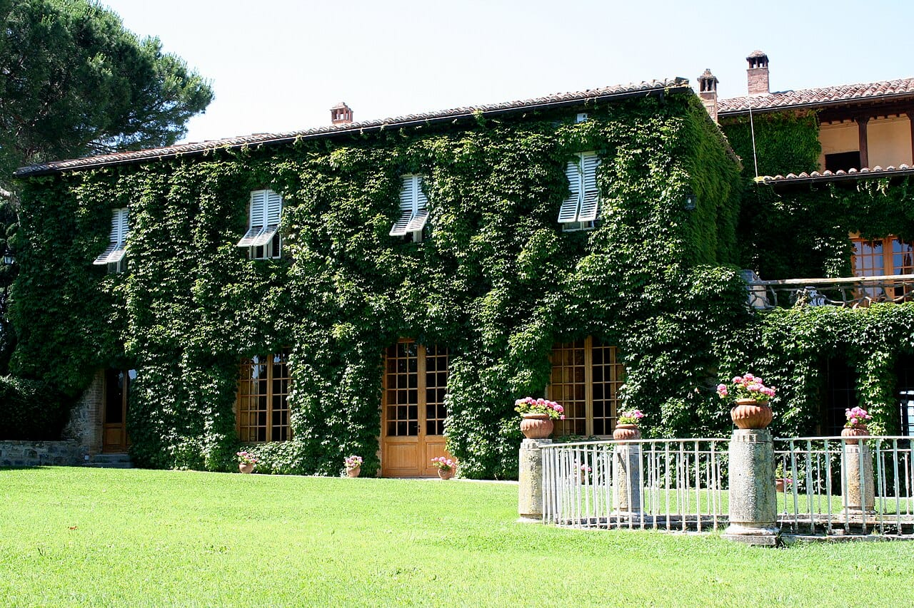
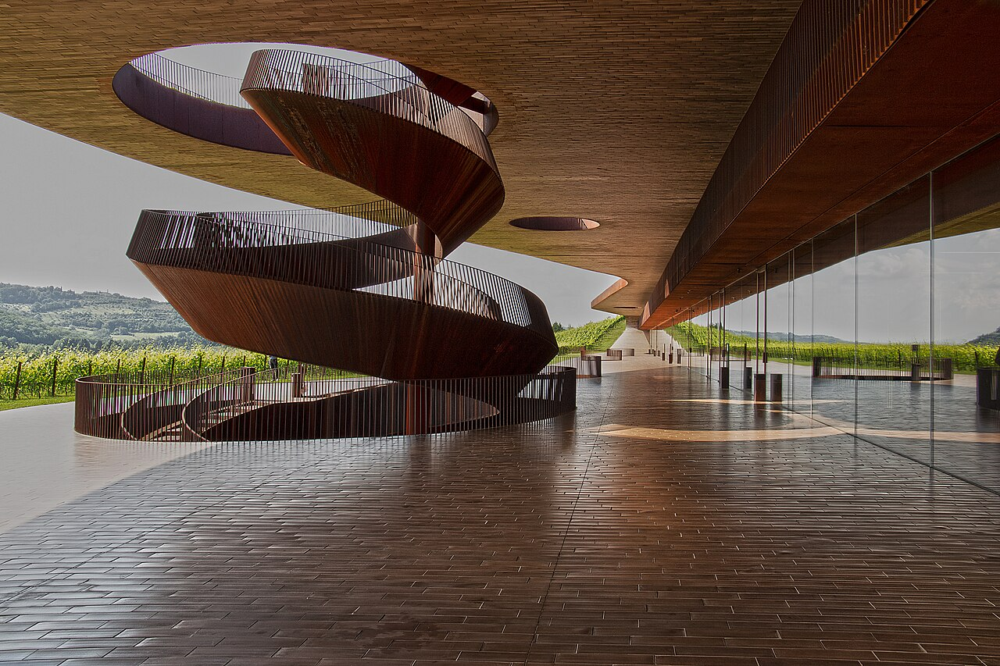

# 比昂迪-桑蒂酒庄

从蒙塔希诺镇往东北，路在柏树与橄榄林之间上升，最后进入 Greppo 的院子。这里的房子不高，墙上有爬藤，酒窖还是 19 世纪的样子。比昂迪-桑蒂不是一座“城堡酒庄”，它更像一个把时间藏在地下的家族农庄：1888 年，Ferruccio Biondi Santi 在这里产出首批正式标为 Brunello di Montalcino 的酒；今天，酒庄仍以 100% Sangiovese Grosso、老藤与大型斯拉沃尼亚橡木桶陈年为核心。

> **到访信息**
> - 地址：Località Greppo 183, 53024 Montalcino, Siena, Italy。
> - 开放与预约：以[官方页面](https://www.biondisanti.it/en/)为准；开放时间、场次和预约规则会随季节调整。
> - 交通与费用：出发前以官方页面为准，本页不承诺固定票价。
> - 营业状态：已核实；来源最近核对：2026-11-21。

图：比昂迪-桑蒂 Greppo 的藤蔓覆盖宅邸。图片：Megan Cole from Vancouver, Canada，CC BY 2.0，via Wikimedia Commons（[原图页面](https://commons.wikimedia.org/wiki/File:Brunello_di_Montalcino,_Italy_(5874133867).jpg)）。

## 1888 年：比昂迪-桑蒂酒庄的关键起点
比昂迪-桑蒂的故事从两个家族的联姻开始。1840 年，Santi 家族的 Caterina Santi 嫁给 Biondi 家族的 Jacopo Biondi，葡萄园与农庄合并。Caterina 的父亲 Clemente Santi 是研究 Sangiovese 的农学家与酿酒师；他的外孙 Ferruccio Biondi Santi 在 1888 年酿出首批 Brunello，并用“Brunello”这个名字把它与普通 Sangiovese 区分开来。

Ferruccio 的儿子 Tancredi 继续酒庄；Tancredi 的儿子 Franco 在 1970 年接手，直到 2013 年去世。Franco 把 Riserva 的老酒藏在酒窖里，二战期间甚至把酒墙封起来，避免战火；战后他重新打开酒窖，用 19 世纪末的 Riserva 做垂直品鉴，证明 Brunello 的陈年能力。Riserva 在酒庄历史上只生产过约 38 次，不是每个年份都有。

2017 年，法国 EPI 集团收购酒庄，家族保留部分参与；此后酒庄引入新的管理团队与酿酒师，但保留 Greppo 的葡萄园、老酒窖与 BBS11 克隆。BBS11 是酒庄选育并正式登记的 Sangiovese Grosso 克隆，被认为是 Greppo 风土与 Brunello 风格的关键。

## 建筑与空间

Greppo 的建筑是托斯卡纳农庄的尺度：低矮的石屋、爬满藤蔓的墙、柏树列、院子里的石凳。酒窖在地下，入口不显眼，里面是拱顶、石壁与成排的大桶。酒庄保留“La Storica”老酒库，存放 19 世纪末以来的 Riserva；这不是对外展厅，而是家族的时间档案。新酒窖与品鉴空间更简洁，但仍以石、木与中性容器为主。

比昂迪-桑蒂的“建筑”还包括葡萄园本身。Greppo 位于蒙塔希诺山丘的高处，海拔与昼夜温差让 Sangiovese 保持酸度与香气；土壤混合黏土、石灰岩、砂岩与 galestro。酒庄的葡萄园全部种 Sangiovese Grosso，老藤超过 25 年；新藤与老藤分开，Riserva 主要来自老藤。葡萄园不是整齐的工业行列，而是顺着坡向、石墙与小块地展开。

## 酒单与味觉

Brunello di Montalcino 是正牌：100% Sangiovese Grosso，采收后长时间浸渍，发酵后在大型斯拉沃尼亚橡木桶中陈年至少 3 年，再在瓶中陈年至少 1 年，法定最低 4 年才上市。年轻的 Brunello 有酸樱桃、玫瑰、紫罗兰、香料与矿物，单宁细但密；陈年后出现干果、皮革、烟草、蘑菇与森林地表。Riserva 只在最好的年份做，陈年更久，香气更复杂，结构更强，适饮期可以拉到 20–30 年。

Rosso di Montalcino 是更早饮用的版本，同样 100% Sangiovese，但陈年较短，果味更外向，适合餐厅与日常。它不是为了“降低标准”，而是把 Greppo 的年轻葡萄与更早饮用的风格分开。比昂迪-桑蒂不做好莱坞式的“果味炸弹”；它的力量来自酸度、单宁与时间，而不是新桶。

## 怎么喝

Brunello 建议 16–18°C。年轻酒提前 1–2 小时开瓶，或换瓶一次；Riserva 与老年份提前 30–60 分钟即可，不要暴力醒酒。酒杯用较大的红酒杯，倒酒不超过杯肚最宽处；老酒最好一次喝完，不要留到第二天。

配餐上，Brunello 配烤牛肉、野味、松露、蘑菇与硬质奶酪；Riserva 配熟成牛肉、炖菜与陈年帕玛森；Rosso 配番茄意面、烤肉与比萨。避免过辣的菜与厚重甜酱；Sangiovese 的酸度需要油脂与盐分来平衡。

## 比昂迪-桑蒂酒庄的地址与营业安排
地址：Località Greppo 183, 53024 Montalcino, Siena。电话 +39 0577 848023，邮箱 biondisanti@biondisanti.it。酒庄接待需提前预约，不设每日散客参观；品鉴与酒窖访问通常按预约安排，人数与语言以确认邮件为准。从佛罗伦萨自驾约 1 小时 30 分，从锡耶纳约 1 小时，从蒙塔希诺镇约 10 分钟；最后一段是窄路，租车时注意车型。

周边可以接蒙塔希诺镇、Sant'Antimo 修道院、Val d'Orcia、Pienza 与 Siena。若只有半天，酒庄预约品鉴加蒙塔希诺镇足够；一天可以加 Sant'Antimo 与 Val d'Orcia 的风景公路。把[安东尼世家](ref:antinori) 放在另一天：一边是 2012 年的当代建筑，一边是 19 世纪的农庄酒窖，两者不要赶在同一天。

## 礼仪与常见误区

第一，Greppo 不是品酒酒吧；没有预约不要进院子，不要要求临时参观或购买“酒窖直出”的老年份。第二，Riserva 不是“每一年都有的升级版”；它只在特定年份生产，历史上约 38 次，遇到没有 Riserva 的年份很正常。第三，Brunello 不是“越新越好”或“越老越好”；它需要时间，但老酒也有氧化风险，购买与饮用都要看来源。

第四，不要用“100% Sangiovese”概括所有 Brunello；蒙塔希诺的土壤、海拔与克隆差异很大，比昂迪-桑蒂只是其中一个经典表达。第五，酒窖与老酒库不是拍照背景；不要用闪光灯、不要触摸老瓶、不要越过围栏。第六，参观时保持安静；Greppo 仍是家族住宅与生产空间，不是主题公园。

## 从比昂迪-桑蒂酒庄延伸到经典基安蒂路线
蒙塔希诺镇本身值得半天：城墙、Museo Civico、酒庄商店与餐厅都在步行范围内。往南是 Sant'Antimo 修道院与 Val d'Orcia，往北是[经典基安蒂路线](ref:route) 的 Greve、Radda 与 Gaiole；往西是锡耶纳。若想把托斯卡纳的“ Brunello 与 Chianti”对照，可以先去[安东尼世家](ref:antinori) 或[布罗利奥城堡](ref:brolio)，再来 Greppo；也可以把[费尔西纳庄园](ref:felsina) 放在另一天。

不要把品鉴安排在开车前；蒙塔希诺到 Val d'Orcia 的公路弯多、坡陡，夜间照明一般。若乘公共交通，先到 Siena 或 Buonconvento，再换出租车；班次不密，回程要提前确认。

**关键事实。**

| 项目 | 内容 |
| --- | --- |
| 一句话定位 | 蒙塔希诺东北 Greppo 的历史酒庄，1888 年产出首批正式标为 Brunello di Montalcino 的酒；以 100% Sangiovese Grosso、BBS11 克隆、老藤与大型斯拉沃尼亚橡木桶长期陈年著称 |
| 地址 | Località Greppo 183, 53024 Montalcino, Siena, Italy |
| 城市/国家 | 蒙塔希诺 / 意大利 |
| 营业状态 | 已核验营业 |
| 官网 | biondisanti.it |

**来源与边界。** 本页关于「比昂迪-桑蒂酒庄」的关键事实，主要由以下来源交叉核对：Biondi-Santi（确认酒庄官方入口、Greppo 所在地与品牌信息；100% Sangiovese Grosso、Greppo 高海拔、老藤、斯拉沃尼亚大桶陈年与 Brunello 的基本风格）、Biondi-Santi / Non Solo Vini、JancisRobinson.com（2017 年 EPI 收购、Franco Biondi Santi 的老年份、2017 年后管理层与酒庄风格变化）等 5 条来源。产品、地址或营业状态变化较快时，以 biondisanti.it 的最新页面为准；价格、批次与状态会变，涉及这些字段时以页面所列来源的最新版本为准。正文为项目自写，来源只作核验，不复制原文。

## 参考资料
- 托斯卡纳对照：[安东尼世家](ref:antinori)、[布罗利奥城堡](ref:brolio)、[费尔西纳庄园](ref:felsina)、[经典基安蒂路线](ref:route)。
- 背景阅读：[托斯卡纳产区](ref:tuscany)。
关于比昂迪-桑蒂酒庄，本页不绘制参观地图；开放时间、年份与价格以酒庄官网为准。

对照阅读：[安东尼世家经典基安蒂酒庄](ref:antinori)、[费尔西纳庄园](ref:felsina)。

## 相关图像

图：安东尼世家酒庄的螺旋楼梯与几何空间。图片：Repuli，CC BY-SA 4.0，via Wikimedia Commons（[原图页面](https://commons.wikimedia.org/wiki/File:Angoli_e_geometrie.jpg)）。关联图像：比昂迪-桑蒂酒庄。
