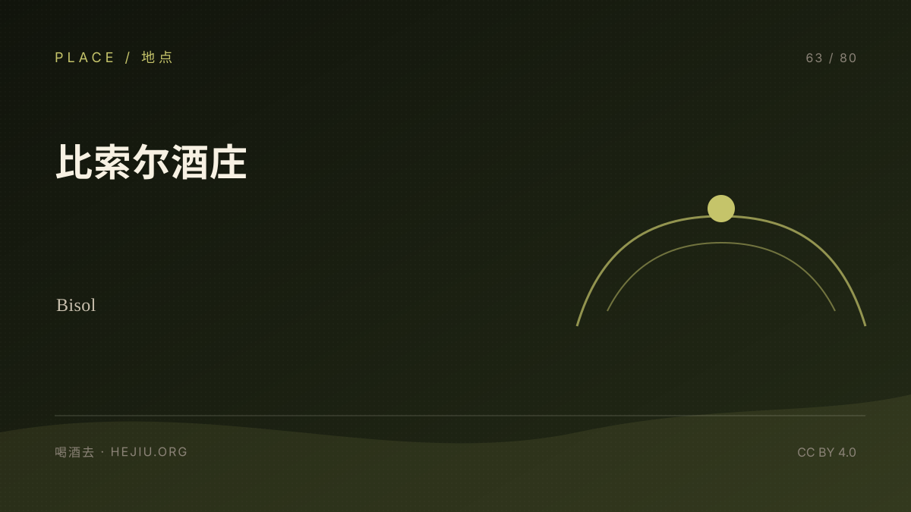

# 比索尔酒庄

比索尔（Bisol1542）在瓦尔多比亚德内的圣斯特凡诺，地址是 Via Follo 33。它把“家族”写成品牌核心：官方叙述称家族在普罗塞克核心地带的活动可追溯到 16 世纪，并以 1542 年作为 Bisol1542 的起点；同一片坡地上，家族已经延续了二十多代。2014 年，酒庄加入 Lunelli 集团，但历史酒窖、葡萄园与品牌仍以比索尔的名字运转。对访客来说，这里既是酒庄，也是理解“陡坡普罗塞克”为什么贵的入口。

图：比索尔酒庄栏目示意图。项目自产或类别插图，用于葡萄园与产区语境，不是该对象的实拍。

## 一五四二年的家族与品牌

“1542”不是葡萄园的种植年份，而是品牌用来标记家族在瓦尔多比亚德内的历史起点。官方叙述把早期文献、卡特兹山坡与家族迁徙串在一起，随后是战争打断、Desiderio “Jeio” Bisol 在战后骑摩托车寻找坡地、子女分工接手。这段故事里真正有用的事实是：比索尔的葡萄来源长期集中在瓦尔多比亚德内的陡坡，而不是平原或外区。

品牌与家族并不完全等同。Bisol1542 是面向市场的品牌，Jeio 是更轻松的系列；2014 年加入 Lunelli 集团后，资本结构改变，但酒庄仍以自己的名字经营。参观时听到的“家族故事”是品牌资产的一部分，判断酒质仍要回到园地、采收与发酵。

## 格雷拉、陡坡与手工采收

[格雷拉](ref:glera)是普罗塞克的法定主品种。Conegliano Valdobbiadene Prosecco Superiore DOCG 要求格雷拉至少占 85%，其余允许少量其他品种。格雷拉酸度高、香气偏白花、青苹果与梨，酒精不重，适合做清爽的起泡酒；它也容易在潮湿年份染病，因此坡地与通风条件很重要。

瓦尔多比亚德内的山丘被官方描述为“英雄式”栽培：坡陡、地块窄，机械进不去，至少需要 600 小时人工才能管理一公顷葡萄园，是机械化方式的好几倍。采收必须手工，果实装进小箱后靠人背或小运输车下山。2019 年，这片山丘被列入 UNESCO 世界遗产，理由正是这种人与地形长期互动的农业景观。你杯中的价格，有相当一部分付给了这些工时。

## 岩壁里的酒窖

比索尔的酒窖被官方描述为“藏在岩石里的宝藏”：在普罗塞克坡地下方挖出的空间，温度常年保持在 10°C 到 15°C，适合长期保存酒与历史瓶。它不是新建的恒温展厅，而是与地形结合的老酒窖；墙面、拱顶与通道都保留着使用痕迹。参观时会先经过较新的接待与品鉴区，再进入较凉、较暗的老酒窖。

酒窖的温度稳定，对起泡酒尤其重要：二次发酵与酒泥接触需要稳定的低温，装瓶后的储存也怕温度波动。参观时注意通风与湿度控制，别把外套留在酒窖里，也不要触摸墙上的历史酒瓶与架上的陈年酒。地面可能湿滑，穿防滑鞋比穿时装鞋合适。

## 卡特兹、里韦与单一地块

卡特兹（Cartizze）是瓦尔多比亚德内的一片小山坡，法定面积只有 107 公顷，形状近似五边形，位于 San Pietro di Barbozza、Santo Stefano 与 Saccol 之间。它被官方称为产区的“质量顶点”，土壤与朝向让格雷拉更成熟，酒体更饱满，香气更偏黄苹果、蜂蜜与花香。卡特兹可以做成不同甜度，从 Brut 到 Dry 都有，不是“越甜越高级”。

里韦（Rive）指陡坡上的小村或小地块，法律上要求更严格，酒标会写具体地名，例如 Rive di Santo Stefano。它强调的是“这一个坡面”的个性，而不是整个产区的平均风格。比索尔的产品线同时覆盖卡特兹、里韦与普通 DOCG，理解这三层，才能读懂酒标上的价格差。不要把“单一地块”当成营销词，它对应的是可核实的地理边界。

## 参观、品鉴与营业时间

官方联系页给出的参观与品鉴邮箱是 hospitality@bisol.it；Strada del Prosecco 协会页面列出的酒窖开放时间为周一至周六 10:00–13:00 与 15:00–18:00，周日 10:00–13:00，并提供酒窖参观、品鉴与零售。集合点与具体场次以预约回复为准，旺季与周末容易满员，建议提前联系。

参观通常从接待区开始，再进入酒窖与品鉴；如果只想买酒，也可以只走零售区。品鉴时要区分 Brut、Extra Dry 与 Dry 的甜度差异，以及有无酒泥接触带来的厚度。不要用“气泡大小”判断质量，真正决定口感的是酸度、糖分、压力与酒泥接触时间。

## 到访提示与对照

从威尼斯开车约一小时，从科内利亚诺约半小时；区域火车可到科内利亚诺或特雷维索，再换巴士或出租车。圣斯特凡诺是瓦尔多比亚德内的一个村，接待区与老酒窖相距不远，从村中心步行即可；若开车，导航输入 Via Follo 33，不要只搜品牌名，以免被带到另一处仓库。酒庄在村内，停车位有限，周末更紧张，旺季提前十分钟到，留出找车位与签到的时间。参观时不要触摸发酵罐、管道与酒架；酒窖温度低，夏天带一件薄外套。

若想把威尼托的两种酒放在一起看，可以继续去富马内的[阿莱格里尼](ref:allegrini)，车程约一个半小时。前者是格雷拉与罐式发酵的起泡酒世界，后者是科维纳与风干葡萄的红酒世界；同一大区，两套完全不同的工艺逻辑。开放时间、预约与价格以官方渠道为准，本页核验日期 2026-11-09，坐标以官方渠道为准。

对照阅读：[格莱拉](ref:glera)、[威尼托](ref:c-extra-1)。

相关条目：[阿莱格里尼酒庄](ref:allegrini)。

**关键事实。**

| 项目 | 内容 |
| --- | --- |
| 一句话定位 | 瓦尔多比亚德内的 Bisol1542，家族自 1542 年起在普罗塞克核心坡地种植格雷拉；酒窖开在岩壁里，周一至周六接待参观与品鉴，卡特兹与里韦系列是理解陡坡风土的关键 |
| 地址 | Via Follo 33, 31049 Valdobbiadene (TV), Italy |
| 城市/国家 | 瓦尔多比亚德内 / 意大利 |
| 营业状态 | 已核验营业 |
| 官网 | bisol.it |

**来源与边界。** 本页关于「比索尔酒庄」的关键事实，主要由以下来源交叉核对：Bisol1542（圣斯特凡诺的 historic winery、陡坡与手工采收、DOCG 系列与卡特兹/里韦定位；参观与品鉴需联系 hospitality@bisol.it）、Strada del Prosecco e Vini dei Colli Conegliano Valdobbiadene（Via Follo 33 地址、酒窖开放时间、酒窖参观与品鉴服务、2014 年加入 Lunelli 集团）、Consorzio di Tutela del Conegliano Valdobbiadene Prosecco Superiore DOCG（15 个市镇、格雷拉、陡坡“英雄式”栽培、每公顷至少 600 小时人工与 2019 年 UNESCO 世界遗产；1969 年 DOC、2009 年 DOCG、15 个市镇与政府质检标签体系）。产品、地址或营业状态变化较快时，以 bisol.it 的最新页面为准；价格、批次与状态会变，涉及这些字段时以页面所列来源的最新版本为准。正文为项目自写，来源只作核验，不复制原文。

## 参考资料

- [Bisol 官方英文站](https://bisol.it/bisol/en/)：圣斯特凡诺酒窖、陡坡、DOCG 系列与品牌历史。
- [Bisol 联系页](https://bisol.it/bisol/en/contact/)：参观与品鉴的 hospitality@bisol.it 联系方式。
- [Bisol1542 — Strada del Prosecco](https://www.coneglianovaldobbiadene.it/soci/bisol-1542/10475/)：Via Follo 33 地址、开放时间、酒窖参观与 2014 年加入 Lunelli 集团。
- [Prosecco.it — Area of Origin](https://www.prosecco.it/en/area-of-origin/)：15 个市镇、格雷拉、600 小时人工与 2019 年 UNESCO 遗产。
- [Prosecco.it — DOCG](https://www.prosecco.it/en/conegliano-valdobbiadene-prosecco-superiore-docg/)：1969 年 DOC、2009 年 DOCG 与质检标签。

补充阅读：[威尼托](ref:c-extra-1)、[起泡酒](ref:c-extra-2)、[原产地命名（appellation）](ref:c-extra-3)。
