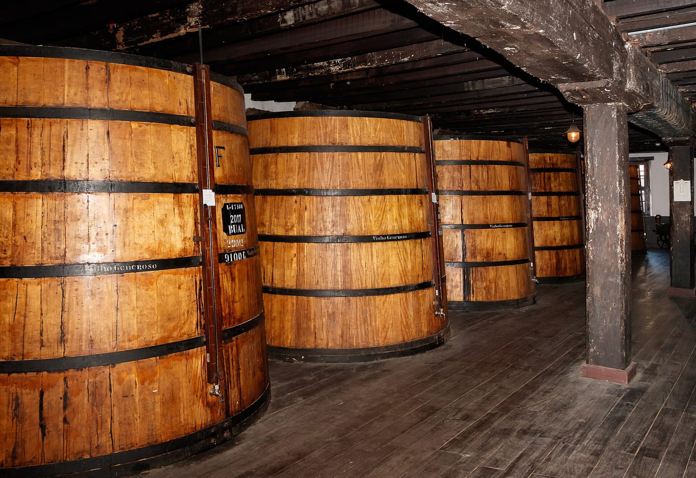

# 布兰迪葡萄酒庄

布兰迪葡萄酒庄（Blandy's Wine Lodge）在丰沙尔市中心，地址是阿拉加街 28 号。它属于马德拉葡萄酒公司，是布兰迪家族七代人经营马德拉酒的据点。这里不种葡萄，而是把岛上各地送来的酒液陈年、调配、装瓶、品鉴和出售；对游客来说，它也是理解马德拉酒“受热陈年”最方便的一站。走进大门，先闻到的是旧木桶、焦糖和海风混在一起的味道。

图：布兰迪葡萄酒庄相关实景照片。图片：H. Zell，CC BY-SA 3.0，via Wikimedia Commons（[原图页面](https://commons.wikimedia.org/wiki/File:Blandy%27s_Wine_Lodge_-_Funchal_03.jpg)）。

## 丰沙尔市中心的一座旧酒窖

酒庄在阿拉加街 28 号，正对市立花园，离主教座堂、市政厅和港口都不远；从邮轮码头步行过来约十分钟。建筑群叫圣方济各酒窖（Adegas de São Francisco），多数建筑可追溯到 17 至 18 世纪，包含旧仓库、鹅卵石街道与小教堂遗迹。约翰·布兰迪在 19 世纪中叶买下这处物业，它与家族的市区住宅直接相连，运酒、办公与生活会客曾共享同一条动线。

今天这里仍保留酒窖的格局：厚墙、高屋顶、木梁，地面到屋脊形成明显的温差。酒窖内有 650 多只木桶与槽，另有家族博物馆、品鉴室和商店。博物馆里能看到丘吉尔的书信、布兰迪家族银行的钱币，以及岛上最古老的木制 lagar，年代可追溯至 17 世纪。地图坐标约为 32.64783, -16.91058；入口在阿拉加街一侧，具体集合点以预约确认单为准。

## 1811 年：一个英国商人家族

1808 年，约翰·布兰迪因健康原因从英国来到马德拉，先在一家酒商行做事。1811 年，他与兄弟托马斯、乔治一起创立自己的酒行，开始向俄罗斯、北欧、安的列斯和北美出口马德拉酒。1824 年，他经过近二十年的零散购置，拼出了今天酒庄所在的物业。1852 年白粉病重创葡萄园时，查尔斯·布兰迪大量收购岛上的老酒库存，使公司在此后仍能持续供货。

1913 年，马德拉葡萄酒协会成立，多家酒商联合采购与酿造；布兰迪与 Leacock 等老字号先后加入，形成岛上最大的生产与出口商。1989 年，布兰迪家族邀请波特酒世家 Symington 入股，后者负责销售与市场，合作延续至今。2015 年起，酒庄进行翻新，加入家族博物馆、商店、品鉴室与活动空间；此后多次入选国际酒业媒体评选的百强酒庄。官方材料强调，布兰迪是少数仍由创始家族拥有并经营原公司的马德拉酒商之一。

## canteiro：阁楼里的缓慢陈年

马德拉酒最特别的地方，是它在热与氧中“变老”而不坏。传统方式叫 canteiro，原意是支撑木桶的横梁。酒桶被放在酒窖最高、最热的阁楼里，至少陈年四年；海岛的亚热带气候让阁楼温度常年偏高，酒液在桶中缓慢受热、缓慢氧化。之后酒桶逐年下移，到更低、更凉的楼层继续陈年，最后到达地面层。木桶从不装满，一部分酒液蒸发，留下“天使份额”，剩下的酒更浓、更复杂，逐渐出现干果、焦糖、咖啡、烟草与海盐的气息。

同一座酒窖里还有另一套加速工艺：estufagem。酒液在大罐中加热到 45 摄氏度，持续约四个月，再转入巴西 satinwood 大槽中陈年两年。这套方法主要用于三年期的 Tinta Negra 基础酒款，效率高，风味更直接；canteiro 则用于更高等级的单一年份与老年份酒。参观时把两种工艺放在一起看，就能明白为什么同样叫马德拉酒，价格可以差出许多倍。

## 从 Sercial 到 Malvasia：四系与 Tinta Negra

马德拉酒的白葡萄四系，按甜度从干到甜排列是 Sercial、Verdelho、Bual 与 Malvasia。Sercial 酸度高、口感干，常带柠檬皮与坚果；Verdelho 中干，圆润一些；Bual 中甜，焦糖与香料更明显；Malvasia（英文常写 Malmsey）最甜，带无花果、咖啡与糖浆气息。Tinta Negra 是岛上种植面积最大的红葡萄，可以通过不同发酵与加强时点做出从干到甜的各种风格。

布兰迪的产品线覆盖 5 年、10 年、15 年与 20 年陈酿，也有单一年份的 Colheita 与年份酒 Frasqueira。马德拉酒由 IVBAM 监管，属于 DOP Madeira 体系；加强使用 96% 的中性葡萄酒精，成酒酒精度通常在 17.5% 至 21% 之间。高酸度是它的骨架，让甜型也不腻。饮用温度不必太低，干型约 12 至 14 摄氏度，甜型约 14 至 16 摄氏度；开瓶后可以放很久，这也是它适合作为餐后酒与收藏酒的原因。

## 三条导览线路与票价

酒庄周一至周日都有导览，建议提前在网上订位。Lodge Tour 约 15 欧元，30 分钟，含两款酒；Premium Tour 约 20 欧元，45 分钟，增加制桶作坊、canteiro 陈年房、satinwood 大槽、葡萄到酒展与家族博物馆，含两款酒；Vintage Premium 约 54 欧元，90 分钟，把前两条线路合在一起，含四款酒与一款 Frasqueira 年份酒；Private Tour 约 140 欧元每人，限二至四人，含五款高端酒与私人收藏室。六岁以下免费，六至十七岁约 7.70 欧元；提前 24 小时可免费取消。

导览语言包括葡萄牙语、英语、德语、法语与西班牙语，具体场次按日期变化。邮轮停靠日与节假日名额紧张，最好提前几天预订；如果只想买酒，商店可以直接进入，不必参加导览。票价与场次会调整，出发前以官网为准。

## 把酒庄放进丰沙尔的一天

酒庄就在市中心，适合安排在上午：先参加 45 分钟的 Premium Tour，再去市立花园、主教座堂与农贸市场；下午可以坐缆车上蒙特，或沿海滨走到老城。若想把马德拉酒喝得更完整，可以再去卡马拉-德洛布什的[恩里克斯与恩里克斯](ref:hh)，那里是仍在运转的装瓶与陈年酒窖，和这里的城市参观路线形成对照。

品鉴可以吐酒，尤其要开车的人；丰沙尔老城坡陡、石板路滑，酒后不要驾车。酒窖潮湿阴凉，带一件薄外套；拍照不要用闪光灯直射老酒瓶与文件。买酒时注意航空液体限制，精品老酒可以请店家提供运输方案。想先做功课，可读[马德拉](ref:madeira)产区页、[马德拉酒](ref:madeirawine)风格页，以及[氧化](ref:oxidation)、[橡木桶陈年](ref:oak)与[甜酒](ref:dessert)三条背景条目；它们会解释为什么这款酒能在开瓶后放上几个月，而普通葡萄酒不行。

对照阅读：[恩里克斯与恩里克斯酒庄](ref:hh)、[马德拉](ref:madeirawine)。

**关键事实。**

| 项目 | 内容 |
| --- | --- |
| 一句话定位 | 位于马德拉丰沙尔市中心的马德拉酒陈年酒窖与参观据点，1811 年由约翰·布兰迪创立，属马德拉葡萄酒公司；以 canteiro 阁楼陈年、制桶作坊与四系马德拉酒闻名，周一至周日有导览 |
| 地址 | Avenida Arriaga 28, 9000-064 Funchal, Madeira, Portugal |
| 城市/国家 | 丰沙尔 / 葡萄牙 |
| 营业状态 | 已核验营业 |
| 官网 | blandyswinelodge.com |

## 相关图像

图：恩里克斯与恩里克斯酒庄类别配图。图片：anagh，CC BY-SA 3.0，via Wikimedia Commons（[原图页面](https://commons.wikimedia.org/w/index.php?curid=53715566)）。关联图像：布兰迪葡萄酒庄。
