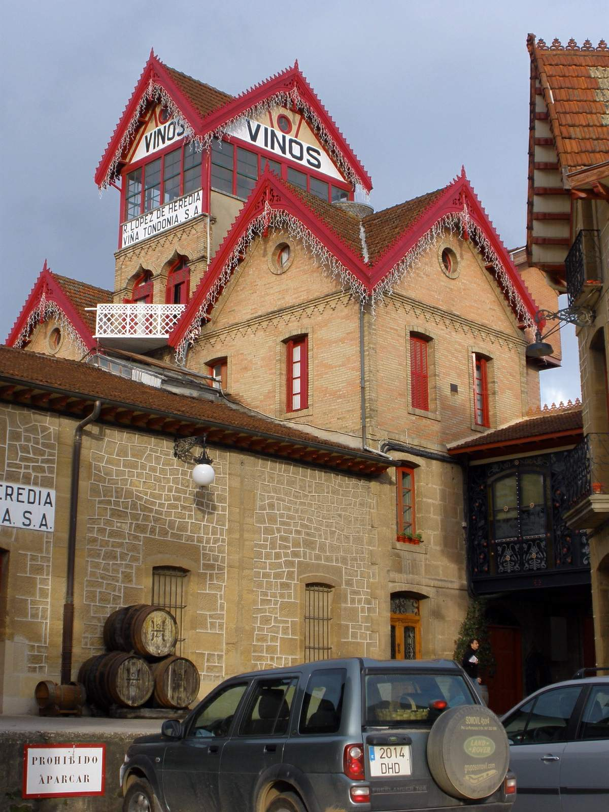

# 洛佩兹雷迪亚酒庄

洛佩兹雷迪亚酒庄在西班牙里奥哈阿罗（Haro）的火车站区（Barrio de la Estación），地址是 Vizcaya 大道 3 号。它由拉斐尔·洛佩兹·德·埃雷迪亚（Rafael López de Heredia y Landeta）于 1877 年创立，是阿罗最古老的酒庄，也是里奥哈最早的三家酒庄之一。与许多把参观做成标准产品的酒庄不同，这里首先是一座仍在按旧节奏运转的生产建筑：地下石窖、成排的美国橡木桶、自家的制桶车间，以及推迟多年才上市的 Reserva 与 Gran Reserva。

图：洛佩兹雷迪亚酒庄。图片：Zarateman，CC0，via Wikimedia Commons（[原图页面](https://commons.wikimedia.org/wiki/File:Haro_-_Bodegas_L%C3%B3pez_de_Heredia_Vi%C3%B1a_Tondonia_1.JPG)）。

## 1877 年：洛佩兹雷迪亚酒庄的关键起点
1877 年，拉斐尔·洛佩兹·德·埃雷迪亚在阿罗火车站旁开始建造酒庄。选址不是偶然：19 世纪末，里奥哈的酒要通过铁路运往法国与大西洋港口，靠近车站意味着更低的运输成本和更快的周转。当时法国葡萄园正遭受根瘤蚜危机，里奥哈因此获得了进入法国市场的窗口；洛佩兹雷迪亚也把酒成批卖到法国，但很快在 1880 年代转向自行装瓶，希望用自己的名字而不是散酒商的名字建立声誉。

酒庄至今由创始家族持有，是里奥哈少数没有把品牌卖给大集团的历史名庄之一。它常被描述为“最传统”的里奥哈酒庄：并不是因为拒绝一切现代设备，而是因为它坚持一套很慢的时间表。红葡萄酒在橡木桶中陈年多年，Gran Reserva 的官方说法是桶陈十年、每年倒桶两次、用新鲜蛋清下胶，然后再在瓶中陈年；白葡萄酒也经长时间橡木桶陈酿，上市时已经带有明显的氧化与坚果气息。对习惯了新世界果味的人来说，这种风格需要调整预期。

酒庄的葡萄园以 Viña Tondonia 为核心。Viña Tondonia 位于埃布罗河右岸，面积超过 100 公顷，是里奥哈少见的整片大型葡萄园；加上 Viña Bosconia、Viña Cubillo 与 Viña Zaconia，酒庄自有葡萄园约 170 公顷。Viña Tondonia 的名字直接出现在酒标上，红、白、桃红都产；Viña Bosconia 是另一片园子，风格通常更圆润；Viña Cubillo 来自较年轻的葡萄藤；Viña Gravonia 则是白葡萄酒，常与 Viña Zaconia 地块联系在一起。记住这几个名字，比记住“里奥哈”三个字更能分辨酒庄的产品线。

## 空间与酒单

酒庄的建筑群由多栋红砖厂房组成，最老的部分可以追溯到 19 世纪末，发酵、陈酿、装瓶与办公仍在同一片街区里完成。真正决定体验的是地下酒窖：它在砂岩中开凿，通道总长可达 200 米，最深处在地面以下十多米，常年低温高湿，墙壁上留着黑色的霉菌层。酒窖里大约放着 12,900 只波尔多式橡木桶，酒庄至今保留自己的制桶车间，是西班牙少数仍能独立制桶的酒庄之一。走进酒窖时，空气、光线与声音都会变，这种体感比任何展板都更能解释“长期陈酿”是什么意思。

产品线可以按“园子—颜色—陈年等级”来读。Viña Tondonia 是旗舰，红葡萄酒以丹魄为主，混入少量歌海娜、格拉西亚诺与马苏埃罗；白葡萄酒以维乌拉（Viura）为主，经长时间桶陈后呈金黄色，带有坚果、蜂蜜与氧化风味；桃红产量少，通常在上市时已经陈年数年。Viña Bosconia 的红葡萄酒更偏圆润，Viña Cubillo 更早饮，Viña Gravonia 是白葡萄酒中的另一条线。Gran Reserva 只在较好的年份生产，Reserva 则更常见；两者都比里奥哈法定最短陈年时间长得多。

这里的“酒单”不是一张鸡尾酒单，而是一套年份与陈年等级的排列。第一次来，最稳的对比是同一园子的 Reserva 与 Gran Reserva，或者同一年的红与白：前者让你看到陈年长度带来的差别，后者让你理解里奥哈白葡萄酒为什么不能用“清淡”来概括。若有机会喝到 Viña Tondonia Blanco，注意它的颜色比一般白葡萄酒深，温度不要过低，否则香气会被压住。

## 怎么参观

酒庄只接受预约参观，没有散客临时导览与品鉴。官方联系方式是 visitas@tondonia.com 与 +34 941 310 244；接待通常安排在周一至周六，周日与节假日除外，采收期会关闭。部分资料称参观主要面向业内人士、进口商与团体，普通游客能否预约、是否含品鉴，要以酒庄的邮件回复为准。不要把它当成“到门口买票”的酒庄，也不要指望在品鉴室随到随喝。

预约时要说清人数、语言、希望看的内容与是否开车。参观通常围绕历史建筑、地下酒窖、制桶车间与桶陈空间展开；如果安排品鉴，通常会选几款代表性酒款，但是否收费、收多少，酒庄会单独说明。酒庄同时有门市售酒，但开放日子并不固定，部分资料称只在特定日期对公众售酒、且不提供品鉴；把这部分也写进行程前，最好先发邮件确认。

参观时长通常在一到两小时之间，取决于是否含品鉴与同行者的问题多少。地下酒窖温度低、湿度大，夏天进去会觉得凉，地面也可能湿滑；穿防滑平底鞋，带一件薄外套。酒窖里光线暗，拍照不要用闪光灯直射酒桶或标签，也不要触摸桶壁与管道。行动不便的参观者要提前说明，历史建筑的门槛与楼梯不一定适合轮椅。

## 洛佩兹雷迪亚酒庄的地址与营业安排
**地址**：Avenida de Vizcaya 3, 26200 Haro, La Rioja, Spain，位于阿罗火车站区（Barrio de la Estación）。

**交通**：阿罗火车站（Haro）就在酒庄旁，出站步行约 5 分钟；也可从洛格罗尼奥（约 45 公里）、维多利亚（约 50 公里）或毕尔巴鄂（约 120 公里）自驾前往。镇内酒庄集中在车站周边，步行可串联 CVNE、Muga、La Rioja Alta、Gómez Cruzado，但每家都需提前预约。

**开放时间**：酒庄没有固定的公众开放时间，参观全部按预约安排；采收期（通常 9 月至 10 月）会关闭或减少接待。`operating_status: verified` 表示酒庄仍在运营，不等于当天对散客开放。

**门票与预约**：必须提前预约，没有散客临时导览。预约邮箱 visitas@tondonia.com，电话 +34 941 310 244；接待通常安排在周一至周六，周日与节假日除外。Rioja UK 产区页面写明：酒庄主要面向业内人士、进口商与团体预约开放，采收期关闭，公众仅在特定日期可到门市买酒，且不提供品鉴。参观费用、是否含品鉴与具体票价本次未核验，须以酒庄邮件回复为准。

**参观时长与注意**：通常 1–2 小时，视是否含品鉴而定。地下酒窖温度低、湿度大、地面可能湿滑，建议穿防滑平底鞋并带薄外套；历史建筑的门槛与楼梯不一定适合轮椅，行动不便者需提前说明。

「洛佩兹雷迪亚酒庄」的开放时间、价格与预约，以[官网](https://www.lopezdeheredia.com/)的公开页面为准；核验日期为 2026-11-08，临时调整以官网当日公告为准。

## 礼仪与误区

第一个误区是把“最传统”理解成“最古老且从未改变”。酒庄在 19 世纪末就主动采用铁路与出口市场，20 世纪也更新过设备；“传统”指的是陈年逻辑与风味取向，不是拒绝一切现代性。第二个误区是把“里奥哈”当成一种单一风格。里奥哈有不同子产区、不同陈年等级与不同葡萄混酿，洛佩兹雷迪亚只是其中偏传统的一支。

第三个误区是看到酒液有沉淀就以为酒坏了。长期桶陈与瓶中陈年的红葡萄酒出现沉淀很正常，喝之前直立静置、必要时醒酒或换瓶即可。第四个误区是把白葡萄酒当成“清淡开胃酒”。Viña Tondonia Blanco 的颜色深、香气复杂，适合配烤鱼、火腿、蘑菇与陈年奶酪，不适合冰到失去香气。

参观时不要迟到，酒庄按预约安排接待，迟到可能被缩短行程或拒绝进入。品鉴时可以把酒吐掉，尤其是要开车的人；里奥哈的酒庄之间距离不远，但乡村道路弯多，喝酒后不要自驾。不要触摸酒桶、管道与老照片，不要进入未开放的地窖分支；拍照前看陪同人员的提示。

## 阿罗的周边街区
阿罗的火车站区本身就是一条“历史酒庄路线”：从洛佩兹雷迪亚出来，步行几分钟就能到 CVNE、Muga、La Rioja Alta 与 Gómez Cruzado。把这些酒庄排在同一天，能直观看到“传统派”与“现代派”的差别；但每家都要预约，不能临时串门。阿罗老城也值得走一圈，和平广场（Plaza de la Paz）周边有酒吧与小餐馆，适合午餐。

如果时间充裕，可以往东到布里奥内斯（Briones）看 Vivanco 葡萄酒博物馆，或往北到拉瓜迪亚（Laguardia）与里奥哈阿拉维萨（Rioja Alavesa）看中世纪小镇与酒庄。往西到洛格罗尼奥，可以在 Calle del Laurel 一带吃 pinchos；往南到圣维森特-德拉萨索谢拉（San Vicente de la Sonsierra），春天有“葡萄酒之战”的节庆。把这些点串成两天，比一天赶路更合理。

不自驾的话，火车到阿罗站最方便，但从阿罗到布里奥内斯、拉瓜迪亚的公共交通班次有限，通常需要出租车或参加当地一日游。只安排半天的话，建议只走火车站区，选两家预约好的酒庄，午餐在阿罗老城，不要再往远处加点。

## 同产区酒庄与延伸阅读
洛佩兹雷迪亚是理解[里奥哈](ref:rioja)传统风格的一个具体样本，也把[葡萄酒](ref:wine)的“陈年”从抽象概念变成可以走进去的地下空间。想了解酒窖如何影响风味，可以读[酒窖与储存](ref:cellar)；想对照同产区的另一家名庄，可以读[贝加西西里亚](ref:vega)。

补充阅读：[A Ginjinha](ref:c-extra-1)。

相关条目：[葡萄酒](ref:wine)、[里奥哈](ref:rioja)、[酒窖与储存：温度、湿度、光照与时间](ref:cellar)。
