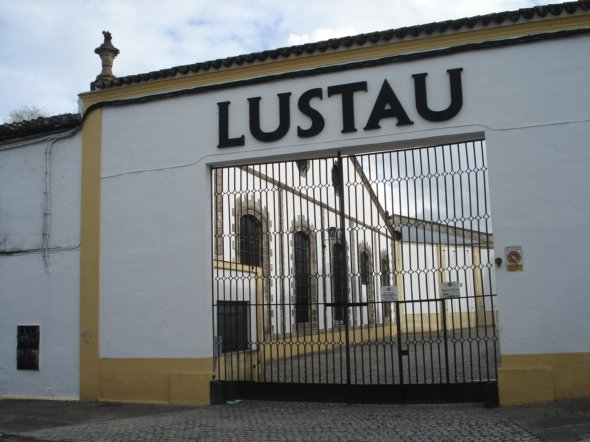

# 埃米利奥·卢士涛酒庄

埃米利奥·卢士涛酒庄（Bodegas Lustau）在赫雷斯-德拉弗龙特拉市中心的阿科斯街 53 号，是雪莉酒三角区里少数同时在赫雷斯、圣玛丽亚港与桑卢卡尔-德巴拉梅达三地陈年的酒庄。它的历史常被压缩成“1896 年创立”，但更准确的说法是：它从一家 almacenista（只为大酒商供酒的储酒行）起家，用了半个世纪才走到台前，又用几十年把“储酒行留下的老酒”做成了自己的品牌。今天走进阿科斯街，看到的是六座 19 世纪的大教堂式酒窖，而不是一座新建的游客中心。

> **到访信息**
> - 地址：Calle Arcos 53, 11402 Jerez de la Frontera, Cádiz, Spain。
> - 开放与预约：以[官方页面](https://www.lustau.es/)为准；开放时间、场次和预约规则会随季节调整。
> - 交通与费用：出发前以官方页面为准，本页不承诺固定票价。
> - 营业状态：已核实；来源最近核对：2026-11-08。

图：埃米利奥·卢士涛酒庄相关实景照片。图片：El Pantera，CC BY 3.0，via Wikimedia Commons（[原图页面](https://commons.wikimedia.org/wiki/File:Lustau-DSC07720.JPG)）。

> **先给结论**
> **一句话：** 这页判断埃米利奥·卢士涛酒庄值不值得专程去，以及到访前要核对什么。
>
> - **适合谁：** 正在计划去埃米利奥·卢士涛酒庄、想知道值不值得专程安排半天到一天的人。
> - **不适合谁：** 只想要“必去榜单”、不准备核对预约、交通和开放时间的人。
> - **先看这两点：**
>   - 酒庄的参观全部按预约安排，入口在 lustau.es 的参观页面，也可发邮件到 visitas@lustau.es 或拨打电话 956 341 597。
>   - 地址：Calle Arcos 53, 11402 Jerez de la Frontera, Cádiz, Spain。

## 阿科斯街 53 号：城市里的酒庄建筑群

酒庄正门在阿科斯街 53 号，邮编 11402，属于赫雷斯-德拉弗龙特拉的老城边缘，离阿雷纳尔广场与圣地亚哥区都不远。它不是一个带葡萄园的乡村庄园，而是一整片嵌在城市街区里的酒窖：外墙刷石灰，屋脊很高，侧窗开在靠近屋顶的位置，让空气进入却不让阳光直射酒桶。酒窖地面铺的是 albero 沙土，踩上去松软，能吸住水分，让温度和湿度保持相对稳定。

从赫雷斯火车站步行过来约 15 分钟，从赫雷斯机场开车约 15 分钟；从塞维利亚开车约 90 公里，从加的斯约 35 公里。本文不写经纬度，坐标以官方渠道为准；具体入口、集合点与行李寄存，以预约确认单为准。酒庄在营业，但营业不等于随时可以进门，参观仍要提前订位。

## 从 almacenista 到自有品牌

1896 年，何塞·鲁伊斯-贝尔德霍（José Ruiz-Berdejo）开始利用业余时间照料家族名为“希望圣母”（Nuestra Señora de la Esperanza）的葡萄园，把酿成的酒卖给更大的雪莉酒商。这种只储酒、不直接面向市场的角色叫 almacenista，中文常译作“储酒行”或“酒库存放商”。1931 年，他的女儿玛丽亚·鲁伊斯-贝尔德霍·阿尔贝蒂（María Ruiz-Berdejo Alberti）在更靠近赫雷斯市中心的地方买下一座小酒窖，把原有的 solera 整体迁入，酒行才第一次有了面向外界的门面。

1940 年代，玛丽亚的丈夫埃米利奥·卢士涛·奥尔特加（Emilio Lustau Ortega）把酒庄迁到赫雷斯老城的圣地亚哥区，也就是今天阿科斯街一带；部分建筑利用了旧摩尔城墙的墙体。1945 年，酒庄不再只做 almacenista，开始以自己的品牌销售：Papirusa、Jarana、Escuadrilla、Emperatriz Eugenia 与 Cinta de Oro 是早期名字。1950 年，它开始出口自有品牌的雪莉酒。

1980 年代，在拉斐尔·巴劳（Rafael Balao）的主持下，酒庄进入扩张期：Solera Familiar 系列成形，1981 年推出第一批 Almacenista 装瓶，1989 年开始陈年 Vintage 系列，1988 年启用了深色、溜肩的专属瓶型。1990 年，卢士涛并入西班牙家族企业 Luis Caballero 集团，获得继续扩张的资金与渠道。2000 年，它在赫雷斯市中心买下六座 19 世纪酒窖，修复后作为主要陈年与参观空间，也就是今天的阿科斯街酒庄。

## 六座大教堂式酒窖

阿科斯街建筑群占地约 2 万平方米，由六座 19 世纪的酒窖组成。它们被称作“葡萄酒的大教堂”，不是因为装饰，而是因为比例：屋脊高、跨度大、柱列整齐，人在里面会自然压低声音。高侧窗把光切成细条，落在成排的橡木桶上；地面是浅色的 albero 沙土，浇水后能降温增湿。这样的结构不是布景，而是陈年设备，酒花能否稳定生长，很大程度取决于这里的温度与湿度。

卢士涛也是雪莉三角区里唯一在赫雷斯-德拉弗龙特拉、圣玛丽亚港与桑卢卡尔-德巴拉梅达三座城市都陈年酒液的酒庄。三地的气候不同：桑卢卡尔靠海，湿度高，酒花更厚，Manzanilla 因此更咸、更轻；赫雷斯内陆一些，温度变化更大；圣玛丽亚港介于两者之间。把同一套 solera 逻辑放到三座城市，风味就会出现细微差别，这也是理解“风土不只在地里，也在酒窖里”的一个具体入口。

## solera、flor 与氧化：三条路径

雪莉酒的分岔发生在加强和酒花上。基酒完成发酵后，准备走生物陈年的酒液强化到约 15%，酒花在表面形成一层白色薄膜，隔绝氧气，带来面包、杏仁与海盐气息；准备走氧化陈年的酒液至少强化到 17%，酒花无法存活，酒液直接与氧气接触，颜色变深，出现榛子、焦糖与旧木气息。Fino 与 Manzanilla 走第一条路，Oloroso 走第二条路，Amontillado 与 Palo Cortado 则先生物、后氧化。

solera 不是一只桶，而是一组按级排列的桶。最老的一层叫 solera，上面依次是第一级、第二级 criaderas；每年从最老的一层取出一定比例装瓶，再用上一层的酒补入，逐层向上补新酒。这样做的结果是风格稳定：无论年份好坏，装瓶的酒都带着同一套“家族记忆”。卢士涛的产品线把这个系统拆得很清楚：Jarana 是 Fino，Escuadrilla 是 Amontillado，Península 是 Palo Cortado，Emperatriz Eugenia 是 Oloroso，Emilin 是 Moscatel，San Emilio 是 Pedro Ximénez。第一次来，用 Jarana 与 Emperatriz Eugenia 对照，比背品牌名更有用。

## 三十多款雪莉与圣器室

卢士涛常说自己有三十多款雪莉酒在售，这个数字来自三城陈年、almacenista 老酒与不同甜度的组合。Solera Familiar 是日常系列，Almacenista 系列则把合作储酒行的单一 solera 单独装瓶，酒标上常写出储酒行的名字与所在城市；Vintage 系列按年份装瓶，在雪莉里并不常见；VORS 代表“Vinum Optimum Rare Signatum”，平均陈年超过 30 年。酒庄把最老的一批酒放在名为“圣器室”（Sacristy）的空间里，参观线路也以它命名。

酒窖大师塞尔吉奥·马丁内斯（Sergio Martínez）负责日常的取酒、补液与酒花观察，他使用粉笔在桶头做标记，再用 venencia 取酒试味。酒庄资料提到，他在 2026 年第八次获得国际葡萄酒挑战赛（IWC）的“世界最佳加强酒酿酒师”称号；此前酒庄还曾在 2011 年获评“西班牙最佳酒庄”，并在 2014 年与 2016 年获评“最佳雪莉酒生产商”。这些奖项不改变酒的味道，但能说明它在新旧两套评价体系里都站得住。

## 参观线路、票价与预约

酒庄的参观全部按预约安排，入口在 lustau.es 的参观页面，也可发邮件到 visitas@lustau.es 或拨打电话 956 341 597。目前公布三条线路：“葡萄酒的大教堂”（The Cathedrals of Wine）约 60 分钟，26 欧元，沿途喝 5 款雪莉酒，结束时再品一款味美思；“雪莉的符号”（The Symbols of Sherry）约 75 分钟，36 欧元，喝 5 款高端酒与 2 款 VORS，最后同样以味美思收尾；“卢士涛的圣器室”（The Sacristy of Lustau）约 90 分钟，60 欧元，先在酒窖里喝 2 款酒，再进入圣器室专喝 VORS。

三条线路都含品鉴，区别在于酒款层级与时长，而不是“看”与“喝”的区别。价格、时段与语言会调整，出发前以官网为准；邮轮停靠日、圣周与赫雷斯节庆期间名额紧张，最好提前几天订位。只想买酒的人可以直接去商店，不必参加导览。

## 实用信息与到访提示

**地址**：Calle Arcos 53, 11402 Jerez de la Frontera, Cádiz, Spain。地图坐标未在本文固定，坐标以官方渠道为准。

**交通**：赫雷斯火车站步行约 15 分钟；机场开车约 15 分钟；塞维利亚约 90 公里，加的斯约 35 公里。老城路窄，开车来要预留找车位的时间。

**开放与预约**：`operating_status: verified` 只表示酒庄在营业，不等于当天有散客名额；参观必须提前预约，周一至周六的场次较多，周日与节假日以减少的场次为准。

**现场注意**：酒窖温度低、地面是沙土，穿深色、好打理的鞋，夏天带一件薄外套；不要触摸酒桶、桶塞与管道，拍照前看陪同人员的提示，闪光灯与三脚架通常不受欢迎；不要喷浓香水。品鉴时吐酒是正常做法。

**喝法与配餐**：Fino 与 Manzanilla 冷藏到 7–10 摄氏度，开瓶后尽快喝完；Oloroso 与 Amontillado 适合 12–15 摄氏度；Pedro Ximénez 可以再低一点，但不要冰到压住香气。Fino 配火腿、炸鱼与橄榄，Oloroso 配野味、菌菇与硬质奶酪，Pedro Ximénez 配蓝纹奶酪与巧克力。

**驾驶边界**：赫雷斯老城适合步行，但品鉴后不要开车。把酒全部吐掉，或提前指定不喝酒的司机；西班牙对酒后驾驶有明确限制，具体数值与执法以当地法规为准。

把这一站放进更大的语境，可以先读[赫雷斯](ref:jerez)产区页与[雪莉酒](ref:sherry)风格页，再对照[solera](ref:solera)、[flor](ref:flor)与[加强](ref:fortification)三条工艺条目；想比较另一家把“城市酒窖”做成参观主线的酒庄，可以读[冈萨雷斯·比亚斯](ref:gb)。两家相距不远，步行或短途车程即可串成半天。

相关条目：[冈萨雷斯·比亚斯酒庄](ref:gb)、[赫雷斯](ref:jerez)。
