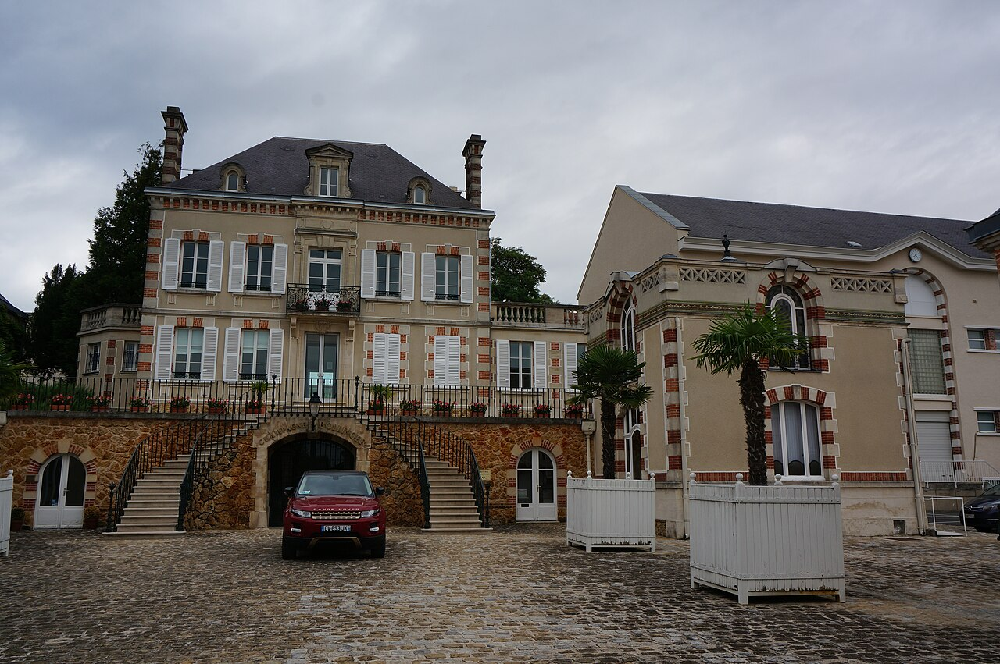
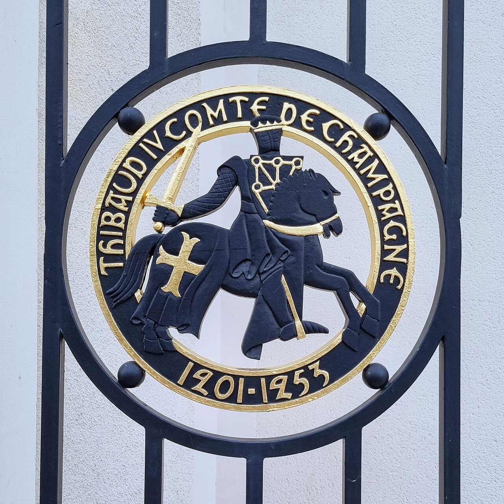

# 堡林爵香槟

从兰斯往北，车开进阿伊（Aÿ）时，葡萄园一直压到镇边。堡林爵的宅邸与酒窖就在主街上，门口是石阶、铁门与一块不张扬的招牌。它与库克是两种香槟：库克把“调配”做成跨年份的图书馆，堡林爵则把 Pinot Noir、旧橡木桶与长时间带酒泥陈年放在前面。要理解堡林爵，先记住三个数字：180 公顷、85%、60%。

> **到访信息**
> - 地址：20 Boulevard Maréchal de Lattre de Tassigny, 51160 Aÿ-Champagne, France。
> - 开放与预约：以[官方页面](https://www.champagne-bollinger.com/en/)为准；开放时间、场次和预约规则会随季节调整。
> - 交通与费用：出发前以官方页面为准，本页不承诺固定票价。
> - 营业状态：已核实；来源最近核对：2026-11-21。

图：堡林爵在阿伊的宅邸与庭院。图片：G.Garitan，CC BY-SA 3.0，via Wikimedia Commons（[原图页面](https://commons.wikimedia.org/wiki/File:Bollinger_01315.JPG)）。

## 1829 年：堡林爵香槟的关键起点
1829 年 2 月 6 日，Athanase de Villermont、Joseph “Jacques” Bollinger 与 Paul Renaudin 在阿伊成立 Renaudin-Bollinger & Cie。Athanase 出身贵族，不能直接经商，提供土地与资本；Joseph 负责销售；Paul 负责酒窖。这个三人结构后来变成家族企业，酒庄今天仍属于堡林爵家族。

1918 年，Georges Bollinger 去世后，Jacques Bollinger 接掌；1923 年他与 Elisabeth Law de Lauriston-Boubers 结婚。1941 年 Jacques 去世，Elisabeth（Madame Bollinger）接管到 1971 年，把酒庄从战争与危机中拉回来。1971 年 Claude d’Hautefeuille 接任，1978 年 Christian Bizot，1994 年 Ghislain de Montgolfier，2008 年 Jérôme Philipon，2017 年 Charles-Armand de Belenet。家族仍在所有权层面掌舵，但日常管理早已不限于家族成员。

堡林爵的葡萄园约 180 公顷，85% 为特级园与一级园，分布在 Aÿ、Avenay、Tauxières、Louvois、Verzenay、Cuis 与 Champvoisy 七个村。Pinot Noir 占 60% 以上，也是 Special Cuvée 中 Pinot 的比例；这种高比例 Pinot 是酒庄风格的骨架。酒庄还保留两块从未被根瘤蚜摧毁的围墙园，Clos Saint-Jacques 与 Chaudes Terres，用来做 Vieilles Vignes Françaises。

## 建筑与空间

阿伊总部是一组 19 世纪的宅邸、庭院、发酵间与地下酒窖。院子里常能看到木桶在阳光下晾晒，酒窖里则是成排的旧橡木桶。堡林爵是香槟区仍保留专职制桶师的酒庄之一，4,000 只旧桶中有不少接近百年；桶龄越大，对酒的影响越小，作用从“给味”变成“给呼吸”。

酒窖的另一件“建筑”是 reserve magnum 墙。堡林爵每年把一部分最好的储备酒装进大瓶，至今约有一百万瓶，最早可追溯到 1890 年。2010 年盘点时，酒庄发现了一个被遗忘的酒窖，里面有 1830 年的 reserve magnum；2016 年，酒庄把这批老酒与历史整理成 Galerie 1829 与 La Réserve 两个酒库。参观时如果能看到这两个空间，会比只看“酒窖很大”更有收获。

## 酒单与味觉

Special Cuvée 是入口：60% 以上 Pinot Noir，加上 Chardonnay 与少量 Meunier，部分酒在旧橡木桶中发酵，带酒泥陈年时间远超法定最低。香气有烤苹果、榛子、奶油、柑橘皮与香料，口感宽而不重，气泡细。La Grande Année 是年份香槟，只在好年份做，全部在旧桶中发酵，手工转瓶与手工除渣；风格更集中，带蜂蜜、坚果、黄李子与矿物。R.D.（Récemment Dégorgé）是延长带酒泥陈年后再除渣的版本，香气更偏烤面包、蘑菇与干果，适合配餐。

Vieilles Vignes Françaises 来自两块未嫁接的围墙园，产量极少，是堡林爵的历史标本；PN 系列则把 Pinot Noir 的单一面相拆开，PN VZ、PN TX、PN AYC 分别来自不同村庄与年份。不要把 Special Cuvée 当成“入门所以简单”：它是酒庄风格最完整的表达，也是判断你是否喜欢堡林爵的基准。

## 怎么喝

建议 8–10°C。不要用太小、太窄的香槟杯；宽口白葡萄酒杯能让 Pinot Noir 的香气展开。倒酒分两次，先少量，等泡沫稳定后再补。Special Cuvée 开瓶即可喝，也可以放 10 分钟；La Grande Année 可以提前 20–30 分钟开瓶；R.D. 与 VVF 不需要剧烈醒酒，但老酒要避免温度骤变。

配餐上，Special Cuvée 配烤鸡、蘑菇、Comté、鱼子酱与炸物；La Grande Année 配龙虾、奶油汁小牛肉、烤鳕鱼；R.D. 配蘑菇、松露、烤禽与陈年奶酪；VVF 更适合单独喝。避免过甜、过辣的菜；堡林爵的酒体偏宽，食物需要有油脂与咸度来托住。

## 堡林爵香槟的地址与营业安排
地址：20 Boulevard Maréchal de Lattre de Tassigny, 51160 Aÿ-Champagne。堡林爵的参观与品鉴需预约，部分体验通过 1829 会员计划或官方活动开放；不要在没有预约的情况下直接进入酒窖。从兰斯自驾约 30 分钟，从埃佩尔奈约 20 分钟；从巴黎东站乘 TGV 到兰斯，再换车或包车。

阿伊镇上停车位不多，酒庄周边以步行与短停为主。若想把香槟区串起来，可以把堡林爵与[香槟大道](ref:avenue)、[库克](ref:krug) 或[泰亭哲](ref:taittinger) 放在两天里；一天塞三家会太赶，尤其是 R.D. 与 VVF 需要慢慢喝。

## 礼仪与常见误区

第一，堡林爵是家族所有，但“家族经营”不等于“所有决策都由家族成员做”；2008 年起 CEO 已由非家族成员担任，不要用血统故事替代企业结构。第二，Special Cuvée 不是“低端款”；它是酒庄风格的核心，陈年与配餐能力都被低估。第三，R.D. 不是“二次发酵”或“加糖”的意思，而是延长带酒泥陈年后“近期除渣”的版本。

第四，不要触摸酒窖里的桶、瓶与转瓶架；旧桶与老酒都很脆弱。第五，不要用“Bolly”称呼来套近乎，除非对方先这么用；这是酒庄内部的昵称，不是正式品牌名。第六，香槟不是越冰越好；8–10°C 比 4°C 更能闻到香气。

## 从堡林爵香槟延伸到香槟大道
阿伊在香槟区的北段，往南是埃佩尔奈与[香槟大道](ref:avenue)，往东是 Verzenay 的葡萄园与灯塔，往西是 Hautvillers 的修道院。可以按“阿伊—Hautvillers—埃佩尔奈”走一天，或把[库克](ref:krug)、[泰亭哲](ref:taittinger) 放在兰斯的两天里。若对 Pinot Noir 特别感兴趣，把 Aÿ、Verzenay、Ambonnay 三个村连起来，比在城里连喝三家更有意义。

只安排半天，堡林爵预约品鉴加阿伊镇散步足够；一天可以加香槟大道与一个白丘村庄。不要把品鉴安排在开车前，香槟区的乡间道路窄，酒后驾驶风险很高。

**关键事实。**

| 项目 | 内容 |
| --- | --- |
| 一句话定位 | 阿伊（Aÿ）的家族香槟酒庄，1829 年由 Athanase de Villermont、Joseph Bollinger 与 Paul Renaudin 共同创立；拥有约 180 公顷葡萄园，85% 为特级园与一级园，Pinot Noir 占 60% 以上 |
| 地址 | 20 Boulevard Maréchal de Lattre de Tassigny, 51160 Aÿ-Champagne, France |
| 城市/国家 | 阿伊 / 法国 |
| 营业状态 | 已核验营业 |
| 官网 | champagne-bollinger.com |

**来源与边界。** 本页关于「堡林爵香槟」的关键事实，主要由以下来源交叉核对：Champagne Bollinger（确认阿伊总部、酒庄建筑与官方入口；1829 会员访问、酒庄活动与稀缺酒款发售的预约机制）、Groupe Bollinger（集团品牌结构与家族所有制的背景）。产品、地址或营业状态变化较快时，以 champagne-bollinger.com 的最新页面为准；价格、批次与状态会变，涉及这些字段时以页面所列来源的最新版本为准。正文为项目自写，来源只作核验，不复制原文。

**并读。** 把「堡林爵香槟」与「库克香槟」、「泰亭哲香槟」、「埃佩尔奈香槟大道」放在一起读时，先确认它们是同一层级还是上下游关系：先确认地址与营业状态，再比较历史、空间与点单体验。本页负责给出场所的基本坐标，对照条目补上具体案例与差异；读完再回到本页，才能分清哪些差别属于场所本身，哪些只是产地、批次或品牌选择。

## 参考资料
- 香槟对照：[库克](ref:krug)、[泰亭哲](ref:taittinger)、[香槟大道](ref:avenue)、[香槟大道步行路线](ref:route)。
- 背景阅读：[香槟产区](ref:champagne)。
- 本页不提供地图；参观、会员与发售信息以官方渠道为准。

对照阅读：[库克香槟](ref:krug)、[埃佩尔奈香槟大道](ref:avenue)。

## 相关图像

图：泰亭哲圣尼凯斯酒庄入口的骑士徽记。图片：UNTERMVIERENBERGE-2，CC0，via Wikimedia Commons（[原图页面](https://commons.wikimedia.org/wiki/File:F-Marne_(51)-Reims_-_Champagne_Taittinger_001.jpg)）。关联图像：堡林爵香槟。
