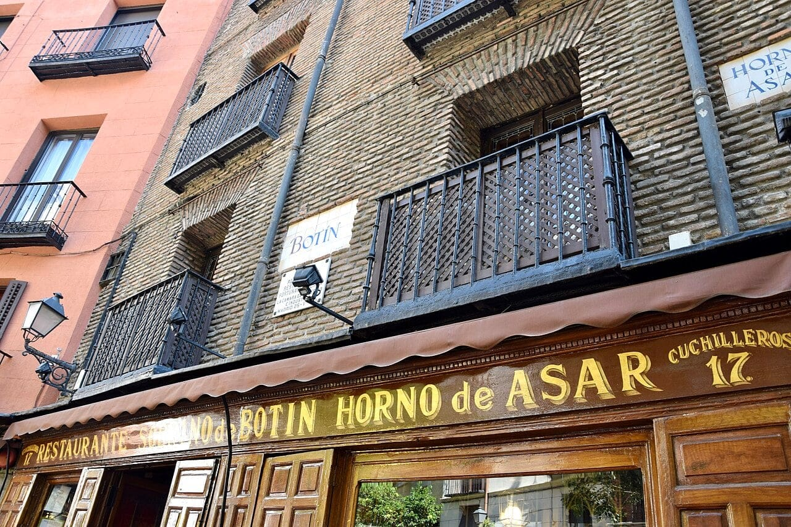

# 博廷餐厅

马德里市长广场西南角有一条很短的斜坡街，叫刀匠街（Calle de Cuchilleros）。17 号的门脸不算张扬，门口却常年有人张望、排队或举着手机拍那块木招牌。博廷餐厅（Restaurante Botín，旧称 Sobrino de Botín）1725 年在这里开业，吉尼斯世界纪录常把它引为“世界最古老餐厅”；它至今仍在营业，卖的是卡斯蒂利亚式的烤乳猪、烤羊与一套非常马德里的老派服务。

图：马德里刀匠街 17 号的博廷餐厅正立面，棕色遮阳篷上写着“Restaurante Sobrino de Botín”和“Horno de Asar”。图片：Ank Kumar，CC BY-SA 4.0，via [原图页面](https://commons.wikimedia.org/wiki/File:2014_-_Sobrino_de_Bot%C3%ADn_%28Casa_Bot%C3%ADn%29_Restaurant%2C_Madrid%2C_Spain_%28_Ank_Kumar_%29_01.jpg)。

> **先给结论**
> **一句话：** 这页判断博廷餐厅值不值得专程去，以及到访前要核对什么。
>
> - **适合谁：** 正在计划去博廷餐厅、想知道值不值得专程安排半天到一天的人。
> - **不适合谁：** 只想要“必去榜单”、不准备核对预约、交通和开放时间的人。
> - **先看这两点：**
>   - 地址是 Calle de Cuchilleros 17, 28005 Madrid，紧邻市长广场（Plaza Mayor）西南侧。
>   - “最古老”这个头衔需要拆开看。

## 为什么是这家

“最古老”这个头衔需要拆开看。博廷的官方店史把起点定在 1725 年：法国厨师让·博廷（Jean Botín）带着阿斯图里亚出身的妻子来到马德里，想为宫廷贵族做事；1725 年，博廷妻子的侄子坎迪多·雷米斯（Cándido Remis）在刀匠街开了一间小客栈，并改造了建筑一层。吉尼斯世界纪录的条目则常写作“由法国厨师 Jean Botín 及其妻子于 1725 年开设”。两种说法在家族关系上略有差别，但都把 1725 年作为连续经营的起点。

这栋建筑本身比餐厅更老。店史称，现存建筑最早的文字记录出现在 1590 年；也就是说，餐厅是搬进了一栋十六世纪的房子，而不是为开餐厅新建的。十九世纪，这里被称为“吃饭的店”（casa de comidas），因为当时“restaurant”这个词还只属于少数模仿巴黎的高级场所。二十世纪，冈萨雷斯家族接手，经过西班牙内战与战后困难时期，才逐渐把它做成今天的规模。1987 年，吉尼斯在同一个版本里把博廷列为世界最古老餐厅，并附上一则轶事：少年戈雅曾在 1765 年在这里洗碗。店方自己把这则故事归入“历史与传说之间”，读者不必把它当成确证。

所以，来博廷最合理的期待不是“吃到世界第一”，而是“在一间持续营业近三百年的家族餐厅里，吃一顿传统的马德里烤制菜”。2025 年，餐厅刚过三百周年；它没有变成博物馆，也没有把老厨房封起来供人参观，而是继续每天生火、烤肉、翻台。

## 时间线

1590 年，建筑有了最早的文字记录；1725 年，小客栈在刀匠街开张；十八世纪，客栈受行会法规限制，不能随意卖肉、酒与其他食物，客人往往只能把食材带来加工，“西班牙客栈里只有旅人自己带的东西”这句俗语便由此而来。十九世纪，一层再次改造，入口的木雕彩绘横饰、橱窗与点心柜台出现，餐厅开始以“casa de comidas”的身份被记住。

二十世纪，冈萨雷斯家族接手时，餐厅只有七名员工，包括夫妻二人与三个孩子；一层入口与二层用于餐厅，地窖是仓库，二、三层是家人的住所。1936 至 1939 年内战期间，餐厅一度变成民兵食堂；战后，安东尼奥与何塞两兄弟逐步扩大经营，才有了今天的四间餐厅、地窖餐区与稳定菜单。1987 年，吉尼斯世界纪录把它列为世界最古老餐厅；2025 年，餐厅以“300 周年”为主题做了一轮品牌与活动更新。把这些节点串起来，会发现“最古老”不是一块静态牌匾，而是一家小店在战争、法规与城市变迁中不断存活的结果。

## 招牌

招牌是烤乳猪（cochinillo asado）与烤羊（cordero asado）。店方称，乳猪与羊来自塞哥维亚周边的 Sepúlveda–Aranda–Riaza 一带，每周进货三到四次；烤肉在旧烤炉里用圣栎木慢烤，火与余烬在炉内一侧分布，让盐、胡椒、水、猪油、白葡萄酒、月桂、洋葱与大蒜的味道均匀附着。这个“旧烤炉从开业沿用至今”的说法是店方叙事的一部分，听起来很传奇，但至少能解释为什么这里的烤肉带有明显的柴火与油脂香气。

菜单不止两道烤肉。官网还列出线钓鳕鱼、比目鱼、博廷式蛤蜊、卡斯蒂利亚汤、西班牙冷汤等；甜点与酒单走传统路线，西班牙葡萄酒是主角。分量偏大，乳猪与烤羊适合两人以上分食；若人数少，可以点一份烤肉加一份汤或蔬菜，不要按“每人一整份”来估算。午市通常 13:00–16:00，晚市 20:00–23:30；官网首页也会把营业时间概括为每天 13:00–23:30，实际以订座确认与当日安排为准。

价格属于马德里老牌餐厅的中上水平，套餐与单点都不是街边小馆的价位；具体菜价、套餐内容与服务费以官网菜单和账单为准。酒单以西班牙产区为主，想配烤乳猪可以请服务生推荐里奥哈或杜埃罗河岸的红酒；不想研究酒单，点 house wine 也不会失礼。餐厅有四间风格不同的餐室，地窖餐区更有老酒窖的感觉，但需要下楼梯，行动不便者订位时应先说明。

## 怎么去

地址是 Calle de Cuchilleros 17, 28005 Madrid，紧邻市长广场（Plaza Mayor）西南侧。地铁 2、5、R 线到 Ópera，1、2、3 线到 Sol，5 线到 La Latina，出站后步行几分钟即到；从市长广场穿过拱门下来，看到斜坡街与排队人群，基本就到了。老城街巷窄，自驾不如步行或地铁；若打车，让司机在市长广场外围放下，比把车开进刀匠街现实。

订位是这里最重要的实用建议。午餐与晚餐都建议提前通过官网或电话（+34 91 366 42 17）预订，周末与节假日尤其要早；餐厅可能要求信用卡担保，提前 24 小时内取消或未到可能按每人 25 欧元收费。没有订到位置时，可以尝试在开餐时段到门口问，但不要把“现场排队”当成稳妥方案。西班牙人的午餐与晚餐时间都比北欧晚，13:00 开门时本地客人还不算多，20:00 晚市刚开始时也相对容易入座。

周边可以顺路安排市长广场、圣米格尔市场（Mercado de San Miguel）、马约尔广场周边的老店与皇宫；饭后往南走到拉丁区（La Latina）或往东到太阳门（Puerta del Sol）都很近。若想把这一带吃成一条线，博廷适合作为正餐锚点，而不是“喝一杯就走”的酒吧。

## 常见误解

第一个误解是把“世界最古老”当成“世界最好吃”。吉尼斯记录的是连续经营年限，不是口味排名；博廷的优点在于传统烤制、老派服务与空间，而不是创新菜。第二个误解是把这里当博物馆：门口与墙上的老照片、文学掌故只是背景，餐厅的核心仍是翻台、点单与吃饭。第三个误解是“戈雅在这里洗过碗”被说成铁证；店方自己都把它放在“历史与传说之间”，听故事可以，别当成可核验的史实。

海明威的关联也需要分清层次。他确实是马德里时期的常客，官方与多家媒体都提到《太阳照常升起》中的角色在博廷吃饭，店方也把海明威、佩雷斯·加尔多斯、格雷厄姆·格林等列为文学顾客；但“海明威的固定座位”更像餐厅叙事的一部分，具体坐哪张桌子并没有那么重要。第四个误解是以为可以安静地吃一顿浪漫晚餐：这里游客多、桌子密、服务节奏快，想慢慢聊天应避开高峰，或选择较晚的时段。

点烤乳猪时要注意，这道菜油脂重、皮脆肉嫩，配面包与红酒比配啤酒更合适；两个人点一份乳猪再加一份汤或沙拉，通常比各点一份主菜更舒服。西班牙小费不是强制，服务费通常已包含在账单里，满意可以取整或留少量零钱。餐厅有着装上的基本体面要求，但不需正装；夏天老城很热，室内比露台更稳。页面核验日期 2026-11-08，营业时间、价格与订位政策以官方渠道为准。

相关条目：[葡萄酒](ref:wine)、[西班牙](ref:spain)、[认识一座城，从一间酒馆开始](ref:pub-and-city)。

## 另见

博廷是[西班牙](ref:spain)饮食史里的一个老样本：它把卡斯蒂利亚烤肉、里奥哈葡萄酒与马德里老城空间绑在一起。想理解这类场所在城市里的角色，可以读[酒吧与城市](ref:pub-and-city)；若更关心杯中的酒，可以从[葡萄酒](ref:wine)的风格与配餐逻辑入手，再回来看一份烤乳猪为什么适合配红酒。

补充阅读：[A Ginjinha](ref:c-extra-1)、[À la Mort Subite](ref:c-extra-2)。

## 相关图像

图：Uga - Lanzarote - Spain. Vineyards -U16。摄影：Luis Miguel Bugallo Sánchez，CC BY-SA 3.0，来自 Wikimedia Commons。。图片：Luis Miguel Bugallo Sánchez，CC BY-SA 3.0，via Wikimedia Commons（[原图页面](https://commons.wikimedia.org/w/index.php?curid=17458062)）。关联图像：博廷餐厅。
