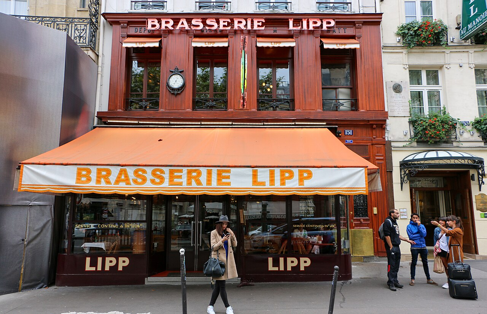

# 利普啤酒馆

圣日耳曼大道走到 151 号，会看到一家外墙铺满彩釉瓷砖、门口挂着“BRASSERIE LIPP”老招牌的店。它不像花神那样把座位摆到人行道上，也不像高级餐厅那样需要门童；推门进去，先是一道老式旋转门，然后是深色木饰、镜面、皮革长椅与密密麻麻的桌子。中午和晚上，这里永远有人在吃饭、谈事、看人。它是一家啤酒馆，但更像圣日耳曼-德普雷的“政治与文学客厅”。

图：Brasserie Lipp 的彩釉瓷砖立面与遮阳篷，151 boulevard Saint-Germain。图片：Daniel Cruz Valle，CC BY 2.0，via Wikimedia Commons（[原图页面](https://commons.wikimedia.org/wiki/File:Brasserie_Lipp,_Paris_17_September_2016.jpg)）。

## 1880 年：利普啤酒馆的关键起点
1880 年 10 月 27 日，来自阿尔萨斯的 Léonard Lipp 与妻子 Pétronille 在圣日耳曼大道开出这家啤酒馆。阿尔萨斯在普法战争后被并入德国，Lipp 像许多同乡一样迁到巴黎；他带着两样本事——辨啤酒、做酸菜——在巴黎开出一间“莱茵河畔啤酒馆”。最初店面只有几张大理石桌、啤酒龙头与酸菜桶，卖的是阿尔萨斯式的家常菜。

第一次世界大战期间，因为反德情绪，店名一度改成“Brasserie des Bords”。1920 年 7 月，来自 Laguiole 的 Marcelin Cazes 接手，把店面重新装修成当时流行的新艺术/装饰艺术混合风格：Léon Fargue 的彩釉墙面、Charly Garrey 的天顶画、棕色皮革长椅与镜面。也是从这时起，Lipp 成为作家、出版人、议员与部长的会面点，巴黎旅游局称它逐渐变成“议会的一个分部”。

1935 年，Marcelin Cazes 设立 Prix Cazes，奖励法语小说；1955 年，他把店传给儿子 Roger Cazes；1990 年，Bertrand 家族接手，延续 Auvergne 与阿尔萨斯两条味觉脉络。1989 年，Lipp 的底层餐厅与装饰列入历史建筑。今天店里仍保留着“table 1”与“table 8”之类的老桌号传说：table 1 靠近吧台，常被说成密特朗与 Mazarine 的座位；table 8 则是两人并坐的“情人桌”。

## 空间与酒单

Lipp 的空间是“窄、深、密”。外立面是彩釉瓷砖与红色遮阳篷，内饰是深色木饰、镜面、黄铜衣帽钩、皮革长椅与白色桌布；桌子挨得近，服务生端着菜在过道里穿行。它没有大落地窗，也没有现代餐厅的开放厨房，光线偏暖，白天靠窗的位置最亮，晚上则更像一间老式剧院包厢。

菜单以阿尔萨斯与 Auvergne 家常菜为主：choucroute garnie（酸菜配香肠、培根与土豆）、cassoulet（周四常见）、牛排、鸭腿、鱼、鹅肝与 profiteroles、baba au rhum、tarte Tatin。酒单以法国葡萄酒为主，阿尔萨斯白葡萄酒、香槟与波尔多/勃艮第都能找到；也有啤酒与经典鸡尾酒。它不追逐年份炒作，更多是按菜配酒：酸菜配白葡萄酒，cassoulet 配西南产区红酒，profiteroles 配甜酒或咖啡。它不是“新派创意餐厅”，强项是把传统菜做得稳定、分量足。

## 怎么喝

中午适合点一份酸菜或 cassoulet，配一杯阿尔萨斯白葡萄酒或啤酒；酸菜的酸度与猪肉的油脂需要酒来切，白葡萄酒比红葡萄酒更合适。晚上可以点牛排、鸭腿或鱼，配波尔多或勃艮第；甜点选 profiteroles 或 baba au rhum，配一杯甜酒或咖啡。

如果只想喝一杯，吧台区比餐厅更容易找到位置；点一杯香槟、kir 或啤酒，配一份小食，看圣日耳曼大道的人流。不要期待“密特朗同款菜单”或固定讲解；Lipp 仍然是营业中的餐厅，点单、吃饭、看人就是进入方式。

## 利普啤酒馆的地址与营业安排
- 地址：151 Boulevard Saint-Germain, 75006 Paris。
- 营业：每日 09:00–02:00，连续服务；节假日与特殊活动会调整。
- 交通：地铁 4 号线 Saint-Germain-des-Prés；公交 39、63、86、95 路附近停靠。
- 预订：晚餐建议提前订；午餐与深夜通常可以直接到店，但周末与政治/出版活动期间会很满。
- 价格：正餐人均较高；吧台一杯酒与小食的消费低于餐厅正餐。
- 着装：门口旧告示写着“tenue correcte”，不必西装，但不要穿拖鞋、运动短裤或背心。

## 礼仪与常见误区

第一，不要因为“利普很有名”就随便坐 table 1 或 table 8；这些桌号有固定常客与预订，服务生会带你入位。第二，不要把“议会分部”当成今天的政治现场；那是对二十世纪客群的形容，今天更多是出版人、律师、游客与本地食客。第三，不要只点一杯咖啡却占正餐桌；想喝一杯，留在吧台或问服务生是否有酒吧位。第四，不要用“1880 年”推断所有装饰都是原物；1920 年代 Cazes 的改造与后来的修复叠加，1989 年列入历史建筑的是底层餐厅与装饰整体。第五，不要在别人吃饭时用闪光灯拍桌；Lipp 的客人对“被看”很敏感，拍照前先问。

## 从利普啤酒馆延伸到和平咖啡馆
从 Lipp 出门，往东两分钟是 Café de Flore 与 Les Deux Magots，往西是 Rue de Rennes 与 Montparnasse，往北穿过 Boulevard Saint-Germain 是 Saint-Germain-des-Prés 教堂与 Musée d'Orsay 方向。可以排成：Saint-Germain-des-Prés 教堂 → Lipp 午餐 → Deux Magots/Flore 喝咖啡 → Musée d'Orsay → 塞纳河。若想看蒙帕纳斯文学圈，往南走十分钟到 La Closerie des Lilas 与 La Coupole。

相关条目：[和平咖啡馆](ref:paix)。

**关键事实。**

| 项目 | 内容 |
| --- | --- |
| 一句话定位 | 巴黎圣日耳曼大道 151 号的 Brasserie Lipp，1880 年由阿尔萨斯人 Léonard Lipp 开办；1920 年 Marcelin Cazes 接手后成为文学与政治人物的会面场，1989 年列入历史建筑，酸菜与 profiteroles 仍是招牌 |
| 地址 | 151 Boulevard Saint-Germain, 75006 Paris, France |
| 城市/国家 | 巴黎 / 法国 |
| 营业状态 | 已核验营业 |
| 官网 | brasserielipp.fr |

**来源与边界。** 本页关于「利普啤酒馆」的关键事实，主要由以下来源交叉核对：Brasserie Lipp（151 boulevard Saint-Germain 地址与每日 09:00–02:00 营业时间）、Paris Convention and Visitors Bureau（“文学与政治声誉”、Gide / Malraux / Proust / Saint-Exupéry / Camus / Sartre 客群与“议会分部”说法）、Groupe Bertrand（交叉核对 1880 年创立、1920 年 Cazes、1990 年 Bertrand 家族接手与 151 boulevard Saint-Germain 地址）。产品、地址或营业状态变化较快时，以 brasserielipp.fr 的最新页面为准；价格、批次与状态会变，涉及这些字段时以页面所列来源的最新版本为准。正文为项目自写，来源只作核验，不复制原文。

**并读。** 把「利普啤酒馆」与「丁香园咖啡馆」、「和平咖啡馆」、「圆顶咖啡馆」放在一起读时，先确认它们是同一层级还是上下游关系：先确认地址与营业状态，再比较历史、空间与点单体验。本页负责给出场所的基本坐标，对照条目补上具体案例与差异；读完再回到本页，才能分清哪些差别属于场所本身，哪些只是产地、批次或品牌选择。

**适用边界。** 对「利普啤酒馆」而言，营业时间、预约方式与菜单会变；到访前以官网、电话或现场公告为准。

**更新提示。** 「利普啤酒馆」最近核对于 2026-11-21；地址、营业时间、门票与预约会变，出行前以官网当日公告为准。

## 参考资料
- 店方“关于”页：<https://www.brasserielipp.fr/zh/about-us/>，用于核对 1880、1920 Cazes、1935 Prix Cazes、1989 历史建筑与装饰细节。
- 巴黎旅游局条目：<https://en.parisinfo.com/paris-restaurant/93697/Brasserie-Lipp>，用于核对文学/政治客群与“议会分部”说法。
- Groupe Bertrand 的团体菜单 PDF：<https://evenement.groupe-bertrand.com/wp-content/uploads/2024/04/LIPP-PE24-MENUS-GROUPES-1.pdf>，用于交叉核对 1880、1920、1990 与地址。
- 同街区的 `place:cafe-de-la-paix`、`place:la-closerie-des-lilas`、`place:la-coupole` 可以对照巴黎“文学咖啡馆/啤酒馆”的不同类型。
- 若走圣日耳曼路线，读 `route:saint-germain-literary-cafes`。
- 相关条目：[丁香园咖啡馆](ref:closerie)、[和平咖啡馆](ref:paix)、[圆顶咖啡馆](ref:coupole)、[圣日耳曼文学咖啡馆路线](ref:saint-germain)、[巴黎丽兹 Hemingway 酒吧](ref:hemingway)

对照阅读：[丁香园咖啡馆](ref:closerie)、[圆顶咖啡馆](ref:coupole)。
