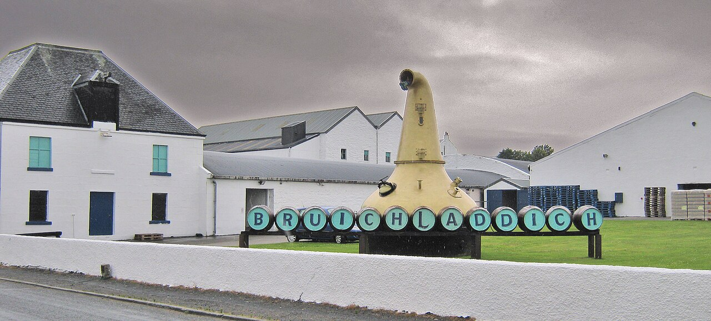
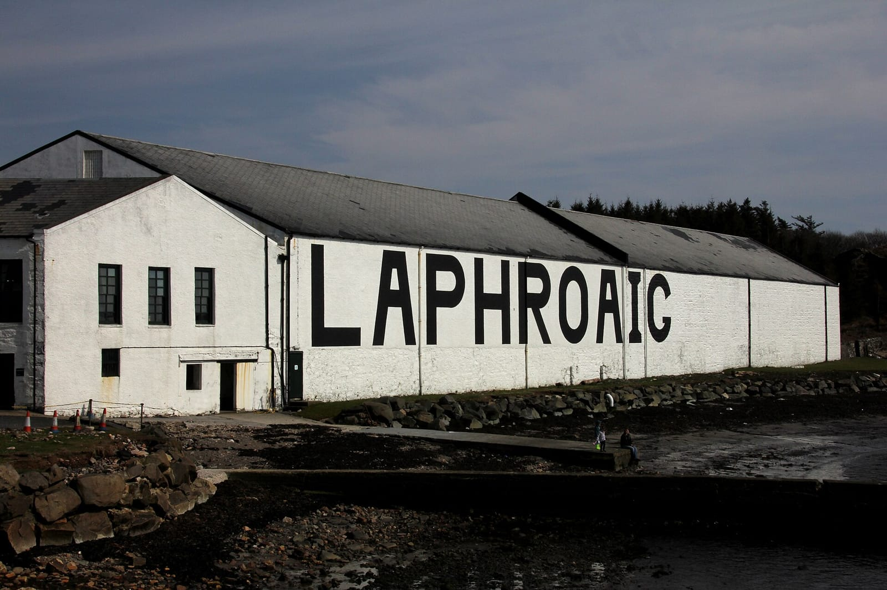

# 布赫拉迪酒厂

从 Bowmore 往西，路沿着 Loch Indaal 的南岸走，左手是灰蓝色的海，右手是低矮的草坡与白墙厂房。布赫拉迪没有酒厂大门上常见的那种“宏伟入口”，它更像一座仍在运转的维多利亚式工厂：白墙、黑窗框、高高的烟囱，墙面上刷着 “PROGRESSIVE HEBRIDEAN DISTILLERS / BRUICHLADDICH / SINCE 1881”。风很大，海很近，酒厂的气味与海盐混在一起。

> **到访信息**
> - 地址：Bruichladdich, Isle of Islay PA49 7UN, Scotland。
> - 开放与预约：以[官方页面](https://www.bruichladdich.com/)为准；开放时间、场次和预约规则会随季节调整。
> - 交通与费用：出发前以官方页面为准，本页不承诺固定票价。
> - 营业状态：已核实；来源最近核对：2026-11-21。

图：布赫拉迪酒厂临 Loch Indaal 的白墙厂房与入口。图片：Fumaro，CC BY-SA 3.0，via Wikimedia Commons（[原图页面](https://commons.wikimedia.org/wiki/File:Bruichladdich-Islay.jpg)）。

> **先给结论**
> **一句话：** 这页判断布赫拉迪酒厂值不值得专程去，以及到访前要核对什么。
>
> - **适合谁：** 正在计划去布赫拉迪酒厂、想知道值不值得专程安排半天到一天的人。
> - **不适合谁：** 只想要“必去榜单”、不准备核对预约、交通和开放时间的人。
> - **先看这两点：**
>   - 第一次来，选 90 分钟的 Guided Distillery Tour 最稳：从厂房、蒸馏器走到仓库，最后有几杯基础酒款。
>   - 第一，不要把“艾雷岛威士忌”一律当成重泥煤。

## 1881 年：布赫拉迪酒厂的关键起点
布赫拉迪由 Harvey 家族的 William、John、Robert 三兄弟建于 1881 年。他们来自 Glasgow 的威士忌世家，却在艾雷岛建了一座“当时最先进”的酒厂：选址靠近海湾，便于运煤、运大麦与运酒；厂房顺着缓坡布置，利用重力把麦芽与液体往下送；蒸馏室做成教堂式的高空间，容纳三对异常高、窄颈的蒸馏器。官方把这种设计称为“革命性”，并说高窄蒸馏器让酒体更优雅。

酒厂的历史并不顺。Harvey 兄弟后来失和，管理不善、禁酒令、大萧条与两次世界大战接连冲击，酒厂在 1929 年关闭，1938 年卖给一家威士忌集团，此后多次关停、转手，1994 年彻底停摆，卖给 Jim Beam Brands。2000 年，伦敦酒商 Mark Reynier 与 Simon Coughlin 组成投资团买下这座半废弃酒厂，2001 年重新点火；Jim McEwan 加入并负责蒸馏。2012 年，Rémy Cointreau 收购酒厂；2020 年 5 月，布赫拉迪成为全球首批获得 B Corp 认证的苏格兰威士忌公司之一。

这段历史里最容易被讲成“传奇”的，是 Reynier 连续九年写信求购、最后在截止日当天中午前两分钟等到贷款到账的故事。故事有趣，但真正改变酒厂方向的是“把葡萄酒世界的 terroir 概念带进威士忌”：不是只追求产量与一致性，而是强调大麦产地、艾雷岛的水与海风、以及每一批酒的差异。

## 建筑与空间

布赫拉迪是一座典型的维多利亚式蒸馏厂，却不是博物馆式的“旧厂房布景”。白墙、黑框窗、石砌基座、窄长的厂房与高烟囱都还在，蒸馏室里的铜器仍在工作。酒厂的参观动线会经过糖化、发酵、蒸馏与仓库；空间不算宽敞，楼梯与门槛多，遇到生产时地面可能湿滑。它的美感来自比例与重复：一排白墙、几扇黑窗、一个写着厂名的门楣，背后就是海。

酒厂没有把访客中心做成大型商业综合体。入口一侧是 Laddie Shop 与接待区，另一侧是生产区；天气好时，门外就是看 Loch Indaal 的位置。布赫拉迪的“建筑看点”不是某一件展品，而是整座厂房与地形的咬合：低矮的体量、顺着坡度的物流、贴着海岸的仓库。它提醒你，威士忌厂首先是一座工厂，其次才是品牌体验。

## 酒款与风味

布赫拉迪同时生产四个品牌：无泥煤的 Bruichladdich 单一麦芽、重泥煤的 Port Charlotte、超重泥煤的 Octomore，以及 The Botanist 金酒。把它们当成“四种不同酒”比当成“一个酒厂的四个系列”更准确：它们共享同一套厂房、设备与人，却在泥煤强度、大麦来源与蒸馏参数上分开。

Bruichladdich 主线通常带海盐、青苹果、柑橘、蜂蜜、麦芽与淡淡的烟熏；它不是“艾雷岛泥煤炸弹”，第一次喝的人常会惊讶于它的干净。Port Charlotte 把泥煤拉高，烟熏、灰烬、海藻与黑色水果更明显；Octomore 是官方所说的“世界上泥煤最重的苏格兰威士忌”之一，泥煤值常在 80 ppm 以上，但高泥煤不等于粗糙，酒体仍有甜度与油脂感。The Botanist 用 22 种艾雷岛野生植物，在改装过的 Lomond 蒸馏器里做金酒；它和威士忌共用厂房，却是完全不同的产品逻辑。

布赫拉迪强调“在地”：官方说 52% 的年度产量使用艾雷岛大麦，所有酒都在岛上糖化、蒸馏、陈年与装瓶；它拒绝添加焦糖色，也不做冷水降度以外的“快速修正”。这些做法不一定让每一瓶都好喝，但能让你在杯子里喝到更清楚的“原料—工艺—地点”关系。

## 怎么喝

第一次来，选 90 分钟的 Guided Distillery Tour 最稳：从厂房、蒸馏器走到仓库，最后有几杯基础酒款。想更深入，选 Warehouse Tasting，直接在桶边喝原酒；时间更长、价格更高，也更适合已经知道自己喜欢什么的人。官方 UK 页面列导览 £15 起、仓库品鉴 £40 起、完整体验 £55 起，但不同区域页面可能显示不同币种与价格，预订时看结算页。

品鉴顺序建议从无泥煤到重泥煤：先 Bruichladdich，再 Port Charlotte，最后 Octomore；如果先喝 Octomore，后面的酒会被烟熏压住。每杯先闻两次，再小口；可以加一两滴水，让香气打开，但不要加冰把味道冻住。开车的人不要参加含品鉴的体验，酒厂会为驾驶者提供少量样品带走，但“带走”不等于“当场喝”。

如果时间只够参加一场，选导览而不是酒吧；布赫拉迪的看点在生产区，不在菜单。Fèis Ìle 期间酒厂会办活动，具体日期与票务以官方公告为准；那是岛上最拥挤的一周，住宿与渡轮要提前很久订。

## 布赫拉迪酒厂的地址与营业安排
- 地址：Bruichladdich, Isle of Islay PA49 7UN, Scotland。
- 坐标：55.7666, -6.5028。
- 电话：+44 (0)1496 850 190。
- 开放：3 月至 10 月每日 09:45–17:30；11 月至次年 2 月周二至周日 09:45–17:00。节假日与临时活动可能调整。
- 导览：90 分钟导览、90 分钟仓库品鉴、150 分钟完整体验与 Botanist 调酒课；建议提前在线预约，旺季当天名额不保证。
- 年龄：品鉴 18 岁以上；只有 Distillery Tour 对所有年龄开放，其他体验通常限成年人。
- 交通：从 Islay Airport（ILY）开车约 30 分钟；从 Port Ellen 或 Port Askaig 渡轮码头开车约 30 分钟。公共交通班次少，包车或自驾最稳。
- 天气：海岛风大、雨来得快，穿防风防水外套与防滑鞋；厂房内温度低，夏天也带一件薄外套。
- 无障碍：访客中心可进入，但生产区有楼梯、门槛与湿滑地面；需要轮椅或行动协助时提前联系酒厂。

## 礼仪与常见误区

第一，不要把“艾雷岛威士忌”一律当成重泥煤。布赫拉迪主线就是无泥煤的；Port Charlotte 与 Octomore 才是泥煤线。第二，不要把 Port Charlotte、Octomore 当成三家独立酒厂；它们是同一座布赫拉迪酒厂的不同品牌。第三，不要用“年份越老越好”判断布赫拉迪；它的很多酒款强调桶型、批次与艾雷岛大麦，而不是长年份。第四，不要在生产区触摸设备、阀门与桶架；酒厂仍在运转，不是游乐设施。第五，不要喷浓香水进品鉴室，也不要在嘴里含着酒大声讲话；吐酒是正常品鉴动作。

还有一层历史伦理：艾雷岛的蒸馏业与土地、租佃、贫困和移民史纠缠在一起，不是只有海风与泥煤。参观时看到旧厂房、仓库与码头，不妨想一想这些酒是如何被运出岛、又由谁在什么样的条件下生产出来的。

## 从布赫拉迪酒厂延伸到Lagavulin
布赫拉迪在 Loch Indaal 的西岸，往南可到 Port Charlotte、Kilchiaran 与 Loch Gorm，往北可到 Bowmore 与 Port Askeig。把酒厂放进“艾雷岛南岸”路线，可以接着去 [Lagavulin](ref:lagavulin)、[Laphroaig](ref:laphroaig) 与 [Ardbeg](ref:ardbeg)，三座酒厂在同一条海岸路上，彼此车程不远；[艾雷岛威士忌路线](ref:islayroute) 适合安排两到三天。

如果只做一日游，布赫拉迪 + Bowmore 是较轻松的搭配；想把南岸三厂也走完，至少留两天。往东飞回 Glasgow 前，可以在 Bowmore 的圆教堂与码头停一下。想对比“泥煤 vs 无泥煤”，布赫拉迪与南岸三厂是最好的组合；想换到斯佩塞的果香与雪莉桶风格，可以继续走 [斯佩塞麦芽路线](ref:speyside)，或到 [Glenfiddich](ref:glenfiddich) 看另一套规模更大的游客体验。

**关键事实。**

| 项目 | 内容 |
| --- | --- |
| 一句话定位 | 苏格兰艾雷岛 Loch Indaal 岸边的维多利亚式蒸馏厂，1881 年由 Harvey 兄弟建造；1929 年关闭、1994 年停产后，2001 年由 Mark Reynier、Simon Coughlin 与 Jim McEwan 复活 |
| 地址 | Bruichladdich, Isle of Islay PA49 7UN, Scotland |
| 城市/国家 | 艾雷岛 / 英国 |
| 营业状态 | 已核验营业 |
| 官网 | bruichladdich.com |

## 参考资料
- 官方历史《Breaking the Mould》：<https://www.bruichladdich.com/blogs/news/breaking-the-mold>，用于核对 1881 年建厂、1929/1938/1994 年关停转手、2000 年购入与 2001 年重开。
- 官方 FAQ：<https://us.bruichladdich.com/pages/faqs>，用于核对四种产品、52% 艾雷岛大麦、2012 年收购、2020 年 B Corp 与开放时间。
- 官方导览页：<https://uk.bruichladdich.com/pages/tours>，用于核对导览类型、时长、价格与 18 岁政策。
- Rémy Cointreau 品牌页：<https://www.remy-cointreau.com/en/brands/bruichladdich-port-charlotte-octomore/>，用于核对 1881/1994/2000/2001/2004/2012/2020 年表。
- 艾雷岛对照：[Lagavulin](ref:lagavulin)、[Laphroaig](ref:laphroaig)、[Ardbeg](ref:ardbeg)、[艾雷岛威士忌路线](ref:islayroute)、[Fèis Ìle 2026](ref:feis)。
- 苏格兰其他路线：[斯佩塞麦芽路线](ref:speyside)、[Glenfiddich](ref:glenfiddich)、[苏格兰威士忌体验](ref:scotchexperience)。

## 相关图像

图：拉弗格蒸馏厂相关实景照片。图片：Bjarne Henning Kvaal…，CC BY-SA 3.0，via Wikimedia Commons（[原图页面](https://commons.wikimedia.org/wiki/File:Laphroaig_Distillery_-_panoramio_(4).jpg)）。关联图像：布赫拉迪酒厂。
