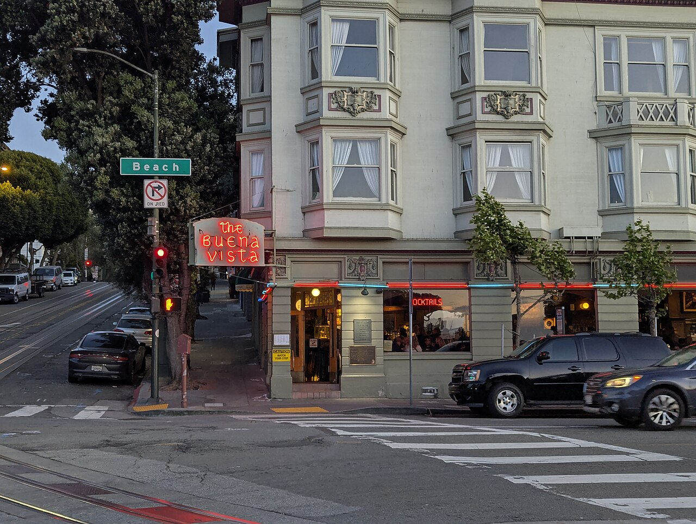

# 美景咖啡馆

旧金山 Hyde 与 Beach 街角有一间看起来并不“网红”的酒吧：白色外墙、深色窗框、门口一块不大的招牌，里面却常常坐满人，吧台上排着一列六盎司玻璃杯，侍者把奶油从杯沿慢慢倒下去。这里是美景咖啡馆（Buena Vista Café）。它的名气几乎完全绑定在一个饮品——爱尔兰咖啡（Irish Coffee）；但它的故事并不只是“发明了一种咖啡”，而是战后旧金山港口、报纸专栏与缆车终点共同造就的一段城市日常。

图：旧金山 Hyde 与 Beach 街角的 Buena Vista Café 外观；原建筑 1916 年由寄宿公寓一层改为酒吧，1952 年开始供应爱尔兰咖啡，照片为 2025 年街景。图片：BriefEdits，CC BY-SA 4.0，via Wikimedia Commons（[原图页面](https://commons.wikimedia.org/wiki/File:Buena_Vista_Cafe,_exterior,_San_Francisco_(May_2025)_03.jpg)）。

## 1916 年：美景咖啡馆的关键起点
美景咖啡馆的官方历史从 1916 年开始：当时这里是一栋寄宿公寓，房东把一层改成酒吧，取名“Buena Vista”（西班牙语“好风景”）。这个名字并不夸张——酒吧面向旧金山湾，附近是沙丁鱼罐头厂与渔港，渔民、码头工人和船员会在这里喝一杯威士忌，顺便观察进港的渔船。官方叙述里有一句很生动的场景：看到船进港，客人就得赶紧喝完回去上工。这种“港口酒吧”的出身，比后来“爱尔兰咖啡圣地”的名声更早。

1952 年 11 月 10 日，故事转到爱尔兰咖啡。当时的老板 Jack Koeppler 与国际旅行作家 Stanton Delaplane 在 Shannon 机场喝过一杯爱尔兰咖啡，回到旧金山后想复刻。两人整夜试验，遇到两个问题：味道不对，奶油不肯浮起来。Koeppler 专程再去 Shannon 学习，回来后继续试验；最终发现奶油要熟成 48 小时、打到特定稠度，才能稳稳浮在咖啡表面。他们选定六盎司、耐热、透明的玻璃杯，形成了今天美景咖啡馆的标准做法。

这段故事常被简化成“美景咖啡馆发明了爱尔兰咖啡”。更准确的说法是：爱尔兰咖啡起源于爱尔兰 Shannon 机场一带，美景咖啡馆在 1952 年把它“美国化、标准化、推广开”。它不是从零发明，而是把一个既有饮品做成可复制的配方与表演。今天吧台上仍按同样顺序操作：先放糖，倒热咖啡，加爱尔兰威士忌，最后从勺背缓慢倒入 lightly whipped cream。奶油不搅拌，喝的时候穿过奶油层喝下面的咖啡，这是判断一杯爱尔兰咖啡是否合格的关键。

美景咖啡馆的位置也决定了它的日常：门口就是 Powell-Hyde 缆车的终点站，游客下车后几乎直接看到酒吧。缆车掉头、铃声、排队的人群与酒吧门口的等候队伍混在一起，构成旧金山最典型的旅游街景之一。它既是“目的地”，也是“等缆车时顺便喝一杯”的街角酒吧。

## 空间与酒单

室内是长条形布局，靠窗是一排座位，吧台沿墙延伸，墙上挂着旧照片与爱尔兰咖啡的海报。空间不算大，桌椅紧凑，白天靠窗光线好，晚上偏暖。吧台是主要舞台：侍者把一排杯子摆好，加糖、倒咖啡、加威士忌，再从勺背倒奶油，动作连贯，像一条小型生产线。靠窗的位置能看到缆车掉头与街角人流，但也最容易被游客挡住。

酒单以爱尔兰咖啡为绝对主角，另有普通咖啡、啤酒、葡萄酒、威士忌与简单鸡尾酒。食物是美式早餐与酒吧简餐：鸡蛋、培根、三明治、汤与甜点，适合早午餐或下午小食。它不是正餐餐厅，也不是精品咖啡店；来这里的人多数是为了那一杯爱尔兰咖啡，或者为了在缆车终点坐下来歇一会儿。

## 怎么喝

点爱尔兰咖啡时，不需要额外加糖或搅拌。正确的喝法是嘴唇碰到奶油层，慢慢吸下面的咖啡与威士忌；奶油会随着每一口略微下移，形成冷奶油、热咖啡、酒香三层交替的口感。若觉得太甜，可以请侍者少放一点糖，但不要要求“不要奶油”——那已经不是这杯酒的做法。威士忌通常用爱尔兰威士忌，品牌会随供应调整；可以问吧台今天用哪一款。

时间上，早晨与上午相对安静，适合坐窗边看缆车；中午到下午游客最多，吧台前常排队。若想拍“奶油倒入杯中”的过程，先确认不影响侍者与其他客人，不要为了拍照挡住通道。想喝第二杯，等第一杯喝到一半再点，奶油层才不会浪费。

## 美景咖啡馆的地址与营业安排
地址是 2765 Hyde Street（@ Beach），San Francisco, CA 94109。它就在 Powell-Hyde 缆车终点站旁，步行可达 Fisherman's Wharf、Ghirardelli Square 与 Hyde Street Pier。官方营业时间：周一至周四 09:00–23:00（厨房 21:30 关），周五 09:00–24:00，周六 08:00–24:00，周日 08:00–23:00；节假日会调整。

咖啡馆接受信用卡，不要求现金；通常不接受预订，先到先得。美国法定饮酒年龄为 21 岁，点酒需带证件。着装随意，旅游鞋与外套都可以。小费按税前 18%–20% 是常规；若只点一杯咖啡坐在吧台，按 1–2 美元给也可以。门口与缆车区域人多，注意保管随身物品。

## 礼仪与常见误区

第一个误区是“美景咖啡馆发明了爱尔兰咖啡”。更准确的是：它把 Shannon 机场的爱尔兰咖啡配方在 1952 年标准化并推广，使之成为美国版本的代表。第二个误区是把奶油搅进咖啡里；正确做法是不搅拌，穿过奶油喝。第三个误区是把这里当成安静咖啡馆；它是旅游区酒吧，排队、缆车铃声与人群是体验的一部分。第四，不要占据缆车掉头区的通道拍照；那是公共交通设施，不是布景。第五，不要把“好风景”当成随时都有；旧金山雾大，下午光线变化很快，想看湾景要趁早。

## 从美景咖啡馆延伸到Vesuvio Café
从咖啡馆出来，可以坐 Powell-Hyde 缆车去 Union Square，或沿 Hyde Street 走到 Fisherman's Wharf、Ghirardelli Square 与 Hyde Street Pier。往南上坡是 Russian Hill 与 Lombard Street；往东可到 North Beach 的[Vesuvio Café](ref:vesuvio)与 City Lights。把美景咖啡馆与[联合牡蛎屋](ref:union)、[钟声酒馆](ref:bell)放在同一条“美国老酒吧”阅读线里，可以比较港口城市与东部老城的酒吧性格；想了解这杯酒的配方与变体，读[爱尔兰咖啡](ref:irish-coffee)；想理解酒吧与城市日常的关系，读[认识一座城，从一间酒馆开始](ref:pub-city)。

## 参考资料
- [爱尔兰咖啡](ref:irish-coffee)
- [联合牡蛎屋](ref:union)
- [Vesuvio Café](ref:vesuvio)
- [钟声酒馆](ref:bell)
- [认识一座城，从一间酒馆开始](ref:pub-city)

最后核对：2765 Hyde Street 的地址、缆车沿线位置与营业安排按官网查于 2026-11-21；爱尔兰咖啡的版本与“发明”说法已在正文加限定。本页是“喝酒去”的旧金山咖啡馆条目，中文与英文版同步；文字许可见上方 rights 字段，图片署名与许可见各图注。

对照阅读：[爱尔兰咖啡](ref:irish-coffee)、[维苏威咖啡馆](ref:vesuvio)。
