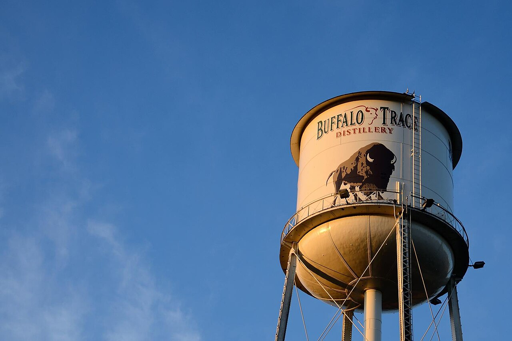

# 水牛足迹酒厂

在法兰克福（Frankfort）北侧的肯塔基河岸，水牛足迹酒厂（Buffalo Trace Distillery）占据着一片仍在生产的厂区：石砌仓库、红砖蒸馏楼、装瓶线与游客中心挤在同一块地上，没有把“历史”隔离成博物馆展柜。它同时是美国国家历史地标和一座每天出酒的工厂，这种“活着的遗产”状态，是理解参观内容的前提。

图：水牛足迹酒厂。图片：Kittugwiki，CC BY-SA 3.0，via Wikimedia Commons（[原图页面](https://commons.wikimedia.org/wiki/File:Buffalo_Trace_Tower.jpg)）。

## 河岸上的两个半世纪

1775 年，Hancock 与 Willis Lee 在肯塔基河北岸建立 Leestown，位置就在今天的厂区；此后这里经历过洪水、火灾与禁酒令。1870 年，E.H. Taylor Jr. 买下酒厂，把它扩建成 O.F.C.；1883 年落成的糖化与发酵翼楼至今仍在，1885 年的 Warehouse C 也还在使用。1930 至 1933 年，这里是少数获准生产药用威士忌、并继续蒸馏新酒的酒厂之一。1984 年，Blanton's 在这里装瓶，常被称为世界上第一款单桶波本；1992 年 Sazerac 收购酒厂，1999 年改名为 Buffalo Trace，同名旗舰酒款也在这一年推出。2013 年，酒厂被列为国家历史地标，同年建起实验性的 Warehouse X。[肯塔基](ref:kentucky)的波本产业把这段连续生产史当作资产，而不是背景故事。

这段历史也解释了厂区为什么看起来“不整齐”：不同年代的建筑挨在一起，早期的石墙、后来的红砖厂房与更新的不锈钢设备并不追求统一风格。Taylor 当年把这里称作“世界模范蒸馏厂”，但他留下的并不是一座冻结的样板，而是一套可以继续加建的骨架。参观时如果只记年份，很容易忽略这一点；真正值得看的是建筑之间的接缝，以及酒厂如何在不停产的情况下维护它们。

## 从 Freehouse 开始：预约与动线

所有访客先在 Freehouse Welcome Center 核验证件、领取手环。参观分三种：Trace Tour 约 75 分钟，适合第一次来，也是唯一全程无障碍的路线；Old Taylor Tour 同样 75 分钟，围绕 E.H. Taylor 的旧宅、O.F.C. 发酵槽与 Warehouse C；Hard Hat Tour 105 分钟，进入生产区，经过大型糖化锅与微型蒸馏器，最后在 Dryhouse 结束。三条路线都含品鉴，导览、品鉴与停车均免费。

预约最多提前八周开放，每周三上午十点（东部时间）再放出一周名额；旺季名额很快售罄，但每天仍可能留少量现场名额。即使不参加导览，也可以进入游客中心、商店与品鉴区；品鉴区不需要预约，只是要在闭馆前半小时之前到。若计划看完整生产流程，Hard Hat 是唯一选择，但它对年龄与行动能力有要求，预约前先读清楚。

## 糖化、微蒸馏与仓库

Hard Hat 路线最能看到“工厂”的一面：糖化锅把玉米、黑麦、麦芽与石灰岩水一起煮熟，发酵后的酒液进入连续蒸馏器，再经 doubler 提纯。2007 年启用的 E.H. Taylor, Jr. Microstill 是壶式与柱式的组合，用来做小批次试验，也是酒厂把实验纳入日常生产的象征。仓库区更能说明时间成本：Warehouse C 建于 1885 年，1886 年这里首次使用蒸汽供暖；Warehouse X 则是 2013 年建造的实验仓库，用来研究温度、湿度与空气流动对熟成的影响。游客中心旁的商店设在 1881 年建的 Warehouse A 里，买酒前可以先看一眼桶架与墙面，理解“仓库也是风味设备”。

## 酒款地图

[Buffalo Trace](ref:buffalo-trace-bottle) 是基准款：以玉米为主、黑麦提供辛香，常见焦糖、香草、橡木与一点柑橘皮。Eagle Rare 10 年更干、更偏橡木与香料；Blanton's 以单桶装瓶，强调桶间差异；W.L. Weller 与 Pappy Van Winkle 系列走小麦配方，口感更圆；Sazerac Rye 则把视线拉向黑麦。第一次来，最有效的对比是基准款与 Eagle Rare：同一厂区、相近配方，差别主要在年份与选桶。再喝一口 Weller，就能体会“把黑麦换成小麦”带来的柔软质地。

美国法规要求波本以玉米为主，配方中玉米至少 51%，在新烧焦橡木桶中熟成，装瓶酒精度不低于 40%；标为“straight”的酒还需至少两年陈酿。水牛足迹的配方并非只有一种：黑麦配方、小麦配方与黑麦威士忌在同一条参观线上并存，这让人更容易理解“酒厂风格”其实是多套配方、蒸馏与仓库管理的组合，而不是单一秘方。把这里的酒与[美格](ref:makers-mark)的纯小麦配方对读，差异会更清楚。

品鉴时不要急着给酒排序。先确认杯中是哪条产品线，再问自己三个问题：甜味来自玉米还是桶？辛香来自黑麦还是橡木？余味是干还是油？同一厂区的酒可以在这些问题上给出完全不同的答案。若同行者有人不喝烈酒，游客中心也提供无酒精饮料与波本奶油等低度选择，不必为了陪同而勉强喝完整杯。

## 到访提示

地址是 113 Great Buffalo Trace, Frankfort, KY 40601。自驾从 I-64 的法兰克福出口进入，跟着 Visitor Parking 标识走，不要走 Fair Oaks Lane 附近的卡车入口。周一至周六 9:00 至 17:00，周日 11:00 至 17:00；复活节、感恩节、平安夜、圣诞节与元旦闭馆。旺季建议提前 20 至 30 分钟到，想先逛商店则留 45 至 60 分钟。厂区内的 John G. Carlisle Cafe 于 2026 年 5 月开业，只做快餐、不接受预订，想在导览前吃饭至少要留 90 分钟。

品鉴总量受牌照限制，每人每天最多 1¾ 盎司，参加多场品鉴要自行分配；开车的人应把全部样品交给同行者或直接跳过。坐标 38.2175、-84.8694 取自公开地理条目，精确入口与停车安排以官方渠道为准。

## 把这里放进波本地图

从路易斯维尔出发约一小时，往西可接[美格](ref:makers-mark)与巴兹敦的天堂山，往南则是 Woodford Reserve 与 Four Roses。把水牛足迹放在上午，能避开团队客流，也给下午的仓库参观留出体力。酒厂商店的瓶装供应每天变化，部分酒款仍实行配额，进店前先看当天的 Product Availability 页面，不要把“到了就能买到”当成计划。想先建立背景，可读[波本](ref:bourbon)与[美国](ref:usa)条目，再看[地点与工艺](ref:place-and-process)如何解释“同一套法规、不同厂区”的差别。

相关条目：[波本威士忌](ref:bourbon)。

**关键事实。**

| 项目 | 内容 |
| --- | --- |
| 一句话定位 | 美国肯塔基州法兰克福的波本威士忌蒸馏厂，厂址自 1775 年 Leestown 聚落起延续至今，1870 年由 E.H. Taylor Jr. 扩为 O.F.C.，1999 年改名 Buffalo Trace；现为国家历史地标，导览、品鉴与停车免费，需提前在官网抢约 |
| 地址 | 113 Great Buffalo Trace, Frankfort, KY 40601, USA |
| 城市/国家 | Frankfort / 美国 |
| 营业状态 | 已核验营业 |
| 官网 | buffalotracedistillery.com |

**来源与边界。** 本页关于「水牛足迹酒厂」的关键事实，主要由以下来源交叉核对：Buffalo Trace Distillery（113 Great Buffalo Trace 地址、三条导览的时长与年龄限制、每周三放号规则、免费品鉴与 1¾ 盎司上限、营业时间与闭馆日；国家历史地标身份与 Warehouse X 实验仓库的说明）、TopoQuest（坐标 38.218020, -84.868720（本文取四位小数）与厂址位置）、Kentucky Distillers' Association（酒厂在肯塔基波本路线中的位置与周边串联方式）等 10 条来源。产品、地址或营业状态变化较快时，以 buffalotracedistillery.com 的最新页面为准；价格、批次与状态会变，涉及这些字段时以页面所列来源的最新版本为准。正文为项目自写，来源只作核验，不复制原文。
