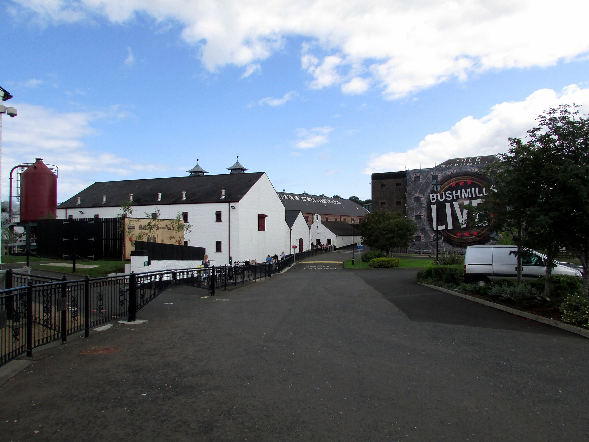
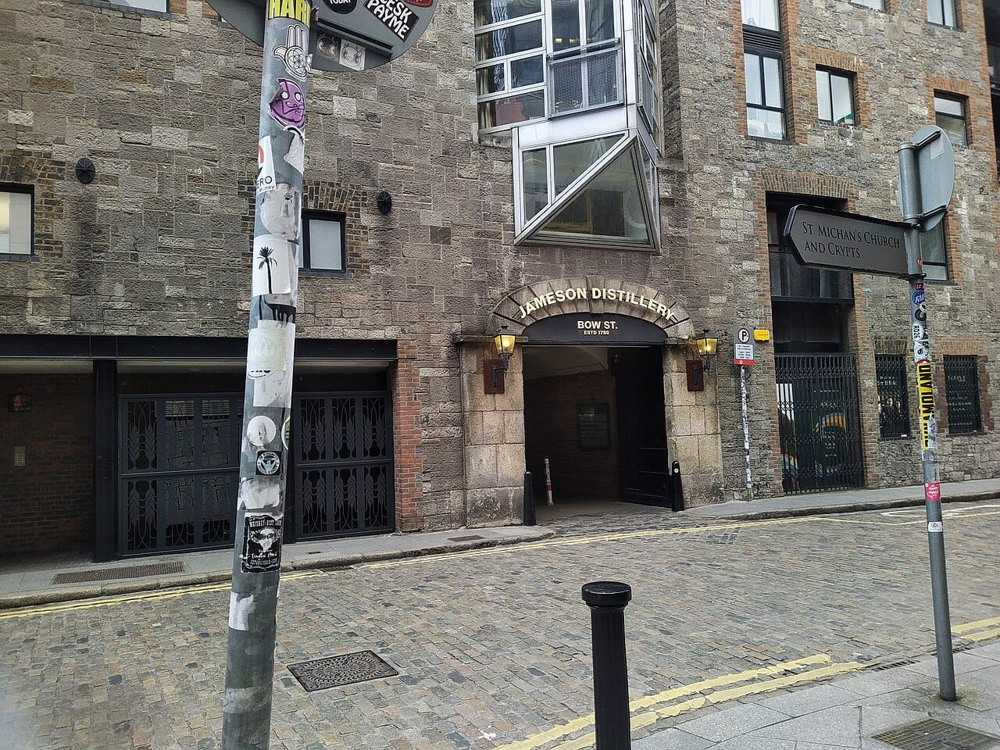

# 布什米尔斯酒厂

布什米尔斯（Bushmills）是北爱尔兰安特里姆郡北海岸的一个村庄，酒厂就在村内的布斯河（River Bush）边，距离巨人之路约两英里。它对外最响亮的身份是“世界最古老的持照威士忌酒厂”，依据是 1608 年的一张蒸馏执照；但今天你看到的厂房、游客中心与 1608 酒吧，是后来逐步建成和翻修的。把执照年代、建厂年代与现存建筑年代分开，是理解这个地方的起点，也能解释为什么它既像一处工业遗址，又仍是一个正常运转的生产单位。

> **到访信息**
> - 地址：2 Distillery Road, Bushmills, Co Antrim BT57 8XH, Northern Ireland。
> - 开放与预约：以[官方页面](https://www.bushmills.eu/)为准；开放时间、场次和预约规则会随季节调整。
> - 交通与费用：出发前以官方页面为准，本页不承诺固定票价。
> - 营业状态：已核实；来源最近核对：2026-11-08。

图：布什米尔斯酒厂相关实景照片。图片：Reading Tom，CC BY 2.0，via Wikimedia Commons（[原图页面](https://commons.wikimedia.org/wiki/File:Bushmills_Whiskey_Distillery_02.jpg)）。

## 一座村庄、一条河与一张 1608 年的执照

1608 年，英王詹姆斯一世把包括布什米尔斯一带在内的土地与权利授予 Sir Thomas Phillips，其中包含蒸馏许可；酒厂由此把 1608 年视为自己的起点。这个说法出现在酒厂官方叙述与北爱尔兰旅游资料中，但“最老”指的是同一地点上持续持有的蒸馏许可传统，而不是一间 17 世纪的原厂房。真正让布什米尔斯稳定运转的，是布斯河的水、周边的农业腹地，以及后来铁路与港口带来的运输条件。

今天从贝尔法斯特自驾约一小时，从都柏林过来约两个半小时；公共交通通常先坐火车到 Coleraine，再换巴士或出租车进村。酒厂不在铁路线上，村内步行范围不大，把车停在厂区停车场最方便。坐标以官方渠道为准，导航直接输入地址即可；如果从巨人之路过来，沿海岸公路行驶只需很短一段。

## 三次蒸馏：爱尔兰风格的骨架

酒厂把“三次蒸馏”写进品牌核心：100% 发芽大麦在铜制壶式蒸馏器中经过三次蒸馏，得到更干净、果香更明显的新酒，这是它单一麦芽的基底。需要说明的是，三次蒸馏是[爱尔兰](ref:ireland)许多酒厂的传统选择，却不是[爱尔兰威士忌](ref:irish)的法律强制要求；法规更关心原料构成、蒸馏酒精度、陈年时间与产地标识。与苏格兰常见的两次蒸馏相比，三次蒸馏通常让酒体更轻、口感更柔，但也更依赖后期桶陈来补回厚度。

理解这一点，可以把[蒸馏](ref:distillation)与[壶式蒸馏器](ref:potstill)两条背景放在一起读：蒸馏次数改变的是新酒的“骨架”，桶型与时间决定它后来长成什么样。酒厂的调和酒仍会加入谷物威士忌，所以“三次蒸馏”并不等于“全部是单麦”；看酒标时要区分单一麦芽与调和两类。

## 走进厂区：从糖化到装瓶

导览通常从游客中心集合，先讲村庄与执照的历史，再进入生产区：糖化槽、发酵槽、蒸馏车间、桶陈仓库，最后回到品鉴室。布什米尔斯的厂房不是博物馆式布景，设备仍在运转，所以空气里有麦芽、酵母和铜器的味道。装瓶线在工作日运行，周五下午与周末通常停机；生产也会因检修或排产暂停，导览内容因此每次略有不同。

厂区地面可能湿滑，楼梯多，穿防滑鞋比穿正式皮鞋更合适；对蒸汽、噪音或强烈气味敏感的人，提前向工作人员说明。导览过程中不要越过黄线、触摸阀门或把手伸进发酵槽；这些规定不是形式，生产区的高温与运转设备确实有风险。若只想喝一杯而不参加导览，可以到 1608 酒吧，但仍需遵守现场的年龄与饮酒规定。

## 酒单怎么读：从 Original 到单麦

吧台与商店的入口是 Bushmills Original：以壶式蒸馏麦芽酒与谷物酒调和的[爱尔兰威士忌](ref:irish)，轻、干净，适合做 highball 或直接加冰。Black Bush 的麦芽比例更高，并用 Oloroso 雪莉桶陈年，干果与香料更明显；Red Bush 以波本桶为主，甜感更直接。单一麦芽序列常见 10 年、12 年、16 年与 21 年，桶型与收尾各有不同，价格也随之抬升。

不要把“年份更高”当成唯一标准：10 年的青苹果与麦芽感、12 年的雪莉桶厚度、16 年的多层桶组合，本来就是不同用途的酒。若只想建立参照，先点一套核心对比，再决定买哪一瓶。商店里会有旅游渠道限定与较高年份的单瓶，购买前先考虑行李空间与携带规定；开瓶后的氧化与温度变化，也会让瓶中的味道与品鉴室里那一杯不同。

## 预约、到达与开放

地址是 2 Distillery Road, Bushmills, Co Antrim BT57 8XH, Northern Ireland。导览建议提前在官网预订，旺季与周末容易满员；团体 12 人以上须提前联系并支付订金。官方列出的礼品店与 1608 酒吧开放时间为周一至周六 10:00–17:00、周日 11:00–17:00，导览场次随季节调整；8 岁以下儿童不能参加标准导览，18 岁以下不能进入 premium 品鉴。

票价按导览类型大致在 15–50 英镑之间，具体以官网当日信息为准。从巨人之路、Dunluce 城堡或 Portrush 过来都在半小时车程内，适合与北海岸路线串成一天。若不自驾，可以把 Coleraine 当作换乘点，提前查好巴士时刻并预留返程时间；乡村线路晚间班次少，不要把所有希望押在临时打车上。

## 到访提示与周边

酒厂是生产场所，不是酒吧：没有预约不要进入生产区，不要触摸蒸馏器、管道与桶架；品鉴时先闻后喝，喝不完可以吐掉。开车的人全程不喝，北爱尔兰的乡村道路窄、弯多，一杯也可能影响判断，最稳妥的是指定司机、包车或参加含接送的团。

若想把爱尔兰威士忌的两种叙事放在一起看，可以再去都柏林的[尊美醇弓街酒厂](ref:jameson)：一家仍在生产，一家已改为展馆，对照之下更容易理解“酒厂观光”与“酒厂生产”的区别。周边的巨人之路、Dunluce 城堡与布什米尔斯村本身，都值得留出时间；把酒厂安排在上午，下午走海岸线，通常比反过来更从容。

相关条目：[尊美醇弓街酒厂](ref:jameson)、[爱尔兰](ref:ireland)。

**关键事实。**

| 项目 | 内容 |
| --- | --- |
| 一句话定位 | 北爱尔兰安特里姆郡布什米尔斯村的爱尔兰威士忌酒厂，以 1608 年蒸馏执照自称“世界最古老的持照威士忌酒厂”；厂内仍用铜制壶式蒸馏器三次蒸馏，设有预约导览、礼品店与 1608 酒吧 |
| 地址 | 2 Distillery Road, Bushmills, Co Antrim BT57 8XH, Northern Ireland |
| 城市/国家 | 布什米尔斯 / 英国 |
| 营业状态 | 已核验营业 |
| 官网 | bushmills.eu |

**来源与边界。** 本页关于「布什米尔斯酒厂」的关键事实，主要由以下来源交叉核对：Bushmills（2 Distillery Road 地址、礼品店与 1608 酒吧开放时间、儿童与团体规定；1608 年蒸馏执照、三次蒸馏与 100% 发芽大麦的官方表述）、Tourism Ireland（导览时段、票价区间与团体预约提示）、Tourism NI（村庄位置、安特里姆海岸与巨人之路的距离关系）。产品、地址或营业状态变化较快时，以 bushmills.eu 的最新页面为准；价格、批次与状态会变，涉及这些字段时以页面所列来源的最新版本为准。正文为项目自写，来源只作核验，不复制原文。

## 相关图像

图：尊美醇弓街酒厂。图片：Lingual Friendulum，CC0，via Wikimedia Commons（[原图页面](https://commons.wikimedia.org/wiki/File:Jameson_distillery_2.jpg)）。关联图像：布什米尔斯酒厂。
