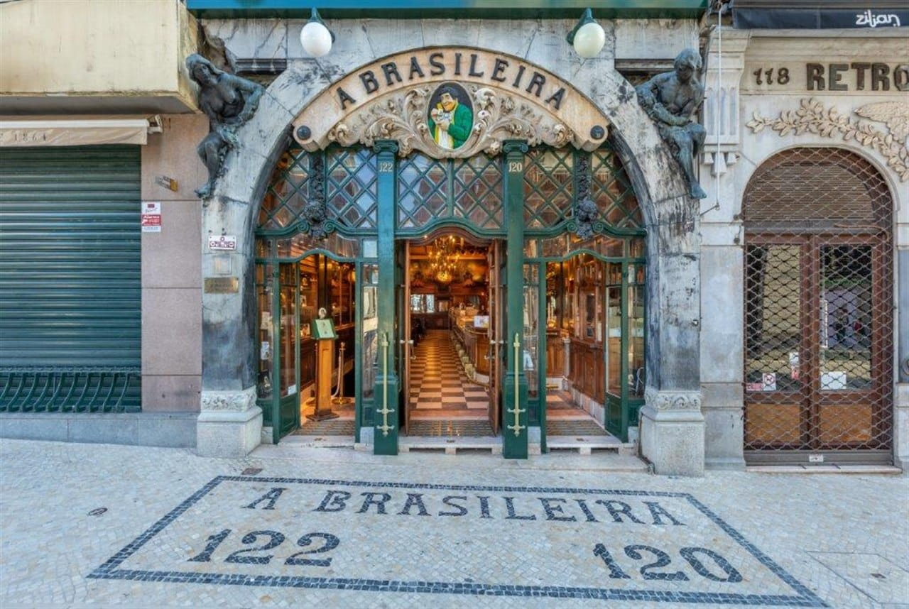
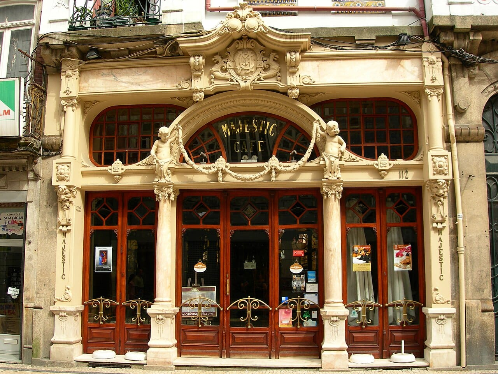

# A Brasileira

Rua Garrett 的坡道上，A Brasileira 的深绿色遮阳篷与金色字母很难错过。门口一张小圆桌旁，费尔南多·佩索阿的青铜像支着下巴坐着，膝盖上摊着一本书，像是随时会抬头向路过的人要一杯咖啡。游客排队和铜像合影，本地人则绕过人群，推门进入镜面、深色木饰与大理石台面组成的老咖啡馆。它是希亚多最像“城市客厅”的一间店，也是里斯本把文学记忆做成日常生意的最成功案例之一。

图：希亚多 Rua Garrett 120 号的 A Brasileira 新艺术风格立面。图片：VDT2021，CC BY-SA 4.0，via Wikimedia Commons（[原图页面](https://commons.wikimedia.org/wiki/File:A_BRASILEIRA_DO_CHIADO.jpg)）。

## 1905 年：A Brasileira的关键起点
A Brasileira 于 1905 年开业，创办人是 Adriano Telles。店名直译是“巴西女人”，但更准确的理解是“巴西咖啡”——当时葡萄牙与巴西之间的咖啡贸易兴盛，这家店最初以销售巴西咖啡豆、推广巴西咖啡为业。它并不是从一开始就做“文学咖啡馆”，而是先做咖啡生意，再因为位置、客群与空间，慢慢变成作家、画家、医生、律师与共和国政治人物碰面的地方。

官方品牌页把 1905 年的立面与室内设计归到建筑师 Manuel Norte Júnior 名下，风格是当时巴黎流行的新艺术（Art Nouveau）：曲线金属、植物纹样、镜面与木饰，目的不是复古，而是让咖啡馆看起来像一间现代城市的展示厅。1920 年代，佩索阿开始固定来店里，他通常坐在较靠里的位置，读书、写作、观察。1988 年，也就是佩索阿百年诞辰那年，门前立起了他的青铜坐像，从此“和佩索阿一起喝咖啡”成了希亚多的标准游客动作。

## 建筑与空间

今天的店面保留了 1905 年的基本格局：临街的玻璃与深绿遮阳篷，进门后的长吧台，靠墙的镜面与木饰，以及二楼/后厅的餐区。新艺术风格的金属线条不算夸张，但在暖黄灯光下很有重量；镜面把本来不大的空间折成几层，白天反射街景，晚上反射吊灯与客人。门口露台是最抢手的位置，因为它正对 Rua Garrett 的行人流，也正对佩索阿的铜像。

空间的使用方式有两套。第一套是“站在吧台喝一杯”：靠近门口的吧台适合快速点一杯咖啡或酒，喝完就走。第二套是“坐下来”：露台、内厅与餐区适合早餐、下午茶或晚餐。两种节奏在同一间店里并存，这也是它比纯游客咖啡馆更有生命力的原因。想拍照的人最好避开正午与周末下午，否则铜像周围几乎没有空位。

## 酒单与味觉

A Brasileira 的招牌是咖啡，尤其是里斯本式的浓缩“bica”。它通常比意大利 espresso 更短、更浓，端上来时杯壁烫手，表面有一层浅褐色的 crema。可以点“um café”或“uma bica”；如果怕苦，可以点 garoto（加一点牛奶的短咖啡）或 galão（长杯牛奶咖啡）。配咖啡的经典选择是葡式蛋挞、pastel de nata、杏仁饼干与巧克力蛋糕。

酒单方面，它不是鸡尾酒吧，而是咖啡馆兼餐厅：有波特酒、马德拉酒、葡萄牙白葡萄酒、香槟与简单的鸡尾酒。下午可以点一杯干白或波特，配小食；晚上可以点鸡尾酒或餐酒，配正餐。不要期待“佩索阿同款”有明确配方——他喝什么、坐哪张桌子，更多是文学传说而不是菜单事实。最稳妥的点法是：一杯 bica、一只蛋挞，坐在露台看两分钟街景，再决定要不要加酒。

## 怎么喝

早上八点开门后到十点前，是相对安静的时段，适合吃早餐、读报、看店员把椅子摆到露台上。中午到下午三点，Rua Garrett 的游客最多，露台几乎满座；想坐下來就早点到，或者直接站吧台。傍晚六点后，灯光变暖，适合点一杯酒和小食；晚餐时段则更接近餐厅节奏，建议预订或避开高峰。

点单时先找座位再点，还是先点再找座位，取决于区域：露台通常由服务员带位，吧台可以直接点。不要在佩索阿铜像旁边长时间摆拍，尤其不要坐到铜像腿上或把杯子放在书页上；那是公共雕塑，不是道具。喝完咖啡不要把杯子端到街上；里斯本的咖啡馆习惯是留在桌上，由服务员收。

## A Brasileira的地址与营业安排
- 地址：Rua Garrett 120-122, 1200-205 Lisboa。
- 营业：每日 08:00–02:00（Visit Lisboa；节假日与特殊活动可能调整）。
- 交通：地铁 Baixa-Chiado（绿线/蓝线）；从 Rossio 或 Praça do Comércio 步行约 5–8 分钟。
- 预订：正餐建议预订；早餐、咖啡与露台通常直接到店。
- 价格：咖啡与蛋挞属日常价位，正餐与酒单更高；露台座位有时会收取不同的餐桌服务费，点单前看菜单。
- 无障碍：门口有台阶，露台与内厅动线较窄；行动不便者建议从侧门或提前联系门店确认。
- 周边：Livraria Bertrand、Museu Nacional de Arte Contemporânea、Teatro Nacional de São Carlos 都在步行几分钟内。

## 礼仪与常见误区

第一，不要把 A Brasileira 只当成“佩索阿雕像打卡点”；它仍是一间营业中的咖啡馆，客人要过路、点单、吃饭，拍照请让出动线。第二，不要把“bica”点成“espresso”；在里斯本说 bica 更本地，也更容易得到正确的短杯。第三，不要以为所有座位都能只点一杯咖啡；正餐区在午餐与晚餐时段通常要求点菜。第四，不要坐在铜像腿上或攀爬雕塑；佩索阿像可以被靠近，但不应该被当成家具。第五，不要把 1905 年写成“咖啡馆迁入现址”的年份；官方叙述是 1905 年开业，立面与室内由 Manuel Norte Júnior 设计。第六，不要把它与波尔图的咖啡馆混为一谈；A Brasileira 的文学记忆属于希亚多，不是波尔图。

## 从A Brasileira延伸到A Ginjinha
从 A Brasileira 往北两分钟是 Livraria Bertrand 与 Carmo 修道院，往东是 Teatro Nacional de São Carlos 与 Baixa，往南可走到 Praça do Comércio 与太加斯河。可以把这一站排成“早晨 bica → 希亚多书店 → Carmo 修道院 → 圣胡斯塔升降机 → 河岸午餐”。若想把里斯本的“站立小杯”与“坐席咖啡”放在同一天，先到 [A Ginjinha](ref:ginjinha) 喝一杯 ginjinha，再步行十分钟到 A Brasileira 喝 bica，是最自然的一条对照路线。波尔图的 [Café Majestic](ref:majestic) 可以对照葡萄牙另一座城市的历史咖啡馆；维也纳的 [Café Central](ref:central) 与 [Café Hawelka](ref:hawelka) 则能把“作家咖啡馆”放进中欧脉络。巴黎的 [Café de la Paix](ref:paix) 是另一种“宏大立面 + 文学/政治客群”的样本。

## 参考资料
- 现运营方品牌页：<https://ovalordotempo.pt/marcas/a-brasileira-do-chiado/>，用于核对 1905 年、Adriano Telles、Manuel Norte Júnior、佩索阿与 1988 年铜像。
- Visit Lisboa 的“21 间有历史的店”路线：<https://www.visitlisboa.com/en/lisbon-stories/21-shops-with-history-route/pois>，用于核对地址与营业时间。
- Visit Lisboa 的佩索阿路线：<https://www.visitlisboa.com/en/lisbon-stories/4-route-pessoa/pois>，用于交叉核对文学地标叙述。
- 同城的 `place:a-ginjinha` 是“站立小杯”，A Brasileira 是“坐席咖啡”，两者可以对照里斯本两种日常。
- 若继续中欧咖啡馆路线，读 `place:cafe-central`、`place:cafe-hawelka` 与 `route:vienna-coffee-house-evening`。
- 相关条目：[A Ginjinha](ref:ginjinha)、[Café Majestic](ref:majestic)、[Café Central](ref:central)、[Café Hawelka](ref:hawelka)、[Café de la Paix](ref:paix)

## 相关图像

图：Café Majestic 的新艺术正立面与“MAJESTIC”招牌，Rua de Santa Catarina 112。图片：Maragato1976，CC BY-SA 3.0，via Wikimedia Commons（[原图页面](https://commons.wikimedia.org/wiki/File:Caf%C3%A9_Majestic_(Porto).jpg)）。关联图像：A Brasileira。
