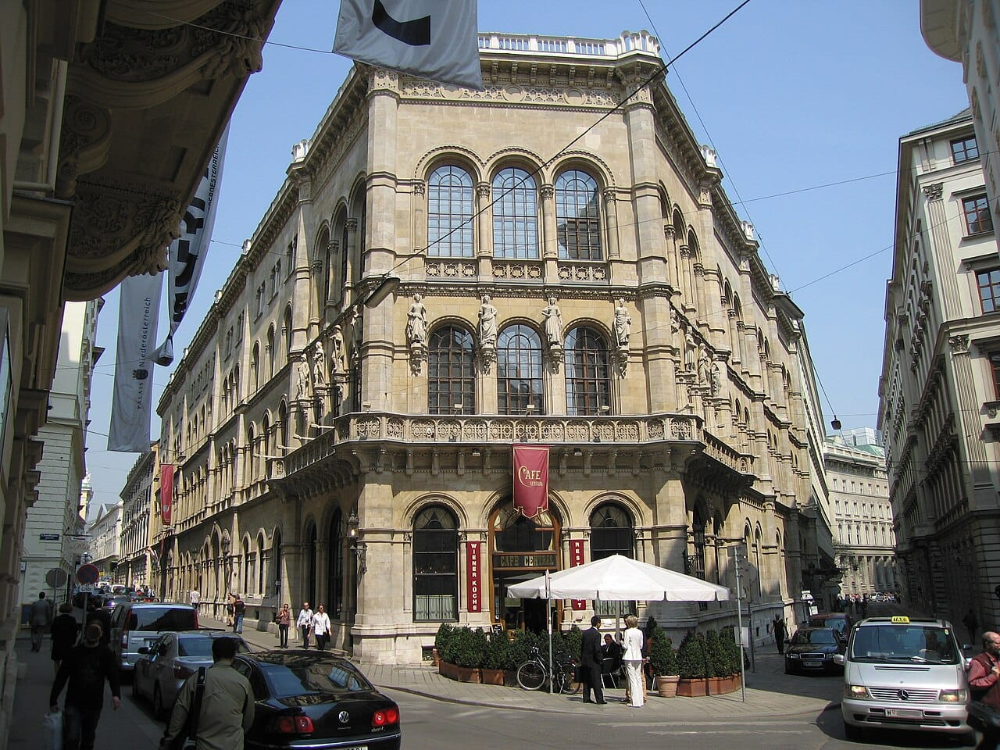

# 中央咖啡馆

> **到访信息**
> - 地址：Herrengasse 14 (Ecke Strauchgasse), 1010 Wien, Austria。
> - 开放与预约：以[官方页面](https://www.cafecentral.wien/)为准；开放时间、场次和预约规则会随季节调整。
> - 交通与费用：出发前以官方页面为准，本页不承诺固定票价。
> - 营业状态：未核实；来源最近核对：2026-11-08。

图：中央咖啡馆。图片：User:Florian Prischl，Public domain，via Wikimedia Commons（[原图页面](https://commons.wikimedia.org/wiki/File:Palais_Ferstel.jpg)）。

## 1876 年：中央咖啡馆的关键起点
中央咖啡馆在维也纳内城的 Herrengasse 14，位于费尔斯特宫（Palais Ferstel）底层。这座宫殿式建筑建于 19 世纪中叶，最初容纳维也纳证券交易所；1876 年交易所迁出后，Gustav 与 Hermann Pach 兄弟在底层开出咖啡馆，"Café Central"由此开业。今天它仍在这座建筑的拱廊与厅堂里营业，座位上方是石柱与拱顶，而不是后期搭出来的"复古布景"。

咖啡馆的名声与 20 世纪初的维也纳知识分子圈绑在一起。官方叙述列举的名字包括托洛茨基、弗洛伊德，以及作家阿尔弗雷德·波尔加、斯蒂芬·茨威格、彼得·阿尔滕贝格，还有建筑师阿道夫·路斯。这些人是真实的顾客与常客，但"某人固定坐哪张椅子"多半是后来的传说。把名人故事当成背景，比当成打卡坐标更接近事实。

20 世纪中叶，咖啡馆一度关闭；1986 年，随着费尔斯特宫修复，它在原建筑内重新开门。这个"中断—重开"的经历很重要：今天看到的中央咖啡馆是 1980 年代修复后的版本，它继承了 1876 年的名字、位置与咖啡馆传统，但不是所有家具与装饰都从 1876 年原样保留下来。

## 空间与酒单

空间的关键词是"拱顶、石柱、钢琴、报纸"。主厅高而开阔，靠窗的位置能看到 Herrengasse 的街景；侧厅与拱廊下更安静。维也纳咖啡馆的座位不按"翻台率"设计，桌与桌之间留出距离，一个人带一本书坐一下午是被允许的，这一点与威尼斯或巴黎的旅游型咖啡馆不同。

咖啡单是维也纳体系的入门课。Wiener Melange 是浓缩咖啡加热奶与奶泡，比例接近"小杯拿铁"但更轻；Einspänner 是高杯装的浓缩，上面覆一层厚奶油；Verlängerter 是"加长"的浓缩，接近淡美式；Kleiner Brauner / Großer Brauner 是小杯或大杯加少量奶。第一次来点 Melange 最稳，想喝浓一点就点 Einspänner，想喝淡一点就点 Verlängerter。

食物与甜点是另一半。早餐有面包、蛋类与果酱组合；下午以蛋糕为主，Sachertorte、Apfelstrudel、Topfenstrudel 都是常见选择；正餐时段供应奥地利菜，如炸牛排、炖牛肉与烤菜。具体菜单随季节调整，价格以现场为准。

## 第一次去怎么点

进门后自己找空位，坐下等侍者过来点单；不要站在门口等"带位"，也不要直接去吧台点。一个人可以只点一杯咖啡，坐很久；两个人想分享蛋糕，点一块加两把叉子是常规做法。想体验完整的一套，可以点 Melange 加一块 Sachertorte，或早餐时段点咖啡、蛋与面包。

时段上，开门后的早晨最安静，适合读报与写字；下午两三点是蛋糕与游客的高峰，门口常排队；晚上有钢琴演奏，气氛更满，但谈话音量也被抬高。想安静聊天，选侧厅或靠里的位置；想感受主厅，就接受人多与声音大。

费用结构要说清：维也纳传统咖啡馆通常不收座位费，也不收"音乐费"；账单是饮品与食物加小费。若在旅游区遇到菜单上标注的座位费或最低消费，以菜单为准，不要套用"维也纳咖啡馆都不收费"的想象。这一点与威尼斯的[花神咖啡馆（威尼斯）](ref:florian)不同，后者在乐队演奏时按人收取音乐附加费。

## 中央咖啡馆的地址与营业安排
**地址**：Herrengasse 14（官方写作 Ecke Herrengasse / Strauchgasse），1010 Wien, Austria，位于费尔斯特宫（Palais Ferstel）底层拱廊内。入口不算显眼，跟着 Herrengasse 的门牌找比跟着人群找更可靠。

**交通**：乘地铁 U3 到 Herrengasse 站，出站即到；从圣斯蒂芬大教堂步行约 5 分钟。内城适合步行，但石板路与拱廊地面在雨天较滑。具体线路与无障碍出口以 Wiener Linien 当日信息为准。

**营业状态（重要）**：官网公告，Café Central 自 2026 年 3 月 16 日起因全面整修暂停营业，预计 2026 年冬季重开；截至页面核验日 2026-11-08，官网未发布已恢复营业的消息，因此 `operating_status` 记为 `unknown`，不按“永久关闭”处理。整修期间，官方推荐前往 Freyung 3/1 的 DECENTRAL 快闪店（每日 07:30–22:00，电话 +43 1 533 37 63-61）。重开后的营业时间、订位方式与菜单尚未公布，必须以官网当日信息为准。

**门票与预约**：不收门票，按点单消费；整修期间不开放现场排队，也不再接受此前的在线订位。重开后的价格与订位规则以官方渠道为准。历史上咖啡、蛋糕与正餐分开计价，在维也纳属于中高水平；早餐与下午茶的预算差别很大。

着装休闲整洁即可，不需要正装。建议备现金，结账时更方便。

「中央咖啡馆」的开放时间、价格与预约，以[官网](https://www.cafecentral.wien/)的公开页面为准；核验日期为 2026-11-08，临时调整以官网当日公告为准。

## 礼仪与常见误区

第一，坐下来不等于点单，要等侍者过来；招手时用眼神与轻声示意，不要大声喊。第二，一杯咖啡坐两三个小时是正常的，但高峰时段长时间占大桌会影响等位，自己判断。第三，水杯通常随咖啡附上，不需要另点；想喝气泡水可以单点。第四，小费不强制，结账时报出含小费的总额，常见是凑整或 5%–10%，不要把现金留在桌上走人。

常见误区有四个：把 Melange 当成"拿铁"（它更小、奶泡更轻）；把中央咖啡馆当成"托洛茨基的书房"（名人是背景，不是布景）；以为必须点正餐才能坐；以为所有维也纳咖啡馆都收座位费。另一个实际误区是只看点评排行就认定"排队越长越好"——中央咖啡馆的位置与名气确实带来游客，但内城还有不少安静的老咖啡馆，体验不同。

不适合来这里的情况：赶时间只想站着喝一杯的人；想安静开电话会议的人；预算只够最便宜快餐的人。它适合"把时间花在坐下"的旅行方式。

## 维也纳的周边街区
出门就是 Herrengasse 与费尔斯特宫的拱廊，往东步行几分钟到圣斯蒂芬大教堂与格拉本大街（Graben），往南是奥地利国家银行与内城街巷，往北可到市政厅与大学区。把中央咖啡馆放在上午：先喝咖啡看报纸，再走去大教堂，中午在格拉本一带吃饭，下午逛博物馆。

若想把"咖啡馆"作为主题，可以安排维也纳内城的多家老咖啡馆对比，但一天两三家就够，太多会味觉与注意力疲劳。中央咖啡馆适合作为"第一站"，因为它空间大、菜单全、对第一次来的人友好；想安静，再把后面的时间留给小巷里的店。冬季维也纳天黑得早，下午四点后街上人流转向圣诞市集与剧院，路线要相应调整。

## 同城酒馆与延伸阅读
- [酒吧与城市](ref:pub-and-city)：咖啡馆如何用座位、报纸与营业时间组织公共生活。
- [花神咖啡馆（巴黎）](ref:cafe-de-flore)：巴黎左岸的文学咖啡馆，可与维也纳的"咖啡馆作为公共客厅"对照。
- [花神咖啡馆（威尼斯）](ref:florian)：威尼斯广场上的历史咖啡馆，费用结构与本页不同。

补充阅读：[A Ginjinha](ref:c-extra-1)。

相关条目：[认识一座城，从一间酒馆开始](ref:pub-and-city)、[花神咖啡馆](ref:cafe-de-flore)、[A Ginjinha](ref:c-extra-1)。

## 相关图像

图：认识一座城，从一间酒馆开始类型示意图。项目自制双语视觉卡，示意性编辑图，不是现场照片。关联图像：中央咖啡馆。
