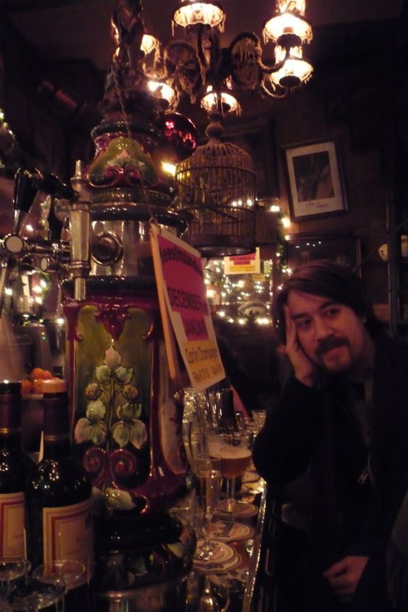
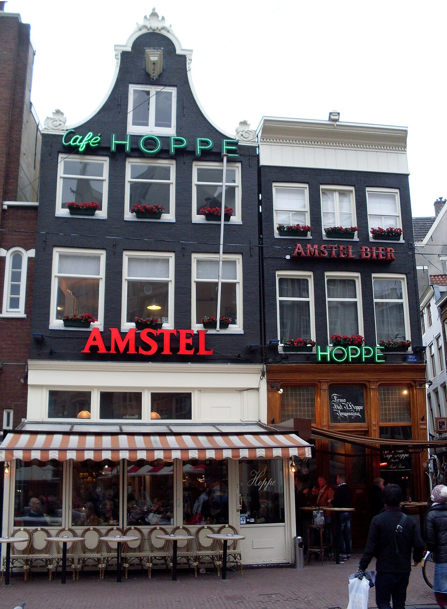

# Café De Dokter

从 Spui 广场往南，拐进 Rozenboomsteeg 这条几乎只能容两个人并排走的小巷，4 号门上挂着一块不显眼的招牌：“Café De Dokter”。推门进去，空间小到会让人先愣一下：一张吧台、几把高脚凳、墙上密密麻麻的旧钟、鸟笼、医疗器械、老照片与吊灯，几乎没有转身的余地。它不是“设计成复古”的酒吧，而是把两百多年的杂物原样留着，让时间自己变成装修。

图：Café De Dokter 18 平方米的吧台、吊灯与鸟笼。图片：Rex Roof，CC BY 2.0，via Openverse / Flickr（[原图页面](https://www.flickr.com/photos/18199354@N00/3147493495)）。

## 1798 年：Café De Dokter的关键起点
Café De Dokter 于 1798 年由附近医院的一位外科医生创办，最初是医生与医学生的会面点，也可以理解为“医生们的候诊室/休息室”。店名“De Dokter”就是“医生”，当地人更爱叫它“Het Doktertje”（小医生）。它从一间医疗从业者的聚会场所，慢慢变成面向所有人的 bruin café，但医疗主题一直留在空间里：古董医疗器械、医学书、旧药瓶、解剖图与医生肖像，和啤酒杯、jenever 瓶混在一起。

今天的经营者是 Maria 与 Henry，一对老年夫妇；Maria 从父母手里接店，而她的父母在这间店里工作了近五十年。官方资料说，同一家族已经经营到第七代。这个“家族第七代”说法在旅游文章里常被引用，但具体代际计算并不重要；重要的是，它不是连锁店，也不是博物馆式复原，而是一间仍在用家族记忆运转的微型酒吧。2013 年，它被各类“阿姆斯特丹最小酒吧”榜单反复提及，但店里并没有因此扩大或改造。

## 建筑与空间

18 平方米是这间店最常被引用的数字。吧台占去一半，剩下的空间放得下几张高脚凳、一个角落的立式酒柜与一条窄过道；客人多的时候，门口会站满人，杯子从吧台传到街边。墙面几乎没有空白：钟、鸟笼、旧医疗器械、照片、招牌、瓶盖与酒标层层叠叠，吊灯把暖黄的光打在深色木饰上。空气里有旧木头、灰尘与 jenever 的味道；杯子却擦得很亮，形成一种“灰尘可以留下，酒杯必须干净”的对比。

空间不适合大团体。四个人以上就会把门口堵住；想拍照，最好先点一杯，征得同意后再拍，不要用闪光灯。高脚凳不多，站着喝是常态；冬天门口冷，店内更挤，夏天则有人端着杯子站在巷子里。吧台后的 Maria/Henry 通常很愿意聊天，但高峰时不要拉着他们讲太久，后面还有人要点单。

## 酒单与味觉

De Dokter 的核心是 jenever，尤其是自家配方的“Dokters Recept”（医生的配方）。它属于荷兰式杜松子酒，麦芽味比英国 gin 更明显，甜度也更高；通常用小杯（borrel）供应，配一杯啤酒或苦味酒。店里也有啤酒、葡萄酒、简单鸡尾酒与软饮，但没有花式调酒。食物很少，可能只有奶酪、坚果或简单小食；它不是吃饭的地方。

点单时可以直接说“een jenever, Dokters Recept”或“een biertje”。如果不确定 jenever 的强度，先问“jong of oud”（年轻或陈年）：年轻版更干净、更烈，陈年版更圆、更甜。配一杯 Amstel 或当地啤酒是阿姆斯特丹的标准喝法；不要点“gin tonic”并要求很多装饰，这里不是 gin bar。价格属阿姆斯特丹中等，现金支付最稳妥。

## 怎么喝

最佳时间是周三到周六下午四点到六点，或晚上九点后。下午人少，能看清墙上的物件，也能和店主聊两句；晚上巷子里会站满人，气氛更热闹，但几乎没有座位。周末与节假日非常挤，团队最好分开到店。因为不接受预订，策略只能是早到；如果门口已经站满，先在外面等一轮，不要硬挤进去。

点单时站在吧台前，等店主抬头再开口；不要敲吧台或大声喊。喝完的空杯放回吧台，不要带到巷子里。店里可能有爵士乐，但音量不大；不要自带音箱或大声外放。结账时把现金准备好，不要在最后一刻找零；如果刷卡被拒，不要争论，附近有 ATM。

## Café De Dokter的地址与营业安排
- 地址：Rozenboomsteeg 4, 1012 PR Amsterdam。
- 营业：周三至周六 16:00–01:00（Atlas Obscura/Time Out）；Foursquare 写作周二开始，存在冲突，出发前建议电话或现场核对。周日至周二通常关闭。
- 交通：地铁 52 Rokin，步行 2 分钟；电车 2、11、12 到 Spui，步行 3 分钟。
- 预订：不接受预订，现场站立/等位；团队建议分开到店。
- 支付：只收现金（常见说明；带够欧元零钱）。
- 容量：约 18 平方米，四人以上会非常拥挤；不要带大件行李。
- 无障碍：小巷窄、门口有门槛，轮椅无法进入；行动不便者建议在外侧等候。

## 礼仪与常见误区

第一，不要把“De Dokter”理解成医疗诊所；它是酒吧，名字来自 1798 年的医生聚会史。第二，不要用闪光灯拍室内；空间小、客人近，闪光会打断谈话。第三，不要点花式鸡尾酒或要求“低糖/无糖”；这里主打 jenever、啤酒与简单小食。第四，不要以为“家族第七代”是官方工商登记；它是店方与媒体反复讲述的家族叙事。第五，不要在高峰时把门口堵住拍照；Rozenboomsteeg 是居民与行人共用的小巷。第六，不要把营业时间当成绝对；周三/周二开始的冲突说明它依季节与人手调整，出发前核对最稳。

这里不接受预订，也不收信用卡；旺季把同行人数控制在两三人，比临时加座更符合店里的空间节奏。

## 从Café De Dokter延伸到Café Hoppe
从 De Dokter 出门，往北两步就是 Spui 与 [Café Hoppe](ref:hoppe)，往东是 Rokin 与 Amsterdam Museum，往南是 Singel 与花市，往西是 Kalverstraat 的购物街。可以把这一站排成“Spui 书市 → Hoppe 站着喝一杯 → De Dokter 挤进 18 平方米 → Rokin 晚餐”。若想把阿姆斯特丹的微型酒吧做成一条路线，Hoppe 是“双空间 + 站立文化”，De Dokter 是“极限小 + 家族史”；[Heineken Experience](ref:heineken) 是啤酒品牌博物馆，[De Halve Maan](ref:halve-maan) 与 [Cantillon](ref:cantillon) 是比利时啤酒厂/酒馆的对照。马德里的 [Casa Labra](ref:labra) 则是另一种“小空间 + 站立小食”的伊比利亚样本。

**关键事实。**

| 项目 | 内容 |
| --- | --- |
| 一句话定位 | 阿姆斯特丹 Rozenboomsteeg 4 号的 Café De Dokter，1798 年由附近医院的外科医生创办，最初是医生与医学生的会面点；今天它只有约 18 平方米，是阿姆斯特丹最小的酒吧之一 |
| 地址 | Rozenboomsteeg 4, 1012 PR Amsterdam, Netherlands |
| 城市/国家 | 阿姆斯特丹 / 荷兰 |
| 营业状态 | 已核验营业 |
| 官网 | facebook.com |

## 参考资料
- Atlas Obscura 的 De Dokter 条目：<https://www.atlasobscura.com/places/cafe-de-dokter>，用于核对 1798 年、18 平方米、家族第七代、Maria/Henry、Dokters Recept 与营业时间。
- Walktionary 的 De Dokter 页面：<https://walktionary.com/place/netherlands/amsterdam/caf-de-dokter>，用于交叉核对地址与“最小酒吧”定位。
- Time Out 的阿姆斯特丹最佳酒吧榜单：<https://www.timeout.com/amsterdam/bars-and-pubs/best-bars-in-amsterdam>，用于交叉核对只收现金/不接受预订与营业时间。
- Foursquare 的 De Dokter 页面：<https://foursquare.com/v/de-dokter/4bc0a1ef4cdfc9b618219321>，用于核对地址与营业时间冲突。
- 同城的 `place:cafe-hoppe` 是“双空间”酒吧，`place:heineken-experience` 是啤酒品牌博物馆，`place:de-halve-maan` 与 `place:cantillon-brewery` 是比利时啤酒文化样本。
- 相关条目：[Café Hoppe](ref:hoppe)、[Heineken Experience](ref:heineken)、[De Halve Maan](ref:halve-maan)、[Cantillon](ref:cantillon)、[Casa Labra](ref:labra)

## 相关图像

图：Spui 18–20 号的 Café Hoppe 双立面，绿色霓虹与 Amstel 招牌。图片：Marcelmulder68，CC BY-SA 3.0 nl，via Wikimedia Commons（[原图页面](https://commons.wikimedia.org/wiki/File:Spui_nr._18_en_20.jpg)）。关联图像：Café De Dokter。
