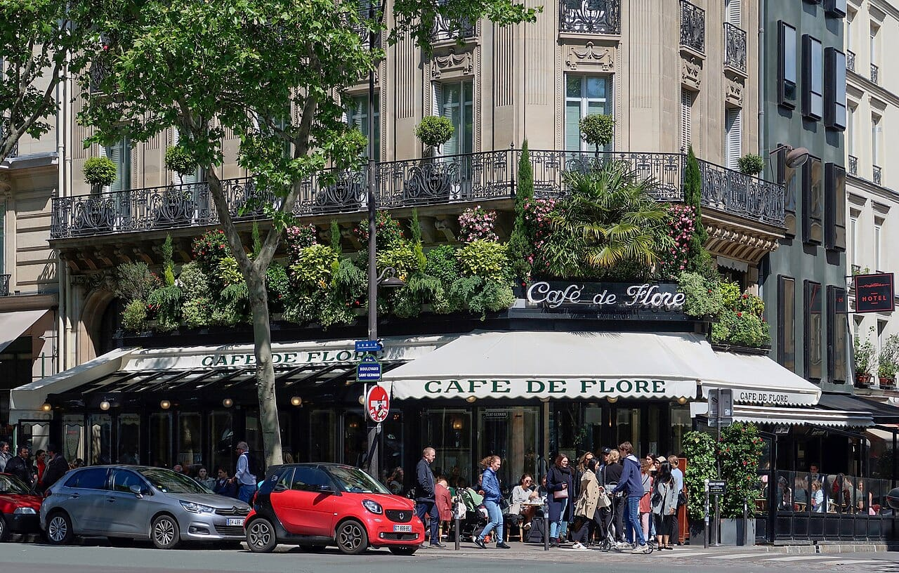

# 花神咖啡馆

花神咖啡馆（Café de Flore）在巴黎第六区，位于圣日耳曼大道与圣伯努瓦街的街角，门牌 172 Boulevard Saint-Germain。它于 1887 年开业，店名来自大道另一侧的一尊花神（Flora）小雕像。与双叟咖啡馆一样，它常被写成“文学咖啡馆”；但花神的独特之处在于街角位置、红色长椅与镜面构成的“舞台感”，以及更年轻、更不客气的花神文学奖。

> **到访信息**
> - 地址：172 Boulevard Saint-Germain, 75006 Paris。
> - 开放与预约：以[官方页面](https://cafedeflore.fr/)为准；开放时间、场次和预约规则会随季节调整。
> - 交通与费用：出发前以官方页面为准，本页不承诺固定票价。
> - 营业状态：已核实；来源最近核对：2026-11-08。

图：花神咖啡馆。图片：Celette，CC BY-SA 4.0，via Wikimedia Commons（[原图页面](https://commons.wikimedia.org/wiki/File:Caf%C3%A9_de_Flore,_172_boulevard_Saint-Germain,_Paris_6e.jpg)）。

## 1933–1994：花神咖啡馆的历史节点
花神开在圣日耳曼大道刚刚贯通之后，属于奥斯曼改造巴黎后新形成的街区。十九世纪末，这里聚集作家与艺术家；二十世纪，达达、超现实主义与存在主义等流派的名字都与这一带发生关系，阿波利奈尔、布勒东、萨特与波伏娃常被提起。1994 年，一群作家与记者在花神的桌边创立“花神文学奖”（Prix de Flore），奖励“有前途”的作者，评选标准强调原创性、现代性与年轻感。与 1933 年创立、更接近“机构奖”的双叟文学奖相比，花神奖更像一场在咖啡馆里进行的文学圈内部游戏：奖金额度不高，但话题性强，每年十一月在店里颁出。历史与奖项共同解释了这家店为什么总被放在“文学咖啡馆”的叙事里。

## 空间与酒单

花神的空间分室内与街角露台。室内保留红色长椅、镜面、木桌与装饰艺术风格的线条，桌子排得较密；露台正对圣日耳曼大道，是观察街区的位子，也是行人必经之处。饮品以咖啡、热巧克力、茶为主，餐食有法式早餐、克罗克先生三明治、简单前菜与甜点；它同样不是鸡尾酒吧，酒单很轻。价格属于游客区水平，单杯咖啡与热巧克力的定价明显高于普通街区咖啡馆。这里适合“坐下来”，不适合“站着喝完就走”；座位本身就是消费的一部分。

## 第一次来怎么点

先看街角哪一侧有空位：露台适合看人流，室内适合聊天。法语“un café”是一小杯浓缩；想要牛奶咖啡点“café crème”，想要热巧克力直接说“chocolat chaud”。早餐时段可以点一套面包、黄油与果酱，配咖啡或热巧克力；正餐时段克罗克先生三明治与简单咸食比甜点更管饱。若只想体验氛围，两人分点一杯咖啡与一份甜点即可，不必每人点全套。不要要求“萨特坐过的位子”，店里没有为名人保留的固定座位；也不要把“花神”当成可以随便续杯的连锁咖啡馆。

## 花神咖啡馆的地址与营业安排
地址：172 Boulevard Saint-Germain, 75006 Paris（坐标 48.85414, 2.33256）。官网法律声明中登记的公司地址为 174 boulevard Saint-Germain，与店面门牌 172 号相邻，找店时以街角的 172 号为准。

交通：地铁 4 号线 Saint-Germain-des-Prés 站步行约 2–3 分钟；从双叟咖啡馆横过街口即到。公交与出租车可在 Boulevard Saint-Germain 沿线停靠，街角不适合长时间停车。

开放时间与预约：官网只提供历史、菜单与法律声明，没有列出每日营业时间表，也没有在线订座入口，因此具体开门与打烊时间未核验；多数第三方导览资料写作每天约 7:30 至次日 1:30，仅供参考。日常以现场等位为主，旺季与周末下午排队明显；团体与特殊需求建议先致电 +33 1 45 48 55 26。

门票与消费：咖啡馆不收门票，按菜单点单。价格属游客区水平，单杯咖啡与热巧克力明显高于普通街区咖啡馆；菜单 PDF 可在官网查阅。着装无硬性要求，casual 或 smart casual 均可；露台在雨天与大风天并不舒适。

「花神咖啡馆」的开放时间、价格与预约，以[官网](https://cafedeflore.fr/)的公开页面为准；核验日期为 2026-11-08，临时调整以官网当日公告为准。

## 礼仪与常见误区

坐下后请尽快点单，不要用一杯咖啡占住四人桌整个下午；高峰时段店员会委婉提醒。不要挪动邻桌椅子，也不要把婴儿车或大件行李堵在街角通道。拍照时避开其他顾客正脸，不要为了拍红色长椅而让同伴站到马路边缘。服务节奏慢是巴黎咖啡馆的常态；需要结账时说“l’addition, s’il vous plaît”，小费可按账单取整。最常见的误区是把“存在主义咖啡馆”当成安静读书的地方：周末下午人声、车流与拍照的人都很密。另一个误区是把文学奖当成“店里常驻活动”；颁奖是一年一次的场合，不是每天都有。

花神咖啡馆的文学传统不等于店里仍在进行文学沙龙；把历史顾客当成今天的现场氛围，容易对服务与价格产生错误期待。

## 什么情况不适合来

如果你预算有限、想找安静地方工作、带着大件行李或婴儿车、或者期待完整的鸡尾酒与晚餐菜单，花神都不合适。它也不适合一大群人突然涌入而不提前沟通；街角座位有限，等位会影响到路人。讨厌游客人群的人应避开周末与节假日白天，工作日上午相对安静。想喝夜酒的人请去酒吧，不要指望咖啡馆承担酒吧功能。

## 从花神咖啡馆延伸到双叟咖啡馆
沿圣伯努瓦街往北是书店与小餐馆，往南可到圣日耳曼德佩教堂与欧仁·德拉克罗瓦博物馆；附近还有 Marché Saint-Germain 与 Rue de Buci 的食品街。它与[双叟咖啡馆](ref:deux-magots)在同一街口两侧，适合按[圣日耳曼文学咖啡馆路线](ref:route-saint-germain)比较两家：先看双叟的广场露台，再回到花神的街角座位，观察同一街区两种不同的“看人”角度。若从塞纳河过来，步行约十分钟；地铁出站后不要急着过马路，先看清街角与门牌。

## 同城酒馆与延伸阅读
咖啡馆与酒吧同属城市的公共生活：可以对照[酒吧与城市](ref:pub-and-city)，看座位、常客与营业时间如何塑造一个空间。若要把两家文学咖啡馆放在一起看，读[双叟咖啡馆](ref:deux-magots)与[圣日耳曼文学咖啡馆路线](ref:route-saint-germain)。

对照阅读：[认识一座城，从一间酒馆开始](ref:pub-and-city)、[圣日耳曼德佩文学咖啡馆半日路线](ref:route-saint-germain)。

把花神咖啡馆放回圣日耳曼德佩的文学咖啡馆线路，可对照[认识一座城，从一间酒馆开始](ref:pub-and-city)与[圣日耳曼德佩文学咖啡馆半日路线](ref:route-saint-germain)。

**关键事实。**

| 项目 | 内容 |
| --- | --- |
| 一句话定位 | 巴黎圣日耳曼德佩的文学咖啡馆，19 世纪末开业，以知识分子顾客和经典巴黎咖啡馆氛围闻名 |
| 地址 | 172 Boulevard Saint-Germain, 75006 Paris |
| 城市/国家 | 巴黎 / 法国 |
| 营业状态 | 已核验营业 |
| 官网 | cafedeflore.fr |
