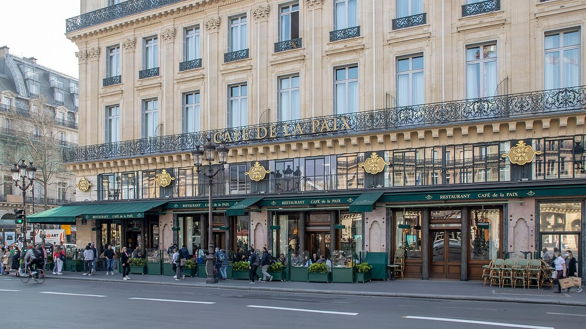
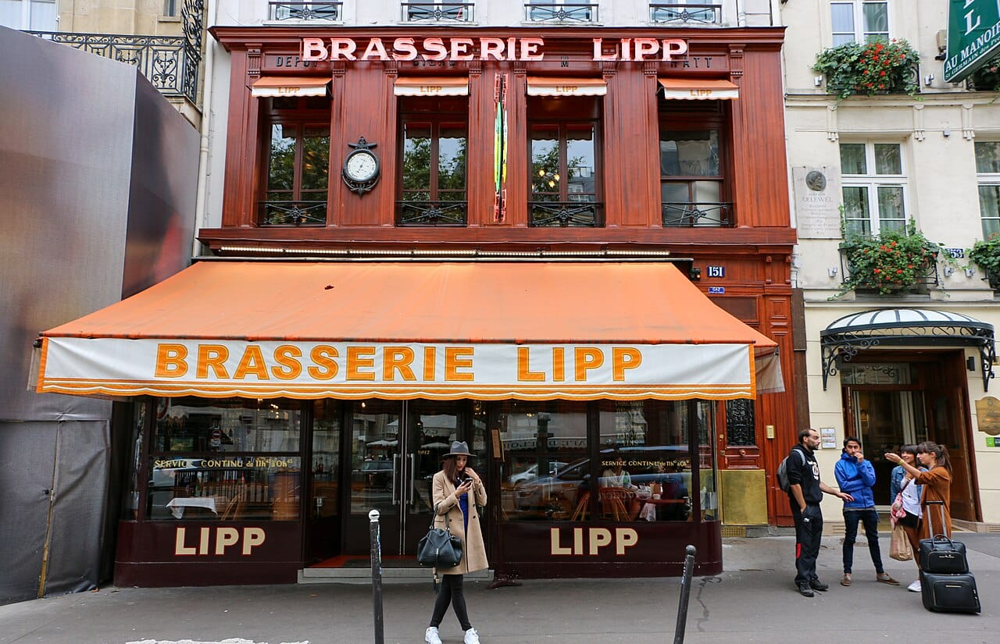

# 和平咖啡馆

从巴黎歌剧院正门出来，穿过 Place de l'Opéra 的车流，就能看到和平咖啡馆的绿色遮阳篷与金色门楣。它的位置几乎好得过分：一边是 Garnier 歌剧院，一边是 Grand Hôtel，背后是 Boulevard des Capucines 与 Grands Boulevards 的百货公司。游客在这里喝第一杯咖啡、看歌剧院立面、等一场演出；巴黎人则把它当作歌剧院街区的地标，知道它什么时候最吵、什么时候适合坐在露台上看人。

图：Café de la Paix 面向 Opéra Garnier 的日间立面与遮阳篷，5 Place de l'Opéra。图片：Arthur Weidmann，CC BY-SA 4.0，via Wikimedia Commons（[原图页面](https://commons.wikimedia.org/wiki/File:Caf%C3%A9_de_la_Paix_1.jpg)）。

## 1862 年：和平咖啡馆的关键起点
和平咖啡馆 1862 年开业，与 Grand Hôtel 同年。1862 年 5 月 5 日，Eugénie 皇后亲自为 Grand Hôtel 揭幕；据店方记载，她参观后说“这就像在我自己家一样，我仿佛到了 Compiègne 或 Fontainebleau”。这个细节说明，和平咖啡馆从诞生起就不是街角小馆，而是第二帝国时期“酒店 + 剧院 + 大道”组合的一部分。

十九世纪末，它的客人名单包括 Guy de Maupassant、Victor Hugo、Émile Zola、Oscar Wilde 与 Arthur Conan Doyle；店方还保留着“Sherlock Holmes 在这里与 Watson 碰面”的文学趣谈。Serge de Diaghilev 与俄罗斯芭蕾舞团也在这一带办过多次晚宴，店方甚至半开玩笑地记下他常常赊账离席。1948 年 6 月，Maurice Chevalier、Henri Salvador 与 Yves Montand 在和平咖啡馆相聚，为“This is Paris”录音。这些故事让这里成为歌剧院街区的社交舞台，而不只是游客咖啡站。

今天的内部由 Pierre-Yves Rochon 主持修复，保留拿破仑三世风格的金色护墙板、格顶、镜面与吊灯，同时把家具线条做得更简洁。它不是把旧装饰“封存”起来，而是把十九世纪的壳子重新放进当代餐厅的动线：咖啡区、露台、餐厅与酒吧各自有边界，但共享同一套视觉语言。

## 空间与酒单

和平咖啡馆的室内像一间被点亮的第二帝国客厅：金色护墙板、白色与浅木色的家具、镜面、格顶与大型吊灯，座位沿墙与窗排列，露台则直接对着歌剧院。它的空间不适合“躲起来”，更适合“被看见”：中午是商务客与购物客，傍晚是看演出的人，夜里是大道上的过路客。

咖啡区全天供应咖啡、茶、热巧克力、糕点与轻食；餐厅菜单包括法式洋葱汤、蜗牛、鹅肝、鞑靼牛肉、海鲜与经典法餐。甜点里的 gâteau Opéra、mille-feuille 与可丽露是常见选择。酒单以法国葡萄酒、香槟与经典鸡尾酒为主，aperitivo 时段可以在露台点一杯香槟或 kir，配小食看广场。

## 怎么喝

早上 07:00 开门后，咖啡区是全天气氛最轻的时候。点一杯 café crème 或 expresso，配一只可丽露或羊角包，坐在窗边看歌剧院开门前的广场。午餐时段 12:00–15:00 是餐厅最忙的时候，若不想等位，可以只喝咖啡或吃轻食，避开正午。

下午适合在露台点一杯香槟、kir royale 或 café gourmand，配一份小甜点。傍晚 18:00 以后，餐厅进入晚餐节奏；如果只是想在演出前喝一杯，咖啡区与露台更合适，不必占用餐厅桌。夜里 23:00 前后，咖啡区结束营业，最后一杯咖啡或餐后酒要在收档前点好。

## 和平咖啡馆的地址与营业安排
- 地址：5 Place de l'Opéra, 75009 Paris，歌剧院正对面。
- 营业：咖啡区每日 07:00–23:00 连续营业；餐厅早餐 07:00–10:30、午餐 12:00–15:00、晚餐 18:00–23:00；公共假日时间会调整；周日有 Grand Brunch。
- 交通：地铁 3、7、8 号线 Opéra 站；RER A 线 Auber 站；公交 20、32、45、52、66、68、95 路。
- 预订：餐厅接受预订，露台与咖啡区通常不接受预订，按到场顺序入座。
- 价格：露台、咖啡区与餐厅的价位不同；同一杯咖啡在露台与餐厅也可能不同价，先看菜单。
- 演出日：歌剧院有演出时，18:00 以后与散场前后最拥挤，想安静喝一杯要避开这两个时段。

## 礼仪与常见误区

第一，不要把露台当成免费观景台。点一杯饮品再坐下是基本规则，长时间只拍照会妨碍翻台。第二，不要穿拖鞋或泳装进入餐厅；店方没有明文制服要求，但这是歌剧院对面的正式餐厅，商务休闲更合适。第三，不要以为“咖啡区”和“餐厅”可以随便换位；不同区域有不同菜单与服务，落座前让服务生带你入位。第四，不要把“1862 年”理解成所有装饰都是原物；内部经过多轮修复，金色护墙板与格顶属于受保护的历史装饰，家具与灯光则是当代整修的一部分。第五，不要在歌剧演出散场时堵在门口等位；那个时段人流最大，提前预订或改去旁边的大道咖啡馆更现实。

露台座位通常是看人与被看的一部分，价格与服务节奏也与室内不同；把这里当成安静办公场所会不合场景。

## 从和平咖啡馆延伸到利普啤酒馆
从和平咖啡馆出发，歌剧院就在马路对面；往北是 Boulevard Haussmann 与 Galeries Lafayette、Printemps，往南穿过 Place Vendôme 是 Tuileries 与 Louvre，往东沿 Boulevard des Capucines 可以到 Madeleine 与 Rue Royale。可以把路线排成：歌剧院外观 → 和平咖啡馆露台 → Galeries Lafayette 屋顶 → Place Vendôme → Tuileries。若要看演出，提前一小时在露台喝一杯，再穿过广场进场，是最顺的动线。

相关条目：[利普啤酒馆](ref:lipp)。

**关键事实。**

| 项目 | 内容 |
| --- | --- |
| 一句话定位 | 巴黎歌剧院对面的 Café de la Paix，1862 年随 Grand Hôtel 开业；拿破仑三世风格的金色护墙板、格顶与露台，使它成为歌剧院街区最典型的“看人与被看”的咖啡馆 |
| 地址 | 5 Place de l'Opéra, 75009 Paris, France |
| 城市/国家 | 巴黎 / 法国 |
| 营业状态 | 已核验营业 |
| 官网 | cafedelapaix.fr |

**来源与边界。** 本页关于「和平咖啡馆」的关键事实，主要由以下来源交叉核对：Café de la Paix（1862 年开业、Grand Hôtel 与歌剧院对面的位置、拿破仑三世风格与今日餐厅定位；咖啡区每日 07:00–23:00 连续营业、午餐 12:00–15:00、晚餐 18:00–23:00 与周日早午餐）、InterContinental Paris Le Grand（交叉核对地址、营业时间与 Maupassant / Hugo / Hemingway 的客群叙述）。产品、地址或营业状态变化较快时，以 cafedelapaix.fr 的最新页面为准；价格、批次与状态会变，涉及这些字段时以页面所列来源的最新版本为准。正文为项目自写，来源只作核验，不复制原文。

**并读。** 把「和平咖啡馆」与「丁香园咖啡馆」、「利普啤酒馆」、「圆顶咖啡馆」放在一起读时，先确认它们是同一层级还是上下游关系：先确认地址与营业状态，再比较历史、空间与点单体验。本页负责给出场所的基本坐标，对照条目补上具体案例与差异；读完再回到本页，才能分清哪些差别属于场所本身，哪些只是产地、批次或品牌选择。

## 参考资料
- 店方历史页：<https://www.cafedelapaix.fr/en/history/>，用于核对 1862 年 5 月 5 日、Eugénie 皇后、Diaghilev 与 1948 年录音。
- 店方 FAQ：<https://www.cafedelapaix.fr/fr/faq/>，用于核对咖啡区与餐厅的营业时间。
- 同一文学/剧院脉络的巴黎场所：`place:la-closerie-des-lilas`、`place:brasserie-lipp`、`place:la-coupole`。
- 若想走圣日耳曼文学咖啡馆路线，读 `route:saint-germain-literary-cafes`。
- 本页把“Sherlock Holmes 在此与 Watson 碰面”作为店方文学趣谈，不作为可考证的历史事件；营业时间与价格以官方当日信息为准。
- 相关条目：[丁香园咖啡馆](ref:closerie)、[利普啤酒馆](ref:lipp)、[圆顶咖啡馆](ref:coupole)、[圣日耳曼文学咖啡馆路线](ref:saint-germain)、[巴黎丽兹 Hemingway 酒吧](ref:hemingway)

对照阅读：[丁香园咖啡馆](ref:closerie)、[圆顶咖啡馆](ref:coupole)。

## 相关图像

图：Brasserie Lipp 的彩釉瓷砖立面与遮阳篷，151 boulevard Saint-Germain。图片：Daniel Cruz Valle，CC BY 2.0，via Wikimedia Commons（[原图页面](https://commons.wikimedia.org/wiki/File:Brasserie_Lipp,_Paris_17_September_2016.jpg)）。关联图像：和平咖啡馆。
