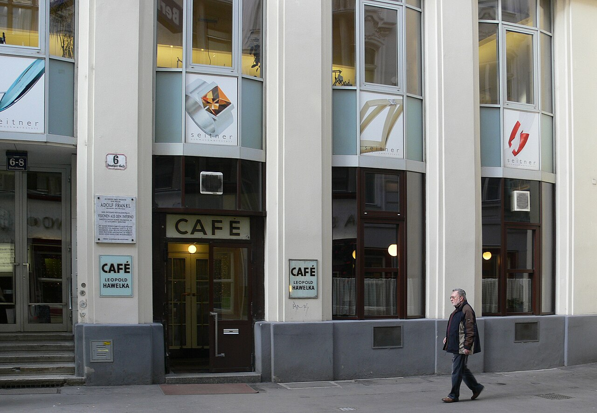

# 哈维尔卡咖啡馆

从圣斯蒂芬大教堂往南走两分钟，拐进多罗特街（Dorotheergasse），会看到一块不新的招牌：Café Hawelka。门面不大，橱窗里堆着报纸，桌椅挤得很近，墙上挂着画和旧照片。它没有维也纳大咖啡馆的宏大拱顶，也没有“必须打卡”的橱窗陈列，却常被当作维也纳咖啡馆文化里“还活着”的那一类：家族经营、价格普通、允许一个人坐很久。

图：维也纳哈维尔卡咖啡馆的门面。图片：Photo: Andreas Praefcke，CC BY 3.0，via Wikimedia Commons（[原图页面](https://commons.wikimedia.org/wiki/File:Wien_Caf%C3%A9_Hawelka.jpg)）。

## 1939 年：哈维尔卡咖啡馆的关键起点
哈维尔卡咖啡馆 1939 年 5 月开业，创始人是莱奥波德·哈维尔卡（Leopold Hawelka）与约瑟菲娜·哈维尔卡（Josefine Hawelka）。莱奥波德此前在 1936 年经营过同区的 Kaffee Alt Wien；1939 年，夫妻俩接手多罗特街的 Café Ludwig，把它改成自己的咖啡馆。这个时间线要分清：1936 年是上一家店，1939 年才是哈维尔卡本店。把两者混在一起，会把咖啡馆的年龄多说三年。

开业不久，二战爆发，莱奥波德被征入伍，咖啡馆关闭；1945 年秋，夫妻俩在建筑大体完好的原址重新开门。战后维也纳的咖啡馆不只是喝咖啡的地方，也是取暖、读报、交换消息与找工作的公共空间。1955 年占领结束之后，哈维尔卡逐渐成为作家与评论家的据点，海米托·冯·多德勒、弗里德里希·托尔贝格、希尔德·施皮尔、汉斯·魏格尔都是常客。1961 年，附近另一家文学咖啡馆 Herrenhof 关闭，更多艺术家转到哈维尔卡，形成了一个更松散的圈子：百水先生（Hundertwasser）、恩斯特·富克斯、鲁道夫·豪斯纳、赫尔穆特·夸尔廷格、奥斯卡·维尔纳，以及后来更年轻的 H.C. 阿尔特曼与格哈德·吕姆。

约瑟菲娜在 2005 年去世，莱奥波德在 2011 年去世；他们的儿子金特（Günter）接手，直到 2021 年去世。现在咖啡馆由第三代阿米尔（Amir）与米夏埃尔（Michael）经营，家族还在第 23 区经营自己的咖啡烘焙。这个传承不是营销故事，而是咖啡馆气质的一部分：家具没有大规模翻新，菜单没有扩张成“国际菜系”，熟客仍能在下午找到自己的位置。

## 空间与酒单

哈维尔卡的空间关键词是“挤、暗、旧、报纸”。桌子小，椅子是弯木椅，沙发靠背磨得发亮，墙上是常客留下的画、海报与照片。它不是为拍照设计的，灯光也不适合自拍；但如果想观察维也纳人如何“把咖啡馆当客厅”，这里比中央咖啡馆更直接。座位不按翻台率安排，一个人点一杯咖啡坐两小时是常态；高峰时段拼桌也常见，坐下前问一句“这里有人吗”是基本礼貌。

咖啡单是维也纳体系：Wiener Melange（浓缩加热奶与奶泡）、Einspänner（高杯浓缩覆厚奶油）、Verlängerter（加长浓缩）、Kleiner Brauner / Großer Brauner（小杯或大杯加少量奶）。第一次来点 Melange 最稳；想要更浓、更甜，点 Einspänner；想喝淡一点，点 Verlängerter。哈维尔卡不是“精品咖啡”店，豆子与萃取按传统做法，重点在温度、杯具与可以坐下来的时间。

食物方面，白天有早餐、面包、蛋类与简餐；晚上八点以后，厨房开始烤 Buchteln——一种酵母面团包李子酱的甜点，出炉后趁热撒糖粉。Buchteln 是哈维尔卡最出名的东西，但它是“晚间甜点”，不是全天供应的招牌菜；去早了吃不到，去晚了可能卖完。除了 Buchteln，也有蛋糕、冰淇淋与奥地利家常菜，具体以当日菜单为准。

## 第一次去怎么点

进门后自己找空位，坐下等侍者过来；不要站在门口等带位，也不要直接去吧台点单。一个人可以只点一杯咖啡；两个人想分一块 Buchteln，点一块加两把叉子是常规做法。想体验完整的一套，可以下午点 Melange 加一块蛋糕，晚上八点后再点 Buchteln 配咖啡；如果只想尝味道，两个人分一块就够，Buchteln 本身不小。

时段上，上午九点到十一点最安静，适合读报、写字；下午两三点是游客与购物人群的高峰；晚上八点后 Buchteln 出炉，店里会突然热闹起来。想拍照，尽量避开饭点与周末下午；想感受“文学咖啡馆”，工作日的傍晚更接近本地人的节奏。哈维尔卡没有钢琴演奏，也没有着装要求，穿日常衣服即可。

费用结构要说清：维也纳传统咖啡馆通常不收座位费，也不收“音乐费”；账单是饮品与食物加小费。若菜单上出现座位费、最低消费或“Buchteln 需搭配饮品”的规则，以菜单为准。哈维尔卡的价格在维也纳内城属于中等，不是最便宜，但也没有中央咖啡馆的旅游区溢价。结账时不要大声喊“买单”，用眼神或轻声示意侍者即可。

## 哈维尔卡咖啡馆的地址与营业安排
**地址**：Dorotheergasse 6, 1010 Wien, Austria。从圣斯蒂芬大教堂步行约 2 分钟；门牌在多罗特街北侧，靠近与格拉本大街交叉口。招牌不大，看到“Café Hawelka”与门口堆着的报纸就到了。

**交通**：地铁 U1 或 U3 到 Stephansplatz 站，出站步行 2–3 分钟；也可从格拉本大街步行过来。内城是步行区，出租车不能停在门口；最近的下车点在格拉本大街或 Ring 环城路。石板路在雨天较滑，穿高跟鞋要小心。

**营业时间**：周一至周四 09:00–00:00，周五至周六 09:00–01:00，周日 10:00–20:00。节假日与特殊活动可能调整，出发前看官网或门口告示。`operating_status` 记为 `verified`，表示官网与旅游局的营业信息在 2026-11-20 仍可查，且没有停业公告；这不等于每天一定开门。

**预订**：哈维尔卡通常不接受大规模预订，walk-in 为主；小团体可以直接到店，但周末晚上与 Buchteln 时段可能需要等位。没有 dress code，也没有最低消费；带小孩可以，但店内空间窄，婴儿车不方便。

**价格**：咖啡与甜点属于维也纳内城中等水平；Buchteln 按块计价，具体价格以菜单为准。只收现金的时代已经过去，但小额消费刷卡可能不方便，备一点现金更稳。

页面核验日期 2026-11-20；营业时间、价格与 Buchteln 供应以官方渠道为准。

## 礼仪与常见误区

第一，不要把“1936 年”当成哈维尔卡的开业年；1936 年是莱奥波德经营 Kaffee Alt Wien 的时间，哈维尔卡本店是 1939 年 5 月。第二，不要一进门就问“Buchteln 有没有”；它通常晚上八点后才出炉，白天问会被视为不了解店铺节奏。第三，不要把它当成“安静的书房”；晚上与周末很吵，想读书写字要选工作日上午。

常见误区有四个。其一，以为维也纳咖啡馆都收座位费；传统咖啡馆通常不收，但旅游区个别店会收，以菜单为准。其二，以为“名人常客”意味着店里还保留他们的专座；哈维尔卡没有“某某专用桌”，只有常客大致坐惯的区域。其三，以为 Buchteln 是“随时可点的甜点”；它是晚间出炉的限定品，卖完就没了。其四，以为咖啡馆必须点正餐才能坐；一杯咖啡坐一下午是允许的，但高峰时段不要独占大桌。

不适合来这里的情况：赶时间只想买一杯外带咖啡的人；需要安静开电话会议的人；推婴儿车或带大件行李的人。它适合“把时间花在坐下”的旅行方式，也适合想观察维也纳日常而不是只看宫殿的人。

## 维也纳的周边街区
出门就是多罗特街，往北两步是格拉本大街与圣斯蒂芬大教堂，往南可到维也纳国家歌剧院与 Ring 环城路。把哈维尔卡放在上午：先喝咖啡读报，再去大教堂，中午在格拉本一带吃饭，下午逛博物馆或去中央咖啡馆。若想把“咖啡馆”作为主题，一天安排两家就够：上午哈维尔卡，下午中央咖啡馆；两家的空间与客群不同，对比起来有意思。

往西步行十分钟到维也纳大学与市政厅，往东到老城小巷与莫扎特故居方向。冬季维也纳天黑得早，下午四点后街上人流转向圣诞市集与剧院，路线要相应调整。哈维尔卡门口没有停车位，建议全程步行或地铁。

若遇到门口排队，不要堵住多罗特街的人行道；队伍通常不长，等十分钟左右就能进。晚上 Buchteln 出炉前后，店内温度高、气味重，穿厚外套可以脱下来搭在椅背上，但不要占用邻座。

## 同城酒吧与延伸阅读
- [酒吧与城市](ref:pub-and-city)：咖啡馆如何用座位、报纸与营业时间组织公共生活。
- [中央咖啡馆](ref:cafe-central)：维也纳另一家文学咖啡馆，空间更大、游客更多。
- [斯拉维亚咖啡馆](ref:slavia)：布拉格的国家剧院对面咖啡馆，另一种“文学与政治”传统。
- [花神咖啡馆（巴黎）](ref:cafe-de-flore)：巴黎左岸的文学咖啡馆，可与维也纳的家族咖啡馆对照。
- [罗马希腊咖啡馆](ref:greco)：已停业的意大利历史咖啡馆，说明“有名”与“仍在营业”是两件事。

相关条目：[认识一座城，从一间酒馆开始](ref:pub-and-city)、[中央咖啡馆](ref:cafe-central)、[斯拉维亚咖啡馆](ref:slavia)。
